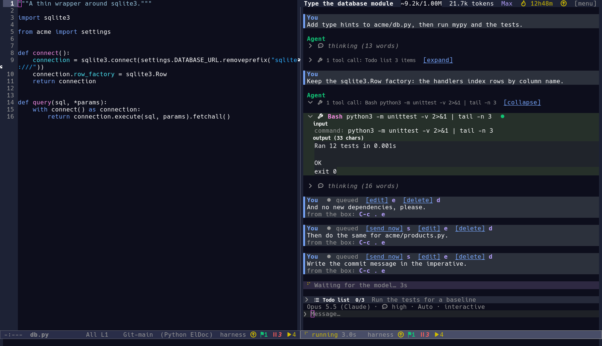

# Emacs Agent Harness
An Emacs native harness for agentic development.

# Table Of Contents
- [Overview](#overview)
- [Getting Started](#getting-started)
- [Connect To A Harness Server Elsewhere](#connect-to-a-harness-server-elsewhere)
- [Install](#install)
- [Modules](#modules)

# Overview
A powerful agentic LLM harness built in Emacs. 



Everything in Emacs agent harness is implemented via the module system. The harness loads no modules by default. Your installation is unique based on which modules you enable. 

Modules to provide the following functionality are shipped with the Emacs agent harness package:

- Agent sessions with tool use 
- Tools 
- Permissions 
- Completion providers 
- Task mode 
- Btw sessions 
- Usage, cost, quota tracking
  - A cost reads in one of two units everywhere it shows -- the session
    list, the task board, the chat, the usage and Insights pages, the
    estimates of a cache refresh or a compaction: money (`$1.20`) when
    calls are billed per token, and the share of the plan's quota
    windows (`1% / 0.6%`, in full `1% / 0.6% of 5h / 7d quota`) when a
    subscription pays.  The share is an estimate: the harness divides
    what the plan covered, at API prices, by what each window is worth
    in them, worked out from its own records and the use the plan
    reports; until a window has enough use to tell, the plan's name
    stands in
- And more 

See the [Modules](#modules) section for more details.

# Getting Started
To use Emacs agent harness:

1. **Install**  
   Add the following straight recipe to install the package:
   ```elisp
    (:host sourcehut :repo "catvec/emacs-agent-harness"
           :files ("harness.el" "lisp" "scripts" "icons"))
   ```
   See the [Install](#install) section for more details or install instructions without straight.  
   
   Next require and start the harness:
   
   ```elisp
   (require 'harness)
   (harness-start)
   ```
2. **Configure**  
   Configure the features you want via `(harness-enable-modules ...)`:
   ```elisp
   (harness-enable-modules
       :features tasks merge supervisor notifications tasks-notify
       :providers openai deepseek
       :tools sessions handin web
       :ui btw tree)
   ```
   See the [Modules](#modules) section for more details and available choices.  

   Configure the harness keymap prefix via the `harness-ui-prefix-key` variable (Default: `"C-c h"`).
   
Now the harness is ready. To get started press `PREFIX` on its own to open the grouped menu: choose a group to see its commands, then a key to run one. `PREFIX n` creates a new session.

# Connect To A Harness Server Elsewhere

By default the harness UI in your Emacs starts its own harness process and talks to it. To drive a harness on another machine instead, run a harness server there with `scripts/harness-server`:

```bash
# On the server. Pick a long secret; the client uses the same one.
export HARNESS_SERVER_TOKEN="$(openssl rand -hex 24)"
export HARNESS_SERVER_HOST=0.0.0.0
export HARNESS_SERVER_PORT=4276
scripts/harness-server
```

It prints `HARNESS-ACP-ADDRESS HOST:PORT` when it listens. `HARNESS_SERVER_CONFIG` may name a file of Emacs Lisp forms loaded before it starts, for modules and settings an init file would set:

```elisp
(setq harness-enabled-modules '(tasks merge supervisor))
;; Optional: its own sessions and tasks, if another harness uses the default.
(setq harness-state-directory "~/.local/state/harness-server/")
```

Then, in the Emacs running the UI, set the server's address and the same secret before `(harness-start)`:

```elisp
(setq harness-server-address "server.example.org:4276"
      harness-acp-token "the same secret as HARNESS_SERVER_TOKEN")
(harness-start)
```

The UI now starts no harness process of its own: it opens sessions, runs tools and shows tasks on that server. The server refuses a non-loopback address without a token of at least 16 characters. If it listens on its loopback interface instead, reach it through an ssh tunnel (`ssh -L 4276:127.0.0.1:4276 SERVER`) and point `harness-server-address` at `127.0.0.1:4276`.

There is a form for this too. `C-c h c` (`harness-connect-server`) asks for the address and the token and connects at once, offers to remember the server for the next start (`harness-server-address`), and copies the settings as a `setq` for an init file. An empty address returns to this Emacs's own harness. `C-c h C` (`harness-server`) shows the harness the UI talks to: where it runs, its address and round trip, its version and Emacs, the sessions it runs and the modules it loaded — a server elsewhere or the harness on this machine. In corporate mode (`harness-corporate-mode`) the UI never leaves this machine.

A harness that enables `harness-acp-remote` also serves ACP to other devices, over the same host and port; its shared `harness-acp-token` works here too.

# Install
## straight.el

``` elisp
(straight-use-package
 '(harness :host sourcehut :repo "catvec/emacs-agent-harness"
           :files ("harness.el" "lisp" "scripts" "icons")))
(require 'harness)
(harness-start)
```

## Doom Emacs
In `packages.el`:

```elisp
(package! harness
  :recipe (:host sourcehut :repo "catvec/emacs-agent-harness"
           :files ("harness.el" "lisp" "scripts" "icons")))
```

In `config.el`:

```elisp
(require 'harness)
(harness-start)
```

## Manual installation

Clone the repository:

```bash
git clone https://git.sr.ht/~catvec/emacs-agent-harness ~/src/emacs-agent-harness
````

Then add it to your init file:

```elisp
(add-to-list 'load-path "~/src/emacs-agent-harness")
(require 'harness)
(harness-start)
```

# Modules 
The harness can act as a simple spartan LLM chat interface or an advanced automated task queuing system. The choice is up to you, based on what modules are enabled. 

The `(harness-enable-modules ...)` function helps enable and load modules of your choosing. Place it somewhere in your Emacs configuration:

``` elisp
(harness-enable-modules
    :features tasks merge supervisor notifications tasks-notify
    :providers openai deepseek
    :tools sessions handin web
    :ui btw tree)
```

See [`docs/modules/README.md`](./docs/modules/README.md) for a full list of modules by category.

You can set the `harness-enabled-modules` variable to `t` in order to load all modules distributed with the harness.

A non-comprehensive list of all the different functionality offered by modules shipped with the harness:

- [Model complexity guide](docs/model-complexity.md) (optional): model names
  sorted from Simple tasks through Very complex tasks, with Unrated models
  last. Enable with `(harness-enable-modules :features model-complexity)`;
  open with `C-c h =`. The session/task model picker shows the same plain
  level names. Rankings are editable estimates, not benchmarks.
- Agentic sessions with tool use
  - One settings line -- below the compose box in a chat, above it on the
    task board -- has what changes what the session does: the model, thinking
    level, permission mode and interactive switch, and, in a task's
    session, where its task stands in the queue with [Pause], [Resume]
    and [Start now].  A chat's header line keeps what it used: the
    context, the total tokens and the cost.  A narrow window drops the
    least important items first and ends in a clickable `…` that shows
    every one it cut, in full
  - Image rendering, with images that zoom where they are (`+` `-` or the wheel, `0` fits, `1` at 100%), open larger in an image popout, and view in a window of their own
  - Native image yank (paste) into message support (and drag-and-drop)
  - Native Emacs message editing experience
  - Auto-session naming
  - Compaction
  - Token cache awareness
    - Stale cache warning
    - Auto compaction before cache expire
    - Cache warming
  - Rewind, tree view, forking
  - Recaps
  - Non-interactive mode
- Tools 
  - Standard file read / write / search tools
  - Emacs control 
  - Sub-agents
    - A sub-agent blocked on you is announced, shown blocked in the session list, and listed first in the sub-agents panel above the parent's compose box, with what it asks and the buttons that answer it
  - Todo
  - Ask question
  - Threaded replies, with the words a reply quotes marked where they stand and a count of the replies
  - Event watches, the watches a session still has live pinned above its compose box
  - Harness introspection and control
  - Limit number of concurrent tool calls
- Git worktrees 
- Private commit attribution (optional, git-ai): which model and prompt wrote each commit, kept off the code remote
- Permissions
  - Operating system level jails (Cross platform)
  - NVIDIA OpenShell, a jail backend you ask for: set `harness-sandbox-backend` to `openshell`, which `auto` never picks. Its setup is in [`docs/openshell.md`](./docs/openshell.md)
  - Directory allow listing, including the worktrees of the sub-agents a session started, which it may read
  - Secret file blocking
  - Auto mode
  - A permission panel that parts the lasting answers from Allow and Deny
  - Live access introspection: `session_info` reports the session's permission mode, writable and read-only directories with their sources, network, tools turned off, Linux capabilities and standing allow/deny rules
  - The access view names a sub-agent worktree among a session's directories, with buttons to give it up or make it writable
- Usage, cost, quota tracking
  - A cost reads in one of two units everywhere it shows -- the session
    list, the task board, the chat, the usage and Insights pages, the
    estimates of a cache refresh or a compaction: money (`$1.20`) when
    calls are billed per token, and the share of the plan's quota
    windows (`1% / 0.6%`, in full `1% / 0.6% of 5h / 7d quota`) when a
    subscription pays.  The share is an estimate: the harness divides
    what the plan covered, at API prices, by what each window is worth
    in them, worked out from its own records and the use the plan
    reports; until a window has enough use to tell, the plan's name
    stands in
- Completion providers
  - Claude Code SDK & API
  - ChatGPT
  - OpenAI completion generic
  - OpenRouter 
  - Deepseek
  - Provider self test & verification
- Task mode
  - Hand in tool to present evidence of task completion
  - Review agent file changes in ediff 
  - Maximum task concurrency
  - Priorities
  - `PREFIX a` opens the task board of the buffer's project: the project
    of its directory, or in a session buffer the session's own project,
    whatever directory that session works in and whatever other
    project's board is open
- Insights
- Btw sessions
  - Closing a session: `PREFIX x` closes any, `C-c M-k` at the end of a chat's keys; a BTW closes as its `[close]` does
- [Voice dictation and spoken replies](docs/voice.md) (`ui-voice`, optional)
  - WAV push-to-talk with local/configurable transcription and synthesis, editable compose text, quick voice chat and explicit interruption
  - Providers with a `wav` or `live` capability: WAV dictation, ChatGPT Live over the API, a local whisper.cpp and text-to-speech pipeline, the scripted fixture or a custom sidecar
  - Live voice keeps the audio path in a JSON-lines sidecar and delegates to the chat, with an animated stage line, a styled transcript, mute, playback interruption and separate work cancellation
  - Effort levels (low, medium, high) pick the local whisper model and the provider's own fragments
  - [Voice audio backends](docs/voice-audio.md): PipeWire, PulseAudio, ALSA or ffmpeg, newest first, with failover
  - [Realtime voice research](docs/voice-realtime.md): GPT-Live, backchannels, delegation, the sidecar protocol and open-source pipelines
- [Compose stacks](docs/stacks.md) (`stacks`, optional) on a [container runtime](docs/container-runtime.md) (`container-runtime`, optional)
  - Docker over its socket or rootless Podman, chosen automatically or by hand; a stack never calls either directly
  - A module or plugin declares the services it needs; the harness starts and stops the stack and joins its network to the harness server's
  - Each stack has its own network and publishes random loopback ports, so 8080 never collides
  - Bundled `voice-local` stack: whisper.cpp for speech to text, with the local provider reading its published port; Kyutai Unmute stays an opt-in profile because it has no published image
- Sticky compose box (`ui-sticky-compose`)
  - A chat window scrolled away from its compose box draws a compact copy of it in its mode line while you compose
  - The start and end of the draft, its lines and attachments, and a button that jumps back to the box
- Configuration via customize
  - Global overridden by per-project (via `.dir-locals.el`)
  - Corporate policy profiles

# Private commit attribution

The optional `commit-attribution` module records which model wrote
which lines of a commit, and which prompt of a harness session asked
for them, without publishing that information to the code remote.  It
uses [git-ai](https://github.com/git-ai-project/git-ai) (1.7.6) for the
line-level attribution, but runs it in a private profile: OSS telemetry
off, prompts local, no login, and the HTTP notes backend pointing at a
small private service instead of `refs/notes/ai` in the repository.
The code remote, a mirror and a fork therefore have no notes to carry.
The module keeps no prompt records of its own.  When you turn on prompt
sync, a record of each prompt, redacted through `harness-secrets`, is
written to the private service through a management API that is
separate from the endpoints git-ai uses; a secret redaction triggers
the same API, so a secret taken out of this machine is taken out of the
service too.  The encrypted vault and the UI are later phases of the
design.

It is off by default.  Enabling it for a project in that project's
`.dir-locals.el` (the settings page's Project scope) or globally in
your init file turns it on:

```elisp
(harness-enable-modules :features commit-attribution)
```

```elisp
;; .dir-locals.el of the project, or a global setting
((nil . ((harness-commit-attribution . t))))
```

A repository needs a private notes URL before the module checkpoints
anything; the token comes from the setting or, preferably, from the
environment:

```elisp
(setq harness-commit-attribution-notes-url "https://notes.example.internal"
      ;; Prefer the environment variable GIT_AI_API_KEY for the token;
      ;; this setting is written to ~/.git-ai/config.json (mode 600).
      harness-commit-attribution-notes-token nil)
```

Run the private notes service on a machine only your devices can reach
(a LAN, WireGuard/Tailscale, or a TLS reverse proxy), with a token:

```bash
scripts/attribution-notes-server --db ~/attribution-notes.db \
    --host 0.0.0.0 --port 8765 --token-file ~/.config/harness/attribution-token
```

git-ai 1.7.6 already speaks this protocol: `notes_backend.kind = "http"`
(or `GIT_AI_NOTES_BACKEND_KIND=http`) uploads notes to
`<base>/worker/notes/upload` and writes no `refs/notes/ai`.  Its own
`git ai notes serve` is an in-memory reference server; the script here
is the persistent, authenticated version of the same contract.  The
service also has a small management API (`/management/prompts/...`)
for the harness's own prompt records; git-ai never calls it, and it is
where a secret redaction cleans the records the harness uploaded.

Then write the private git-ai profile (it backs up the old
`~/.git-ai/config.json` first) and check it:

```elisp
M-x harness-commit-attribution-doctor
```

or, from Lisp:

```elisp
(harness-call 'commit-attribution/configure default-directory)
(harness-call 'commit-attribution/doctor default-directory)
```

To report, use `M-x harness-commit-attribution-report` (a revision
range, default `HEAD`) or the methods `commit-attribution/report`,
`commit-attribution/show` and `commit-attribution/show-prompt`.  The
report reads the notes service and the prompt records from its
management API, never the commit message, and counts AI lines: git-ai
leaves human and untracked lines unattributed.  `show-prompt` asks the
same management API.  The pre-commit safety net covers an
edit-and-commit in one shell command while it can reach git-ai; the
doctor says when it cannot.  The encrypted prompt vault (`harness-commit-attribution-vault`)
and the task-report UI (`harness-commit-attribution-task-report`) are
documented follow-ups, phases 3 and 4 of
`docs/analysis/private-commit-model-attribution-2026-10-29.md`.

The module keeps no prompt records of its own.  When prompt sync is on,
each prompt is masked with `harness-secrets-mask-text` and stored in
the private service: `excerpt` keeps a short redacted excerpt, `full`
the whole redacted prompt, and `hash` only its SHA-256.  The record goes
through the service's management API (`/management/prompts/...`),
which is separate from the `/worker/...` endpoints git-ai uses.  The
service stores it in plaintext behind its token, so run it on a private
network or over TLS, and back up or prune its database as you would the
notes:

```elisp
(setq harness-commit-attribution-prompt-sync t)
```

A report on another device links the record, and
`commit-attribution/prune` deletes old ones through the same API.  A
`secrets/redact` redaction (`redact_secret`, `M-x harness-redact-secret`)
calls the management API too and rewrites the records the service
holds, replacing the secret in place; the value is never sent.  The
prompt hash is taken from the redacted text, never the original.
git-ai's own `prompt_storage` stays `local`: it never receives the
harness prompts.  Its `notes` mode (redacted prompts inside the note)
and `default` mode (upload to git-ai's cloud) are not used here.
