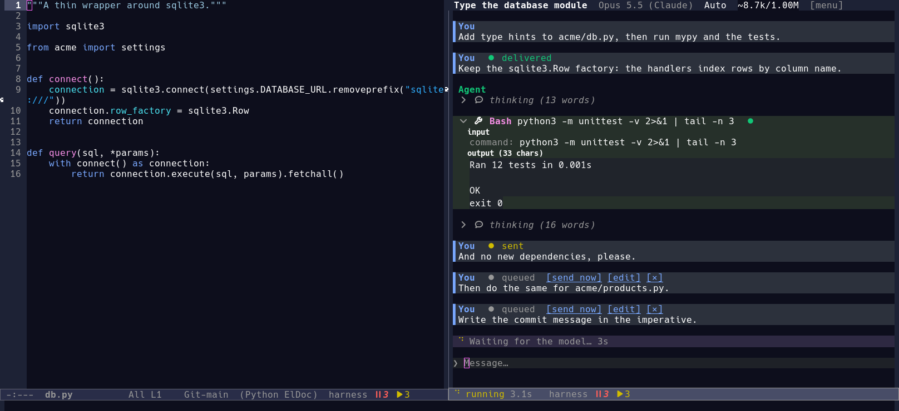

# Emacs Agent Harness
An Emacs native harness for agentic development.

# Table Of Contents
- [Overview](#overview)
- [Getting Started](#getting-started)
- [Install](#install)
- [Modules](#modules)

# Overview
A powerful agentic LLM harness built in Emacs. 



Everything in Emacs agent harness is implemented via the module system. The harness loads no modules by default. Your installation is unique based on which modules you enable. 

Modules to provide the following functionality are shipped with the Emacs agent harness package:

- Agent sessions with tool use 
- Tools 
- Permissions 
- Completion providers 
- Task mode 
- Btw sessions 
- Usage, cost, quota tracking
- And more 

See the [Modules](#modules) section for more details.

# Getting Started
To use Emacs agent harness:

1. **Install**  
   Add the following straight recipe to install the package:
   ```elisp
    (:host sourcehut :repo "catvec/emacs-agent-harness"
           :files ("harness.el" "lisp" "scripts" "icons"))
   ```
   See the [Install](#install) section for more details or install instructions without straight.  
   
   Next require and start the harness:
   
   ```elisp
   (require 'harness)
   (harness-start)
   ```
2. **Configure**  
   Configure the features you want via `(harness-enable-modules ...)`:
   ```elisp
   (harness-enable-modules
       :features tasks merge supervisor notifications tasks-notify
       :providers openai deepseek
       :tools sessions handin web
       :ui btw tree)
   ```
   See the [Modules](#modules) section for more details and available choices.  

   Configure the harness keymap prefix via the `harness-ui-prefix-key` variable (Default: `"C-c h"`).
   
Now the harness is ready. To get started press `PREFIX =` to see an interactive menu of commands. Or `PREFIX n` to create a new session.
   
# Install
## straight.el

``` elisp
(straight-use-package
 '(harness :host sourcehut :repo "catvec/emacs-agent-harness"
           :files ("harness.el" "lisp" "scripts" "icons")))
(require 'harness)
(harness-start)
```

## Doom Emacs
In `packages.el`:

```elisp
(package! harness
  :recipe (:host sourcehut :repo "catvec/emacs-agent-harness"
           :files ("harness.el" "lisp" "scripts" "icons")))
```

In `config.el`:

```elisp
(require 'harness)
(harness-start)
```

## Manual installation

Clone the repository:

```bash
git clone https://git.sr.ht/~catvec/emacs-agent-harness ~/src/emacs-agent-harness
````

Then add it to your init file:

```elisp
(add-to-list 'load-path "~/src/emacs-agent-harness")
(require 'harness)
(harness-start)
```

# Modules 
The harness can act as a simple spartan LLM chat interface or an advanced automated task queuing system. The choice is up to you, based on what modules are enabled. 

The `(harness-enable-modules ...)` function helps enable and load modules of your choosing. Place it somewhere in your Emacs configuration:

``` elisp
(harness-enable-modules
    :features tasks merge supervisor notifications tasks-notify
    :providers openai deepseek
    :tools sessions handin web
    :ui btw tree)
```

See [`docs/modules/README.md`](./docs/modules/README.md) for a full list of modules by category.

You can set the `harness-enabled-modules` variable to `t` in order to load all modules distributed with the harness.

A non-comprehensive list of all the different functionality offered by modules shipped with the harness:

- Agentic sessions with tool use
  - Image rendering
  - Native image yank (paste) into message support (and drag-and-drop)
  - Native Emacs message editing experience
  - Auto-session naming
  - Compaction
  - Token cache awareness
    - Stale cache warning
    - Auto compaction before cache expire
    - Cache warming
  - Rewind, tree view, forking
  - Recaps
  - Non-interactive mode
- Tools 
  - Standard file read / write / search tools
  - Emacs control 
  - Sub-agents
  - Todo
  - Ask question
  - Threaded replies 
  - Harness introspection and control
  - Limit number of concurrent tool calls
- Git worktrees 
- Permissions
  - Operating system level jails (Cross platform)
  - Directory allow listing
  - Secret file blocking
  - Auto mode
- Usage, cost, quota tracking
- Completion providers
  - Claude Code SDK & API
  - ChatGPT
  - OpenAI completion generic
  - OpenRouter 
  - Deepseek
  - Provider self test & verification
- Task mode
  - Hand in tool to present evidence of task completion
  - Review agent file changes in ediff 
  - Maximum task concurrency
  - Priorities
- Insights
- Btw sessions
- Configuration via customize
  - Global overridden by per-project (via `.dir-locals.el`)
  - Corporate policy profiles
