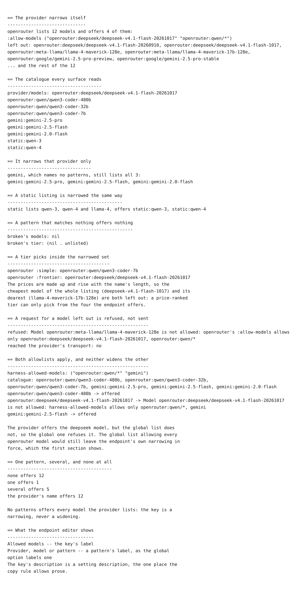

# Per-provider `:allow-models`

`demo.sh` shows an endpoint narrowing itself to a few of its provider's
models, from the outside -- through the calls a client makes, not the
filter function:

```sh
demo/allow-models/demo.sh
```



That image is rendered from this demo's own output, so the two cannot
drift: after changing the demo, run `demo/allow-models/render-evidence.py`
and it rewrites `docs/evidence/allow-models/allow-models-demo.svg` and
`.png` beside it.  The demo registers four made-up providers and sends
nothing to any server, so the image needs no live catalogue and no
credential, and it is the right picture to commit every time.

1. **The provider narrows itself.** `openrouter` lists twelve models and
   offers four: one named exactly, and one family by glob.  This is the
   motivating case -- three of OpenRouter's several hundred, without a
   harness-wide allowlist that would constrain every other provider.
2. **The catalogue every surface reads.** `provider/models` lists the
   narrowed set, and only it: the picker, the model index, tier
   selection and price ranking read this one list.
3. **It narrows that provider only.** `gemini`, which names no patterns,
   still lists all three of its models.
4. **A static listing is narrowed the same way.** `static` lists its
   models as a fixed list rather than from a `/models` route, and the
   glob applies to it too.
5. **A pattern that matches nothing offers nothing.** `broken` has no
   model in the catalogue and its tier says `unlisted`; the log names the
   pattern once, so a picker shows no model of it rather than a provider
   that looks broken.
6. **A tier picks inside the narrowed set.** The cheapest and the
   dearest model of the whole listing are both left out, so a
   price-ranked tier can only pick from what the endpoint offers.
7. **A request for a model left out is refused, not sent.** The message
   names the setting and its patterns, and the provider's transport is
   never reached.
8. **Both allowlists apply, and neither widens the other.** A model must
   pass its provider's own `:allow-models` and `harness-allowed-models`
   alike: the global list refuses a model the endpoint offers, and a
   global list that allows every model still leaves the endpoint's own
   narrowing in force.
9. **One pattern, several, and none at all.** No patterns offers every
   model the provider lists, one offers what it matches, several offer
   the union, and a pattern that is the provider's own name matches all
   of it: the key is a narrowing, never a widening.

The last section prints the endpoint editor's two labels and says where
the prose is allowed, which is the copy the key adds.
