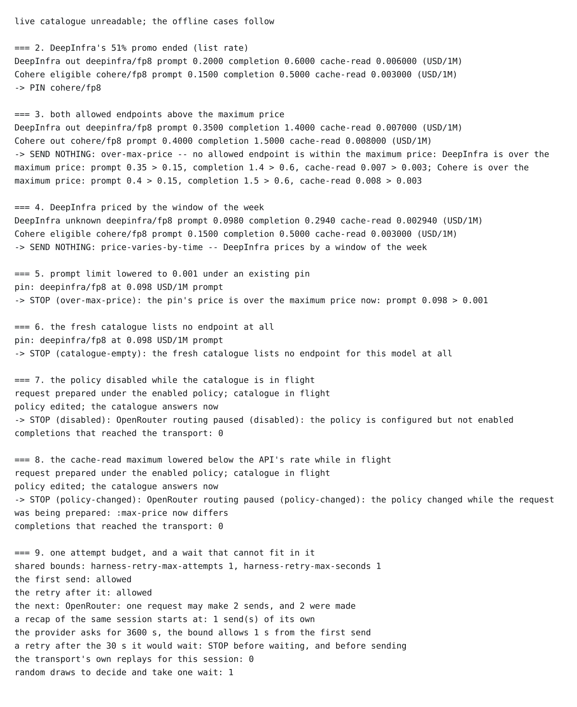

# Price-aware OpenRouter selection

`demo.sh` prints what the policy decides for
`deepseek/deepseek-v4.1-flash-1017`, and why, in nine situations:

```sh
demo/openrouter-pinning/demo.sh
```



That image is rendered from this demo's own output, so the two cannot
drift: after changing the demo, run
`demo/openrouter-pinning/render-evidence.py` (or `--offline`) and it
rewrites `docs/evidence/openrouter-pinning/policy-demo.svg` and
`.png` beside it.

The first four are printed twice: once from a stock catalogue with
`HARNESS_DEMO_OFFLINE=1`, once from the live endpoint listing.  Cases 5
and 6 need a catalogue but no network, and the last three need neither.

1. **Today, as published.** The live endpoint listing, read-only.
   DeepInfra's `deepinfra/fp8` is listed at its 51%-off promotional
   rate and is the cheaper of the two allowed endpoints, so it is
   pinned.
2. **The promo ended.** The same catalogue with DeepInfra at its list
   rate. That rate is over the example limits in prompt and cache-read,
   so DeepInfra is not a candidate and a *new* session would pin Cohere —
   the same rule, no priority order. Nothing about a session already
   pinned changes: it pauses instead.
3. **Both above the maximum price.** Every allowed endpoint is dearer
   than the limits, so nothing is sent at all.
4. **A rate that varies by the window of the week.** The listing cannot
   be read as one price, so the decision blocks rather than quietly
   taking Cohere.
5. **A limit lowered under an existing pin.** The pin is fresh and still
   listed; what changed is what the policy will spend, so it stops with
   `over-max-price` instead of sending at the old price.
6. **A refresh that lists nothing.** An empty catalogue is not "no
   refresh": it cannot be evidence the pinned endpoint still exists, so
   it stops with `catalogue-empty`.
7. **A policy disabled while a request waits for the catalogue.** The
   request was prepared under the enabled policy; by the time the
   reading arrives the policy is off, so the request stops with
   `disabled`.  Nothing reaches the transport — least of all a request
   with no restriction fields on it.
8. **A cache-read maximum lowered while a request waits.** The wire's
   `max_price` bounds prompt and completion only, so nothing at the
   router could have caught this after the fact: the reading is compared
   with the limits in force at dispatch, and the request stops with
   `policy-changed`.
9. **One attempt budget, and a wait that cannot fit in it.** The bounds
   are the shared retry layer's, not the policy's: with
   `harness-retry-max-attempts` 1 a request may send its first POST and
   one retry, and the send after that is refused before it is made.  The
   budget is the *request's*: a recap of the same session starts at one
   send of its own, so it neither spends the step's attempts nor resets
   them.  A `Retry-After` of an hour under a one-second bound is refused
   before the wait rather than after it, and the transport is asked for
   no replays of the session, so the shared count is the only one.  The
   wait is drawn once and the value drawn is the value waited: the last
   line counts the draws.

Cases 5 and 6 used to dispatch anyway; cases 7 and 8 did too, and 7
used to send with no `provider` object at all.  The transport used to
replay a governed request up to three times on its own, so one allowed
retry made four requests; case 9 is where that is now read.  Cases 7
and 8 run the real completion callbacks over a transport that records
what it was asked to send rather than sending it, which is how the demo
shows the count.

The script sends no completion, installs no policy and touches no
Harness: it calls the selector, the dispatch check and the completion
callbacks directly, over a fake transport.  It reads OpenRouter's public
endpoint listing once — no credential, no charge — and
`HARNESS_DEMO_OFFLINE=1` skips even that, showing cases 2 to 6 from a
stock catalogue.

Every price in the demo comes from the catalogue; the policy holds only
the allowed providers and the spending limits.  How a request is retried
is not in it at all: those numbers are the shared retry layer's, one
place for every provider.  Those limits are the
example's, and where their figures come from is the operator's comment
in `config.el`, not something the harness reads.  See
[docs/openrouter-pinning.md](../../docs/openrouter-pinning.md).

What this does not show: a real request, real cache hits, or a real
provider switch.  Those need the paid smoke plan in
[docs/openrouter-pinning.md](../../docs/openrouter-pinning.md).
