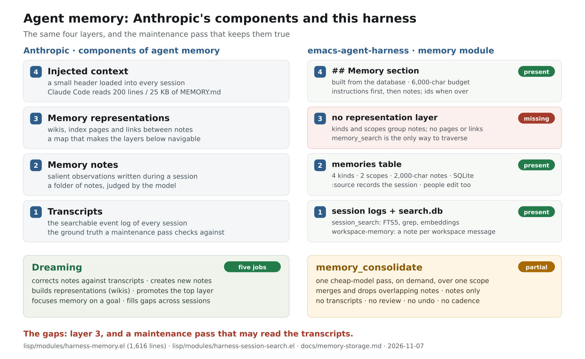

# Our memory against "The components of agent memory" (2026-11-07)

**Question.** How does the harness's memory module work, and how does it
compare with Anthropic's account of the components of agent memory
([published 2026-11-06](https://www.anthropic.com/research/components-of-agent-memory))?

**Short answer.** The module is a solid implementation of three of the
article's four layers, and a thin one of the process that maintains them. It
captures notes while the model works (layer 2), keeps them in a typed,
transactional store with search, and injects them into every session (layer 4);
the transcripts it could learn from are indexed by a separate module (layer 1).
It has no representation layer (layer 3: wikis, links, index pages), and its
only maintenance pass, `memory_consolidate`, does one of dreaming's five jobs,
runs only on demand, never reads a transcript, and applies a cheap model's
answer without review or undo. The article's measured gains come mostly from
the parts we lack: correcting notes against transcripts, and representations
used alongside search. Two properties are ours and worth keeping: one
transactional store that a redaction can purge, and an injected section whose
text is fixed between memory changes, so a provider's prompt cache survives.

**Recommendation.** Fix the collision between the two memory modules first
(finding D1): with both loaded, the lasting memory's `memory_search` and
`memory/get` are replaced by the workspace's, and a call in an ordinary session
fails. Then, in the order the article's evidence suggests: (1) a maintenance
pass that reads the transcript a note came from (`:source` already records it),
can create notes from it, and proposes changes for review; (2) a small
representation — a topic map that names notes by id — built by that pass and
kept under a strict size; (3) staleness and verification, shown in the prompt,
so an injected note can be distrusted; (4) a cadence and a report, so the pass
runs at all; (5) a measurement, so any of this is judged rather than guessed.



## What counts as memory here

Several things in the tree look like memory, and the article's definition sorts
them:

| Thing | What it is | In the article's terms |
|---|---|---|
| `memory` ([lisp/modules/harness-memory.el](../../lisp/modules/harness-memory.el)) | notes saved by the agent or the user, in a user and a project scope, injected into every session | layer 2 and layer 4; the subject of this page |
| `workspace-memory` ([lisp/modules/harness-workspace-memory.el](../../lisp/modules/harness-workspace-memory.el)) | a note per user, assistant and plan message of a workspace episode (the injected brief excepted), with full-text recall | closer to layer 1 with a search box: its own page calls it "a cache of the distilled conversation, not a second transcript index" |
| session transcripts ([lisp/modules/harness-session-search.el](../../lisp/modules/harness-session-search.el)) | every session's node log, indexed (FTS5 with porter stemming, grep, optional embeddings) and read by `session_search`, `session_read`, `session_history` | layer 1 |
| `compaction`, `handoff` | summaries that replace older turns, to continue in a new context window or provider | context management, which the article explicitly excludes from memory |

The `memory` module is optional (`(harness-enable-modules :features memory)`);
with it off, a session has no lasting memory, and what follows is what the
module gives when it is on.

The article defines memory as knowledge gained from experience and kept between
sessions, readable later — and excludes weights, in-context learning and
compaction. The `memory` module's own definition is the same: "what the user or
the agent decided once, and would otherwise have to say again". The harness also
makes the article's distinction between memory and compaction: the compaction
module writes summaries for the current conversation, not notes for later ones.

## How the module works

### Capture: the model writes a note, in the moment

A memory is captured by `memory_save` ([line 1276](../../lisp/modules/harness-memory.el)),
by the memory page or quick capture, and by nothing else; consolidation can
later rewrite or merge it, but adds no knowledge of its own. The tool takes the
text, one of four kinds (`preference`, `convention`, `fact`, `reference`), a
scope (`project` or `user`) and `replaces`, a list of ids the new note absorbs.
The write is `memory/add` ([line 391](../../lisp/modules/harness-memory.el)):
it trims the text, refuses one longer than `harness-memory-max-chars` (2,000),
resolves the project to the main checkout a worktree was made from
([line 238](../../lisp/modules/harness-memory.el)), and records the session it
came from in `:source` ([line 435](../../lisp/modules/harness-memory.el)).
Saving exactly the same text again in the same scope and project edits the note
that holds it instead of making a second ([line 383](../../lisp/modules/harness-memory.el));
there is no near-duplicate detection besides that.

The tool schema has no `id`, so a correction is a new text with the old id in
`replaces`, which deletes the old note in the same transaction. Nothing keeps
what the old note said: the store is destructive, by design
([docs/memory-storage.md](../memory-storage.md)).

### Store: one SQLite database is the truth

`memory.db` in the state directory (`~/.emacs.d/harness/` by default) holds
`memories`, one row per note, and beside it an FTS5 external-content table over
`text` kept in step by triggers, int8 vectors keyed by memory id and text hash,
and an index on scope and project ([line 661](../../lisp/modules/harness-memory.el)).
A change is one transaction over the row, its full-text entry and its vectors;
`replaces` deletes and inserts in one transaction; a crash cannot leave two
stores disagreeing, and there is nothing to rebuild to learn what the notes are.
Without FTS5, search filters the rows in Elisp; without SQLite, a write says so.

### Retrieve: full text first, meaning when asked

`memory_search` ([line 1292](../../lisp/modules/harness-memory.el)) takes the
session search's syntax — every word, `"quoted words"`, `word*`, `OR`, `-word`
— over FTS5 with BM25 ranking, and returns up to 20 by default. A plain word is
matched as a prefix, and common endings are stripped from the word itself, so
"deploy" finds "deployment" and "parsing" finds "parse"
([line 557](../../lisp/modules/harness-memory.el)); when a search
finds nothing with every word, it retries with the words ORed, and the answer
does not say it was loosened. An empty query lists the notes. With
`harness-memory-embedding-model` set, `mode semantic` embeds the notes that have
no current vector in batches of 32, keeps the last 32 query vectors, and ranks
by cosine in Elisp
([line 922](../../lisp/modules/harness-memory.el)). Embeddings are off by
default: memory text leaves the machine only with the user's choice.

### Inject: a generated section, fixed until a memory changes

`memory/prompt` ([line 1056](../../lisp/modules/harness-memory.el)) builds the
`## Memory` section of the system prompt, and the filter at
[line 1134](../../lisp/modules/harness-memory.el) appends it at priority 55 —
after the Planning and Links sections, before Available skills and the task
sections. It is built from the notes alone, never from the request, so its text
is the same from step to step
and between turns until a note changes. That is a prompt-cache decision: the
system prompt is the start of the provider's prompt cache, and a section built
from the latest request would make every step a cache miss. A save changes it
once; the next request after a save therefore cannot match the old prefix.

The section holds, in order: the project's instructions, the user's
instructions (preferences and conventions), in full while they fit; then the
project's notes and the user's (facts and references), in full only when all of
them fit in what is left of `harness-memory-prompt-budget` (6,000 characters by
default), otherwise as an index line per note — id, the first 160 characters,
the kind ([line 1034](../../lisp/modules/harness-memory.el)) — and a final
"(N more memories; memory_search finds them)". The preamble is 358 characters.
The section is absent when the session has no memories, or when
`harness-memory-in-prompt` is nil.

### Maintain: one cheap pass, on demand

`memory_consolidate` ([line 1329](../../lisp/modules/harness-memory.el)) and
`memory/consolidate` ([line 1449](../../lisp/modules/harness-memory.el)) give
one scope's notes (at least two) to the simple tier of the session's model and
ask it to merge overlapping notes and drop stale ones, answering one JSON
object. The answer is applied only if every id it names exists, no id is named
twice and every kind is one of the four ([line 1369](../../lisp/modules/harness-memory.el));
then the new notes and the deletions are one transaction
([line 1412](../../lisp/modules/harness-memory.el)). A malformed answer changes
nothing; a well-formed but wrong answer is applied. There is no dry run, no
diff, no history and no undo, and nothing runs the pass on a schedule — it is a
tool call, a page button, or a method a user calls.

`memory_forget` deletes a note; the page can edit, delete and add; a redaction
([line 1526](../../lisp/modules/harness-memory.el)) replaces a secret in every
note it covers, rebuilds the full-text index from the changed rows, VACUUMs the
database and truncates the write-ahead log.

### The surfaces

| Surface | What it gives | Where |
|---|---|---|
| tools | `memory_save`, `memory_search`, `memory_get`, `memory_forget`, `memory_consolidate` | [lines 1276-1338](../../lisp/modules/harness-memory.el) |
| methods | `memory/add`, `update`, `delete`, `get`, `list`, `search`, `prompt`, `consolidate`, `redact` | the module |
| events | `memory/changed` (view, action), so the memory page follows a change made elsewhere | [line 1606](../../lisp/modules/harness-memory.el) |
| page | `C-c h M`: both scopes, grouped by kind, add/edit/forget/search/consolidate | [lisp/ui/harness-ui-memory.el](../../lisp/ui/harness-ui-memory.el) |
| capture | `C-c h m`, `C-u` for the user scope | the same file |

## The article's model, in one page

The article describes memory as a hierarchy between one session and the next,
with a maintenance process, *dreaming*, that works over it:

| Layer | What it is | The article's evidence |
|---|---|---|
| 4 Injected context | a small layer loaded into every session; Claude Code loads the first 200 lines or 25 KB of `MEMORY.md` as an index | must stay small; too-long instruction files reduce adherence |
| 3 Memory representations | wikis and index pages, with links that map the notes | wiki with search 54% → 61%, against 53% for search alone, ~20,000 tokens saved per question; wiki alone 13% → 48% as it grew; but one wiki grew to 1.77× its corpus |
| 2 Memory notes | salient observations written during a session, judged by the model | models differ in salience: 413 files / 978k characters (Sonnet 3.7) vs 10 files / 43k (Fable 5); CL-Bench 0.564 → 0.828 (Opus 5) |
| 1 Transcripts | the searchable event log | the ground truth dreaming checks notes against; search alone is a strong baseline |

Dreaming's jobs: correct notes against transcripts (the Mt. Moon correction
sends the agent back into the cave and on to the next city at action 1,935,
where the uncorrected note never gets past it); create notes; build
representations; promote notes into the injected layer; focus memory on a goal
(41 of 57 graded contract facts, then all 57 after the build instructions
changed); and
fill gaps across sessions (nine links to a missing page repointed, three pages
added). Its open questions are when to create memory (in-session vs dreaming),
how to keep it up to date, and the cost of maintaining representations.

The article also finds that *steering* matters more for older models: telling
Sonnet 4.6 to read its memory before answering, and to test its theories about a
wrong answer, nearly doubled its score (0.364 → 0.641), and Sonnet 5 does it
unprompted 9 times in 10. But a fixed rule —
"record only failures" — cost Opus 5 0.234 and Opus 4.7 0.150 of the gain.

## Layer by layer

| Article's component | In this harness | Verdict |
|---|---|---|
| 1 Transcripts | session logs + `session-search` (`search.db`), `session_search` / `session_read` / `session_history`; `workspace-memory` beside it | present, twice |
| 2 Memory notes | `memories` table, four kinds, two scopes, 2,000-char notes, `:source`, tools and page | present, typed |
| 3 Representations | nothing: kind and scope grouping, `replaces`, and an id index when over budget | missing |
| 4 Injected context | `## Memory` section, 6,000-char budget, instructions first, index fallback | present, generated |
| Dreaming | `memory_consolidate`: one job, on demand, notes only | partial |

### 1. Transcripts — present, and twice

The transcript layer is well covered. `session-search` indexes every node's
final text in SQLite with FTS5 and porter stemming
([line 203](../../lisp/modules/harness-session-search.el)), fuses BM25, session
names and optional embeddings by reciprocal rank, and adds literal grep and
semantic modes; `session_search`, `session_read` and `session_history` expose
it. `workspace-memory` stores a note per workspace message, with FTS5 over the
notes.

The differences from the article are not of coverage but of connection: the
memory module cannot read any of it. There is no path from a note to the
transcript that produced it, even though `:source` names that session. The
article's strongest correction example, and its CL-Bench learning loop, both
walk that path.

### 2. Memory notes — present, and more strictly shaped

The capture model is the article's: the model judges salience and writes a
note, in the session, through a tool. The article's warning that a model's
judgment of salience is the whole game applies to us: what is not saved in the
session is not saved at all.

Our schema is the difference. A note is one of four kinds, in one of two
scopes, at most 2,000 characters, one statement. That gives the prompt a fixed
shape (instructions before notes, project before user) and gives consolidation
something to validate. The article's notes are free-form files in a directory,
which is what lets them become pages and links — and what let a model produce
413 files that mostly restate what the screen already said. The article's
finding that memory should hold what can only exist if written down (a rule, a
plan, a tested strategy) is the rule our tool description tries to state
("Do not save task details, transient state").

Two differences matter beyond shape:

- **Provenance is recorded but never used.** `:source` is written by the tool
  ([line 1180](../../lisp/modules/harness-memory.el)) and read only by
  redaction. It is never shown to a model, and consolidation does not see it.
  The article's corrections depend on exactly this link.
- **Our kinds have no place for a correction or a trap.** The workspace memory
  design already has richer kinds (`decision`, `open-loop`, `correction`,
  `procedure`, `person`) in
  [the dream's extractor](../workspace-mode.md). The lasting memory's four
  kinds do not, and `replaces` deletes the old note, so the record that an
  earlier belief was wrong — and why — is lost. The article's best notes are
  precisely "a rule, how I know it is true, and the trap I found".

### 3. Representations — missing

There is no page, no link, no topic and no index that a model can traverse.
`memory_search` is the only way from one note to another, and the injected
index line is a truncated note, not a pointer into a map. The grouping in the
prompt is by kind and scope, which is a filing cabinet, not a representation:
it says where a note is filed, not what it is about or what it is near.

The harness does have an on-demand knowledge layer of that shape: skills
([harness-skills.el](../../lisp/modules/harness-skills.el)). A compact index of
them is in the prompt and `skill_load` reads one, which is the article's
"index, then read on demand" pattern. But a skill is authored — by a person, a
plugin, a project, or an agent writing a file — not grown from the memory
store: nothing promotes a note into a skill, or a skill back into a note. The staged workspace design
imagines that connection (`skills/`, "skills the user or the dream promoted",
[docs/workspace-mode.md](../workspace-mode.md)), and a representation layer for
the lasting memory could reuse the mechanism.

The article's numbers are the case for adding one: wiki with search rose from
54% to 61% against 53% for search alone, and saved ~20,000 tokens per question,
while wiki alone started at 13% and grew to 48%. Its caveat is as important: a wiki can grow to
1.77× its corpus and abstract nothing, and on a task where one document answers
the question it gave no gain. A representation has to be smaller than what it
represents and better connected.

### 4. Injected context — present, generated rather than curated

Ours is a section generated from the database at every request, not a file the
model maintains. That has one clear benefit (it cannot drift from the store)
and one clear cost (the model cannot choose what is promoted; recency is the
only ordering, though an edit bumps a note to the top of its group, and nothing
can be demoted to a lower layer because there is no lower layer).

The article's constraints hold for us: the top layer must stay small, and an
incorrect note is carried into every session. Our budget is 6,000 characters
(~1,500 tokens) against Claude Code's 25 KB header (~6,000 tokens), so we are
smaller, but we spend the budget on full note texts rather than on an index,
and we have no "checked" or "stale" marker to help the model weigh what it
reads. The preamble's "treat them as the user's standing instructions and as
facts of this project; follow them" makes a wrong note more expensive, not
less.

See finding D2 for a measurement of the index fallback: it is not compact for
short notes.

### Dreaming — one job of five, without the evidence

| Dreaming job | Ours |
|---|---|
| correct notes against transcripts | no: consolidation never reads a transcript |
| create notes from experience | no: only the model, in a session, through `memory_save` |
| build representations | no |
| promote notes into the injected layer | implicitly: every note is injected if it fits; newest first |
| focus memory on a goal / fill gaps across sessions | no: one scope-wide merge pass, no goal, no per-source pass |

`memory_consolidate` is a maintenance pass in the article's sense — it is an
offline model call over the notes — but it sees only the notes, can only merge
and delete what is already there (its prompt says "Never invent something that
is not in a memory"), and writes its answer without a review step. The article's
dreaming is a pipeline: collect evidence, extract candidates, reconcile them
(new, duplicate, update, contradiction, stale), plan, apply the safe edits,
review the rest, keep a report and an undo. We have the "plan and apply" middle
of that pipeline, without the evidence or the review.

The harness already has a design for the rest, for the workspace's memory:
the staged `workspace-dream` module, with a schedule (nightly, after a burst of
work, on demand, before a risky change), candidate scoring, a reviewable
report and undo ([docs/workspace-mode.md](../workspace-mode.md),
[the implementation page](../workspace-mode-implementation.md)). It is not
implemented, and it is about a different store (the Logseq graph), but the
shape is the article's and the lasting memory module is where it would pay
first.

## What we have that the article does not

| Property | Ours | Why it matters |
|---|---|---|
| One store, one transaction | `memory.db`, with FTS5 and vectors in the same file; `replaces` and consolidation are atomic | no two-store divergence, no rebuild ([storage](../memory-storage.md)) |
| Redaction | `memory/redact` replaces a secret, rebuilds the index, VACUUMs, truncates the WAL | the article does not discuss secrets in memory at all |
| Human editing | page and quick capture, same store as the agent's notes | the person can correct or delete what the agent wrote |
| Scopes and worktrees | project memories resolve to the main checkout; user memories hold everywhere | every task worktree and sub-agent shares one project's memory |
| Push retrieval | notes are in the prompt; search is for what does not fit | the "did not read its memory before answering" failure the article found in Sonnet 4.6 is designed out for notes that fit |
| Cache stability | the section depends only on the notes, not the request | a provider's prefix cache survives step to step until a note changes |
| Typed notes | four kinds, two scopes, a length limit | makes the prompt layout deterministic and consolidation checkable |

The last three have a cost in the same direction: a fixed schema and a fixed
place in the prompt buy stability and validation, and give up the freedom that
lets notes become pages, links and goal-shaped memory.

## Defects and frictions found while reading

### D1. The two memory modules collide, and the lasting one breaks

Both `memory` and `workspace-memory` register a bus method `memory/search`
(two different arities: `(query &opts)` and `(workspace query &opts)`), a
`memory/get` (one and two-to-three arguments) and a tool named
`memory_search`. `harness-defmethod` defines one function per name and
`harness-define-tool` stores one tool per name, so whichever module loads last
wins. With both loaded — `(harness-enabled-modules t)` loads every module, and
a user may simply enable both features — the lasting memory's search and get
are gone, and the surviving `memory_search` is the workspace's: its
description is the one the model reads ("Search the workspace's long-term
notes"), and an ordinary session refuses it:

```text
only the memory module loaded:
  memory/get -> (:scope project :kind fact :id "m-3urf9pjg" ... :text "The deploy target is Fly.io." ...)
  memory_search tool -> Search memories

after workspace-memory loads too:
  memory_search tool module -> workspace-memory
  memory/get -> (:signalled "Wrong number of arguments: (2 . 3), 1")
  memory_search tool -> (:content "The memory search failed: Wrong type argument: stringp, (:mode \"text\" ...)" :is-error t)
```

This is the kind of failure the article's "injected context" section warns
about from the other side: the Memory section is still injected and still tells
the model to use `memory_search`, but the tool behind that name answers about a
different store, or fails. The smallest fix is to namespace the workspace
module's methods and tools (`workspace/memory/search` and a distinct tool
name), or to have one `memory_search` dispatch on the session's kind. A test
that loads both modules and calls each store through the tool name would keep
it fixed.

### D2. The index fallback is not compact for short notes

When the notes do not fit, every note is shown as `- <id>: <first 160 chars>
(<kind>)` ([line 1034](../../lisp/modules/harness-memory.el)). Measured on a
rendered section, a 154-character note costs 157 characters in full and 176 as
an index line: the id and kind add 19 characters, so the index is *larger* than
the note for anything up to about 179 characters, and saves only the characters
beyond 160 in a longer one. The 2,000-character cap bounds the saving at about
1,820 characters per note. With 40 notes of 150 characters the full text is
6,120 characters and the index 6,880: the fallback that is meant to fit more
notes fits fewer (about 32, where truncating full lines would show about 36). A
plain truncation would be more, and an index that names a topic rather than
quoting a note would be a real index (see G2).

### D3. Three search implementations, three behaviours

The memory index uses `unicode61` and a hand-written suffix expansion
([line 679](../../lisp/modules/harness-memory.el)); the session index and the
workspace notes use `porter unicode61` ([line 344](../../lisp/modules/harness-session-search.el),
[line 80](../../lisp/modules/harness-workspace-memory.el)). "Running" finds
"run" in the session search, because porter stems both to "run"; the memory
search stems "running" to "runn" and matches only prefixes of its own list, so
"run" is not found. A form the memory search does not reach is a note the model
has no other way to find. There are also
two embedding settings (`harness-memory-embedding-model` and
`harness-session-search-embedding-model`), so "semantic" can be on for
transcripts and off for memories, or the reverse. Unify the tokenizer, or say
in the docs why memory's is different.

### D4. Two small frictions

On an unknown id, `memory_get` searches the store for the id string itself
([line 1234](../../lisp/modules/harness-memory.el)), which rarely matches a
note, so the helpful "The nearest: …" almost never appears; listing the few
newest ids would be more useful.

A search that found nothing with every word is retried with the words ORed
([line 780](../../lisp/modules/harness-memory.el)), and neither the tool result
nor the page says so: a model can read a loose match as if the note had every
word it asked for. This one is worth fixing when the store is next touched:
the search already knows (`:loose`), and the result just does not say it.

Both are cosmetic next to D1.

## The gaps, and what to do about them

### G1. A maintenance pass that reads the transcripts

*The article:* corrects a wrong note against the transcript (Mt. Moon) and
turns experience into notes (CL-Bench); Opus 5's memory held a rule, how it knew
it, and the traps it found, and that is what lifted it from 0.564 to 0.828.

*Ours:* `:source` records the session, and nothing reads it. Consolidation sees
notes only and is told never to invent text, so the note set can shrink but
never grow outside a session.

*Smallest step:* give the consolidation request, per note, a bounded excerpt of
its source session (the first user message and the last assistant reply, or the
session search's snippet) and let the answer mark a note checked or corrected,
naming the excerpt. Then allow new notes with a `:source` when a session had
none — a scribe. Keep the structural validation, and add one rule: a correction
must name the evidence it was checked against. The staged workspace dream
already has candidate scoring and reconciliation to borrow.

### G2. A representation layer

*The article:* wiki with search 54% → 61% against 53% for search alone; wiki
alone 13% → 48%; ~20,000 tokens saved per question; but 1.77× bloat and no gain
where one document answers.

*Ours:* nothing to traverse; the index line is a truncated note.

*Smallest step:* a "Memory map" note of kind `reference`, project scope,
listing topics with the ids of their notes, written by consolidation, injected
like any other memory, rebuilt (never appended) on each pass, and capped (e.g.
40 lines) so it cannot become the wiki that was bigger than its corpus. No new
table, no new prompt path, no new UI. A `see-also` column on notes would be the
next step if the map is useful; a skill the dream promotes into, as the
workspace design has it, would be the larger one.

### G3. Consolidation that cannot lose data

*The article:* the dream proposes changes, applies the safe ones, leaves the
rest for review, keeps a report and an undo, and backs the graph up before it
runs.

*Ours:* a structurally valid answer is applied whole; deleted notes are gone;
there is no history, no dry run and no backup.

*Smallest step:* `:dry-run` on `memory/consolidate`, returning the plan the
method already computes and returns in `:added`/`:removed`; the tool and the
page show it, and apply is a second call. Before applying, write the plan and
the replaced texts to a `memories_history` table (or copy `memory.db`), so an
undo is possible. This is the same store as the user's preferences; the cost of
a wrong merge is silent.

### G4. Staleness and verification

*The article:* notes go stale and are trusted; Opus 4.7 consolidated its notes
and marked which facts it had checked and which were still unconfirmed, Sonnet 5
marked an answer confirmed after the grader checked it and wrote a correction
when it was wrong, and the models that closed that loop (Opus 5.5, Sonnet 5.5)
scored about 0.83; Claude Code keeps the injected layer small by moving detail
down and leaving links.

*Ours:* no date and no verified state in the prompt; `updated` exists only in
the database; the preamble says to follow the notes.

*Smallest step:* show `updated` (and a `verified` time when set) on each note
line, add a `memory_verify` tool or a `:verified` flag to save/consolidate, and
soften the preamble to "trust them unless a source you can check contradicts
them". Consolidation is then told to focus on the oldest unchecked notes, which
is the article's "focus dreaming on information likely to change".

### G5. A cadence and a report

*The article and the staged design:* dreaming runs nightly, after a burst of
work, on demand and before a risky change, with a report and a "last dream"
time.

*Ours:* nothing runs unless a person or a model asks; nothing records that a
pass ever happened.

*Smallest step:* record `last-consolidation` and a count of notes changed since;
run a light pass when a session that saved memories ends, or nightly when the
harness is idle; show the time on the memory page. The scheduler parameters of
the staged workspace dream (`…-dream-hour`, `…-dream-catch-up`, `…-dream-idle-minutes`,
`…-dream-min-turns`) are the shape to copy.

### G6. Salience rules: separate task state from task lessons

*The article:* fixed rules can hurt — "record only failures" cost Opus 5 0.234
and Opus 4.7 0.150 — while general guidance ("a memory folder is available")
helped the strongest models. Its best memories were task-derived rules, traps
and corrections.

*Ours:* the tool description and the injected preamble both say "Do not save
task details, transient state or secrets". A model could read that as "do not
save what the task taught me", which is exactly what the article's strongest
memories are. And the preamble says "follow them", which raises the cost of a
stale note.

*Smallest step:* reword to name the distinction — do not save task *state*
(what is true now, and readable from the tools), do save task *lessons* (a rule
that worked, a trap, a correction), with the session as the source. Then
measure whether memory helps at all (G7) before tuning further.

### G7. Measurement

*The article:* CL-Bench (0.306 → 0.610 for Sonnet 5, 0.564 → 0.828 for Opus 5),
Pokémon, the Stainless corpus (13% → 48%), the Harvey LAB merger. Every claim
is a number.

*Ours:* ten unit tests of mechanics, and no measure of whether memory changes
what the agent does. The cost is measurable today: a rendered section is 612
characters for four short notes and 3,653 for 22 (Appendix A).

*Smallest step:* a paired experiment — the same N small tasks with a hidden
convention, each in a fresh session, memory off vs on, scored by whether the
convention is followed and what the section costs. The harness has the pieces
to script it (`replay`, `provider-check`, tasks with their own worktrees). Until
then, every change to salience, consolidation or the index is a guess, and the
article's numbers are the only reference for what "memory worth having" looks
like.

## What not to copy

- **A representation larger than its corpus.** 1.77× the documents, and a
  detailed map that abstracted nothing. The map in G2 must be capped and
  rebuilt.
- **A fixed salience rule set in advance.** The article's own experiment shows
  it can cost a strong model most of its memory gain: "record only failures"
  took 0.234 off Opus 5's gain of 0.264.
- **A large injected layer.** Every injected token is paid in every session,
  and a wrong note is paid in every session too.
- **An append-only archive of everything.** Sonnet 3.7's 413 files and 978k
  characters earned one badge where 10 files earned four: most of it was
  readable from the screen.

## How the claims here were checked

- Read `harness-memory.el` (1,616 lines), `harness-workspace-memory.el`, the
  relevant parts of `harness-session-search.el`, `harness-agent.el`,
  `harness-prompts.el`, their module pages and `docs/memory-storage.md`.
- Ran the memory suite: 10 tests, all passing (mechanics only).
- Rendered the section with the test helpers: 612 characters for four short
  notes; 3,653 for 22; the index form at a 1,200-character budget (Appendix A).
- Loaded `memory` and then `workspace-memory` in one harness and called each
  store through `memory_get` and the `memory_search` tool (D1).
- Counted the index and full line lengths for the same note (D2), and read the
  tokenizers of the three full-text tables (D3).

## Appendix A: the rendered section

Four notes, default budget — 612 characters, no index:

```text
## Memory

Lasting things saved with memory_save. Treat them as the user's standing instructions and as facts of this project; follow them. Save a new one when the user states a preference, corrects your approach or confirms one, or when you learn something durable that will matter in a later session. Do not save task details, transient state or secrets.

### Project instructions
- Don't import inside function bodies; put imports at the top.
### User instructions
- Prefer short answers and no filler.
### Project notes
- The deploy target is Fly.io.
### User notes
- The dashboard is at https://fly.io/apps.
```

The same store with 22 notes (3,653 characters) is all full text; at a
1,200-character budget the notes become index lines:

```text
### Project notes (index)
- m-o1un4e5u: Deploy note 19: the release checklist rotates the logs, drains the queue, checks the dashboards and then asks the on-call engineer to confirm the rollout. (fact)
- m-czq0moqn: Deploy note 18: ... (fact)
- m-s2u52ah8: Deploy note 17: ... (fact)
(17 more memories; memory_search finds them)
```

An empty store yields no section at all.

## Appendix B: code map

| What | Where |
|---|---|
| kinds, scopes, limits | [lines 98-160](../../lisp/modules/harness-memory.el) |
| capture (`memory/add`) | [line 391](../../lisp/modules/harness-memory.el) |
| store, schema, rows | [lines 661-766](../../lisp/modules/harness-memory.el) |
| full-text search | [lines 768-785](../../lisp/modules/harness-memory.el) |
| embeddings and semantic search | [lines 787-948](../../lisp/modules/harness-memory.el) |
| `memory/search` | [line 952](../../lisp/modules/harness-memory.el) |
| the prompt section | [line 1056](../../lisp/modules/harness-memory.el) |
| the system-prompt filter | [line 1134](../../lisp/modules/harness-memory.el) |
| the five tools | [lines 1276-1338](../../lisp/modules/harness-memory.el) |
| consolidation | [lines 1342-1509](../../lisp/modules/harness-memory.el) |
| redaction | [line 1526](../../lisp/modules/harness-memory.el) |
| module definition | [line 1609](../../lisp/modules/harness-memory.el) |
| session search | [lisp/modules/harness-session-search.el](../../lisp/modules/harness-session-search.el) |
| workspace memory | [lisp/modules/harness-workspace-memory.el](../../lisp/modules/harness-workspace-memory.el) |
| the staged dream design | [docs/workspace-mode.md](../workspace-mode.md) |
