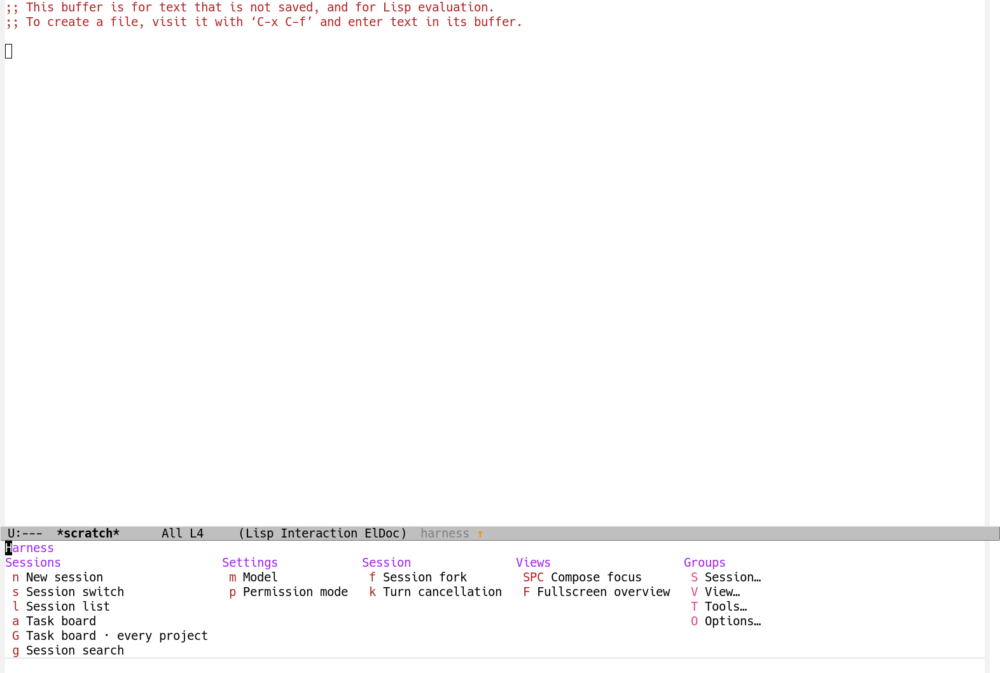
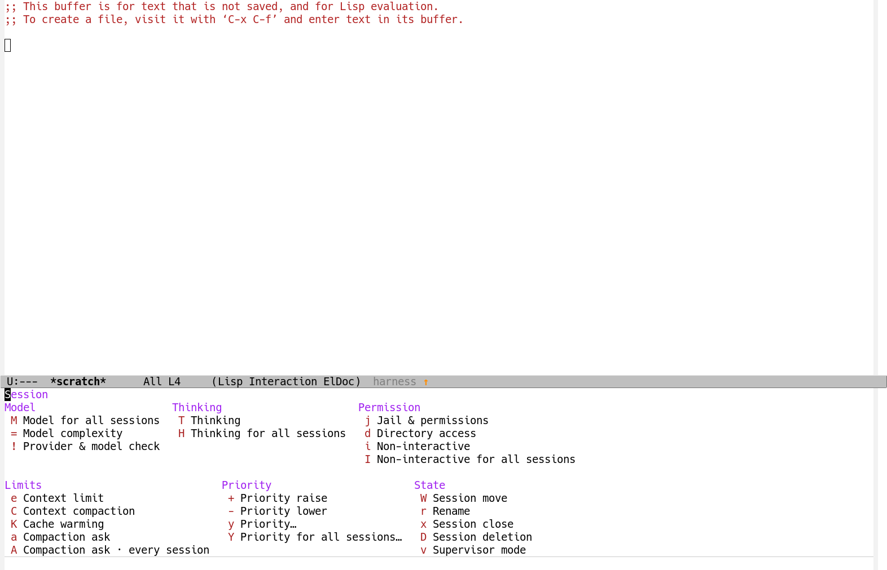

# The `C-c h` menu and the keys under it

## The problem

`C-c h` had two descriptions of itself that disagreed.

The keymap, `harness-ui-map`, bound about forty commands directly:
`C-c h O U` opened the version page, `C-c h R` reloaded, `C-c h V Q` showed
the task slots.  The menu that opened when `C-c h` waited for a key was
`harness-groups-menu`, a hand-written transient that named groups of its
own invention -- `s` Sessions, `o` Session settings, `p` Priority, `t`
Tasks, `u` Tools, `c` Config & remote -- and each group's menu named
keys that were not keys of the prefix at all.  So `C-c h O U` worked and
`U` in the menu did not; `C-c h s` switched sessions and `s` in the menu
opened a submenu.  Nothing in the menu could be typed.

The two descriptions were maintained separately: the keymap by
`define-key` in a dozen modules, the menu by `transient-append-suffix`
calls in the same modules.  They drifted because nothing held them
together.

## What the keys are now

One tree.  The top level keeps the commands used most, and everything
else is one key further, under a group that is a real prefix keymap.

| Key | Top level | |
| --- | --- | --- |
| `n` | New session | |
| `s` | Session switch | |
| `l` | Session list | |
| `a` | Task board | |
| `G` | Task board · every project | |
| `g` | Session search | |
| `m` | Model | |
| `p` | Permission mode | |
| `f` | Session fork | |
| `k` | Turn cancellation | |
| `SPC` | Compose focus | |
| `F` | Fullscreen overview | |
| `S` | Session… | the session's settings, access, priority and state |
| `V` | View… | the sessions' views, and the region's commands |
| `T` | Tools… | what the harness costs, keeps and remembers |
| `O` | Options… | configuration, the server, upkeep |

The groups, each a keymap of its own:

| `C-c h S` | | `C-c h V` | | `C-c h T` | | `C-c h O` | |
| --- | --- | --- | --- | --- | --- | --- | --- |
| `M` | Model for all sessions | `o` | Latest session | `B` | Budget removal | `S` | Settings |
| `=` | Model complexity | `O` | Session open | `m` | Memory… | `O` | Modules |
| `!` | Provider & model check | `t` | Conversation tree | `M` | Memory | `X` | Module enablement |
| `T` | Thinking | `b` | BTW side conversation | `x` | Secret redaction… | `N` | Notification test |
| `H` | Thinking for all sessions | `u` | Usage & cost | `E` | Secret sources | `c` | Server connection… |
| `j` | Jail & permissions | `A` | Insights | `/` | Quick search | `C` | Server details |
| `d` | Directory access | `Q` | Task slots | `h` | ChatGPT plan… | `P` | Remote control |
| `i` | Non-interactive | `E` | Computers | | | `y` | Remote approval |
| `I` | Non-interactive for all sessions | `Y` | Workspace | | | `U` | Version |
| `e` | Context limit | `w` | Worktrees | | | `M-u` | Harness update |
| `C` | Context compaction | `z` | Companion pet | | | `R` | Harness reload |
| `K` | Cache warming | `v` | Voice | | | `L` | Log |
| `a` | Compaction ask | `r` | Audio recording | | | | |
| `A` | Compaction ask · every session | `>` | Region prompt | | | | |
| `+` | Priority raise | `<` | Region thread reply | | | | |
| `-` | Priority lower | | | | | | |
| `y` | Priority… | | | | | | |
| `Y` | Priority for all sessions… | | | | | | |
| `W` | Session move | | | | | | |
| `r` | Rename | | | | | | |
| `x` | Session close | | | | | | |
| `D` | Session deletion | | | | | | |
| `v` | Supervisor mode | | | | | | |

A demoted command keeps its old letter inside its group: `C-c h e` is
`C-c h S e`, `C-c h U` is `C-c h O U`, `C-c h t` is `C-c h V t`.
Four commands that had no key of their own -- `harness-compact`,
`harness-rename-session` and the two compaction-ask commands -- have one
now.  The letters the groups themselves take (`S`, `V`, `T`, `O`) were
the commands they used to run: settings moved to `O S`, and modules to
`O O`.

## How the menu cannot drift again

`harness-ui-bind` is the only way to bind a key of the tree.  It takes
the key, the command, the label the menu calls it, and where it stands:

```elisp
(harness-ui-bind "e" #'harness-set-context-limit "Context limit"
                 :group 'session :column "Limits")
```

It records the entry in the level's list and binds the key in the
level's keymap.  The menu of a level is made from that list as it opens
(`harness-ui-menu-columns`), so the key beside an entry *is* the key
that runs it.  There is no second description to keep in step.

A group is a level with a menu of its own, made by
`harness-ui-define-group`; its key takes the group's keymap, not its
menu, so the group's own keys follow it (`C-c h S e`) and the key alone
opens the menu when it waits, as the top level does.

A level names its columns in the order they are read, and may name them
in rows: the session group has six columns and shows three to a line,
so its menu is 92 columns wide rather than 179, and fits a frame the
terminal has.  `harness-ui-level-rows` is that list of lists of column
titles.  A key whose column no row names still shows, in the last row,
under the last column's title.

A key another command already has is not taken: the binding is left as
it is and the log says so, so two modules cannot bind one key to two
commands by accident.  A command of a module that is off is left out of
the menu, and appears when the module loads.

## The menu on idle, at every level

The idle timer used to recognise one prefix, `C-c h`, and queue one
event.  It now recognises any level: the keys typed so far are the
prefix and then a group's key, and the level they take has a menu, so
the event that opens that level's menu is queued.  `C-c h` alone opens
the top level's menu; `C-c h S` alone opens the session group's.  A key
typed before the delay is read as usual, and the menu never takes it.

## Alternatives

**Keep the flat menu and drop the groups.**  The flat `harness-menu`
already agreed with the keymap, so making `C-c h` open it would have
fixed the disagreement with no key moving.  It was rejected because the
user asked for the tiered menu to stay: forty keys at one level is what
made the menu hard to read in the first place.

**Keep the groups but make them menu-only.**  The groups could have
stayed as they were, with the menu showing `s` for Sessions while `s`
still switched sessions.  That is the bug, not a fix: a key the menu
shows must be a key that works.

**Group keys at free keys only.**  The groups could have taken keys no
command had, such as `?` or `X`, leaving every existing binding where it
was.  It was rejected because the free keys are scarce and arbitrary,
and because the point of the tier is to make the top level short: a
group at `?` would have left forty keys at the top and added a
forty-first.

**Derive the labels from the commands' docstrings.**  The menu could
have taken each label from the first line of the command's
documentation, so that no label had to be written.  It was rejected
because the copy rule is that interface text is a noun phrase, and a
docstring's first line is a sentence about the command, not a name for
it.

## What it looks like

`C-c h` alone, its top level in five columns:



`C-c h S` alone, the session group in two rows of three columns:



The other three groups are in `docs/evidence/c-c-h-menu/` beside them.

## What holds it

- `harness-ui-keys-are-one-tree`: every key of every level runs the
  command its entry names, typed from `harness-ui-prefix-key`.
- `harness-ui-menus-show-the-keys-of-their-level`: the keys a level's
  menu shows, read from the menu's own text, are exactly the keys bound
  at that level, and each runs what the menu says.
- `harness-ui-groups-are-real-prefix-keymaps`: a group's key is a
  keymap, and the group's own keys follow it.
- `harness-ui-common-commands-stay-at-the-top`: the commands the user
  named -- the task board, the session list, a new session -- are one
  key under the prefix.
- `harness-ui-menus-are-noun-phrases`: the exact words of every entry,
  as the copy inventory has them.
- `harness-ui-every-key-stands-in-a-column-its-level-names`: no key is
  lost to a module naming a column its level does not have, and no
  heading stands over an empty column.
- `harness-ui-menu-opens-on-the-prefix-alone`: the idle event opens the
  menu of the level that waits, and a key typed after the prefix queues
  nothing.
