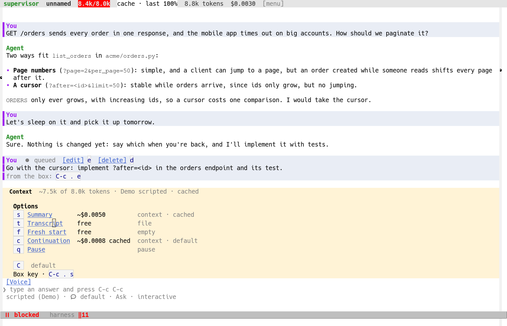
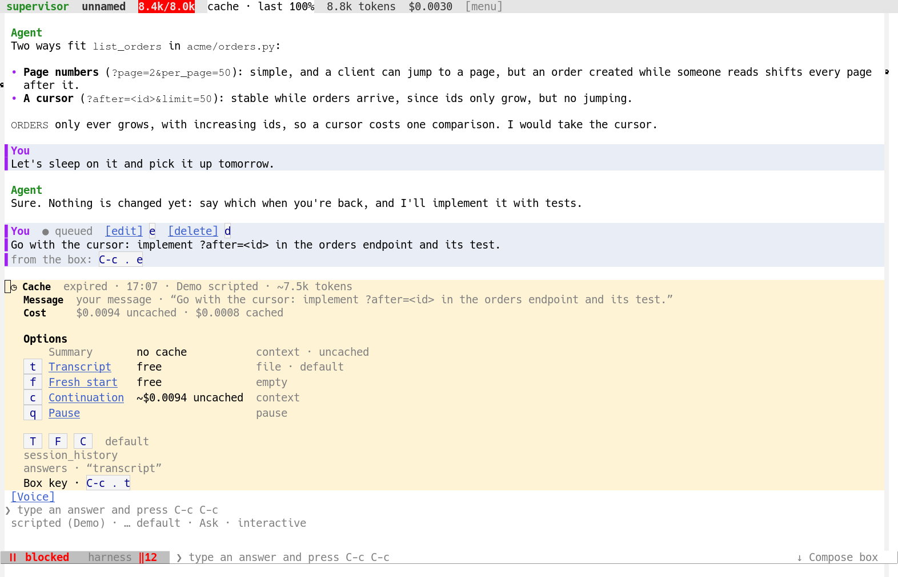
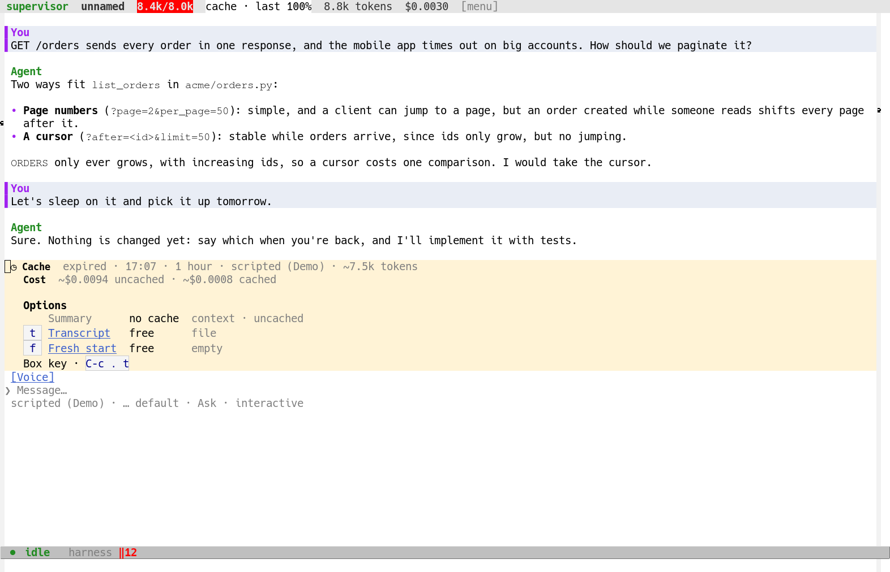

# A compaction that reads the cache, and one short menu

## The problem

The report had two halves, and the first review of the fix grew the second
into the very thing it complained about.

The panel the harness shows when a conversation nears its window said
`Carry on ~$0.0011 uncached` for a 368k-token context whose prompt cache
was warm. `$0.0011` *was* the cache-read price; the word "uncached" came
from a table (`harness-carry-ways`) that hardcoded `read uncached` into
the summary descriptions and from a cost line that printed "uncached"
whenever the cached and uncached prices differed by less than a cent.

Under it was a real defect. A compaction summary was built as a request
of its own -- the compaction system prompt, no tools, the conversation as
messages -- so the chat's cached prefix could never cover it. The estimate
said so (`:cached nil`), which meant no automatic path could make a
summary at all: the panel offered Summary and Brief, and
`harness-compaction--effective-kind` silently made a transcript instead.
The menu promised what the harness would not do, and priced it as though
it would.

The menu itself was seven flat options (brief, summary, transcript, fresh,
cut, carry on, not now) that mixed three unrelated decisions and two
implementation variants. The first fix replaced them with a *paged* menu:
Compact, then a span page, a messages page, a tool-detail page and count
pages behind each counted choice; Clear context, then a transcript file,
nothing kept or the newest kept. That was worse. It exposed every
permutation of the summary's recipe -- span × messages × tool detail ×
count × output cut -- as though each were a decision the user had to make,
and it made the automatic question show a different menu from the one a
cold cache asks.

The review was explicit: do not show three thousand choices; pick the
good ones; offer the bare minimum other harnesses do and at most one
novel method; and show the same menu for a cold cache and for a full
window, differing only in why it is asked.

A later review found the two surfaces still drawn apart: the cache panel
above the compose box had a heading, a `Resend` line and its own buttons
beside a dim summary, while the question had the rows; and both still
spoke in sentences ("Not offered · prompt cache cold", "Choose how to
hand over"). The two must share one renderer, and every string must be a
label.

## What the change decides

### A summary is the conversation's next request

`harness-compaction--prefix-request` builds a summary from
`harness-agent-step-request`: the same model, system prompt, tools,
thinking level, provider state and conversation as the chat's next step,
with the summarisation instruction appended as the last user message.
A provider's prompt cache is a prefix cache, so it serves everything the
chat already sent, and only the instruction is uncached input. The
instruction is appended to the last user message where there is one, so
even that message's original text stays inside the cached prefix.

`harness-compaction--prefix-cache-p` is the one predicate for this: the
session's cache lasts for its model, its provider is sent the
conversation at every request, and the agent's request builder is
there. `harness-compaction--estimate-summary` reports `:cached` from it,
prices the conversation at the cache-read price and the instruction at
the input price, and keeps `:cost-uncached` for the price once the cache
lapses. A hosted loop keeps its own conversation and is served by a fork,
which the estimate counts as cached, as it did before.

A `brief` summary cannot be cached: it renders the conversation's
narrative anew (`harness-compaction--narrative-messages`), which no
cache of the chat covers. It stays what it always was -- a way to carry a
conversation to a *new* provider cheaply -- and is offered by the model
switch, not by compaction menus.

The recipe is gone, and with it `lisp/harness-compact-recipe.el`. It
scoped *what the summary keeps* -- span, whose messages, how much of
each tool call -- but never what the request reads: the whole
conversation is still the input, so every variation was cache-friendly.
It therefore changed only the summary's output, while multiplying the
choices a user had to make. One summary now covers the whole
conversation and says so; the first and last messages are kept verbatim
around it. The model is still told not to call a tool.

### One menu of five ways, both questions

```
Context  ~84.0k of 100k tokens · Demo scripted · cached

   Options
    s  Summary       ~$0.330         context · cached
    t  Transcript    free            file
    f  Fresh start   free            empty
    c  Continuation  ~$0.025 cached  context · default
    q  Pause                         pause

    C   default
   session_history
   Box key · C-c . s
```

`harness-carry-menu-ways` is that list, once: `summary`, `transcript`,
`fresh`, `carry-on`, `hold`. `harness-carry-menu` makes the choices from
a `compaction/estimate` answer, and a way that cannot be made is *kept*
and marked `:unavailable` rather than left out. The question before an
automatic compaction and the question before a message to a session
whose prompt cache went cold both call it, so they show the same rows
for different reasons; only the detail and the reason differ. A model
switch draws the same table with its own two summary ways (`brief` and
`summary`) and `No switch` for `hold`, since it has no message to keep
waiting.

What the five are:

- **Summary** -- the session's model summarises the whole conversation,
  read from the prompt cache while it lasts. Shown with no cache when
  its own request would read the conversation uncached: a dim row with
  no key, its price column saying `no cache`, a tooltip saying why, and
  an answer that names it anyway asks again saying why. It cannot be an
  "always" answer.
- **Transcript** -- the whole conversation goes to a file in the
  session's directory and a note tells the model to read what it needs
  of it. No request. This is the harness's own method, the one novel
  choice beyond what other harnesses offer.
- **Fresh start** -- nothing is carried over but a note saying so; the
  model looks back at what it needs with the session_history tool. No
  request.
- **Continuation** -- send the whole conversation as it is, priced from
  the cache when it lasts and uncached when it does not. It is always
  offered, past the model's window too: it is the user's to choose, and
  a provider that cannot send the conversation says so. It is the
  default, because it changes nothing, and a default that compacts the
  conversation is too easy to give by accident.
- **Pause** -- the message waits, and the next one asks again. A
  lasting answer may not make it the default.

The old `ignore` way is Continuation: both sent the whole conversation
and added nothing, and two rows for one decision was part of the
complaint. `Silence` survives only as a setting a cold-cache answer may
still name; no menu offers it. `brief` and `truncate` remain compaction
kinds and settings -- a handoff still offers a brief,
`harness-compaction-kind` still takes either, and `/compact brief` or
`/compact truncate` still makes one -- but no menu offers them.

### The cache panel is the same panel

The panel above the compose box for a lapsed cache (`harness-ui-cache`)
used to draw a heading of its own, a `Resend` line and two buttons beside
a dim summary. It is now the same panel component the questions use:
`harness-ui-cache--spec` builds the title `Cache`, the detail (`expired ·
14:07 · 5 minutes · Demo scripted · ~84.0k tokens`), a `Cost` row
(`~$0.315 uncached · ~$0.025 cached`), the ask line `Options`, and the
rows the menu gives, filtered to the ways that make sense above a waiting
message: `Summary`, `Transcript` and `Fresh start`. The summary is dimmed
with `no cache`, since a cold cache holds no request of its own; the two
rows that ask no model are buttons with their keys, and the footer says
`Box key · C-c . t`. The heading, the labelled rows, the ask line, the
keys and the tooltips come from one renderer, so the two surfaces cannot
drift apart again. `harness-ui-carry-choice`, which words a cost as a
plan's share and keeps the cache word beside it, moved from
`ui-compaction-ask` to `ui-carry` so both use it.

### The words are labels, not sentences

Every string is a short noun, noun phrase or adjective, a segment after
another with ` · `: `Context`, `Cache`, `Options`, `Cost`, `Message`,
`Summary`, `Transcript`, `Fresh start`, `Continuation`, `Pause`,
`Brief`, `No switch`, `cached`, `uncached`, `no cache`, `file`, `empty`,
`pause`, `context`, `default`, `session_history`, `Box key`. The panel's
rows carry the waiting message, the model, the tokens and the prices;
the detail carries the reason and the context its fullness. There is no
sentence in a panel, a row, a tooltip, a question or a hint: a cold
summary's price column says `no cache`, not a sentence about what it
would read. A hint is segments too (`Cache · cold · 14:07 · transcript ·
answer`), and so is an outcome note (`Compaction · ~84.5k tokens ·
transcript · /tmp/p/.harness/transcripts/t.md`). Prose remains only in
the manual flow's explicit help buffer, which is help; the model's own
output and tool results are data, and are left alone.

### Nothing is offered that cannot be made

`compaction/estimate`'s per-kind entries carry `:available`: a summary
only when its own request reads the prompt cache, a brief only where a
handoff has no cached alternative, and transcript, fresh and truncate
always. `harness-carry-menu` turns that into the dim row. The core still
fails closed for callers that name a model kind anyway -- an agent's
`compact` tool, a saved cold-cache default that names a summary, a stale
queued compaction. `harness-compaction--effective-kind` turns it into
the OPTS `:fallback` kind (a transcript) and a hint says what was not
made: no choice, approval or saved answer is warmth.

The handoff is the deliberate exception: the conversation is leaving for
a provider that never saw it, so there is no cache to read and the
transfer is the point. `handoff/switch` asks with OPTS `:transfer`, which
`--effective-kind` lets through; the panel says what the summary costs
now and what it costs once the cache lapses (`:cost-uncached`).

### The manual command and the cache panel ask the same list

`harness-compact` (C-c h C, C in the menu, /compact in a chat) asks one
list with `read-multiple-choice`: `Summary (~$0.463)`, `Transcript
(free)`, `Fresh start (free)`, `Continuation (~$0.422 cached)` -- the
same menu without Pause, which has no waiting message. A cold summary is
a row reading `Summary (no cache)`; picking it says so and asks again.
The help buffer names the session, the model and the cache, and what
carrying on costs (`Session · “Parser work”`, `Model · Big`, `Cache ·
warm`, `Continuation · ~84.5k tokens · cached`). `/compact KIND` skips
the question, as before.

The cache panel is not a menu of its own: it is the same table, filtered
to the ways that make sense above a waiting message. A summary is a dim
row (`no cache`); Transcript (key t) and Fresh start (key f) are rows
with what they cost.

### The words follow the price

`harness-carry-cache-text` derives `cached` or `uncached` from the
estimate, and `harness-carry-cost-text` says the same for carrying on
from the same source. The hardcoded phrases are gone from
`harness-carry-ways`: a summary's wording is `context · cached` or
`context · uncached`, and carrying on's price says `~$0.0008 cached` or
`~$0.315 uncached`, never a word that contradicts the price beside it.
The panel's cache row (`harness-ui-compaction-ask`) prints what the
harness's cost text says rather than appending "uncached" of its own,
and the cold-cache panel's summary row says only `no cache`, with no
second sentence about what it would read.

## Copy inventory

Every string below is asserted exactly in a test, on the side that emits
it or the side that draws it; none is a sentence. Help text in the
manual flow is separate, as help; the model's own output and tool
results are data, not copy, and are left alone.

| State | Rendered text |
| --- | --- |
| Panel titles | `Context`; `Cache`; `Model switch` |
| Automatic detail | `~84.0k of 100k tokens · Demo scripted · cached`; `… · uncached`; `~101k of 100k tokens` when it is over the window |
| Ask line | `Options` |
| Choices | `Summary`, `Transcript`, `Fresh start`, `Continuation`, `Pause`; a model switch's `Brief`, `Summary`, `No switch` |
| Way wording | `context · cached`, `context · uncached`, `file`, `empty`, `pause`, `context`, `narrative`; the default row says `context · default` |
| Cold detail | `expired · 14:07 · Demo scripted · ~3.0k tokens`; `dropped · 14:03 · redaction · Demo scripted · ~3.0k tokens`; `cold · cache of Model M (Test) · session Model O (Test) · ~3.0k tokens` |
| Cold rows | `Message  your message · “… ”`; `Cost  $0.500 uncached · $0.050 cached`; no cost row for a dropped cache |
| Cache panel | detail `expired · 14:07 · 5 minutes · Demo scripted · ~84.0k tokens` / `dropped · 14:03 · redaction`; row `Cost  ~$0.315 uncached · ~$0.025 cached`; the summary alone with no cached price: `Cost  ~$0.315 uncached` |
| Cache offer | the same rows: `Summary      no cache          context · uncached`, `t  Transcript   free            file`, `f  Fresh start  free            empty`; `Compaction · transcript` while it runs; `Box key · C-c . t` |
| Manual question | `Options`; `Summary (~$0.463)`, `Transcript (free)`, `Fresh start (free)`, `Continuation (~$0.422 cached)`; cold `Summary (no cache)` |
| Manual help | `Compaction`, `Session · “Parser work”`, `Model · Big`, `Cache · warm`, `Continuation · ~84.5k tokens · cached`, `Summary · no cache` |
| Footers | `session_history`; `Box key · C-c . t`; `answers · “transcript”`; `default` |
| Tooltips | `Summary · ~$0.330 · context · cached · ~1.5k tokens · key · s · button`; `Continuation · ~$0.025 cached · context · default · key · c · default · C · button`; the cold row's `no cache`; the cache rows' `Transcript · free · file · key · t · button` and `Fresh start · free · empty · key · f · button` |
| Outcome notes | `Compaction · ~84.5k tokens · summary`; `Compaction · ~84.5k tokens · transcript · /tmp/p/.harness/transcripts/t.md`; `Fresh start · ~84.5k tokens`; `Context cut · ~84.5k tokens`; `Compaction · reverted · ~55 tokens`; `Compaction · restored · ~59 tokens`; the hints `Context · continuation · ~N tokens uncached · answer` and `Context · summary · automatic`; the cold hint `Cache · cold · 14:07 · transcript · answer` |

## Alternatives considered

- *Keep the flat seven and mark what is cold.* It still asks the user to
  choose between a summary and a brief, and between three ways of
  clearing, in one list; that was the complaint. It also leaves the
  cache word in the labels, where it is a property of the estimate, not
  of the option.
- *Keep carrying on unavailable past the model's window.* That was the
  first shape of this menu, and the user asked against it: a session
  that ran to its window must still be able to say "carry on", and a
  provider that cannot send the conversation is the one to complain,
  not the harness by hiding the choice.
- *Keep the configured compaction kind as the default.* It makes an
  accidental RET or Space compact the conversation, which is the
  "auto compact makes the session an idiot" failure the user named.
  Carrying on is the safe default: it changes nothing, and the question
  comes back only when the conversation changes.
- *No "always" on the automatic question.* Then a user who wants to
  carry on is asked again at every boundary. "Always carry on" is the
  one lasting answer the question needs; it is saved and can be turned
  off in Settings.
- *Keep the paged menu and add the missing pages.* The pages are the
  permutations. Span, messages, tool detail, count and output cut are
  not decisions a user should have to make before a compaction; one
  whole-conversation summary is what other harnesses make, and a cold
  summary cannot be had at all.
- *Offer a cold summary with a warning and let the user pay.* Rejected:
  the rule is fail-closed on model kinds, and no informed exception was
  asked for. A cold summary reads as much as carrying on, so the
  warning would be the option's only value.
- *Make `brief` the cached one.* Impossible by construction: it renders
  the narrative into a new request.
- *Drop the transcript file and keep only what other harnesses do.* It
  asks no model, costs nothing, and keeps everything reachable through
  session_history, so it is the one extra worth having.
- *A separate menu for a cold cache.* That is what the review asked
  against: one menu, two reasons. A way that cannot be made is a row
  that says so, not a way that vanishes.
- *A new panel widget.* The carry panel already knows how to draw a
  title, a detail line, an ask line, choices with keys, costs and
  tooltips, and an answer callback; reusing it keeps the keys, keymap
  and pending-question plumbing shared with the cold-cache and handoff
  questions.

## The shape of the change

- `lisp/harness-carry.el`: `harness-carry-menu-ways`, `harness-carry-menu`
  and `harness-carry--not-offered`; the one table both questions use;
  the labels `Continuation`, `Pause` and `Silence` (a setting's word,
  never a menu row), and `No switch` for a handoff's hold.
- `lisp/modules/harness-compaction.el`: the single-question ask
  (`harness-compaction--ask`), the unavailable row and the re-ask when
  one is named, the fixed whole-conversation summary instruction, the
  page and recipe plumbing removed; carrying on as the default and
  always offered (`harness-carry-menu`), "always carry on" saved as
  `harness-compaction-carry-on`, and the shortened hints, hold reasons
  and outcome notes (`Compaction · …`).
- `lisp/modules/harness-cowboy.el`: the same menu from the same
  function; `ignore` parses as `carry-on` and `brief` as `summary` for
  settings that still name them; the cache detail, message and cost as
  segments; a handoff's title and ask line as nouns.
- `lisp/ui/harness-ui-carry.el`: the shared renderer, with a panel's
  turn drawn above the box; an unavailable choice without a key or a
  button, dimmed, with a tooltip; the footer `default`, the `Box key`
  line, the tooltips' `key · K · button` and the `always` capital.
- `lisp/ui/harness-ui-compaction-ask.el`: one page, the heading and the
  choices; the choice adapter moved to `ui-carry` so the cache panel
  uses the same one.
- `lisp/ui/harness-ui-cache.el`: the panel is now a `harness-ui-carry`
  spec -- title `Cache`, the detail, a `Cost` row, `Options` and the
  summary, transcript and fresh rows -- not a heading, a `Resend` line
  and buttons of its own; the old `--heading`, `--offer` and
  `--offer-help` are gone.
- `lisp/ui/harness-ui-compact.el`: the manual flow asks the same list
  with `read-multiple-choice`; the recipe pages gone; the cache panel's
  kinds are `summary`, `transcript` and `fresh`; the notes and hints are
  segments.
- `lisp/ui/harness-ui-cowboy.el`: the cold-cache panel is a spec of the
  shared renderer: title `Cache`, the detail, `Message` and `Cost` rows
  and the choices; the summary row is the unavailable one.
- `lisp/ui/harness-ui-handoff.el`: title `Model switch`, ask `Options`,
  and cache notes as segments.
- `lisp/harness-compact-recipe.el` and its test: deleted.
- Docs: `docs/modules/*.md` regenerated from the source commentary,
  `docs/architecture.md`'s compaction, cowboy, cache, handoff and chat
  sections, `DESIGN.md`'s compaction paragraph.

## How it was verified

- `test/harness-compaction-test.el`: a warm summary request starts like
  the chat's next request and reads the cache; a cold one is shown with
  no cache; no choice, approval or question answer can make a cold one;
  the answer to the question is the kind chosen; the unavailable summary
  asks again when named; carrying on is the default and always a choice;
  "always carry on" saves the setting and stops the asking, while a
  session nobody waits for still compacts.
- `test/harness-ui-compaction-ask-test.el`: the panel's exact heading,
  detail, ask, five rows, costs, tooltips and the cold dim row; no page
  behind it.
- `test/harness-ui-compact-test.el`: the manual flow's one page, the
  same four choices, the cold re-ask; the cache kinds; the exact
  outcome, hint and help strings.
- `test/harness-ui-cache-test.el`, `harness-ui-cowboy-test.el`,
  `harness-cowboy-test.el`, `harness-cache-dropped-test.el`,
  `harness-cache-compact-test.el`, `harness-handoff-test.el`,
  `harness-carry-test.el`, `harness-ui-carry-test.el`,
  `harness-ui-handoff-test.el`: the same menu in both questions and in the
  cache panel, the cold row and the cache words. Each asserts the rendered strings
  exactly -- headings, ask lines, rows, costs, tooltips, footers and
  outcomes -- not a sentence-guessing heuristic; the copy inventory
  above is the list checked against the live screenshots.
- A live harness (`scripts/dev.sh`) with a warm, near-full session and a
  cold-cache session: screenshots of the automatic question, the
  cold-cache question -- the same five rows, the summary dimmed -- the
  cache panel and the manual question, checked against the copy
  inventory. `scripts/demo-compaction-panel.sh full`,
  `scripts/demo-compaction-panel.sh cold` and `… cache` make each in the
  dev harness and leave point on the panel.
- `scripts/test.sh` with no arguments, and `scripts/lint.sh`, before
  hand-in.

## Screenshots

Taken from the dev harness with `scripts/demo-compaction-panel.sh full`,
`… cold` and `… cache`, and checked against the copy inventory above.

| The automatic question | The cold-cache question | The cache panel |
| --- | --- | --- |
|  |  |  |
