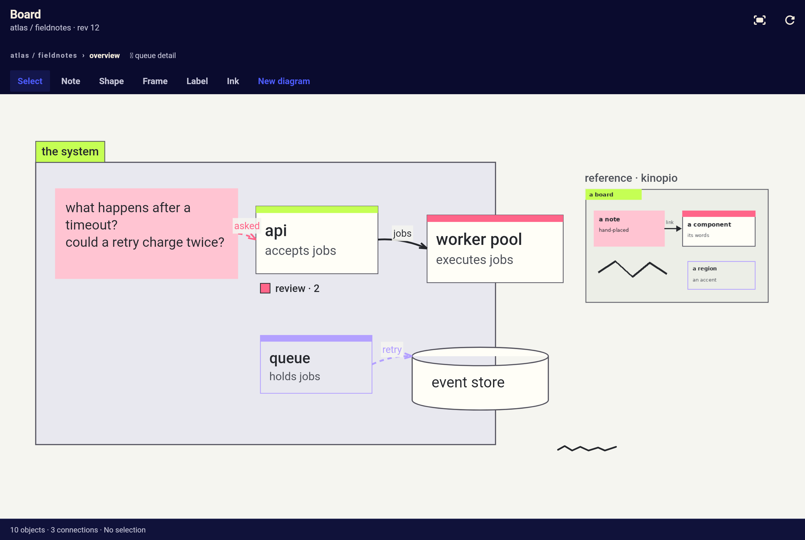
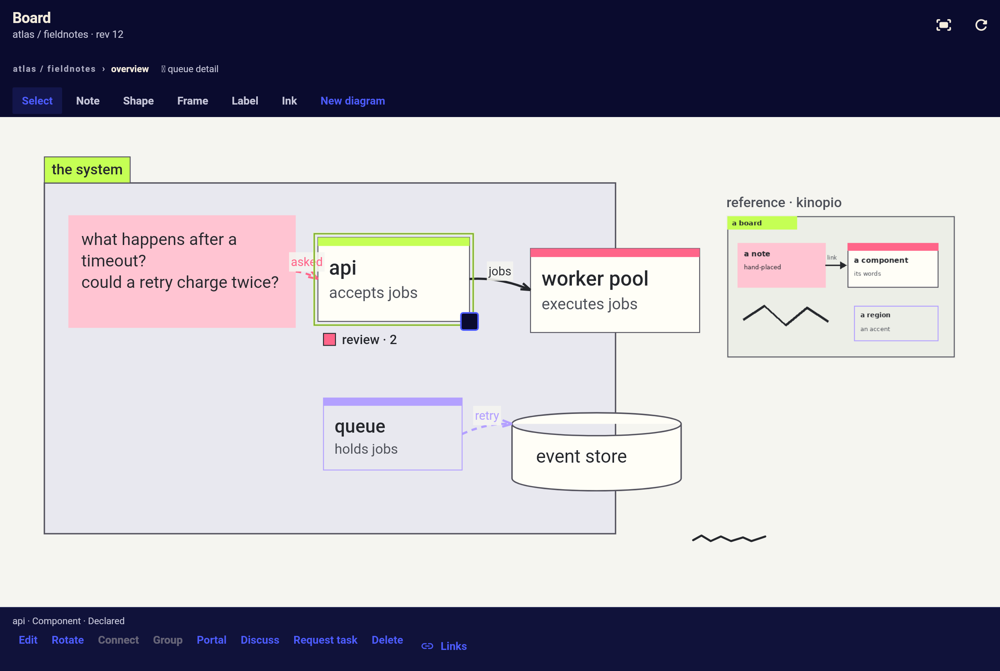
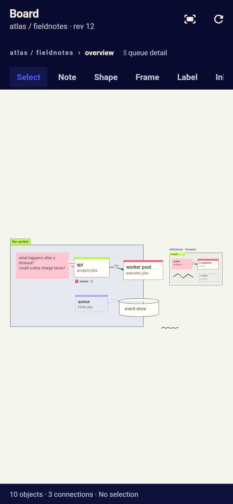
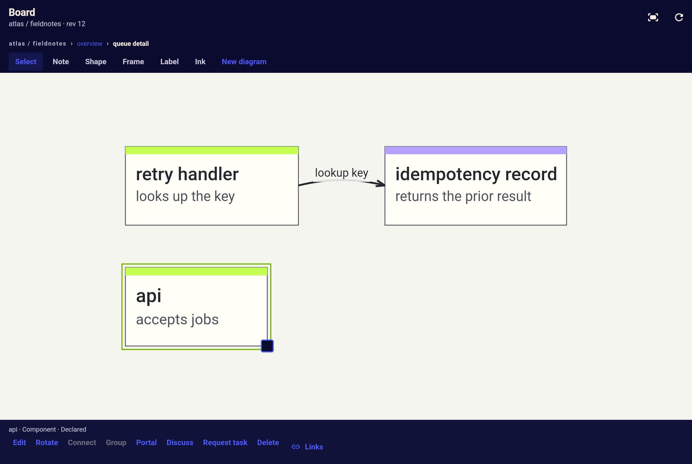
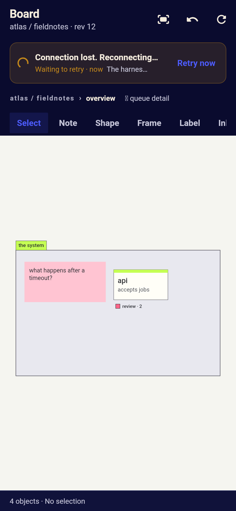
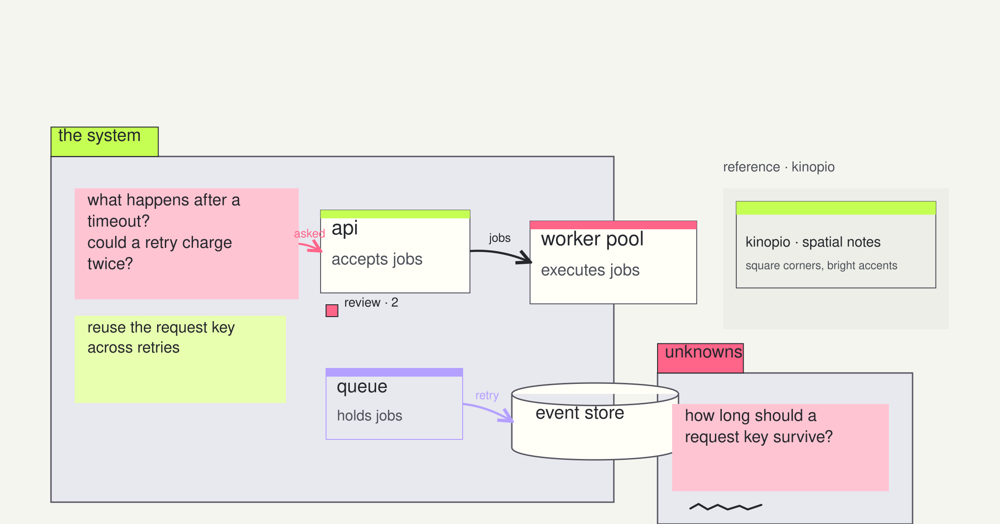

# The freeform agent board

A shared freeform canvas for thinking and working with agents: notes,
authentic ink, geometric shapes, architecture diagrams, connectors and
linked resources.  The main interactive surface is the Flutter client;
Emacs shows a real rendered snapshot of the same board and can hand a
board, diagram and selection to a connected Flutter client.  The agent
works the board through ordinary tools that read a scene and commit
explicit patches.

There is no lifecycle.  Nothing re-arranges the board, nothing promotes
a note into a task, and editing a drawing never creates a task or
approves code.

## What this decides

1. **One grammar, no hidden primitives.** Every board, theme label,
   title tab, task marker and diagram is built from the same typed
   objects and the same operations.  A renderer knows styles, not
   special cases; `grammar.describe` returns exactly the shapes,
   operations and style keys the engine validates.
2. **Semantic identity apart from representation.** A component is one
   `object` with one id and one history.  Each diagram holds a *view* of
   it: local geometry, its own transform, style and layer.  The same
   object can therefore appear in several diagrams without a second
   meaning or a second history, which is what a drill-down or portal is.
3. **Explicit operations only.** `scene.edit` takes ordered operations
   and returns a validated patch; nothing commits until
   `patch.commit`.  There is no search, ranking, candidate generation or
   goal predicate anywhere in the module.
4. **Geometry is numeric and bounded.** Coordinates are x right, y down,
   angles clockwise, in canvas units.  Transforms are 2×3 affine
   matrices `[a b c d e f]`, the same six numbers SVG uses.  A zero or
   near-zero determinant, a non-finite number or a number past the
   limits is refused.
5. **Undo is an edit of its own.** A commit keeps the preimages it
   replaced.  `history.undo` proposes a compensating batch from those
   preimages against the revision being undone; objects somebody else
   changed since are left alone and reported as conflicts.
6. **The schema is versioned.** A stored board carries `schema`; a
   document of another version is refused, never half-read.
7. **A theme is a palette, and every palette reads.** Words are set in a
   role the theme resolves, and where a theme fills a surface with a
   bright accent -- a frame's title tab -- the words on it are whichever
   of the theme's `ink` and `paper` has the higher contrast on that
   accent.  Night commons' green tab is dark-on-bright for that reason.
   The two renderers (Emacs's SVG and the Flutter canvas) make the same
   choice, so the picture and the app agree; a test measures the pairs.

## The document

A board document is the wire shape (JSON) and the stored shape; only
`history` and the client views live beside it in the store.

```jsonc
{
  "schema": 1,
  "id": "b-fieldnotes",
  "name": "atlas / fieldnotes",
  "project": "/home/noah/src/atlas",   // or null
  "theme": "electric-commons",         // electric-commons | open-labels | night-commons
  "revision": 12,
  "created": 1762700000.0, "updated": 1762700900.0,
  "diagrams": [
    {"id": "d-overview", "name": "overview", "parent": null,
     "viewport": {"x": 0, "y": 0, "zoom": 1},
     "selection": ["n-api"],
     "portals": [{"from": "n-store", "diagram": "d-queue"}]}
  ],
  "objects": [
    {"id": "n-api", "kind": "component", "name": "api", "text": "accepts jobs",
     "role": "declared",                       // observed | declared | proposed | unknown
     "locked": false,
     "group": null,                            // the group object this is a member of
     "resources": [{"kind": "task", "ref": "t-8f2", "label": "task · jobs"}],
     "task": null,
     "views": {
       "d-overview": {
         "shape": {"kind": "rect", "w": 164, "h": 91},
         "transform": [1, 0, 0, 1, 72, 214],
         "style": {"fill": "card", "stroke": "edge", "strokeWidth": 1,
                   "cap": "accent", "textColor": "ink", "fontSize": 22},
         "z": 3,
         "anchors": {"left": [0, 45], "right": [164, 45], "tip": [164, 45]}
       }
     }}
  ],
  "relationships": [
    {"id": "e-jobs", "kind": "flow", "diagram": "d-overview", "label": "jobs",
     "from": {"object": "n-api", "anchor": "right"},
     "to": {"object": "n-workers", "anchor": "left"},
     "style": {"stroke": "ink", "strokeWidth": 2.4, "dash": null},
     "resources": [], "role": "declared"}
  ]
}
```

Shapes (`grammar.describe` lists them): `rect` (`w`, `h`), `ellipse`
(`rx`, `ry`), `polygon` (`points`), `path` (`segments`, optionally
`raw` for ink), `text` (`text`, `size`), `image` (`w`, `h`, `src`,
`name`).  A `path`'s segments are `["M",x,y]`, `["L",x,y]`,
`["C",x1,y1,x2,y2,x,y]`, `["Q",x1,y1,x2,y2]` and `["Z"]`: a finite
polyline or Bézier chain, never an SVG string to parse.  An `image`
names its file above itself; it has no card shell.

Styles are fill/stroke roles (`ink`, `card`, `paper`, `frame`, `edge`,
`muted`, `accent`, `accent-soft`, `note`, `note-soft`, `violet`,
`danger`, `none`) which the three themes resolve; a literal `#rrggbb`
is allowed.  A theme is a palette, not a new capability: every style key
a theme uses is one `paint` validates.

## Operations

`scene.edit` (`board/patch`) takes `:ops`, an ordered array.  Every op
is validated against the document as it will be after the ops before
it, so a create followed by a transform of that create works.

| Op | Fields | Notes |
| --- | --- | --- |
| `create` | `id?`, `kind`, `name?`, `text?`, `diagram`, `shape`, `transform?`, `style?`, `anchors?`, `z?`, `resources?`, `task?` | a new semantic object with its first view |
| `view.add` | `id`, `diagram`, `shape?`, `transform?`, `style?`, `anchors?`, `z?` | the same object in another diagram (a portal target, a detail) |
| `view.remove` | `id`, `diagram` | removes a representation, never the object |
| `set-shape` | `id`, `diagram`, `shape` | control points, samples, size |
| `set-transform` | `id`, `diagram`, `transform` | the placement matrix itself |
| `move` | `id`, `diagram`, `dx`, `dy`, `budget?` | translation about the view's origin; `budget` bounds the distance |
| `transform` | `id`, `diagram`, `kind` (`rotate`\|`scale`\|`reflect`\|`affine`), `pivot`, ... | rotate (`angle`), scale (`sx`,`sy` positive), reflect (`axis`: `x`\|`y`\| `[ux,uy]`), affine (`matrix`) |
| `set-style` | `id`, `diagram`, `style` | merged into the view's style |
| `set-text` | `id`, `text` | the object's text (a label is never mirrored by a transform) |
| `set-name` | `id`, `name` | |
| `lock` | `id`, `on` | a hard constraint: locked geometry refuses edits |
| `group` | `id?`, `members`, `diagram` | a `group` object with members; membership is semantic |
| `ungroup` | `id` | members keep their own identity |
| `attach` | `child`, `parent`, `child-anchor`, `parent-anchor`, `angle`, `scale`, `mirror`, `diagram`, `bake?` | expands to `set-transform` |
| `connect` | `id?`, `kind?`, `label?`, `from`, `to`, `diagram`, `style?`, `resources?` | a relationship, not a shape |
| `relate` | `id`, `resources` | replaces an object's resource links |
| `layer` | `id`, `diagram`, `z` | |
| `delete` | `id` | removes the object and its views and relationships |
| `diagram.add` | `id`, `name?`, `parent?`, `viewport?` | another diagram, optionally a child of this one |
| `diagram.parent` | `diagram`, `parent` | where a diagram sits in the breadcrumb |
| `diagram.portal` | `diagram`, `from`, `to?`, `on?` | one drill-down: the object that leads into another diagram, and the way to take it away (`on: false`) |
| `diagram.portals` | `diagram`, `portals` | the whole list of drill-downs, replaced |
| `select` | `diagram`, `selection` | the selection navigation stores; it makes no revision of its own when a client writes it |
| `viewport` | `diagram`, `viewport` | the viewport navigation stores |
| `set-theme` | `theme` | the palette the whole board wears |
| `set-board-name` | `name` | what the board is called |
| `detach` | `id`, `diagram`, `new-id` | a copy of the view as an object of its own (an instance made independent) |

`restore` is the one operation a patch accepts that the grammar does not
list: it carries the preimage of a commit and is undo's own, so no caller
should fabricate one.  Every other operation is in `grammar.describe`,
and a test holds the two lists together.

Two rules matter and are tested:

- **Attachment order.** `attach` places the child so its `child-anchor`
  lands on the parent's `parent-anchor`: reflect across the child's
  growth axis (`x`) when `mirror` is set, then scale by `scale`, then
  rotate by `angle` (clockwise), then translate to the parent anchor.
  `child = T(parentAnchor) · R(angle) · S(scale) · F(mirror)`.  Angles
  are in degrees, scale must be positive and finite.
- **Labels do not mirror.** A transform changes the view's matrix; it
  never negates text, and a reflection of a text object is refused
  unless the op says `"text": true` (an explicit request).

`scope` is optional: when a patch names `scope`, every object an op
touches must be in it, or the patch fails with `hard-constraint`,
before anything is written.  That is how an agent is held to the
selection it was given, and how unrelated geometry stays unmoved.

## Reading, previewing, committing

`scene.read` (`board/get`) answers `revision`, the diagram (viewport,
selection, portals), every object with its exact geometry and text, the
local frames and named anchors, the resources with their resolved state
and the objects near a selection.  It also returns the stored snapshot
of the board (`svg`) when `:image` is asked for: a real rendering from
the same geometry, not a second model.

`patch.preview` renders the *exact* batch (`board/preview`) and reports
constraint failures, reference problems, objects that would move and by
how much, and text overflow estimated from the shape and font size.  It
returns a patch id and content hash; it changes nothing.

`patch.commit` (`board/commit`) takes that id and hash (or the same ops
again), the revision the caller read (`expected`) and an idempotency
key.  It revalidates the batch against the current document, refuses
with `stale-revision` when the read set moved, and applies the whole
batch atomically as one new revision.  A key seen before returns the
answer it gave, so a retried call after a lost answer commits once.

`history.undo` (`board/undo`) is a commit of a compensating batch built
from the preimage of the revision being undone.  It refuses when the
revision is no longer the newest (`stale-revision`), and when a
preimage no longer matches what the commit left it, it keeps the other
objects' work and reports that object as a conflict.

### Error kinds

Every refusal carries one of these codes, and the tools say which:

| Code | When |
| --- | --- |
| `invalid-parameter` | a non-finite number, an out-of-range number, zero scale, a missing field, an unknown style key |
| `unknown-id` | an object, diagram, relationship or patch that is not there |
| `stale-revision` | `expected` is not the document's revision, or the patch was made against another revision |
| `unsupported-operation` | an op or shape kind this grammar does not have |
| `precondition` | the op does not fit the object (a transform on a text object with `text: false`, a view on a diagram that does not exist) |
| `hard-constraint` | a locked object, a scope violation, a movement over its budget, a containment or overlap rule the patch declared |
| `invalid-reference` | a resource or relationship endpoint that names nothing, or a shape that cannot be attached |
| `permission` | the session may not write this board |

Soft preferences never fail: an object moving farther than a `movement`
preference, a text likely to overflow, an overlap nobody declared — they
are diagnostics with `level: "warning"` and the patch still commits.
Intentional overlap is allowed unless an op declares `avoid`.

## Tools

| Tool | Bus method | Contract |
| --- | --- | --- |
| `board.list` | `board/list` | the boards there are, newest first, with the id every other tool names |
| `board.create` | `board/create` | a new empty board in a project, with its diagram and its link |
| `scene.read` | `board/get` | revision, selection, exact geometry/text, anchors, resources with state, nearby objects, optional SVG |
| `grammar.describe` | `board/grammar` | shape kinds, operations, style keys, units, limits, themes |
| `scene.edit` | `board/patch` | ordered ops → validated patch, expanded ops, created/changed ids, preimages, diagnostics |
| `patch.preview` | `board/preview` | the exact batch rendered and diagnosed; no commit |
| `patch.commit` | `board/commit` | atomic apply with read set and idempotency key |
| `history.undo` | `board/undo` | compensating edit from preimages, conflicts reported |
| `board.pin` | `board/pin` | the revision as a delivered artifact, with its landing diagram; later edits cannot rewrite it |
| `board.pins` | `board/pins` | the artifacts a board delivered, or one of them as the document it kept |
| `board.discuss` | `board/discuss` | a thread of the task's own review, anchored to one place at one revision |
| `board.discussions` | `board/discussions` | the threads on a board, and whether the drawing has moved since each |
| `board.delete` | `board/delete` | a board removed with its client state; a delivered artifact refuses it |

The tools carry the calling session, so a board whose `writers` do not
include it answers `permission`.

An agent that has no board id yet starts with `board.list` and
`board.create`; there is no other way to a board, which is why both are
tools and not only bus methods a client calls.  `board.delete` is for a
board made by mistake, and it refuses a board a task delivered a pin of
unless `force` says the artifact goes with it: a pin names the board it
came from, so it is not left pointing at nothing.

### The skill

The tools are the whole of what an agent can do with a board, but not
the order to do it in: read the grammar, make a board, read it, propose
an edit, preview it, commit it, undo it, pin what was delivered, discuss
a place.  So the module carries a skill, `skills/freeform-board/SKILL.md`
in the harness's own tree, which says that order, the units, the
refusals and the traps (the read set, a patch that is not a commit, the
idempotency key, `scope`).  It is registered with the skills module from
`tools-board`'s own init, and listed exactly while `tools-board` is
ready: a harness that disabled the board tools lists no board skill, and
a skill the person wrote of the same name shadows it, since a module's
skill is a global one listed after the user's own.

## Links and integrations

An object or relationship's `resources` are typed: `task`, `message`,
`call`, `thread`, `diagram`, `document`, `symbol`, `screen`, `board`.
Each is resolved through the harness's own APIs where one exists
(`task/get`, `session/node`, `patch-review/get`), and the answer says
`resolved`, `stale` or `unsupported` — never a generic task page in
place of a precise message.  `board/link/describe` is the only resolver;
`scene.read` reports every resource through it.

A `harness:board/BOARD/diagram/DIAGRAM/object/OBJECT` link is a real
link kind (`harness-links.el`), so an agent can point at a place on the
board in its answers, and Emacs and Flutter both open it.

Review threads are the native ones (`patch-review`): a thread anchored
to a board object keeps the board revision it was written against in
its `:meta`, and the object's id, diagram and revision, which is what
keeps the anchor through moves and renames.  `board.discuss` makes one
through the review's own `patch-review/board-thread`, so it is replied
to, resolved and read in the review like any other thread; the board
keeps only the list of reviews it was discussed in, in its client state,
so it can find its threads again without scanning every task's review.
Resolving a thread, accepting a diagram change and approving code stay
three separate actions: the board never calls a review verdict.

### The delivered artifact

A task can hand its architectural explanation in as a drawing.
`board.pin` (`board/pin`, the `board.pin` tool) copies the board's
current revision -- the document without its history -- into a pin of
its own, with the landing diagram and an optional object to open.  The
pin is written once and never changed: edits after it, including a
later commit that moves the same objects, cannot reach what was
delivered.  `board/pins` lists the pins of a board, or answers one with
the document it kept and its rendering, which is what the Emacs page's
`[Open]` shows.  The pin's answer names two links: `target`, the
artifact at the revision it was pinned at, and `current`, the board as
it goes on.  Pinning is not accepting the drawing and not approving
code.

Navigation from Emacs to Flutter is a real request, not a URL guess:
`board/focus` stores the landing place and emits `board/focused`, which
a connected Flutter client hears and opens.  With no client connected,
the board page says so and offers the link.  Nothing pretends a client
is there.

## Persistence and concurrency

Boards are documents under `harness-state-directory/boards/`, one file
each, written atomically.  Client view state (viewport, selection, the
last focus request) is a separate small document, so navigation does not
make revisions.  History is bounded (the newest 200 commits, each with
the preimages it needs for undo) and kept in the board document, so undo
survives a restart.  Two writers serialize on the commit function: the
read set is checked and the document written in one turn of the
harness's single thread, so a commit either lands whole or not at all.

## Building a diagram in Flutter

The Flutter canvas is the main surface, and a person builds the diagram
there.  Every authoring action is an ordinary operation of the grammar,
sent as a patch, previewed and committed like any other edit; the app
holds no drawing of its own that the engine could not rebuild.

| Action | Operation |
| --- | --- |
| a tool and a tap: `Note`, `Shape`, `Frame`, `Label` | `create` with the shape and paint that kind is made of |
| a drag with `Ink` | `create` of a raw `path` from the samples drawn, never smoothed |
| a drag on an object | one `set-transform` at the end, carrying the whole distance |
| the resize handle | `set-shape` with the new size |
| a tap with Shift held, or a long press | the selection grows or shrinks; a pointer picks the two ends of a connector |
| `Edit` | `set-text`, and `set-name` |
| `Rotate` | `transform` `rotate`, 90° about the object's own middle |
| `Connect` with two selected | `connect` between the sides that face each other |
| `Group` with two selected | `group`: membership is semantic, the members keep their ids |
| `Ungroup` | `ungroup` of the group the selected object is in |
| `Delete` | `delete` |
| `New diagram` | `diagram.add`, then walk into it |
| `New board` in the board list | `board/create`, then the new board's own page |
| `Portal`, and the diagram it opens | `diagram.portal` |
| `Discuss` | a thread of the task's review, at the object and the revision on screen |
| `Request task` | `task/submit` of the board's project, with the board, the diagram and the selection in the prompt |

Every one of them is a batch a person could have typed into
`scene.edit`: the canvas is a way to make the operations, not a second
kind of drawing.  The client keeps no state the engine does not have,
so a board made by hand is a board an agent reads and edits like any
other.

The copy is the repository's: tools are nouns (`Select`, `Note`,
`Shape`, `Frame`, `Label`, `Ink`), actions are verbs (`Edit`, `Rotate`,
`Connect`, `Group`, `Ungroup`, `Portal`, `Discuss`, `Request task`,
`Delete`, `New diagram`, `New board`, `Create`, `Submit`), and states
are noun phrases (`No task`, `No other diagram`, `No project`,
`2 selected`, `Grouped`, `Locked`, `Saved`, `Stale · the board moved`,
`Unconfirmed`, `Task · ID`).  A tooltip says what a control needs, not a sentence about
it: `Connect two selected objects`, `Group two selected objects`,
`Ungroup the members`, `Quarter turn clockwise`, `Drill down from this
object`, `Discuss in the task review`, `Implementation task from the
selection`, `No task`, `No project`, `No other diagram`.  The canvas's
resize handle is named `Resize`, a noun like every other handle.  A
sheet is titled with its noun:
`Words`, `Drill down`, `Discuss · NAME`, `New task`, `New board`, with
the fields `Text`, `Name`, `Comment`, `Task` and the buttons `Cancel`,
`Save`, `Send`, `Submit`, `Create`.

`Discuss` uses the task the object marks, or the task a resource of it
links; with neither it says `No task` rather than guessing at one.

`Request task` is the one way a drawing makes a task, and it takes the
person's explicit request: the sheet asks what the task is, and the
prompt it sends names the board, the diagram and the objects picked, so
the task can find the drawing again.  Editing, moving or accepting a
drawing never makes a task and never approves code; a board with no
project says `No project` and offers nothing.

## When the connection goes

A board page is opened over the shell, so the shell's own connection
banner is covered by it.  The page draws the app's banner itself, and a
connection that goes is never shown as the board's answer: `No board ·
The connection was closed.` was the defect, and the board list's
`ACP error -32003: The connection was closed.` was the same defect one
page out.

- A read that fails because the connection went keeps the drawing that
  was read, and says nothing about the board: the banner says the
  connection is being got back, and the page waits, with the activity
  where a board never read would otherwise be said not to exist.
- A write whose answer never came is `Unconfirmed`, a state like
  `Sending` and `Delivered`: the harness may have committed it, so the
  page does not say `Refused`, which only the harness can say.
- A page that notices the failure asks the app to check the connection
  (`checkConnection`), so a socket that died without a word is found out
  then rather than when the next request times out.
- When the connection is back, the page reads the board again: what it
  holds settles an unconfirmed edit, and the notice that said so goes.
  The board list reads again the same way.

`harness_client/test/board_connection_test.dart` holds this shut, and
`test/board_screenshots_test.dart` takes
`docs/evidence/freeform-board/board-connection-lost-phone.png`.

## What is not here

- No automatic search, candidate ranking, search budget, goal predicate
  or branch lifecycle.  The leaf study in the fixture is a construction
  example, not a search product.
- No general recognition of emergent subshapes, no proof of
  expressiveness in continuous geometry, no constraint solver beyond
  the declared hard rules (scope, lock, budget, containment).
- No live cursors, collaborator presence or simulated agent activity.
- Screen-share moment links resolve only when a computer and a capture
  exist; otherwise the inspector says `unsupported` (see
  `docs/computers.md`, and the live-video task it depends on).
- The static analysis resource kind records a symbol at a revision; it
  is a declared evidence reference, not observed runtime flow.
- The Flutter app does not yet show a board's pins on the canvas page:
  the engine, the `board.pin` tool, the links, the Emacs page and the
  client's own `boardPins` and `boardPinned` calls have them; a pinned
  section on the board page is the next step, not something the app
  pretends to have.
- A `screen` link is resolved, and refused, by the harness's own
  capabilities; the board adds nothing to what the computer-use modules
  can see.

## The Emacs page

`J` in the harness map (`M-x harness-boards`) lists the boards of the project and
opens one: the rendered snapshot at the top, the diagram's breadcrumb,
the pinned revisions, and under them the objects; at point a `RET` opens
the object's links (session, message, task, thread), its diagram or the
Flutter board.  The page shows the revision, who last committed and how
many objects moved.

The `Pinned` section names each delivered artifact -- its title, the
revision it was pinned at, the diagram it lands in and what it holds --
with two ways in: `[Open]` shows the pinned document as it was, drawn by
the harness's own renderer, and `[Current board]` opens the board as it
is now.  A page whose pins have not arrived yet says `…`, one with none
says `no pinned revision`; the section is never drawn empty and never
claims an artifact the harness did not answer with.

## Pictures

The board page, drawn by the app's own widget tests from the fixture in
`test/fixtures/harness-board-fixture.el`:



The tools a person builds a diagram with, and what a selected object can
do:






The same component, placed again by a second diagram's own view, with the
breadcrumb back:



The board with the connection lost: the drawing stays, and the app's own
banner says the connection is being got back, in place of any claim about
the board:



And the same board drawn by Emacs's own renderer, which is the picture the
Emacs page shows:



Against a real harness, `harness_client/test/board_real_harness_test.dart`
makes a board through `board/create`, draws a note through the client's
own patch-preview-commit path, reads it back with `board/get`, pins the
revision and checks that an edit after the pin does not reach the
artifact -- `tool/with_real_harness.sh flutter test
test/board_real_harness_test.dart`.  It skips itself with no harness to
talk to.

That test is worth running for what a fake cannot say.  It found two
faults in the client's write path that the fake harness had been
answering anyway: `board/commit` was sent its patch as `patch`, when the
engine's argument is `patch-id`, and the commit left out the `scope` the
patch was made with -- which the patch's hash covers, so the engine made
a different patch and refused the commit.  Every edit with an object id
in it would have failed against a real harness while the fake tests
passed.  The fake now refuses both, the way the engine does.
