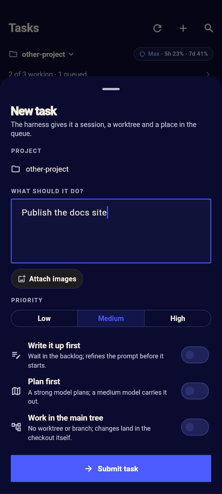
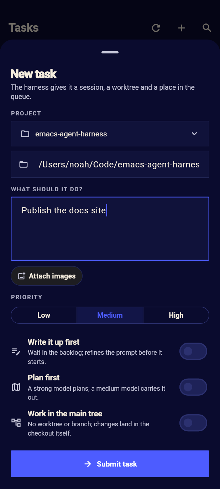
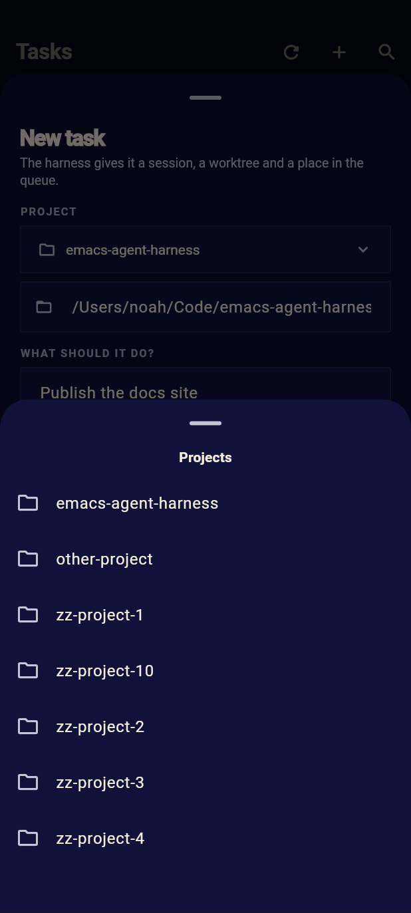
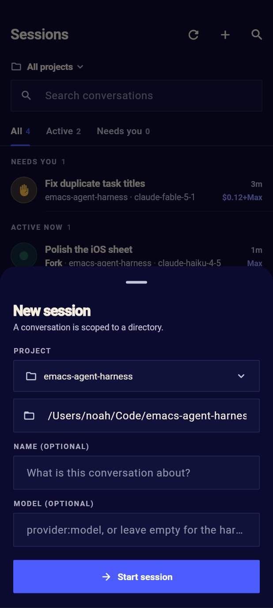

# Project pickers in the client

## What was wrong

Both sheets that make work put their projects on screen as a wrap of pills:
*New task* and *New session*.  A harness with many projects fills the sheet
with them (the *New task* sheet's project section alone can be taller than the
phone), the sheet pushes the description, priority and the button out of
sight, and the pill that is already chosen is drawn among all the others, so
the sheet asks a question that has already been answered.

## What the sheets do now

- **A task sheet on a board narrowed to a project asks for no project.**  The
  board's project is the task's: the sheet says *PROJECT* and the project's
  name, with the folder icon, and there is no dropdown, no path field and no
  other project to pick.  A draft begun on the board of every project, with
  another project chosen, keeps its description and pictures but not its
  project: the board that is open decides, and sending from a narrowed board
  cannot file a task in another project.
- **Everywhere else the project is a dropdown.**  On a board of every
  project, and in *New session*, `PROJECT` is a field that names the chosen
  project and opens the list of projects when it is tapped, one project at a
  time.  The field is followed by the absolute-path field, as before, so a
  directory that is not one of the harness's projects can still be typed.
- The dropdown's list is the app's menu (`showHarnessMenu`): a scrolling
  bottom sheet on Android and a `CupertinoActionSheet` on an iPhone, titled
  *Projects*.  It holds the projects the app derives from the harness
  (`insights/projects` and `project/mains`), never the worktrees or scratch
  directories of tasks and sub-agents.
- The action sheet's rows let a long project name ellipsize instead of
  overflowing the sheet: project names are directory names and can be as
  long as the phone is wide.

## The widget

`HarnessSelect<T>` in `lib/src/ui/adaptive/adaptive_widgets.dart` is a
`HarnessTextField`-shaped field: the folder icon, the chosen label (or the
hint when nothing is chosen), and a chevron, in the fill, corner radius and
border of the theme.  It is a button to a screen reader, and tapping it opens
`showHarnessMenu` with the options and calls back with the choice.  The sheets
pass a stable key (`task-project`, `session-project`) so the rendered field,
its label and its absence on a narrowed board are asserted exactly.

`HarnessMenuItem` and `showHarnessMenu` already existed for the task board and
the sessions filter, so the dropdown uses the same platform menu every other
project choice does, with no new popup code.

## Copy

Per `docs/ui-guide.md`, interface text is nouns and noun phrases:

| Where | Text |
|---|---|
| Label above the field | `PROJECT` |
| Field with nothing chosen | `No project chosen` |
| Menu title | `Projects` |
| A narrowed board's project | the project's name, under `PROJECT` |

Project names, the absolute-path hint and the existing validation message are
data or pre-existing copy and are unchanged.

## Alternatives

- *Keep the pills.* They are a list of everything at the wrong moment: the
  chosen one is lost among the rest, and with thirty projects the controls
  under them are off the sheet.
- *A Material `DropdownButton`.* Its menu is anchored to the field and has no
  scrolling for many or long entries, and it is not the style of an iPhone;
  the app's `showHarnessMenu` is already the one platform-adapted choice.
- *An "Other directory…" item in the dropdown that reveals the path field.*
  It would hide the path field until it is wanted, but it makes typing a path
  two taps, and removes the visible statement of where the work will go; the
  existing path field stays, under the dropdown.
- *Hide the project entirely on a narrowed board.*  The sheet covers the
  board's own project line, so the person filing the task would not see where
  it goes.  A fixed row says it without offering a choice.

## Pictures

Drawn by the test below with `HARNESS_SHOTS` on an Android phone
(412×915), dark theme:

| | |
|---|---|
|  |  |
|  |  |

## Tests

`test/project_picker_test.dart` (with the fonts of a phone, and `HARNESS_SHOTS`
for pictures) asserts:

- a task sheet on every project: one field, the chosen project's name, the
  menu titled *Projects*, choosing another project fills the field and the
  path, and the submitted `cwd` is that project;
- a task sheet on a narrowed board: no `task-project` field, the fixed
  `task-project-fixed` row names the board's project, no path field, and the
  submitted `cwd` is the board's project;
- a draft begun elsewhere does not decide a narrowed board's task;
- nothing chosen shows `No project chosen`;
- the menu holds projects, not worktrees or scratch directories, against a
  harness that lists both;
- the new session sheet picks its project the same way, and the created
  session's `cwd` is the choice;
- the iPhone style: the field and its action sheet, choosing and sending.

`test/task_board_widget_test.dart` and `test/widget_flows_test.dart` keep
their board and session flows and now assert the dropdown in place of the
pills.

The app's older failures (the task board header overflow with the test font,
and the project label a card should show on a board of every project) are
unchanged by this: the full-build check compares against the branch's base
and lists them as the base's.
