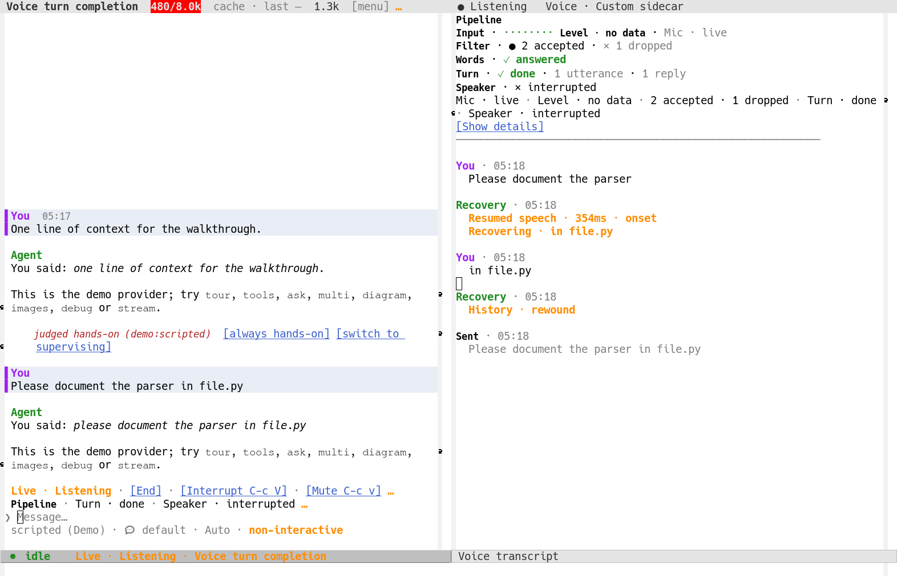

# Taking back a voice turn the speech endpoint cut short

## The problem

The live voice transport submits a transcript as soon as the speech model
returns one.  That is right for a request and wrong for a thought: a
dictation has pauses, a speech endpoint calls a pause an utterance end, and
the agent answers the fragment.  Noah's report is the whole of it -- the
person resumes speaking about half a second later, and the answer to half a
sentence is already under way.

Task `t-595zkjeu` gated assistant output while the person spoke; that is a
different problem, and this change does not repeat it.  There, no turn
existed yet and the fix was to hold output.  Here the turn exists, has been
submitted, may have run tools and may be answering.  The only remedy is to
take it back.

The code is `lisp/ui/harness-ui-voice-recovery.el` (the decision) and the
recovery section of `lisp/ui/harness-ui-voice-live.el` (the doing).

## What decides it

Two rules, and nothing else.

### The window is measured to the speech, not to the words

A voice message is *armed* when it is submitted.  The window is the interval
from that submission to the moment the person's **resumed speech began**, as
the sidecar's own speech gate reports it (`speech` with `active: true`, a few
frames after the first voiced sound, before any transcription exists).

Measuring to the transcript's arrival instead would be measuring the speech
service.  A continuation spoken 200 ms after the submission whose words come
back three seconds later is still a continuation, and the fixture tests cover
exactly that (`harness-ui-voice-recovery-late-transcript-of-early-speech-still-recovers`,
`harness-ui-voice-live-recovery-keeps-its-timing-as-evidence`).  A provider
that reports no speech gate leaves the transcript's arrival as the only
evidence; the window then applies to that, a slow transcription may fall
outside it, and the record says which measure it used (`onset` or
`transcript`).  Both are written into the voice transcript, so a recovery can
be audited after the fact rather than argued about.

The first onset after the submission is the one that counts.  A later one
cannot move the window, and an onset reported before the submission is not
resumed speech at all.  The submitted message's own capture is excluded: the
sidecar reports onset and captions for the burst being transcribed, and those
are the message, not the person going on.

### Words, not a complete sentence

The trigger is the **first accepted nonempty words** that flow from the
resumed speech -- the first `user_delta`, or the first delegation for a
provider that sends no captions.  There is no wait of any kind between those
words arriving and the cancellation going out: the cancel is sent in the same
event that carried them.

What never triggers:

- an empty transcription, spaces, punctuation only, a musical note, a dash;
- a caption the provider marks `unsure` (its own confidence, not a guess by
  this code);
- a caption of the submitted message's own capture;
- words whose speech began outside the window;
- words that arrive after the recovery has already been taken back.

That is `harness-voice-recovery-words-p` and `harness-voice-recovery-trigger`,
and the live transport calls them from the event handler.  Nothing waits for a
sentence, an utterance end, or a silence.

## What it does

1. **Stop.** Playback is interrupted on the sidecar, held text is dropped,
   the acknowledgment is cancelled, and the output gate is held so no further
   piece of the old answer is spoken.
2. **Cancel.** The ordinary `session/cancel` path, the one the Cancel work
   control already uses -- no new cancellation mechanism, no new permission.
3. **Wait for the acknowledgement.** The rewind happens only when
   `agent/turn-ended` reports the cancelled turn over.  A head moved under a
   running turn would go on being written after, so a turn that does not
   acknowledge within `harness-voice-live-recovery-cancel-timeout` (5 s) is
   not rewound; the fallback below applies and the transcript says why.
4. **Read the history.** `_harness/session/nodes` gives the transcript path
   as the harness has it, not as this client guessed it.
5. **Rewind, or not.** `harness-voice-recovery-plan` decides from that path:

   | History | Action |
   | --- | --- |
   | the voice message is on the head's path, no tool ran in the turn, no message followed it | `rewind`: `session/set-head` to the node before the message |
   | the transcript does not hold the message | `intact`: the head never moved past the thought; nothing to move |
   | a tool call ran, a message followed, there is no earlier node, or the path could not be read | `append`: keep the history, add only the continuation |
   | the set-head call fails | `append`, with the failure in the transcript |

6. **Rebuild the thought.** The original words (after a rewind) and the
   continuations go into the ordinary pending voice turn.  The existing
   turn-completion grace decides when the person is done talking and submits
   the whole thought once, through the same `session/prompt` path as any other
   message.  The recovery does not submit anything itself.
7. **Stay listening.** Successive premature endpoints within the same thought
   append their own words; a revised transcript of the same capture replaces
   its earlier words in place, so nothing is dropped and nothing repeats.

## The safe fallback, and what a rewind is not

A rewind cannot undo a tool's side effects.  A file written, a command run, a
message sent are done, whatever the transcript says afterwards.  So the plan
never rewinds a turn that ran a tool: it keeps the history and appends the
continuation.  The answer to the fragment stays in the transcript, where a
person can see it, and the agent's next turn reads the corrected thought after
it.  That is worse than a clean rewind and much better than claiming a
rollback that did not happen.

A message typed after the voice turn is never rewound away either: it is
something the person wrote and meant, and the voice has no business dropping
it.

A rewind is not a deletion.  The nodes the cancelled turn wrote stay in the
session's tree on their own branch, reachable from the session tree view, and
the transcript's `Recovery` section keeps the evidence: the resumed speech's
measure and length, the first words heard, and the history's decision.  That
is the audit record.

## Races, late events and lifecycles

| Situation | What happens |
| --- | --- |
| Cancellation acknowledgement arrives | the rewind proceeds (step 3) |
| It never arrives | after the timeout, no rewind, continuation appended, transcript says `cancel timeout` |
| A late chunk or tool call of the cancelled turn arrives | it is not spoken: the turn is over and `harness-voice-live--turn-active` is off |
| A late delegation of the continuation's own capture arrives | it is absorbed into the thought, and the sidecar is answered `recovered` so it stops waiting |
| The same delegation arrives twice | the source is one continuation, so the thought says it once |
| A caption is revised after the draft was built | the draft is rebuilt from the same plan, replacing its own sources |
| The target moves (session switch, workspace thread) | the recovery is abandoned; nothing of another thread is rewound |
| Mute, stop, reconnect, redaction, reload | the recovery is abandoned with the call's gate |
| The call ends before the rewind | the callback finds no recovery and does nothing |
| Two recoveries in a row | each has its own id, so a callback from the first cannot finish the second |

The record is a value that evidence notes replace with a copy, so every
callback names its recovery by id (`harness-voice-live--recovery-same-p`),
never by identity.

Provider history follows the head without anything new: `session/set-head`
moves the head, and `harness-agent--follow-head` cuts a hosted provider's
conversation to the last checkpoint on the path, or starts a new one from the
transcript, before the next turn's request.  The recovery adds no provider
code.

## Settings

| Setting | Default | Meaning |
| --- | --- | --- |
| `harness-voice-live-recovery-window` | 0.6 s | submission → resumed speech onset; nil turns the recovery off |
| `harness-voice-live-recovery-cancel-timeout` | 5.0 s | how long the cancel may take before the history is left alone |

Noah's example was "about half a second"; 0.6 s covers it with room for the
gate's own onset hold (30 ms local, 60 ms Flutter) without reaching into the
next thought.  A longer window recovers more continuations and takes back more
answers the person may have wanted; a shorter one is the opposite.  There is
no fixed wait after the words arrive: the cancel goes out with them.

## Interface copy

The recovery adds one stage and one transcript section.  Both are noun
phrases, as `CLAUDE.md` asks.

| Surface | Exact copy |
| --- | --- |
| Status while the turn is being taken back | `Recovering thought` |
| Stage line glyph | `↺` |
| Transcript section heading | `Recovery` |
| Resumed speech line | `Resumed speech · 150ms · onset` (or `· transcript`) |
| First words line | `Recovering · in file.py` |
| Rewind done | `History · rewound` |
| History kept | `History · kept · tool calls` / `· later message` / `· no earlier message` / `· cancel timeout` / `· <set-head failure>` |
| Nothing to move | `History · unchanged` |
| Abandoned before it could start | `Not recovered · retargeted` / `· muted` |

No prose is added to the controls or to a tooltip.  Exact rendered-copy
assertions are in `harness-ui-voice-live-test.el`
(`harness-ui-voice-live-recovery-first-words-cancel-at-once`,
`harness-ui-voice-live-recovery-keeps-its-timing-as-evidence`,
`harness-ui-voice-live-recovery-other-session-is-untouched`) and in the
status copy test.

## Alternatives considered

- **A longer silence threshold before submitting.**  The natural first idea,
  and it is what `t-595zkjeu` already improves: a longer hangover delays every
  request by that much and still guesses wrong on an unusually long pause.
  It cannot fix a submission that already happened.
- **Ask the model to answer the fragment briefly and wait.**  Costs a turn and
  a model call on every pause, and still produces an answer to half a thought.
- **Steer the running turn instead of cancelling it.**  A steering message
  joins the conversation after the fragment, so the model reads a question
  about the fragment and then the rest of the thought; it does not unsay what
  it already wrote, and the transcript keeps a question that was never the
  person's.
- **Delete the turn's nodes.**  `session/discard-nodes` exists, and it would
  leave nothing to audit and nothing for the tree to show.  Moving the head
  keeps the record and is the mechanism the tree's own checkout uses.
- **Measure the window at transcript arrival.**  Simpler and wrong: it makes
  the window a property of the speech service's latency, so a slow STT turns
  every continuation into a new thought.
- **Rewind unconditionally.**  Cheap to write, and a lie about tool side
  effects.

## Verification

Deterministic ERT tests, no microphone, no speech service, no model:

- `lisp/ui/harness-ui-voice-recovery-test.el` (18 tests): the window inside and
  outside, late transcript of early speech, arrival as the fallback measure,
  first onset only, the message's own capture, empty/noise/unsure input,
  finished and recovering records, combining and revising continuations, the
  draft per plan, every plan branch and its line, and the evidence.
- `lisp/ui/harness-ui-voice-live-test.el` (17 recovery tests, the whole file
  108): the first words cancel at once, outside the window is a new thought,
  empty and noise never cancel, one submission at final speech end, successive
  endpoints, partial revisions, tool calls keeping the history, a later
  message, the cancel timeout, an already finished turn, a failed rewind, an
  abandoned recovery on a target switch, mute and stop, late chunks and tool
  calls, a repeated delegation, the evidence lines, and the feature switched
  off.

Observed timing in the fixtures is the test clock: the recovery starts in the
same event as the first word (asserted: no timer between), and the cancel
timeout fires at the configured delay.  This is **fixture evidence**, not a
microphone measurement; a live microphone check remains a deployment step,
and no claim here is about real speech-to-text latency.

The walkthrough drives the same handlers in a development harness with a
scripted sidecar and the demo provider:

```sh
scripts/voice-turn-demo.sh start-quiet   # a fresh call with nothing said
scripts/voice-turn-demo.sh early         # the fragment, submitted
# 0.5 s later the same scripted speech goes on; the demo does it for you
scripts/voice-turn-demo.sh state         # the draft, the evidence, what was sent
scripts/voice-turn-demo.sh early-tool    # a turn that ran a tool: history kept
scripts/voice-turn-demo.sh early-off     # the window off: no recovery
```


