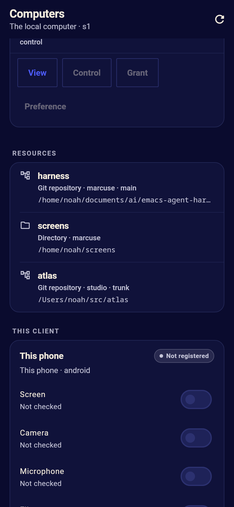

# The mobile client as a computer

A client and a computer are separate things: a client reads and enacts
the harness's state over ACP, and a computer is a machine whose tools the
harness may call.  The Flutter client (`harness_client/`) is both.  It
draws the Computers page and the RFB view, and it can register the phone
or desktop it runs on, lend that computer's tools as MCP servers over its
ACP connection, and keep no harness state of its own.  The server stays
the engine: it keeps the registry, the access policy, the event loop and
the session transcripts.

This document is the app's side of [computers](computers.md).  The harness
contract -- records, grants, the gate, the ACP methods and the MCP host --
is there and in [architecture](architecture.md#computers).

## Shape

```
Flutter app (one process)                    harness server
┌─────────────────────────────┐              ┌──────────────────────────┐
│ MobileComputerController    │  ACP (WS)    │ harness-acp              │
│  identity + secret          │◄────────────►│  client session          │
│  capability opt-ins         │              │ harness-computers        │
│  capture port               │              │  record, grants, gate    │
│ MobileComputerEndpoint      │              │ harness-mcp              │
│  computer MCP server        │◄────────────►│  external connection     │
│  files MCP server           │ _harness/    │  initialize, tools/list, │
│  token check, file scope    │ computer/mcp │  tools/call              │
└─────────────────────────────┘              └──────────────────────────┘
```

Nothing but the ACP connection crosses the boundary.  There is no second
port, no listener in the app and no harness record in the app: an
in-process MCP server is reached exactly like the Emacs endpoint's, by
the harness sending `_harness/computer/mcp` to the client that registered
it.  When the client leaves, its registration is marked disconnected and
its tools go with it.

## Identity and registration

- The identity is `cmp-<os>-<random>`, stable for the installation.  The
  secret is 256 random bits, base64url without padding.  Both are kept in
  `harness-computer/identity.json` in the app's own file area.  On a
  phone that is the app's cache: inside the app sandbox, but the OS may
  reclaim it, and it is not hardware-backed.  A platform keystore is the
  seam a later version replaces; the wire format does not change.
  `ComputerIdentity.load` also downcases an id it finds, because the
  harness keeps computer ids lowercase and a client that kept another
  case could not find its own record.
- The id is generated lowercase for the same reason.  The secret is never
  hashed on the device; the harness keeps only a salted SHA-256 of it.
- Registration is explicit.  The Computers page's `[Registration]`
  button calls `computer/register` with the computer description, the
  secret, the resources (the app-files directory, and a display, camera
  and microphone while those capabilities are offered) and the two MCP
  servers.  Nothing registers on the app's behalf at connect time; a
  registered installation reconnects with `computer/attach` and its
  secret.
- The harness attaches the MCP servers *before* it answers `register` or
  `attach`, because the answer carries the MCP token.  The handshake
  (`initialize`, then `notifications/initialized`) therefore arrives
  while the app still waits for the token.  `MobileComputerEndpoint`
  accepts that handshake only while a bind (`register` or
  `attachIfKnown`) is in flight; once it settles, every MCP message must
  carry the token of the current registration, compared in constant
  time.  Both directions prove the binding: the harness sends only on the
  connection of the client it bound to the computer, and the client sends
  only for its own id, its own server names and its current token.

## Capabilities

The vocabulary is the harness's: `view`, `camera`, `audio`, `files` and
`clipboard`.  Each is a person's opt-in on the page, and separate from
the harness's grant: the harness may allow a session a capability the app
does not offer, and an app may offer one the session is not granted.
Only a capability the person turned on and the platform reports usable is
advertised in `computer/register` and `computer/update`.

A capability is in one of the harness's states: `available`, `denied`
(the OS refused), `revoked` (the person or the OS withdrew it),
`unavailable`, `foreground-only`, `suspended` (the app left the
foreground), or `error`.  Only `available` and `foreground-only` count as
offered.  Capabilities travel both as the offered list and as
`capabilityStates`, so the Computers page and `session_info` can say why
one is not there.

`MobileComputerController` is a `WidgetsBindingObserver`.  When the app
goes to the background, every capture stops, the capability state says
`suspended` and the change is advertised; nothing resumes by itself when
the app comes back.  `[Capture off]` bumps a generation, stops the
capture and advertises the change; a frame or clip that finishes after
the bump is refused rather than counted.

Screen, camera and microphone are behind `ComputerCapturePort`.  The port
owns the OS permission prompts, the capture session, the lifecycle and
the frame format; the endpoint owns the MCP tool, the state machine and
the token.  This build ships `NoopComputerCapturePort`, so those three
read `Unavailable` and the harness gets no such capability.  The platform
ports are the staged remainder (see [Not yet](#not-yet)).  Clipboard is
implemented by the controller through Flutter's `Clipboard`, in the
foreground only.  Files is implemented by the app's scoped store.

## The tool servers

The `computer` server:

| tool | does | offered while |
| --- | --- | --- |
| `info` | what the phone is, its id, OS, capabilities and servers | always |
| `screenshot` | one PNG of the screen | `view` is offered |
| `camera` | one JPG/PNG picture, with optional width and height | `camera` is offered |
| `audio` | one WAV clip, 1-15 seconds | `audio` is offered |
| `clipboard` | read or write the clipboard | `clipboard` is on |

The `files` server:

| tool | does |
| --- | --- |
| `info` | the root and whether writing is on |
| `list_dir` | one directory, with name, path, type, size and time |
| `read_file` | a text file by line range |
| `file_info` | metadata for one path |
| `write_file` | a text file under `outbox/`, only with writing on |

Every tool answer is an MCP result: text for people, structured content
where the harness's `computer_call` can use it, and `isError` for a
refusal.  The harness's `computer_camera` and `computer_view` tools call
the matching server tools and turn the structured image into a session
picture, so the transcript shows the picture the phone took.  A tool the
app does not offer is refused before the MCP call, with the capability's
state in the reason.

## Files

`AppComputerFileStore` roots the app's files at
`harness-computer/` in the app's file area, with `imports/` and
`outbox/`.  Only relative paths are accepted.  Absolute paths, `..`, NUL
bytes and symbolic links are refused, and the resolved path must stay
under the root.  A person's import is a copy the system picker chose,
never the original path; the agent sees the copies.  Writes need the
person's switch and go to `outbox/` only.  The limits are 512 KiB for a
read or import and 256 KiB for a write, with at most 500 entries in one
listing; over them, the tool answers with an error rather than truncating
silently.  The page shows `[File writing]` (`Outbox only`) and
`[File import]`.

The root is a cache directory in this build, and the OS may reclaim it;
the import/outbox scope, not durability, is what the store guarantees
today.  Moving it to app documents (or the platform's private files
directory) is a platform-channel change that does not alter the tools.

## The page

The Flutter Computers page gets a `This client` section after
`Resources`: the device's label (`This phone` or `This device`), its name,
id and OS, a registration state (`Not registered`, `Registered`,
`Disconnected`), a switch per capability with its state, `[File writing]`
and `Outbox only` when files are on, `[Capture off]` while a capture is
active, and the buttons `[Registration]`, `[Reconnection]`,
`[Disconnection]`, `[Revocation]` and `[File import]`.  The copy is nouns,
noun phrases and adjectives like the rest of the page
(`Capture only · no pointer or keyboard control`, `Screen capture ·
broadcast extension required`).  The page is drawn at the end so the
registry and the resources keep the top of the page.



## Platform matrix

| capability | Android path | iOS path | this build |
| --- | --- | --- | --- |
| screen | `MediaProjection` consent, a foreground service of type `mediaProjection`; from Android 14 a per-session token | a ReplayKit broadcast upload extension | no-op port: `Unavailable` |
| camera | CameraX, `CAMERA` permission | AVFoundation, `NSCameraUsageDescription` | no-op port: `Unavailable` |
| microphone | `RECORD_AUDIO` permission | AVAudioSession, `NSMicrophoneUsageDescription` | no-op port: `Unavailable` |
| files | app sandbox | app sandbox | real, scoped |
| clipboard | `ClipboardManager` | `UIPasteboard` | real, foreground |

The Android screen contract is the one on
<https://developer.android.com/media/grow/media-projection>; the iOS
screen contract is ReplayKit's broadcast upload extension,
<https://developer.apple.com/documentation/replaykit>.  The app does not
claim a capability the platform port has not reported: the matrix says
what the port will use, not that this build can do it.

## Decisions and alternatives

- **In-process MCP servers, not helper programs.** The app already has an
  ACP connection, a token and an event loop.  Starting a second process
  to speak MCP would duplicate authentication, add a lifetime to manage,
  and still need the ACP request to reach it.  The harness's MCP host is
  the same host on both ends, and the app's two servers are ordinary
  `McpServer` objects in the app isolate.
- **The registration is the person's, not the connection's.** A connect
  does not register a machine: that would give the harness access as a
  side effect of opening a chat, and would make every reconnect a new
  grant.  The app sends `computer/register` only from the button, and
  `computer/attach` only with a secret it already kept.
- **The capture port is a seam, not a plugin in this change.** Screen and
  microphone capture need an OS consent flow, a foreground service on
  Android and a broadcast extension on iOS; those are platform work with
  their own lifecycle and stores.  Keeping them behind a port lets the
  registration, MCP, token, file and capability machinery be tested
  without a device, and lets the capture work land without changing the
  harness contract.  The port is the same `ComputerCapturePort` the
  Emacs endpoint implements, so the two clients speak one vocabulary.
- **A second permission check is not a second policy.** The harness's
  gate decides what a session may do on a computer; the app's switches
  decide what this phone offers at all.  Both are needed: the person may
  want to advertise files but not camera, and a session may be allowed a
  camera on another computer but not this one.  The page shows the app's
  side and the server's `computer/access` shows the session's.

## Not yet

- **Platform capture.** A real Android `MediaProjection` port and an iOS
  ReplayKit broadcast extension.  Until then screen, camera and
  microphone are offered by no build and the tools answer with an error.
  The capture session API is the one the voice/computer-use work
  (`MediaCaptureSession`) provides; this change consumes the port, it
  does not duplicate the capture implementation.
- **Pointer and keyboard control.** The app is a capture client, not a
  remote desktop server: it offers no pointer, keyboard or window
  control, and the page says so.
- **Background capture.** The OS can stop a capture when the app leaves
  the foreground, and the app deliberately does not restart it.  A
  foreground service is the Android path; iOS has no general background
  screen capture.
- **Persistence of the identity.** The identity and the app files live in
  the app's cache area in this build; a platform-private directory is the
  next step, and the secret should move to the platform keystore.
- **A remote attach flow in the app.** The app attaches to the harness it
  is already connected to.  Registering this phone from another client,
  or attaching it to a second harness, uses the same methods but has no
  page yet.

## Checking it

`harness_client/test/computer_endpoint_test.dart` covers the identity and
its secret, the scoped file store, the four MCP methods, registration,
the handshake that arrives before the token, a stale or wrong token, a
screen capture, a stop during a capture, a revoked permission, lifecycle
pause, and revocation.  `harness_client/test/computers_test.dart` asserts
the page's exact rendered copy and `test/computers_screenshots_test.dart`
takes its pictures, including `computers-phone-client.png`.

`harness_client/test/mobile_computer_e2e_test.dart` is the end-to-end
check and is skipped unless `HARNESS_MOBILE_E2E=1` and
`HARNESS_SERVER_TOKEN` (at least 16 characters) are set.  The script
does both, with the pinned Flutter SDK and the toolchain's pub cache:

```
scripts/mobile-computer-e2e.sh
```

or by hand:

```
HARNESS_MOBILE_E2E=1 HARNESS_SERVER_TOKEN=... \
  flutter test test/mobile_computer_e2e_test.dart
```

It starts a real `scripts/harness-server` with the `demo:scripted`
provider, connects the app's `AcpClient` and `MobileComputerController`
over the remote WebSocket, registers, creates a session, and prompts it
with `mobile computer demo`.  The provider calls `computer_camera`,
`computer_view`, and `computer_call` for files; the test asserts that the
calls reached the app's MCP servers, that the results are not errors, and
that the picture and the imported file's text came back.  The capture
port is the test's fake; the server, ACP transport, registration, token,
MCP host, tools, grants and file store are real.

What none of it proves is a real phone's screen or camera.  That needs
the platform capture ports and a device, and is stated as a blocker in
the hand-in rather than inferred from the no-op port.
