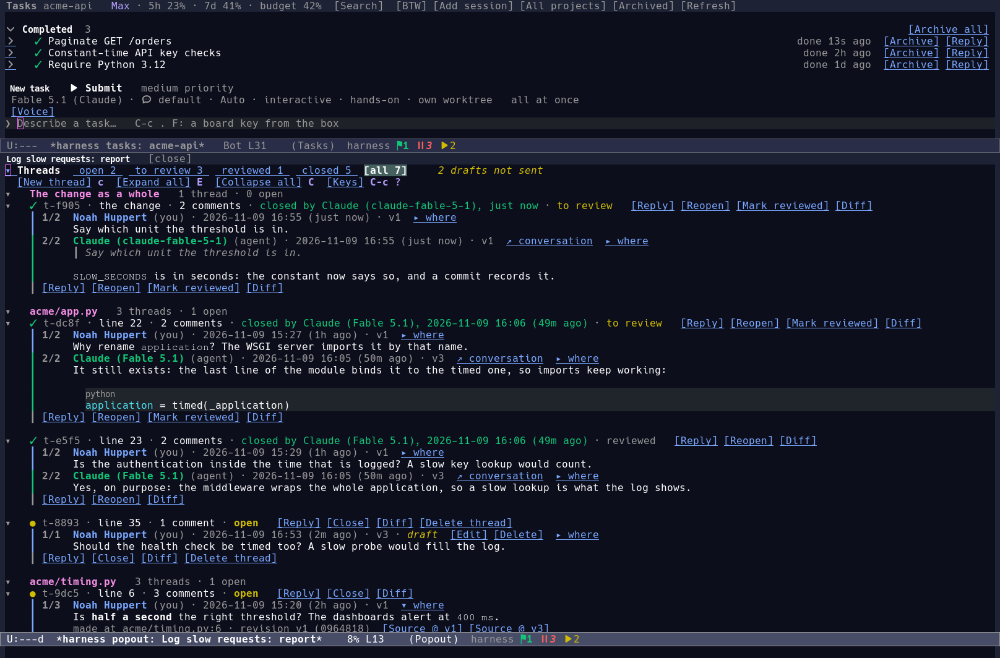
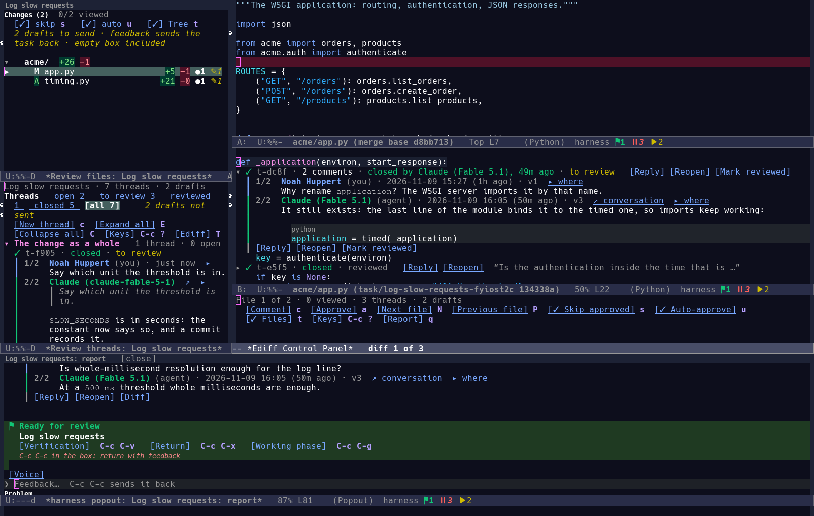
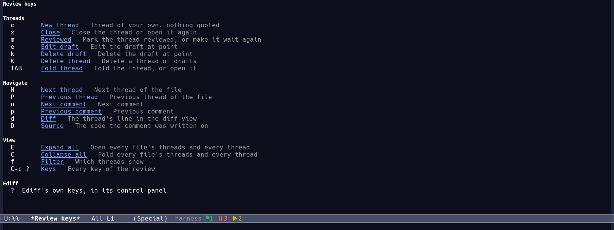

# Review controls: a few on the line, every one in [Keys]

The Ediff control panel had grown its own key legend: one long line of
`RET: … r: … c: …`, cut off at the window's edge, with the thread keys
mixed in among the diff's, while the threads view beside it kept the
vendor library's key legend and none of the review's own keys.  A change
gave the review one model of its controls, and drew every control of it,
in its group, on every surface.  That was too much: the threads heading
of a report became three rows of two dozen keys -- `[New thread] c
[Close] x [Reviewed] m [Edit draft] e [Delete draft] k [Delete thread] K
[Fold thread] TAB`, then the navigation's six, then the view's four --
above six lines of threads, and the pane beside Ediff spent its whole
first screen on them.

Now a surface draws a handful of controls on a line fitted to the
window, and every command of the review, with its key and a click, is in
one buffer: `[Keys]` (`C-c ?`).  This document replaces the earlier one
in this place; the model of the controls -- one table, one set of labels
and tooltips, one drawing -- is unchanged, and what changed is how much
of it a surface shows.

## Decisions

### A control says which surfaces keep it

`harness-ui-patch-review--control-definitions` names every command of the
review once: its group, its label (a string, or a function of the review
for the labels that depend on it), its tooltip, the key it takes on each
surface (`:ediff`, `:threads`, `:pane`), and `:drawn`, the surfaces that
keep it on their line.  A control without `:drawn` is in `[Keys]` alone.

What a surface keeps is what only it can do, never a command a thread's
own line offers:

| Surface | Drawn |
| --- | --- |
| Threads heading, pane | `[New thread]`, `[Expand all]`, `[Collapse all]`, `[Send drafts]` (at work), `[Keys]`; the pane adds `[Ediff]` |
| Ediff panel | `[Comment]`, `[Approve]`, `[Next file]`, `[Previous file]`, `[✓ Skip approved]`, `[✓ Auto-approve]`, `[✓ Files]`, `[Send drafts]` (at work), `[Keys]`, `[Report]` |

A thread's header already has `[Reply]`, `[Close]` or `[Reopen]`,
`[Mark reviewed]` and `[Diff]`, and `[Delete thread]` on a thread of
drafts; a draft has `[Edit]` and `[Delete]`; a thread's triangle and a
file's are the fold.  The heading no longer says any of them again.  The
navigation keys -- `N` and `P` between threads, `n` and `p` between
comments, `d` and `D` for the diff and the source -- are in `[Keys]`,
not drawn: a reader who knows them uses them, and a reader who does not
has one thing to open, not a legend to read every time.

The panel keeps more than the threads heading does, because the panel is
a control panel: its whole body is that line of facts and those controls,
and the settings it shows -- whether approved files are skipped, whether
files gone through are approved -- are switches whose state is nowhere
else while Ediff is on screen.

### One line, fitted, then the lines under it

`--control-lines` joins the drawn controls into one line, two columns in,
each `[Label] key` a button with its tooltip.  A window narrower than the
longest control gets the `:short` labels (`Prev thread`); a control that
still does not fit the room left goes on the next line, under the first,
so that every one is whole and clickable down to 24 columns.  The drawn
controls are few enough that the threads heading is one line at 60
columns and the panel's two at 80.

Width comes from the narrowest window showing the buffer
(`--text-width`, `window-max-chars-per-line`), not from one window that
happens to be selected, so the same buffer shown twice is drawn for the
worse case.  The Ediff panel's height follows its line: `--fit-control`
measures the help's pixels and grows the window to the lines it takes, up
to half the frame, because Ediff sizes the panel once before the review's
own help exists.

### [Keys]: every command, and a click for each

`[Keys]` (`C-c ?`, `?` in the threads view) opens `*Review keys*`, which
lists every control of the surface by group -- **Threads** (Comment, New
thread, Reply, Close, Reviewed, Edit draft, Delete draft, Delete thread,
Fold thread), **Navigate** (Next/Previous thread, Next/Previous comment,
Diff, Source), **Diff** (Approve, Next file, Previous file) and **View**
(Skip approved, Auto-approve, Files, Expand all, Collapse all, Send
drafts, Filter, Keys, Report, Ediff) -- with each one's key and its
tooltip, and Ediff's own keys at the end.

Every row's label is a button, and it runs its command in the buffer the
list was asked from (`--keys-origin`), so a command a surface keeps off
its line still has a mouse target, as the house rules ask of every
keyboard command.  A row whose command acts on the review itself --
`Expand all` and `Collapse all` fold the review's set -- carries that
action instead, so the click does the same thing the key would.

### The facts line stays

Each surface still starts with one dim line of facts, built by
`--info-line` from `(TEXT PRIORITY SHORT)` segments: `File 1 of 6 · 0
viewed · 1 approved · 1 thread · 1 draft` in Ediff, and the title,
version, thread count and draft count at the top of the threads view.  As
the line runs out of room it first uses the short forms (`File 1/6`),
then drops the least important fact; the file the reviewer is on is never
dropped.  A fact is a state, not a key, so it does not compete with the
controls for room.

### Send drafts only where sending works

`[Send drafts]` is filtered by `:when`: `--sendable-p` is true only while
the task is at work.  A review waiting for feedback hides the control --
its drafts go with the feedback that sends the task back, which the
filter row counts (`3 drafts not sent`) -- and the working phase shows it
with the count (`[Send 2 drafts]`), or `[Send drafts]` with none.  The
command itself refuses outside the working phase rather than opening a
dead path.

## Alternatives

- **Keep every control drawn, fitted.**  That is what was there: it was
  complete, and it was the complaint.  Fitting makes it fit; it does not
  make it few.
- **An overflow `…` per surface.**  The house has one for header lines
  and settings lines (`harness-ui-overflow-mark`), and it would have
  taken the leftover controls into a popup.  It would have given the
  reading line a second control beside the buttons that matters less
  than `[Keys]`, which is already the one place every key is -- and a
  popup of buttons a reader has to meet at all is more than a list they
  open once.
- **A transient menu for the review's commands.**  Every suffix would be
  clickable and grouped, and the menu would teach the keys.  But a
  transient is a popup that a click has to open first, and `[Keys]` is a
  buffer that stays open beside the review -- the reader can keep it and
  work from it.  The menu also cannot carry a control's *state*
  (`✓ Skip approved`) as a plain suffix, and a command of the review
  acts on point in the buffer behind the popup, which a transient's
  suffix reaches only through the same indirection `[Keys]` uses.
- **Drop the navigation keys entirely.**  `N`, `P`, `n` and `p` are the
  vendor library's and every reader of its threads view knows them; the
  review's own `M-n` and `M-p` in Ediff are the same two steps.  Hiding
  them from the drawn line is the change; taking the keys away would
  break the readers who use them.
- **A key legend per surface, fitted.**  That is what was there before,
  and then a table that drew all of it.  The table plus `[Keys]` says
  each thing once.

## Copy inventory

Interface text is nouns, noun phrases and adjectives; tooltips are help
and are one line.

| Where | Copy |
| --- | --- |
| Group titles | `Threads`, `Navigate`, `Diff`, `View` |
| Drawn on the threads heading and the pane | `New thread`, `Expand all`, `Collapse all`, `Send drafts` / `Send N drafts`, `Keys`; the pane: `Ediff` |
| Drawn on the panel | `Comment`, `Approve`, `Next file`, `Previous file`, `✓/✗ Skip approved`, `✓/✗ Auto-approve`, `✓/✗ Files`, `Send drafts` / `Send N drafts`, `Keys`, `Report` |
| In `[Keys]` only | `Reply`, `Close`, `Reviewed`, `Edit draft`, `Delete draft`, `Delete thread`, `Fold thread`, `Next thread`, `Previous thread`, `Next comment`, `Previous comment`, `Diff`, `Source`, `Filter`; narrow: `Prev thread`, `Prev comment`, `Prev file` |
| Tooltips | `Comment on the current difference`, `Thread of your own, nothing quoted`, `Reply in the thread at point`, `Close the thread or open it again`, `Mark the thread reviewed, or make it wait again`, `Edit the draft at point`, `Delete the draft at point`, `Delete a thread of drafts`, `Fold the thread, or open it`, `Next thread of the file`, `Previous thread of the file`, `Next comment`, `Previous comment`, `The thread's line in the diff view`, `The code the comment was written on`, `Approve the file; a second press takes it off`, `Next file to review`, `Previous file`, `Leave out the files already approved`, `Approve the files gone through without a comment`, `The files in a column beside Ediff`, `Open every file's threads and every thread`, `Fold every file's threads and every thread`, `Send the drafts to the agent together, while the task is at work`, `Which threads show`, `Every key of the review`, `Back to the report`, `Back to the comparison` |
| Facts line | `File 1 of 6` / `File 1/6`, `N viewed`, `N approved`, `at <commit>`, `N thread(s)`, `N draft(s)`; threads view: title, `vN of M`, `N thread(s)`, `N draft(s)` |
| Keys view | `Review keys`, group titles, `Ediff`, `Ediff's own keys, in its control panel` |
| Empty states | `No open threads`, `No closed threads`, `Nothing to review`, `Nothing reviewed this turn`, `No threads` |
| Errors | `No review here`, `No thread here`, `No draft to send`, `The task waits for review: its drafts go with the feedback that sends it back` |

The Ediff panel gives a control that acts on the difference a tooltip of
its own: `Reply in the thread at the difference`, `Close the thread at
the difference or open it again`, `Mark the thread at the difference
reviewed, or make it wait again`, `Edit the draft at the difference, or
the feedback box`, `Delete the draft at the difference`, `Delete a
thread of drafts at the difference`, `Fold the threads at the
difference, or open them`.

## Shape of the change

- `lisp/ui/harness-ui-patch-review.el`: `:drawn` in the control table,
  the DRAWN filter of `--control-specs`, `--control-lines` fitting the
  drawn controls into one line, `--keys-origin`, `--keys-run` and
  `--keys-row` for the clickable keys list, and the panel help and
  threads heading that draw from them.
- `lisp/ui/harness-ui-patch-review-test.el`: the exact rendered copy of
  the threads heading, the pane's and the panel's lines at 80 columns;
  the same whole and inside the width at 60, 46, 40, 32 and 24; the
  drawn controls of each surface, and that a command a thread's own line
  offers is not drawn again; the keys list's rows, their keys, tooltips
  and buttons, and a click running the command where the list was asked
  from.
- `docs/architecture.md`, `docs/dev-loop.md`, `docs/screenshots.md`: the
  surfaces and the picture descriptions.
- `scripts/harness-media.el`: the `review-ediff` picture starts the pane
  at the facts and the line of controls, with the threads below.

## What it looks like

The threads heading is one line of four controls under the filters; the
panel beside Ediff shows the facts and its own controls, on one line or
two, and never the legend of the keys a thread's header has:

What `[Keys]` opens, every command of the review with its key and what it
does, each row a click:

## Verification

- `scripts/test.sh lisp/ui/harness-ui-patch-review-test.el` -- 167
  tests, including the copy and narrow-width regressions.
- `scripts/lint.sh`.
- `scripts/media.sh review review-threads review-collapsed review-banner
  review-ediff review-to-review review-diff review-thread-lines
  review-keys thread-reply-review` for every picture that shows a
  surface of the review; inspect them for the few controls on one line,
  the panel's own, and no key legend above the threads.
