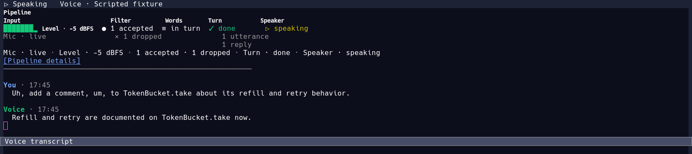
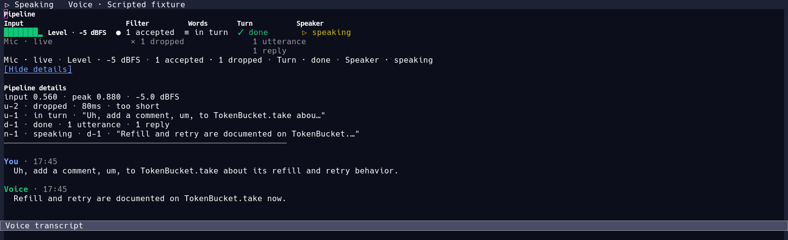
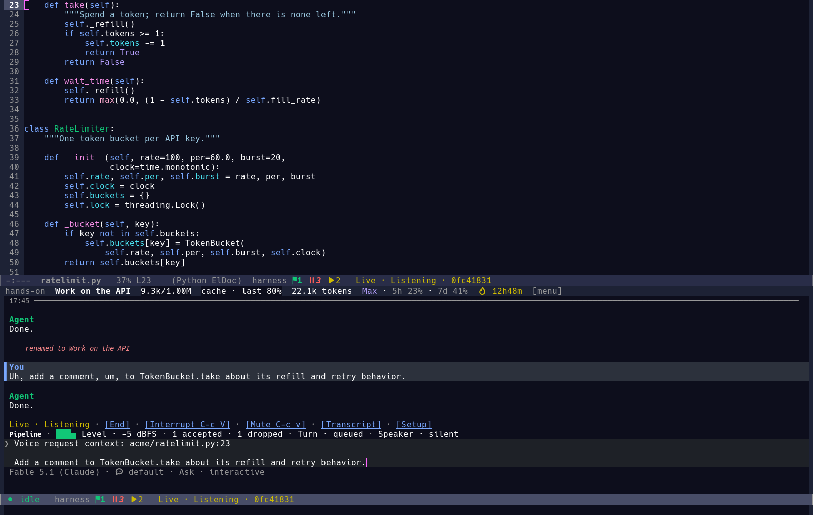

# The voice pipeline the client draws

A voice screen answers one question at a glance: *is my voice getting through,
and where is it now?*  This document is about the strip that answers it, in the
Flutter client's voice screen (`harness_client/lib/src/ui/widgets/voice_pipeline.dart`),
in the compact form a desktop buddy can show, and in the Emacs voice surface
(`lisp/ui/harness-ui-voice-pipeline.el`).  Both surfaces say the same things
in the same words, from their own real events.

The rule the whole thing follows: **nothing on the strip moves on a clock**.
A marker appears when the capture path kept a burst, moves when the stage it
waits on reports, and stops where it really stopped.  When a stage is silent
the screen says which stage it is waiting on, in words.

## The screen

Left to right, as the person asked for it:

```text
Pipeline
Input              Filter                 Words                    Turn                 Speaker
▂▄▆█ level         × dropped · too short  ⋯ transcribing · 2.0s    ✓ answered · 3.0s    🔊 speaking
Mic · live         ● accepted · 1.4s      ≡ transcribed · 1.0s
Level · 56%        ◌ heard
Mic · live · Level · 56% · Speech · heard · 4 accepted · 1 dropped · Turn · done · Voice · speaking
```

- **Input** — the microphone's level *before* the speech filter, drawn as bars
  and a percentage, beside the capture state (`Mic · live`, `Mic · muted`, …).
  No level is not silence: without telemetry the meter says `Level · no data`
  and the bars stay unlit.
- **Filter** — the speech gate (`heard` while it hears speech) and the bursts
  it did **not** keep, with the reason (`too short`, `no words`, `failed`).
  A burst that survives enters here and moves right.
- **Words** — speech to text: `transcribing`, `transcribed`, with a partial
  transcript replacing the text of the same marker.
- **Turn** — the agent turn the words were sent in: `in turn`, then `answered`.
- **Speaker** — the output: `silent`, `ready`, `held`, `handed`, `speaking`,
  `interrupted`, `failed`.  `handed` means the provider was given the text;
  `speaking` means its player is playing.  The two are never merged.

The summary line under the columns carries every fact in text, and the details
toggle (`Pipeline details`, Enter or Space on the focused strip) lists each
marker by its id and stage.  A screen reader gets the summary, then each stage
and each marker.

## Where each stage's data comes from

| Stage | Event | Emitted at | Carries |
| --- | --- | --- | --- |
| level | `VoiceLevelEvent` | `ClipVoiceBackend._onBytes` from `VoiceActivityDetector.level` (smoothed RMS of every 20 ms PCM frame, before the filter) | 0..1 |
| capture state | controller phase, mute, pause, stop, `VoiceEndedEvent`, a non-recoverable `VoiceFailureEvent` | `VoiceController` | `off`, `connecting`, `live`, `muted`, `paused`, `failed`, `disconnected`, `ended` |
| gate | `VoiceSpeechEvent` | clip: `VoiceActivityDetector.gateActive` (60 ms onset, 320 ms end, echo threshold while the reply plays); live: the provider's `speech` / `input_audio_buffer.speech_started` | on/off |
| accepted | `VoiceSegmentEvent(accepted)` | clip: `ClipVoiceBackend._accept`, after the detector kept the burst (`≥ minUtterance`, 240 ms by default); live: the provider's own VAD onset | id, duration, peak level |
| rejected | `VoiceSegmentEvent(dropped)` | clip: `VoiceActivityDetector.onDrop` for a burst under `minUtterance`; empty transcript from the transcriber (`noWords`); live: an empty final transcription (`noWords`) | id, duration, reason |
| failed | `VoiceSegmentEvent(failed)` | clip: the transcriber threw; live: `…input_audio_transcription.failed` | id, the failure's own words |
| transcribing | `VoiceSegmentEvent(transcribing)` | clip: `_drain` before `transcriber.transcribe`; live: a user caption delta | id, text |
| transcribed | `VoiceSegmentEvent(transcribed)` | clip: a non-empty transcript; live: a final user caption or a delegation | id, text |
| in turn | `VoicePipelineTracker.turnSent` | `VoiceController._sendPrompt`, when the prompt is handed to the session | `t-N`, segment id |
| answered | `VoicePipelineTracker.replyReady` on that turn | `VoiceController._onAgentReply` | `n-N`, turn id |
| turn done | `turnDone` | when `bridge.send` resolves (the harness answers a prompt when its turn ends) | `t-N` |
| reply held | `VoiceHeldEvent`, or the controller's `holdingOutput` | backend refuse to speak during speech/pause; controller gate (`speechActive`, `paused`, hearing, transcribing) | reply id |
| reply handed | `VoiceReplyHandedEvent`, `replyHanded` | `speak(text, replyId:)` was given the text | reply id |
| speaking | `VoicePlaybackEvent(playing: true)` | clip: right before `speech.speak()` (the engine awaits completion); live: the provider's `speaking` phase or `response.audio.delta` | reply id, backend generation |
| spoken | `VoicePlaybackEvent(playing: false)` | clip: `speech.speak` resolved; live: `listening` / `response.done` | reply id, generation |
| interrupted | `VoiceController.interrupt` → `tracker.interrupted` | the player stopped; the work goes on | — |
| muted, paused, ended | the controller's own state | — | — |

The one addition to the audio path is the detector's `onDrop` callback: the
moment `VoiceActivityDetector._finish` discards a burst, it reports the
duration and level it measured.  Before it, the strip would have had to guess
from a timer, which is exactly what it must not do.

## How the pieces are kept together

- **Stable ids.** A segment's id comes from the backend that made the decision:
  `u-N` in acceptance order (clip), the provider's `item_id` or `live-N`
  (live); a rejected burst gets `r-N`.  The same id is on the caption
  (`VoiceCaptionEvent.segmentId`) and on the prompt (`VoicePrompt.segmentId`),
  which is not the provider's call id that dedupes sends.
- **Turns and replies.** `t-N` is the controller's turn for one prompt.  A
  reply belongs to the oldest turn the session has not finished — the order
  the harness answers prompts in — and a turn shows all the replies it
  produced (`2 replies`), while several utterances can be sent in one turn
  (`2 utterances`).  Nothing claims a one-to-one mapping that the events do
  not show.
- **Late, duplicate and out-of-order events.** A stage only moves forward; a
  terminal stage (`dropped`, `failed`, `answered`) is never moved again; a
  duplicate is counted and ignored; a `transcribing` that arrives before its
  `accepted` shows the marker where it really is instead of inventing the
  missing step; a partial after a final corrects nothing.
- **Generations.** A new call, a restart or a provider change bumps the
  tracker's generation and clears it.  The controller also bumps a backend
  epoch and ignores events from a backend it replaced, so a stale backend
  cannot resurrect audio or advance another call's segment.  Playback events
  carry the backend's generation, so an old player's stop cannot end a newer
  playback.
- **Stopping.** Stop, mute, pause, interrupt and a failure drop what will not
  be spoken or sent, with the reason (`cancelled`, `muted`, `paused`,
  `interrupted`, `ended`, `context` for a reply folded into the next prompt),
  and the strip says so rather than leaving a marker waiting forever.

## What the strip will not say

- **A level that is not there.** The live provider's WebRTC stream has no
  level telemetry, and a muted or paused microphone has none either: the meter
  says `Level · no data`, never 0%.
- **A filter decision the client did not see.** The live provider's acceptance
  is its own VAD; the client sees speech start/stop and the transcript, not a
  server-side filter.  A live burst whose transcript never arrives stays
  `transcribing` (waiting); the client does not invent a drop.  The bounded
  strip keeps the last six markers, and the totals keep the counts.
- **Speech that is not playing.** A reply the provider was handed but never
  reported playing stays `handed`.  Text generation finishing is not speaking.
- **A second audio stack.** No capture, no level meter and no model call is
  added: the strip reads the events the clip and live backends already produce,
  plus the one detector callback above.
- **A level from the client's live provider.** The provider's WebRTC stream
  carries no input PCM the client can measure; that is why the Emacs side,
  where the sidecar owns the microphone, is the surface that draws the meter
  for the live path.

## The buddy contract

A desktop buddy shows the same pipe without a second implementation:

```dart
VoicePipelineView(
  snapshot: controller.pipelineState, // VoicePipelineSnapshot
  compact: true,                      // one row and one summary line
  heading: false,                     // the buddy names its own panel
)
```

- The snapshot is produced by `VoicePipelineTracker`, which the voice
  controller owns (`VoiceController.pipeline`, `VoiceController.pipelineState`).
  A buddy that drives its own controller feeds the same tracker from the same
  backend events; it must not advance stages itself.
- `compact: true` is one row of bars, markers and the speaker icon plus
  `shortSummary`; the same facts as the wide strip, and no less: the summary
  always carries the capture state, the counts, the turn and the speaker.
- The strings in `VoicePipelineSnapshot.summary`, `shortSummary` and `details`
  are the ones the widget draws; a buddy that needs different wording reads
  the fields and words them itself, it does not change the stages' names.
- The widget brings its own `Material`, so a plain panel hosts it.  It keeps
  one `Timer` (the moment the last level becomes stale) and no ticker; a host
  must dispose it with the tree as usual.
- Reduced motion (`MediaQuery.disableAnimations`) removes the movement between
  stages; every fact stays, and the tests check that the summary is identical.

## The words

Every label is a noun phrase or an adjective, and the tests assert them
exactly (`test/voice_pipeline_widget_test.dart`, `test/voice_pipeline_test.dart`):

| Where | The words |
| --- | --- |
| heading | `Pipeline` |
| stage headers (tooltips) | `Input` (*Microphone level before the speech filter*), `Filter` (*Speech kept for transcription*), `Words` (*Speech to text*), `Turn` (*Agent work*), `Speaker` (*Playback*) |
| capture | `Mic · live`, `Mic · muted`, `Mic · paused`, `Mic · off`, `Mic · connecting`, `Mic · failed`, `Mic · disconnected`, `Mic · ended` |
| level | `Level · 56%`, `Level · no data` |
| gate | `heard` (*Speech gate · speech heard*), and `Speech · heard` in the summary |
| counts | `1 accepted`, `4 accepted`, `1 dropped` |
| marker stages | `accepted`, `transcribing`, `transcribed`, `in turn`, `answered`, `dropped`, `failed` |
| drop reasons | `too short`, `no words`, `cancelled`, `failed` |
| why a burst stopped, in the details | `muted`, `paused`, `interrupted`, `ended`, `restart`, `context` (a reply folded into the next prompt) |
| turn | `Turn · working`, `Turn · replied`, `Turn · done`, `Turn · failed` |
| speaker | `Voice · silent`, `Voice · ready`, `Voice · held`, `Voice · handed`, `Voice · speaking`, `Voice · interrupted`, `Voice · failed` |
| details | `Pipeline details`, `No segments yet`, `1 utterance`, `2 replies` |
| backend problem | the backend's own label, e.g. `Microphone permission denied` (data, not new copy) |

The tooltips, the summary and the details list are all asserted; the
`test/voice_pipeline_widget_test.dart` copy test is the regression check, and
the screenshot test draws every state for a person to look at.

## In Emacs

Emacs runs the live voice through a sidecar that owns the microphone
(`ui-voice-live`), so the pipeline is drawn from the sidecar's own events
rather than from a provider's captions.  It appears in two places:

- **The transcript** (`*harness voice*`, **Transcript**): the wide strip
  above the transcript, the summary line and `[Pipeline details]`; `d` does
  the same from the keyboard.
- **A live chat** (quick voice chat, or any compose box with live voice
  active): one compact line under the voice controls, fitted to the window.
  The speaker and the turn are kept longest; the meter and the counts leave
  first, ending in the `…` that shows what was cut.





```text
Pipeline
Input                     Filter            Words          Turn         Speaker
████▃··· Level · 56%      ● 1 accepted      ≡ in turn      ✓ done       ▷ speaking
Mic · live                × 1 dropped                      1 utterance
                                                           1 reply
Mic · live · Level · 56% · 1 accepted · 1 dropped · Turn · done · Speaker · speaking
[Pipeline details]
```

Every stage carries the event it comes from:

| Stage | Event | Emitted at | Carries |
| --- | --- | --- | --- |
| level | `level` | the sidecar's capture loop, on the PCM it just read, before the detector (`LevelMeter`, at most ten a second) | `input`, 0..1 |
| capture | the session's own state | start, `ready`, mute, `error`, an unexpected exit, stop | connecting, live, muted, failed, disconnected, ended |
| gate | `speech` | the detector's onset and hangover | `active`, `utterance` |
| accepted | `segment` `state=accepted` | `Vad._finish` (the local sidecar) or the GPT sidecar's gate, the moment the burst is kept | `id` (`u-N`), `seconds` |
| dropped | `segment` `state=dropped` | the detector's `cancel` (`too short`), or an empty transcription (`no words`) | `id`, `seconds`, `reason` |
| failed | `segment` `state=failed` | a failed transcription | `id` |
| transcribing | `transcribing`, `user_delta` | the transcription worker, or a provider's caption | `utterance`, text |
| transcribed | `user_delta` `final` | the transcript is whole | text |
| in turn, answered | the UI's own delegation and turn events | `harness-voice-live--delegate-next`, `agent/turn-ended` | turn id |
| ready, held, handed | the UI's own speakable text | when answer text arrives, is held for turn-taking, or is sent as `commentary` | reply id (the node) |
| speaking, spoken, interrupted | `speaking`, `listening`, `interrupted` | the sidecar's player | — |

The words are the client's, with one difference: the speaker says
`Speaker · speaking`, not `Voice · speaking`, because the transcript's header
line already names the provider (`Voice · Local pipeline`).

**The contract for other Emacs surfaces.** `harness-voice-pipeline` is a
plain state model and `harness-voice-pipeline-short-summary` and
`harness-voice-pipeline-compact-line` draw from it without a second tracker,
so the mode line or the desktop buddy can host the same facts; a host that
feeds its own events feeds the same model, and must not advance it itself.

**Accessibility.** Every fact is text: the strip, the summary and the details
are plain buffer text, so a screen reader reads them and they can be copied.
The glyphs (`▷`, `●`, `×`, `✓`) are marks; the word beside each says the same
thing, and colour is never the only cue.  Nothing on the strip runs on a clock:
it redraws when an event arrives, and a stage that has not reported says it is
waiting.  The meter moves with the sound because that is the measurement
itself; it stops when the level does, and a stale level says `no data`.  The
stage line's spinner is decoration, and `harness-voice-live-motion` nil stops
it while the stage's word and elapsed time stay.

**What Emacs does not say.**

- A level from a sidecar that sends none: `Level · no data`, never 0%.
- A drop the sidecar did not report: a burst whose transcript never arrives
  stays `transcribing` where it is.
- Speech that is not playing: a reply handed to a sidecar that never reports
  playback stays `handed`.
- That the pictures are live: the three above are **fixtures**.  The events
  are the protocol's own, fed through the real handlers, but no microphone was
  opened and no speech service was called.  A real session is
  `M-x harness-voice` with a `live` provider.

## What was considered and not done

- **A decorative animation through the stages.** It would look alive while
  nothing happened, and it would claim steps that did not occur.  The strip
  moves only on events; waiting is shown as waiting.
- **Guessing acceptance in the UI** from the level or a timer.  That is a
  second, wrong filter.  The real decision is the detector's `_finish`, so the
  detector reports it.
- **One marker per PCM chunk.** Chunks are not utterances: the filter joins
  them into one burst, and the marker is the burst.
- **A level meter for the live path** from the provider's audio.  The client
  has no access to the input PCM there; an invented meter would be a lie.  The
  Emacs side draws it because its sidecar does own the microphone, and it
  measures the level where it reads the PCM, not in the UI.
- **A second capture path or a second audio stack in Emacs.**  The strip adds
  no capture: the sidecar reports what it measured, and the UI draws it.
- **Reporting `speaking` when the live backend hands text to the provider.**
  The old code did; the strip (and the screen's status) now wait for the
  provider's own playback, so text generation is not labelled as speech.

## What changed

| File | What it does |
| --- | --- |
| `lib/src/voice/voice_pipeline.dart` | the state model and the tracker: input, segments, turns, replies, generations, dedupe, summaries, details |
| `lib/src/voice/voice_backend.dart` | `VoiceSegmentEvent`, `VoicePlaybackEvent`, `VoiceReplyHandedEvent`, caption and speech ids, `speak(text, replyId:)` |
| `lib/src/voice/voice_audio.dart` | `VoiceUtteranceRejection` and the detector's `onDrop` |
| `lib/src/voice/clip_voice_backend.dart` | ids at acceptance, segment events at the real decisions, playback events around the engine |
| `lib/src/voice/live_voice_backend.dart`, `live_protocol.dart` | provider ids, segment events, playback from the provider's events, `handed` instead of `speaking` |
| `lib/src/voice/voice_controller.dart` | owns the tracker, guards the backend epoch, feeds turns, replies and drops from its own decisions |
| `lib/src/ui/widgets/voice_pipeline.dart` | the wide and compact presentations, reduced motion, details, semantics |
| `lib/src/ui/screens/voice_screen.dart` | shows the strip between the status and the transcript |
| `test/voice_pipeline_test.dart`, `test/voice_pipeline_widget_test.dart`, `test/voice_pipeline_screenshots_test.dart` | the state machine, the words, the pictures |
| `test/voice_live_backend_test.dart` | the live path now asserts handed-then-playing |
| `lisp/ui/harness-ui-voice-pipeline.el` | the Emacs model and drawing: capture, level, segments, turns, replies, generations, summary, wide and compact strips |
| `lisp/ui/harness-ui-voice-live.el` | feeds the model from the sidecar protocol and draws it in the transcript and under the controls; `harness-voice-live-motion` |
| `scripts/harness_voice_sidecar.py` | `LevelMeter`, `announce_level`, `announce_segment`, and the measured `cancel` event |
| `scripts/harness-voice-live-gpt`, `scripts/harness-voice-live-unmute` | the level before the gate and the kept/dropped/failed bursts at the real decisions |
| `scripts/harness-voice-live-fixture` | the scripted demo's levels, kept and dropped bursts |
| `lisp/ui/harness-ui-voice-pipeline-test.el`, `lisp/ui/harness-ui-voice-live-test.el`, `test/harness-voice-gate-test.py` | the Emacs model, the protocol wiring and the sidecar's telemetry |

## Verification

```sh
cd harness_client
eval "$(bash tool/client_toolchain.sh | grep '^export')"   # the pinned Flutter
flutter analyze                                            # no issues
flutter test test/voice_pipeline_test.dart test/voice_pipeline_widget_test.dart
HARNESS_SHOTS=… flutter test test/voice_pipeline_screenshots_test.dart

# the Emacs surface and the sidecar it reads
scripts/test.sh lisp/ui/harness-ui-voice-pipeline-test.el lisp/ui/harness-ui-voice-live-test.el
python3 test/harness-voice-gate-test.py
scripts/lint.sh
```

The Emacs pictures are taken by `scripts/media.sh voice-pipeline
voice-pipeline-details voice-pipeline-compose` (see `docs/screenshots.md`).
They are fixtures too: the events are the sidecar protocol's own, fed through
the real handlers, but no microphone was opened and no speech service was
called.  A real session (a `live` provider, `M-x harness-voice`) reports its
own levels and bursts through the same events; what is *not* verified here is
that a physical microphone's levels and the model's playback timings look
right on a device.

The pictures under `harness_client/screenshots/` (`voice-pipeline-flow.png`,
`voice-pipeline-held.png`, `voice-pipeline-compact.png`,
`voice-pipeline-large-text.png`, `voice-pipeline-reduced-motion.png`,
`voice-pipeline-screen.png`) are drawn from **fixtures**: snapshots built from
scripted events, not from a microphone or a speech service.  The app's live
path is exercised by the backend tests with a scripted WebRTC connection and a
scripted microphone; no microphone was opened and no speech service was called
in this task.  What is *not* verified: real levels, real playback timings, and
the live provider's actual VAD behaviour on a device.  Those are the platform's
to show, and the strip reports them rather than simulating them.
