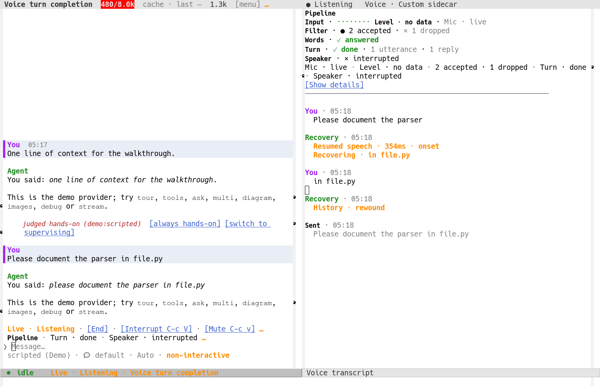

# Voice turn-taking: holding output while a person speaks

Voice mode must not talk over the person using it.  A dictation of a
paragraph has natural pauses; a transcription of the whole utterance is
too late to stop a reply that started when the first word reached the
service.  This page describes the low-latency speech signal, the output
gate on both transports, the pending-update context and the live
conversation controls, and it states the latency budget rather than
claiming a microphone measurement this repository does not make.

## The problem the gate solves

Three things used to arrive in the wrong order:

1. The provider's turn detector sent a full transcript after a silence.
2. The agent answered and the sidecar started speaking at once.
3. The person, still dictating, was interrupted by an answer to the
   sentence before last, or by a background update that had been queued
   while the agent worked.

Text silence is not speech end.  The design separates four events:

| Event | Signal | What it does |
| --- | --- | --- |
| Speech onset | local detector, a few frames after the first voiced sound | closes the output gate immediately |
| Speech end | local detector's hangover | opens the microphone for the next utterance; does **not** mean a transcript exists |
| Transcript ready | speech-to-text result, possibly late or out of order | supplies words with any held output as context |
| Release | a client decision after the transcript, an error, or a false-trigger grace | speaks only what is still current |

## Where the signal comes from

The signal is local and independent of speech-to-text.  It runs on the
audio capture path, before the PCM is uploaded or queued for a model.

- **Local pipeline** (`scripts/harness-voice-live-unmute`): the shared
  `SpeechDetector` in `scripts/harness_voice_sidecar.py` reads 10 ms PCM16
  frames.  A frame counts as likely speech when its energy is above the
  gate's threshold, its zero-crossing rate is voice-like, and its
  first difference shows change above a steady hum.  The threshold is a
  floor (`threshold`, 0.004 by default) raised to 2.5 times the learned
  noise floor: the floor is far below a normal mouth's level, so a
  microphone with its gain low still opens the gate, and the room's own
  noise is what actually decides in a loud one.  Three such frames
  (`onset_hold = 30 ms`) open the gate.  The detector raises its threshold
  above the local player's own level while the assistant speaks and asks
  for a longer echo hold, so a narrow-band speaker echo does not gate the
  assistant against itself.  Its noise floor is learned only from frames
  that do not look voiced: a quiet or missed word is a speech candidate
  even below the threshold, so it cannot teach the detector to miss the
  next one.  The floor follows a quieter frame down faster than a louder
  one up and counts digital silence as a measurement, so an utterance
  leaves the configured threshold behind rather than a raised one; it is
  frozen while the gate is open or the player is audible.  The capture
  loop reads up to 0.2 s per tick so a late tick cannot make the sound
  server drop audio, and the player writes replies on its own thread, so
  a long reply does not stop the detector: the gate sees the first word
  of a person speaking over the assistant, not the end of the reply.
- **GPT-Live adapter** (`scripts/harness-voice-live-gpt`): the same local
  detector runs on the microphone before audio is sent to the server.  The
  server's own VAD still decides its turns, but the local gate is what
  silences the player and tells the server to stop talking; it does not
  wait for the server's transcript.
- **Flutter clip provider** (`voice_audio.dart`): the same idea in Dart.
  20 ms frames, a 60 ms `gateHold` to open the gate, and a 220 ms
  `echoHold` at a 0.055 RMS threshold while playback is active.  The
  detector also cuts utterances at an 850 ms silence; that is the
  dictation tradeoff, not the gate latency.
- **Flutter live provider**: the WebRTC/Realtime provider emits its own
  speech-start event and additionally requests
  `input_audio_buffer.speech_started`; the gate disables remote audio on
  speech onset and re-enables it only after speech stops and a short
  echo guard.  The client does not wait for transcription.

Audio never leaves the local path to reach the gate.  The detector reads
the capture buffer in the sidecar or on the device; only a completed
utterance (or the provider's own stream, where the provider is the
transport) leaves.  No new permission is involved, and the existing
microphone ownership rules still apply.

## Gating output

The gate is a state, not a queue of sentences that starts playing after a
pause.

- Speech onset stops the player immediately (`Player.stop()` in a sidecar,
  `speech.stop()` or remote-audio disable on the client) and holds every
  assistant piece that arrives while speech owns the floor.
- The held list is bounded (40 pieces, 4000 characters each).  It is not a
  replay buffer: a real utterance consumes it as **pending context** and
  it is never spoken after the transcript.
- A speech event that produced no words (a tap, a cough, a door) releases
  the held text after a grace: 1.0 s in the local sidecar, 1.5 s in Emacs
  and the Flutter controller.  The grace is cancelled by a real
  utterance, by mute, by interrupt and by a reconnect.
- Mute, pause, interrupt, end and reconnect clear the held list.  A reply
  that arrives while the conversation is paused is shown in the caption
  and is not queued for a stale replay when the conversation resumes.
- Playback that is already in progress is stopped by speech onset.  A
  provider that can only drop future audio sets its remote-audio track
  off; it does not rely on the transcript to do it.

The Emacs stage line reads `Live · Holding reply` while output is held;
its control line stays the same and the held text is not sent to the
sidecar.

## Transcript, request and pending context

Voice keeps two records, not one.  The **voice conversation** is what was
said and heard on the audio side: the transcript as the speech model
returned it, and every line the voice actually spoke.  The **session
message** is what crosses into the chat: the transcript, unchanged.  The
session's own agent reads it in the conversation it is already in, so a
pronoun needs no block around it and a hesitation needs no rule to strip
it.  [The voice conversation and the request it
sends](design/voice-conversation.md) has the reasoning and the rejected
alternatives.

Nothing is added to the message and nothing is taken out of it: no
distillation, no context envelope, no interpretation model.  Sending it
is local and synchronous -- no process, no timer, no model -- so the
prompt leaves in the same event that carried the transcript.  A burst the
speech model made no words of sends nothing and shows `Not sent · no
words`.

When the transcript arrives, the sidecar sends one `delegation` carrying:

```json
{
  "event": "delegation",
  "id": "u-7",
  "text": "Um, wait, check the flaky test, no wait, check the the parser test too",
  "utterance": 7,
  "speech_active": false,
  "pending": [
    {"id": "n-42", "text": "The merge queue has two tasks waiting."}
  ]
}
```

`pending` is the assistant output that was held, in order, with the id
Emacs gave it or the sidecar's own stable id.  The client merges its own
held pieces with the sidecar's by id and by text, so a piece the transport
and the sidecar both held is reported once.  The session prompt is the
transcript as heard, and then the explicit held-output block when the
sidecar held output while the person spoke:

```text
check the parser test too

<voice-turn-context>
assistant_output: held (not spoken)
held_output:
- The merge queue has two tasks waiting.
decision: answer the new speech; fold the held output in only if it is
still relevant; do not assume it was heard.
</voice-turn-context>
```

The transcript is the first thing in the message.  No file/line or
related-session block is added to a delegation: the session voice mode is
used in is the context.  The agent decides whether to answer the new
speech, fold in the update, or defer it.  The held block is context, not a
command to repeat the old reply.  The user's own caption and the local
echo show the words as they were heard; the voice transcript shows the
same text under `Sent · ...`, so the caption and what crossed cannot
disagree.  The conversation's user message is that text and the held
block, because that is what the model sees.

### Ordering and duplicates

- Each utterance gets a monotonic id (`u-N` in the local sidecar, the
  provider's call id in the live path).  A repeated prompt event with the
  same id is ignored after the first.
- The local sidecar buffers finished transcripts by utterance id and
  delivers them in order.  A late result for utterance 4 waits for 3; a
  result for an utterance dropped by mute is discarded rather than
  delivered after the mute.
- The sidecar sends `speech` (`active: true/false`) before
  `transcribing`; a `start` is the onset, not an utterance.  The end
  event and the transcript are separate, so a speech-end may be followed
  by a long transcription or by no words at all.
- Speech that resumes before a grace release expires cancels the release.
  The old output stays held and is offered to the next transcript as
  context; it is not spoken between the two utterances.
- Cancellation, mute, interrupt, stop and reconnect clear the gate,
  timers, worker queues and held list, so a reconnect starts listening
  rather than stuck in `speech_active` or `awaiting`.

## Taking back a turn the endpoint cut short

Everything above assumes the transcript that arrived is the thought.  It is
not always: a speech endpoint calls a pause an utterance end, and the person
goes on half a second later.  The gate cannot help -- the turn was already
submitted and may be answering -- so the turn is taken back instead.  The
design and its alternatives are in
[the recovery design](design/voice-turn-recovery.md); this section is what a
client and an operator need to know.

- **Armed at submission.**  Every voice message submitted by the live
  transport arms a recovery for `harness-voice-live-recovery-window` seconds
  (0.6 by default; nil turns it off).
- **Measured at the speech, not at the words.**  The window runs from the
  submission to the moment the *resumed speech began*, as the sidecar's own
  gate reports it (`speech` with `active: true`).  Speech to text takes as long
  as it takes, and a continuation spoken inside the window is still recovered
  when its transcript arrives late.  A provider with no speech gate leaves the
  transcript's arrival as the only evidence; the window then applies to that,
  and the transcript says which measure was used -- `onset` or `transcript`.
- **Triggered by words.**  The first accepted nonempty words of the resumed
  speech cancel the turn, in the same event that carried them.  An empty
  transcription, a caption of punctuation or noise, a reading the provider
  marks `unsure`, and the submitted message's own capture never trigger it.
- **What happens.**  Playback stops, output is held, `session/cancel` goes out,
  and once the turn acknowledges the cancellation the history is read and
  rewound to the node before the voice message -- through `session/set-head`,
  the same mechanism the session tree's checkout uses, so a hosted provider's
  conversation is cut to match before the next turn.
- **What is never rewound.**  A turn that ran a tool: a rewind cannot undo a
  file written or a command run, so its history stays and only the
  continuation is added.  A message typed after the voice turn is never
  rewound away either.  The transcript's `Recovery` section says which case
  happened.
- **One submission, at the end.**  The original words and every continuation
  join the ordinary pending turn, and the turn-completion grace above submits
  the whole thought once, when the person stops.  Successive premature
  endpoints add their words without a repeat, and a revised transcript of one
  capture replaces its earlier words in place.
- **Lifecycles.**  A session switch, mute, stop, reconnect, redaction or reload
  abandons the recovery; nothing of another thread is rewound and nothing is
  submitted to one.  A turn that does not acknowledge the cancellation within
  `harness-voice-live-recovery-cancel-timeout` (5 s) is not rewound -- it may
  still be writing -- and the continuation is submitted on its own.

The status line reads `Recovering thought` while this happens, and the
transcript's `Recovery` section keeps the evidence: how the window was
measured and how long it was, the first words heard, and what the history
allowed.



## Live conversation controls

The Flutter voice screen distinguishes four actions, because they mean
four different things:

| Control | Label | Effect | Session |
| --- | --- | --- | --- |
| Microphone | `Mute` / `Unmute` | capture closed or open; indicator `Muted` | unchanged, turn continues |
| Conversation | `Pause` / `Resume` | capture and provider audio stopped; no held replay on resume; indicator `Paused` | unchanged, turn continues |
| Playback | `Interrupt` | current spoken reply stopped; work continues; indicator `Interrupted` | unchanged |
| Call | `End` / `Restart` | `stop` closes the microphone, provider connection and held output; `Restart` starts a new call with the same settings | old call ended; new call on restart |

All four are in-app controls and work without a headset.  They are laid
out in a `Wrap`, so a narrow phone folds them onto a second row rather
than clipping them; the desktop width keeps one row.  Each has a
`Semantics` label, `enabled` and `toggled` state where it applies, a
tooltip that names what it controls, and a shortcut hint.  Keyboard:
`M` mute, `P` pause/resume, `E` or `Escape` end, and the media
play/pause keys map to pause/resume.  Focus is taken when the screen
opens, so the keyboard path works before the person clicks anything.

The states are exclusive: `Paused` is not `Muted` (a paused call has no
microphone and no playback, a muted call keeps listening to the
conversation's turns but does not capture), and neither is `Ended`
(`Restart` is offered instead of `End`).

### A second, compact view

The workspace desktop buddy
([design](design/workspace-voice-buddy.md)) is a second view of the same
`VoiceController`, not a second implementation of this gate.  It reuses the
four controls above, the held-output state and the stop lifecycle: its
`Start` is a guarded new call, its `Ending` is the controller's stop in
progress, and its `End` stops the backend before the card goes away.  The
gate's states are drawn as `Holding reply` and `Reply held`, `Speaking` and
`Hearing you`; a muted or paused microphone is `Mic muted` or `Mic paused`,
never recording, and there is no transfer or transcoding stage to draw.

### Headset and media buttons

This is a best-effort platform seam, not a promise.  A headset button
is a system media key first and an app control second:

| Platform | What can receive the button | In this tree |
| --- | --- | --- |
| Android | an active `MediaSession` with playback state and a media-button callback; Bluetooth routes play/pause there, not to the activity | implemented in `MainActivity.kt` through the `app.harness/voice_media_buttons` channel; active only while the voice screen is open |
| iOS / iPadOS | `MPRemoteCommandCenter` play/pause commands, while the app owns an active audio session and is the Now Playing app | no native bridge in this build; the in-app controls remain the fallback |
| Linux desktop | the desktop environment's media-key route, usually to a media player or an MPRIS owner; Flutter receives a key only when the compositor sends it to the window | the `mediaPlayPause` / `mediaPlay` / `mediaPause` shortcuts work when the key reaches Flutter; no MPRIS registration |
| macOS | media keys normally go to the Now Playing app, not to an arbitrary window | Flutter keyboard events when the system delivers them; no `MPNowPlayingInfoCenter` integration |
| Windows | media keys go to the active media session; an app without one may receive a normal key event | Flutter keyboard events when delivered; no media-session integration |

Conflicts and limits:

- An active Android media session takes play/pause from a music player
  while the voice screen is open; the session is released on `stop`, so
  the button returns to the music player afterwards.  Some headsets send
  a call button instead, which this session does not receive.
- Android may not choose a session that holds no audio focus.  Voice mode
  usually has focus while the provider plays or the microphone is open,
  but not necessarily while it is idle.  The in-app control is the
  reliable path.
- Bluetooth routing differs by headset, OS version and whether another
  call is active.  AirPods expose play/pause on some models and a call
  button on others; iOS owns the routing and can give the button to the
  phone app or to another audio app.
- Media keys are not a replacement for the visible controls, and the app
  never assumes one arrived.

## Latency budget

These are budgets and deterministic fixture numbers, not a claim about a
particular microphone, phone or speech service.  The detector test
measures its own CPU; the sidecar test uses synthetic PCM and a fake STT
that returns immediately.

| Path | Budget | Basis |
| --- | --- | --- |
| Local detection → gate (Python) | 100 ms | 10 ms frame + 30 ms onset hold + tick and scheduling; fixture measured 50 ms at the first `speech` event |
| Local detection → gate (Flutter clip) | 120 ms | 20 ms frame + 60 ms gate hold + event loop |
| GPT-Live local detection → player stop | 150 ms | 10 ms frame + 30 ms onset + pipe/reader and callback; the fixture checks the ordering, not a live key |
| Speech end → STT request | 1050 ms | 850 ms hangover + 20 ms tick; the hangover is the deliberate tradeoff against cutting a natural pause |
| Transcript → delegation | 100 ms | sidecar drain tick (20 ms) and one JSON line; no model work in this path |
| Delegation → session prompt | 0 ms | the transcript is sent as it arrived; no model, timer or batching |
| Held output → prompt context | 0 ms after the transcript | held pieces are consumed synchronously with the delegation |
| False-trigger release | 1100 ms sidecar / 1600 ms clients | 1.0 s sidecar grace, 1.5 s Emacs and Flutter grace, plus scheduling |
| Detector CPU | 500 ms per 30 s audio (test assertion) | fixture run measured about 3 ms CPU per audio second on this machine |

The end-to-end answer latency is *not* in this table: it includes the
speech service's transcription time and the agent's turn.  The gate does
not add a fixed wait to a real utterance; it only delays a reply that
would have been spoken while the person was speaking, and that reply is
then supplied as context.

The tradeoff is explicit:

- A longer hangover cuts fewer words and costs more silence before a
  transcript; 850 ms is the current compromise.
- A longer onset hold rejects more taps and lets a little more of the
  first word into the speaker before it stops; 30/60 ms is deliberately
  short because an interruption is worse than a brief syllable.
- A longer false-trigger grace keeps more context but delays a reply that
  may still be useful; 1.0–1.5 s keeps a cough from silencing the answer
  for long.
- Echo handling without acoustic echo cancellation must choose between
  self-interruption and missing a quiet voice.  The local detector raises
  its threshold while the assistant plays and freezes its noise floor
  then; an open speaker at a level close to the voice still needs
  headphones or a real AEC.

## Controls and state transitions

| From | Action | To | Output |
| --- | --- | --- | --- |
| listening | speech onset | hearing, gate closed | player stopped, output held |
| hearing | speech end, no words | listening after grace | held output released once |
| hearing | speech end, transcript | transcribing → thinking | held output becomes pending context |
| any | mute on | muted | held and queued output dropped, microphone closed |
| muted | mute off | listening | no stale replay |
| any | pause | paused | microphone and provider audio off, held output dropped |
| paused | resume | listening or muted | no stale replay; capture reopens |
| speaking | speech onset | hearing | playback stopped, reply becomes held |
| any | interrupt | interrupted / listening | playback stopped, held output dropped, work continues |
| any | end | ended | workers, microphone and provider released |
| ended | restart | connecting → listening | new call, same settings |
| any | reconnect | listening | gate, timers, held list and dedupe cleared |

## Deterministic tests and what they do not cover

`test/harness-voice-gate-test.py` (run by
`test/harness-voice-gate-test.el` in the normal suite) covers, with
synthetic fixtures and no microphone:

- human-like voiced audio against silence, white noise, hum and a click;
- onset before transcription, and an utterance that is one dictation
  across a 400 ms natural pause;
- a quieter utterance after digital silence, repeated utterances at
  alternating levels, a quiet utterance over low room noise, the same
  decisions across chunk boundaries, silence decaying a raised noise
  floor, and a hum or click leaving no raised floor;
- speaker echo at the player's level not gating the assistant and not
  raising the floor, while a louder voice does and a quieter voice after
  the echo is still heard;
- held output before a blocked STT result exists, transcript plus pending
  context exactly once, and no replay after a real utterance;
- late/out-of-order transcripts delivered in utterance order;
- a false trigger that releases, a resumed voice that keeps the gate
  closed, mute dropping a late transcript, and stop/restart clearing the
  gate;
- playback on its own thread: `play` returns before a slow player has
  consumed the reply, a stop restarts the same backend for the next
  reply, and a five-second reply drops no capture while the person
  speaks over it;
- capture pacing: a full capture pipe drains instead of dropping the
  microphone, and a split sample is carried rather than shifting the
  stream;
- both a loud and a quieter utterance reaching a fake STT in order, and
  noise, hum and echo creating no utterance or self-interruption;
- GPT-Live's own local gate dropping server audio while speech is active;
- the latency budgets above and the detector CPU assertion.

The same fixtures can be written and played or inspected by hand, without a
microphone:

```sh
python3 test/voice_fixtures.py --out /tmp/voice-fixtures
```

The premature-submission recovery is covered by ERT alone, with a scripted
sidecar and a clock the test advances: `lisp/ui/harness-ui-voice-recovery-test.el`
for the window, the accepted-words rule and the history plan, and the recovery
tests of `lisp/ui/harness-ui-voice-live-test.el` for the cancellation, the
rewind, the combined submission, the fallback and the abandoned lifecycles.
The timing those tests observe is the fixture's clock, not a microphone: the
cancel leaves in the same event as the first word, and nothing in the path
waits.

The ERT suites cover the Emacs side (`lisp/ui/harness-ui-voice-live-test.el`)
and the Flutter tests cover the client (`voice_controller_test.dart`,
`voice_clip_backend_test.dart`, `voice_live_backend_test.dart`,
`voice_ui_test.dart`, `voice_screenshots_test.dart`).

Not covered here: a real microphone or speaker, real Bluetooth/AirPods
routing, acoustic echo cancellation, a real speech model's transcription
latency, a live GPT-Live key, overlapping speech from two people, and
network loss in the middle of an utterance.  Those are manual hardware
checks; the fixture tests deliberately do not claim them.

## Sources

- [Android MediaSession](https://developer.android.com/reference/android/media/session/MediaSession)
- [Android handling media buttons](https://developer.android.com/media/optimize/background-media#handling-media-buttons)
- [Apple MPRemoteCommandCenter](https://developer.apple.com/documentation/mediaplayer/mpremotecommandcenter)
- [Flutter keyboard events](https://docs.flutter.dev/ui/input/keyboard)
- [OpenAI Realtime VAD](https://developers.openai.com/api/docs/guides/realtime-vad)
