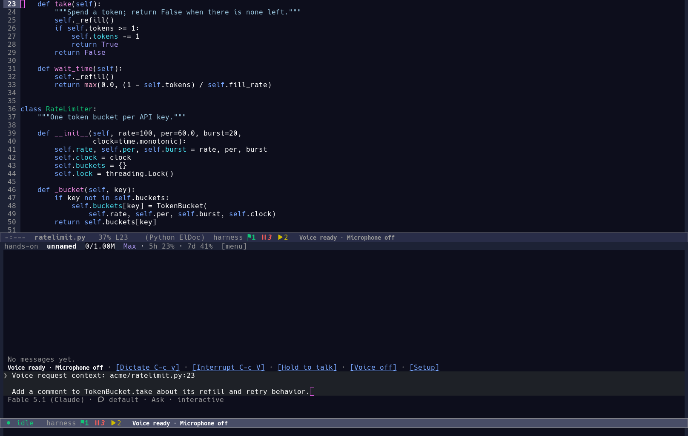

# Voice in Emacs

The optional `ui-voice` module adds voice to the shared compose box and a chat.
It keeps the selected coding provider and normal send path: Claude Code,
ChatGPT, OpenAI-compatible providers and the rest do not need a separate voice
implementation.

Voice has two **capabilities**, and **providers** that implement them, the way
model providers have capabilities of their own:

| Capability | Shape | Needs |
| --- | --- | --- |
| `wav` | Record a completed utterance, transcribe it into the compose box, speak reply sentences | `harness-voice-transcribe-command` and `harness-voice-synthesize-command` |
| `live` | A sidecar owns the microphone, speaker and speech model; Emacs keeps the chat, tools and permissions | The provider's command and what that provider needs |

`harness-voice-provider` selects a provider:

| Provider | Capability | What it is |
| --- | --- | --- |
| `wav` (the default) | `wav` | Local push-to-talk dictation and spoken replies |
| `chatgpt` | `live` | GPT-Live over the API, delegating work to this chat |
| `unmute` | `live` | A local pipeline: whisper.cpp for speech to text and an OpenAI-compatible text-to-speech service |
| `fixture` | `live` | The scripted sidecar: the whole loop without a microphone, key or model |
| `custom` | `live` | Any sidecar in `harness-voice-live-command` |

`M-x harness-voice-select-provider` lists the providers with their capability
and what each still needs; the `[Setup]` control opens the same list.
`harness-voice-capability` is what every command reads, so a new provider with
an existing capability changes nothing in the chat, the tools or the permission
panels.

The default WAV provider is a push-to-talk, text-mediated voice layer, **not**
ChatGPT Live's full-duplex transport:

```text
microphone -> local WAV -> transcription command -> editable compose text
                                              -> normal session/tool loop
speakers   <- player    <- synthesis command   <- assistant text, by sentence
```

It has no WebRTC connection, automatic turn-end VAD, always-on listening, or
acoustic barge-in. Transcription starts after the recording stops; reply speech
can start before the complete text reply arrives. Latency depends on the local
speech models, the coding model and the length of the sentence being generated.

The live capability is what ChatGPT Live and the local pipeline share. Both
ship as sidecars in this tree; the scripted `fixture` provider demonstrates the
loop without a key, a network connection or a speech model. [How realtime voice
stays in the conversation](voice-realtime.md) explains GPT-Live, backchannels,
delegation, the sidecar protocol and the open-source pipelines that can drive
it.



The documentation picture uses a scripted draft, not a live microphone or
speech service. Regenerate it with `scripts/media.sh voice`.

## Enable and use

Add voice to the modules you already enable, before `harness-start`:

```elisp
(require 'harness)
(harness-enable-modules :ui voice)
;; Configure the commands below, then:
(harness-start)
```

Use `M-x harness-enable-module RET ui-voice` to enable it in a running harness.
Configure transcription before recording and synthesis before spoken replies;
there are no automatic model downloads or cloud speech defaults.

| Control | Effect |
| --- | --- |
| `C-c h v`, `M-x harness-voice` | Voice controls for the current compose box, or a bottom quick voice chat from another buffer |
| `C-c v` in a compose buffer | Start dictation; a second press stops and transcribes |
| **Hold to talk** | Mouse press starts recording; release stops and transcribes |
| `C-c V`, **Interrupt** | Stop recording/transcription or reply audio and interrupt the attached voice turn |
| The host's ordinary send key | Send the editable transcript normally (`C-c C-c` in a chat) |

Opening voice controls leaves the microphone **off**. Dictation inserts text;
it does not send it automatically. Keep typing, correct names, add attachments
or reply to a thread before sending. Recording again interrupts speech and the
attached turn, so a correction does not compete with an obsolete reply. The
normal permissions and question panels still apply: saying a request does not
bypass them.

Emacs generally does not deliver keyboard key-release events. Keyboard
dictation therefore uses an explicit start/stop toggle, not guessed release
based on key-repeat timing. Use the mouse control for actual press-and-hold.
The existing `C-c h r` recording command still creates an audio attachment;
voice dictation is a different operation.

The WAV voice status distinguishes **Listening**, **Transcribing**,
**Thinking**, **Synthesizing**, and **Speaking**, with explicit microphone
on/off status. **Voice ready** does not mean the microphone is recording.
**Voice failed** keeps failures visible rather than relying solely on the
echo area. The live provider uses its own **Live · …** statuses below.

### Current work and quick-chat context

In an existing compose box, dictation stays in that box: a chat, task-board
message, quick search, popout or threaded reply uses its existing routing. A
voice chat uses the same session transcript and tools as its typed equivalent.

From an ordinary source buffer, quick voice chat carries source location and
ongoing-session context into its draft. Review that context alongside the
transcript. Session identifiers are references, not copies of all previous
conversations: the selected model can inspect relevant sessions with the usual
harness tools when those tools are enabled. A model must still resolve an
ambiguous target or ask which session/file you mean; speech recognition and a
context list are not guarantees of correct routing.

## Live voice with a sidecar

The live capability keeps a sidecar process in charge of the microphone,
speaker, echo cancellation and the speech model. Emacs sends chat context and
delegated work to it, and shows the transcript, status and permissions. Each
provider supplies the sidecar command; the protocol and the controls are the
same.

### ChatGPT Live

`chatgpt` runs `scripts/harness-voice-live-gpt`, a GPT-Live WebSocket client.
It speaks PCM16 at 24 kHz through `arecord` and `aplay`, starts a session with
client delegation, and turns each delegation into a prompt in the current chat.

```elisp
(setq harness-voice-provider 'chatgpt
      harness-voice-chatgpt-live-id "gpt-live-1"
      harness-voice-chatgpt-voice "marin")
```

Set `OPENAI_API_KEY` in the environment Emacs starts in: the sidecar reads it,
never a buffer or an option. `harness-voice-chatgpt-instructions` appends to the
conversation prompt, which already asks for short spoken replies and delegation
of every request that needs files, commands or tools. The backend model and its
tools are configured on the OpenAI side; this chat is what GPT-Live delegates
to, so the harness agent still runs the workspace.

### Local pipeline

`unmute` runs `scripts/harness-voice-live-unmute`, a local pipeline around two
OpenAI-compatible endpoints: whisper.cpp for speech to text, and a
text-to-speech server with the same request shape. It records with an energy
voice detector, posts each utterance to the speech-to-text endpoint, delegates
the text, and posts the answer to the text-to-speech endpoint for playback. No
hosted model and no API key are involved; audio goes only to the loopback
addresses below unless changed.

```elisp
(setq harness-voice-provider 'unmute
      ;; nil: the running voice-local stack's whisper.cpp service
      harness-voice-unmute-stt-url nil
      ;; nil: the optional unmute service; set a Piper endpoint instead
      harness-voice-unmute-tts-url nil
      harness-voice-unmute-voice "unmute"
      harness-voice-unmute-threshold 0.02)
```

Speech to text defaults to the `voice-local` stack: the provider reads the
random loopback port the stack published for whisper.cpp and posts to its
`/inference` route, so nothing has to be copied by hand. Set
`harness-voice-unmute-stt-url` to point at a whisper.cpp server you run
yourself.

Text to speech is not part of the default start. Kyutai Unmute publishes no
image (upstream builds it locally and wants a GPU), so the stack starts
whisper.cpp alone and `harness-voice-unmute-tts-url` must name a local
OpenAI-compatible TTS, such as a Piper server. The optional `unmute` compose
service is used when it runs; see the stack's README for building it. Without
either, the setup list says `Text to speech endpoint unset`.

A whisper.cpp server (see below) and a Piper server with the same request shape
work too, so the local provider needs no Unmute installation. `arecord` and
`aplay` are required, as they are for the WAV recorder. The energy detector is
not acoustic echo cancellation: use headphones when the speaker is open.

The local stack in `scripts/stacks/voice-local/` runs whisper.cpp in a
container on a network of its own, published on a random loopback port;
`M-x harness-stacks` starts it ([compose stacks](stacks.md)) on the
[selected container runtime](container-runtime.md). `harness-voice-effort`
picks the whisper model the stack loads:
**low** is `ggml-tiny.en.bin`, **medium** (the default) is
`ggml-base.en.bin`, and **high** is `ggml-small.en.bin`. The setup list has the
same three buttons. A provider that declares no fragments passes none; the
local stack still uses the level for its whisper model.

### Scripted fixture and custom sidecars

`fixture` runs the bundled `scripts/harness-voice-live-fixture --demo`, which
sends a transcript, one delegation and a spoken reply without a microphone, key
or model. It is the smallest way to see the loop.

`custom` runs whatever `harness-voice-live-command` holds: an argv list, never a
shell snippet. That is the seam for a Pipecat, Moshi or other sidecar of your
own. `harness-voice-live-startup-timeout` bounds the wait for the sidecar's
`ready` event. Every sidecar runs on the UI client, as the WAV recorder and
player do, even when the harness server is elsewhere.

| Control | Effect |
| --- | --- |
| `C-c h v`, `M-x harness-voice` | Start the live session in this compose box, or show its controls |
| `C-c v` | Start a stopped session, or mute and unmute the running one |
| `C-c V`, **Interrupt C-c V** | Stop playback at once; the agent turn keeps running |
| **Cancel work** | Cancel the agent turn through `session/cancel`; audio keeps running |
| `C-c v`, **Mute C-c v** / **Unmute C-c v** | Close or reopen the sidecar microphone |
| **Transcript** | Show the `*harness voice*` transcript |
| **End** | End the session and close the sidecar |
| **Setup** | The voice providers and settings |

The live status names what the session is doing now: **Live · Off**, **Live ·
Starting**, **Live · Listening**, **Live · Hearing you**, **Live ·
Transcribing**, **Live · Working**, **Live · Speaking**, **Live · Interrupted**,
**Live · Muted**, **Live · Ending** or **Live · Failed**. A stage that runs
longer than a third of a second carries its elapsed time (**Live · Working ·
1.4s**), so a slow turn reads as work rather than as a hang. The stage line at
the top of the transcript spins while the session hears, transcribes or thinks,
and marks speaking with `▷`; the mode-line indicator follows the audio state:
it is a caution color while the microphone is open. **Live · Speaking**
follows the sidecar's playback, not the agent's text generation, so
interrupting sound is visible immediately.

The transcript (`*harness voice*`, **Transcript**) is not a plain log. Its
header line stays in view while you scroll and animates the current step, and
each part is a section with its own label and time:

```text
⠹ Working · 1.4s   Voice · Local pipeline          (header line, always in view)
──────────────────────────────────────────────────────────

You · 12:04
  Add a docstring to the parse function in file.py.

Coding agent · 12:04
  ▸ Reading main.py
  ▸ Editing main.py

Voice · 12:04
  The docstring is in place.
```

The **Coding agent** section is the harness agent the voice delegates to: its
tool calls appear as they run, so the two layers stay visible. The **Voice**
section is what the speech model says back. The buffer is read-only, `C-c v`
dictates or mutes, `C-c V` interrupts and `q` closes it.

The controls that have a key show it, and each reflects its state:
**Dictate C-c v** becomes **Transcribe C-c v** while recording, **Hold to talk**
becomes **Talking · release** while the mouse is down, **Mute C-c v** becomes
**Unmute C-c v**, and **Interrupt C-c V** stops playback without cancelling the
turn.

A live session delegates work instead of typing into the draft. When the
sidecar sends a `delegation`, its text becomes a prompt in the current chat,
prefixed with the same visible file/line and related-session context as quick
voice chat. Assistant sentences stream back to the sidecar as `commentary`;
the turn's complete text returns as `delegate_result`. A second delegation
waits for the running turn. Tool calls, questions and permission panels stay
on screen, and no spoken answer can approve a permission.

The WAV recorder is blocked while the sidecar owns the audio device. The live
transcript is a separate, read-only buffer: the compose draft stays editable
and nothing is sent from it automatically. Session redaction, UI reload and
closing the session stop the sidecar and discard its transcript.

### Sidecar protocol

The sidecar speaks one JSON object per line on stdin and stdout; diagnostics
go to stderr. Audio never crosses the pipe. This is enough to test the UI
without a microphone or model:

| Direction | Event | Meaning |
| --- | --- | --- |
| sidecar to Emacs | `ready` | Session connected; the microphone may start |
| sidecar to Emacs | `listening` / `speaking` | Playback state for the indicator |
| sidecar to Emacs | `user_delta` / `assistant_delta` | Caption text, with optional `final` |
| sidecar to Emacs | `backchannel` | A brief listening sound |
| sidecar to Emacs | `delegation` | Backend request with `id` and `text` |
| sidecar to Emacs | `interrupted` | Playback stopped |
| sidecar to Emacs | `error` / `closed` | Visible failure or clean end |
| Emacs to sidecar | `start` | Session start, protocol version and context |
| Emacs to sidecar | `mute` / `interrupt` / `stop` | Microphone, playback and session lifecycle |
| Emacs to sidecar | `commentary` / `thinking` | Speakable reply or quiet progress |
| Emacs to sidecar | `delegate_result` | Final text, or an error, for a delegation |

[How realtime voice stays in the conversation](voice-realtime.md) has the
full contract, the GPT-Live event mapping and the sidecar phases. The
bundled `scripts/harness-voice-live-fixture` is a working small sidecar for
tests and demonstrations; it emits a scripted transcript and one delegation, so
it needs no speech service.

## Local transcription with whisper.cpp

Install [whisper.cpp](https://github.com/ggml-org/whisper.cpp) and download a
model following its instructions. A small model such as `base.en` is a useful
English starting point; a multilingual model is needed for other languages.
Keep a server running so the model is loaded once, not once per utterance.
With whisper.cpp built and the model available:

```sh
./build/bin/whisper-server -m models/ggml-base.en.bin \
    --host 127.0.0.1 --port 8080
```

Keep this example server on loopback; it accepts uploaded files and is not a
public authenticated transcription service. See its
[server instructions and security warning](https://github.com/ggml-org/whisper.cpp/tree/master/examples/server).

The harness includes `scripts/harness-voice-stt`, a Python 3 standard-library
adapter for that server. No Python speech package is required for the adapter:

```sh
python3 /path/to/emacs-agent-harness/scripts/harness-voice-stt recording.wav
# Optional explicit endpoint, language and request timeout:
python3 /path/to/emacs-agent-harness/scripts/harness-voice-stt recording.wav \
    --url http://127.0.0.1:8080/inference --language en --timeout 30
```

In Emacs:

```elisp
(setq harness-voice-transcribe-command
      (list "python3"
            (expand-file-name "scripts/harness-voice-stt" harness-directory)
            :file))
```

The helper uploads one completed WAV with multipart `file`, `response_format`
and `language` fields. Its default URL is
`http://127.0.0.1:8080/inference`, which is your own server: the bundled
container stack publishes a random loopback port instead and the local voice
provider reads that port from the stack. Only `--url` changes it. It does not follow
redirects or use environment HTTP proxies. Successful stdout is only the
nonempty JSON `text` field as UTF-8 plain text; errors go to stderr with a
nonzero exit. The input limit is 32 MiB and the response limit is 4 MiB. Its
30-second request timeout is configurable with `--timeout`; the surrounding
voice process timeout must be long enough too.

The adapter does not add OpenAI-style model selection or authentication
headers. Another HTTP speech service needs a compatible endpoint or a small
wrapper of its own. An explicit remote `--url` uploads microphone audio there;
use HTTPS and the service's appropriate authentication rather than putting a
credential in this helper's URL.

## Local speech with Piper or eSpeak NG

[Piper](https://github.com/OHF-Voice/piper1-gpl) provides local neural TTS.
The currently maintained `piper-tts` implementation is GPL; individual voice
models have their own licenses. Read the voice's model card before using or
distributing it.

For an isolated installation and an explicitly downloaded example voice:

```sh
python3 -m venv ~/.local/share/harness-voice/venv
~/.local/share/harness-voice/venv/bin/python -m pip install piper-tts
~/.local/share/harness-voice/venv/bin/python -m piper.download_voices \
    en_US-lessac-medium --data-dir ~/.local/share/harness-voice
```

Use absolute model/interpreter paths, since Emacs may have a different working
directory and environment from your shell:

```elisp
(setq harness-voice-synthesize-command
      (list (expand-file-name "~/.local/share/harness-voice/venv/bin/python")
            "-m" "piper"
            "-m" (expand-file-name "~/.local/share/harness-voice/en_US-lessac-medium.onnx")
            "-f" :file))
```

The matching `.onnx.json` configuration must stay beside the model. The command
receives reply text on UTF-8 stdin and writes a WAV to `:file`; no speech text
is interpolated into a shell command. The explicit `-f` matters: Piper can play
audio itself when it is omitted, which would bypass the harness's playback
status and cancellation.

This simple Piper command loads the voice for each synthesis call. That is
portable but slower than a warm service, especially for short sentences. For
lower latency, keep a TTS service loaded and write a wrapper honoring the same
stdin-to-WAV contract. Piper's
[HTTP API](https://github.com/OHF-Voice/piper1-gpl/blob/main/docs/API_HTTP.md)
is one option; such a wrapper is not bundled here.

For a small, less natural but quick local fallback, install `espeak-ng`:

```elisp
(setq harness-voice-synthesize-command '("espeak-ng" "-w" :file "--stdin"))
```

### Recorder and player

Recording uses the existing `harness-ui-media-recorder-command`. Its default
selects `pw-record`, `arecord`, or `ffmpeg` with PulseAudio input and records
16 kHz mono audio. Override the recorder for your operating system or preferred
microphone. OS microphone permission still applies.

`harness-voice-player-command` defaults to an external player selected from the
existing media integration (`mpv`, `ffplay`, or `paplay`). Override it with a
command list containing `:file` for the generated WAV. An external,
interruptible process is required for reliable interruption; native
`play-sound-file` is not the voice playback contract.

## Generic speech command contract

| Option | Input | Successful output |
| --- | --- | --- |
| `harness-voice-transcribe-command` | Recorded WAV at `:file` | UTF-8 plain transcript on stdout |
| `harness-voice-synthesize-command` | UTF-8 text on stdin; output path at `:file` | WAV written to `:file` |
| `harness-voice-player-command` | WAV at `:file` | Playback until process exit |

Commands are executable/argument lists, not shell snippets. `:file` is a
placeholder argument, not the literal string `":file"`. Put adapter diagnostics
on stderr, use a nonzero exit for failures, and do not leave background playback
or worker processes running after the adapter is cancelled. A custom wrapper
can use local Whisper/faster-whisper, Moonshine, Piper, Kokoro or a deliberate
hosted service without changing the selected coding provider. None of those
engines is installed automatically.

`harness-voice-process-timeout` defaults to 60 seconds for transcription,
synthesis and playback; exceeding it is a visible failure, not an accepted
partial transcript. `harness-voice-recording-limit` defaults to 120 seconds;
reaching that cap stops the microphone and transcribes the recorded utterance,
just like releasing the hold button. Adjust both limits for your hardware and
shorter deliberate utterances.

Audio processing is on the **UI client**, even when the harness server is on
another machine. Private temporary recording/synthesis files are deleted when
the operation completes or is cancelled. The included transcription helper
creates no persistent audio copy. Third-party commands/services may keep their
own logs or caches: review their behavior separately. Once you send a
transcript, its text follows the normal session history and selected provider's
data handling. Local STT/TTS does not make a hosted coding model local.

## Native provider voice and realtime alternatives

Provider voice features are not automatically headless APIs. As documented in
November 2026:

- [Claude Code `/voice`](https://code.claude.com/docs/en/voice-dictation)
  supports interactive dictation. Its transcription runs on Anthropic's
  servers and requires a Claude.ai login and a local microphone. It can
  auto-submit a completed transcript in tap mode, but that is still one
  prompted turn, not a spoken conversation. The harness's headless stream-JSON
  integration does not inherit that terminal input UI or expose it as a local
  STT service; it is also not a spoken-reply API.
- [Codex CLI voice](https://learn.chatgpt.com/docs/developer-commands?surface=cli#talk-to-codex-with-voice)
  supports `/voice`/F8 spoken conversation in supported builds and sessions.
  Its
  [app-server realtime protocol](https://github.com/openai/codex/blob/main/codex-rs/app-server-protocol/src/protocol/v2/realtime.rs)
  is experimental. The harness's direct ChatGPT/Responses integration is not
  that interactive CLI and has no realtime bridge here.

ChatGPT Live uses GPT-Live, a full-duplex speech-to-speech model that delegates
to a separate backend. The default WAV provider is the older cascaded shape;
the live provider is the seam for GPT-Live or a local pipeline. The bundled
sidecar is scripted. A real GPT-Live sidecar needs an API key and a
WebSocket/WebRTC client; a local Moshi or Pipecat stack needs its own runtime.
The [realtime research note](voice-realtime.md) covers the architecture, the
backchannel and delegation policies, and the sidecar contract. Its short
version: a local WAV pipeline cannot become full duplex by auto-sending text
or adding a "listening" token.

Several open-source projects can sit behind `harness-voice-live-command`; none
is installed automatically:

| Project | Fit and tradeoff |
| --- | --- |
| [Pipecat](https://docs.pipecat.ai/api-reference/server/services/s2s/openai-live) | Open-source voice-agent framework. Its `OpenAILiveLLMService` supports GPT-Live with Responses or client delegation, and its pipelines cover VAD, turn detection, STT, LLM and TTS for a local route. |
| [LiveKit Agents](https://docs.livekit.io/agents/models/realtime/gpt-live/) | Open-source agent framework with a GPT-Live plugin; another way to own the audio path. |
| [Moshi](https://github.com/kyutai-labs/moshi) | Local full-duplex speech-text model; it is its own dialogue brain, needs a suitable GPU and has no harness backend bridge out of the box. |
| [Kyutai Unmute](https://github.com/kyutai-labs/unmute) | Local streaming STT, text LLM and TTS; turn-based, and needs Linux/WSL, x86-64 and enough VRAM. |

For the WAV command contract, there are lower-latency local engines worth
wrapping; none is installed automatically:

| Project | Fit and tradeoff |
| --- | --- |
| [Moonshine](https://moonshine-voice.readthedocs.io/en/latest/using/transcription/) | Local streaming transcription with provisional/final events; a future alternative to completed-WAV STT. A wrapper is needed for the command contract. |
| [Pocket TTS](https://github.com/kyutai-labs/pocket-tts), [Kokoro](https://github.com/hexgrad/kokoro) | Local TTS alternatives for a custom adapter; check checkpoint/voice licenses and runtime requirements. |

The WAV provider deliberately provides inspectable text and reliable manual
interruption first. The live provider adds continuous audio only through a
sidecar, and the bundled fixture demonstrates the protocol rather than
pretending to be a speech model.

## Adapter checks

The helper's loopback tests need Python 3 only, not a microphone or speech
models:

```sh
python3 -B test/harness-voice-stt-test.py
```

They check the multipart/UTF-8 contract, missing/malformed/empty results, HTTP
errors, request timeout, invalid input, proxy bypass and redirect refusal. The
Emacs voice tests cover the UI lifecycle separately.

The live protocol tests need Python 3, a microphone is not used:

```sh
scripts/test.sh test/harness-ui-voice-live-test.el
```

They start the bundled fixture and scripted sidecars, then check the
transcript, delegation, commentary, interruption, mute, failures, redaction and
the exact status and control copy. To try the fixture by hand, configure it as above and
run `scripts/harness-voice-live-fixture --demo` yourself, or let the Start
control launch it. Hardware recognition, voice quality, echo cancellation and
end-to-end latency still need a trial on your own setup.
