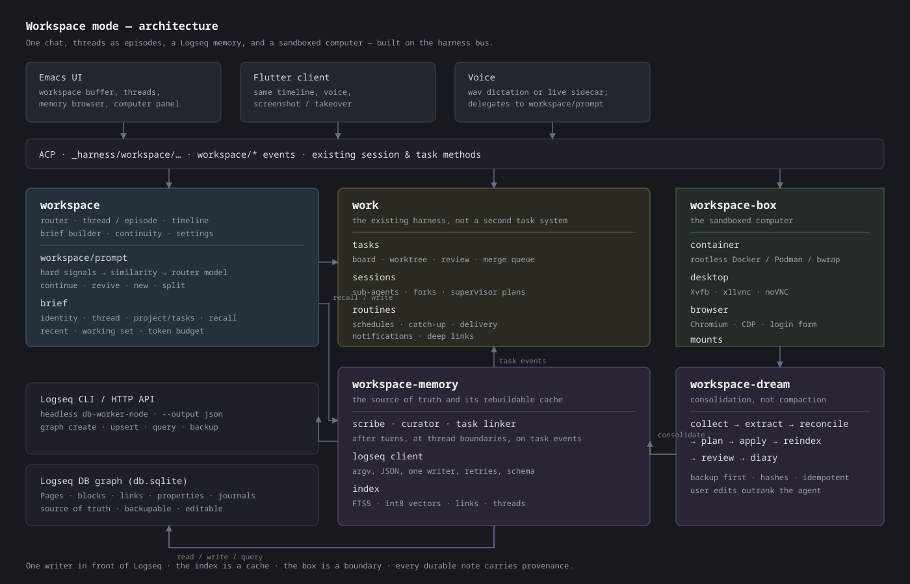
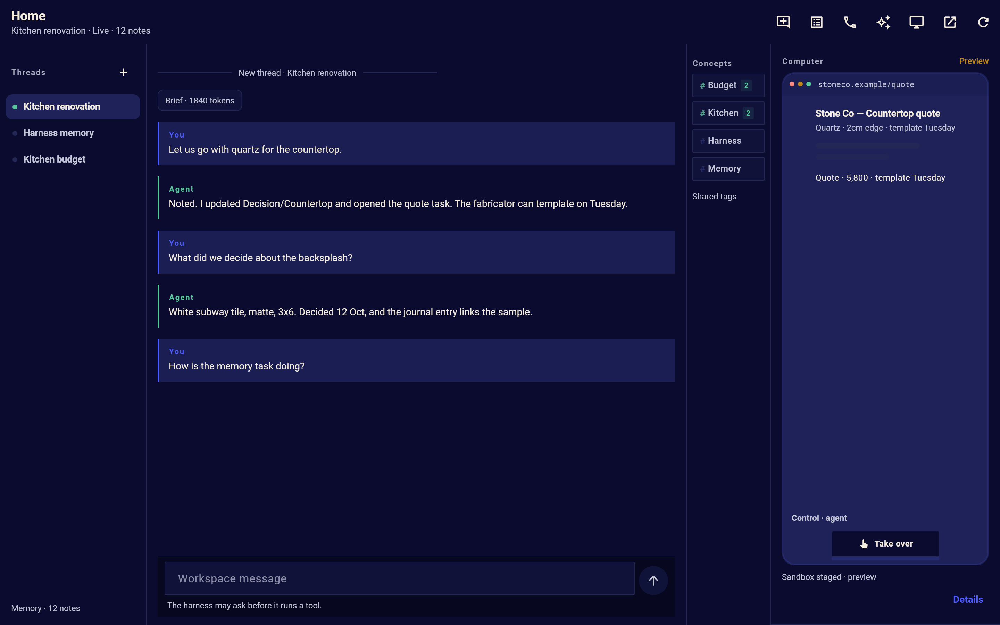
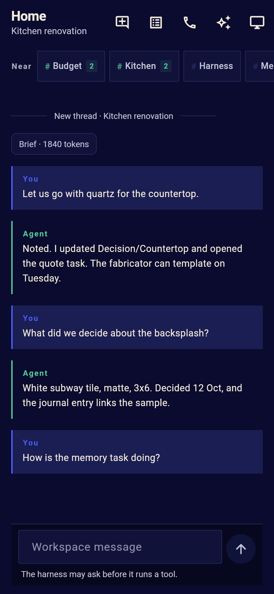
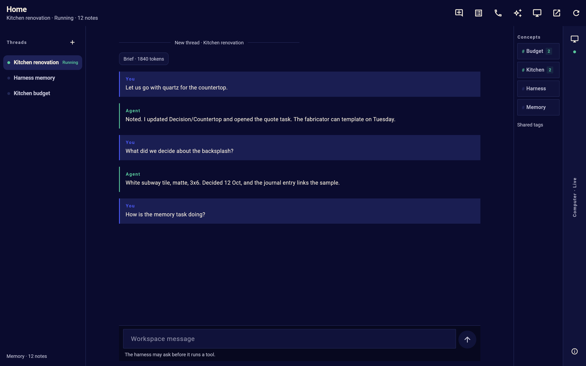
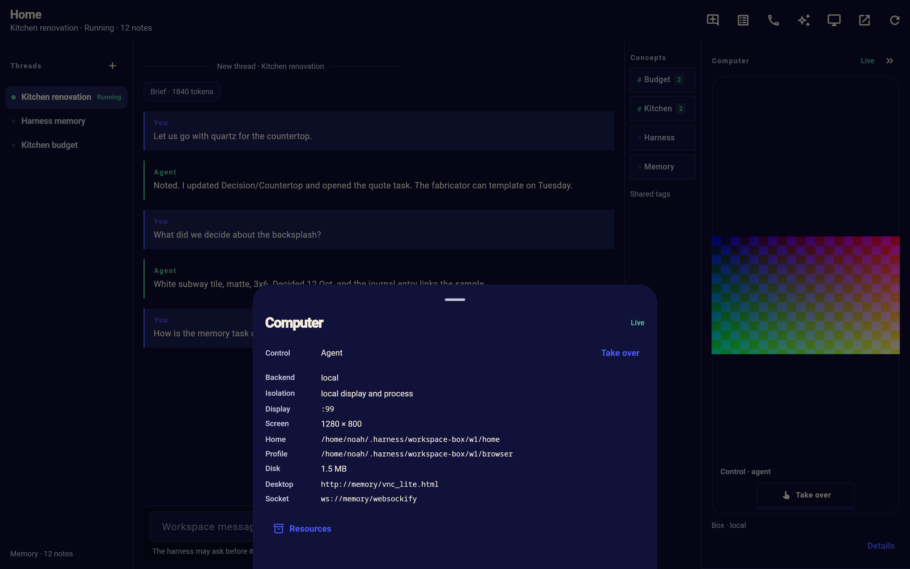

# Workspace mode: implementation design

The implementation contract for [workspace mode](workspace-mode.md).
The main page is the design and the experience; this page is what a
stage's task reads before it writes code: the modules and their
dependencies, storage, methods, events, options, tools, prompts, the
detailed UI and copy inventory, the tests, and the staged plan.  The
first slice is implemented: `workspace`, `workspace-knowledge`, the
markdown half of `logseq`, `workspace-box` and `ui-workspace` are in
the tree, with their tests, and the Flutter client has the `Workspace`
tab, its responsive layout and a computer that draws the real RFB
stream.  The Logseq CLI and its DB graphs, the embedding index, the
scribe/dream, the container backend, routines and voice are not.  The
computer's design and its `local` boundary are in
[workspace computer](workspace-computer.md).  The decision that the
workspace's knowledge is a Logseq graph and the memory module keeps
only behavioral notes is in
[the knowledge graph note](workspace-knowledge-graph.md).

## Contents

- [Architecture](#architecture)
  - [What exists today](#what-exists-today)
  - [Modules](#modules)
  - [The shape of a request](#the-shape-of-a-request)
  - [Storage](#storage)
  - [Methods](#methods)
  - [Events](#events)
  - [Options](#options)
  - [Tools](#tools)
  - [Prompting](#prompting)
  - [Cache and cost](#cache-and-cost)
  - [Permissions and access](#permissions-and-access)
  - [Compatibility and degradation](#compatibility-and-degradation)
  - [Observability](#observability)
- [The UI](#the-ui)
  - [Emacs: one buffer, three regions](#emacs-one-buffer-three-regions)
  - [Timeline entries](#timeline-entries)
  - [Thread sidebar](#thread-sidebar)
  - [The header states](#the-header-states)
  - [The memory browser](#the-memory-browser)
  - [The dream review](#the-dream-review)
  - [The computer panel](#the-computer-panel)
  - [The workspace list and settings](#the-workspace-list-and-settings)
  - [Keys](#keys)
  - [The Flutter client](#the-flutter-client)
  - [Copy inventory (before implementation)](#copy-inventory-before-implementation)
  - [Presentation rules](#presentation-rules)
- [Testing and verification](#testing-and-verification)
- [The staged plan](#the-staged-plan)
- [Alternatives considered](#alternatives-considered)
- [Open questions](#open-questions)
- [Risks and mitigations](#risks-and-mitigations)
- [Measures](#measures)
- [References](#references)

## Architecture



### What exists today

Workspace mode is assembled from parts the harness already has, and
the design tries hard not to duplicate them:

- `session` and `agent`: persistent sessions, the node log, turns,
  tool calls, streaming, compaction, forks, sub-agents, costs.  An
  episode is one of these, not a new conversation engine.
- `session-search`: a SQLite FTS5 index of every transcript and the
  int8 embedding/nearest code this design extracts into a shared
  module.  Memory search reuses the approach and leaves transcripts to
  this module.
- `tasks`, `merge` and `supervisor`: the task lifecycle, worktrees,
  review, the merge queue and supervisor plans.  The workspace is a
  client of them; it does not add a second board.
- `sandbox` and `access`: backends, capability drops, read-only
  profiles, the permission chain, directory grants and the access
  view.  The box is a sandbox profile with a persistent lifecycle.
- `store` and `config`: the state directory, JSON records, layered
  settings and customize.
- `notifications`: pluggable delivery and the UI's click routing.
- `acp` and `acp-remote`: local/TCP/WebSocket ACP, authentication,
  tokens and remote clients.
- `ui-voice` (in progress, its own task): `wav` and `live` voice
  capabilities and sidecars; workspace voice attaches a call to a
  thread rather than reimplementing audio.
- `skills`, `todo-sync`, `recap`, `seed`, `insight`: the pieces the
  dream, the threads and the briefs borrow.

What exists now: the `logseq` module, a client for a Logseq
**markdown** graph (`$LOGSEQ_HOME`, else `~/logseq`; pages, journals,
blocks and properties as files); `workspace-knowledge` (a page per
thread, the day's journal captures, search and the `knowledge_search`,
`knowledge_write`, `knowledge_read` and `knowledge_status` tools); the
`workspace` module (records, threads, episodes, the timeline, routing
and the brief); and `ui-workspace` (the Emacs buffer, thread list,
timeline and compose box), with `test/harness-logseq-test.el`,
`test/harness-workspace-test.el` and
`test/harness-ui-workspace-test.el`.  The harness's own `memory`
module keeps the small behavioral notes and is not the workspace's
knowledge store.

What does not exist yet: the Logseq CLI and its DB graphs (the
markdown graph is read and written directly), the embedding index, the
scribe/curator/dream, the box, routines and voice.  Those are stages 0
and 3 to 8 below.  The Flutter client draws the workspace, its threads
and its computer from the same `workspace/*` and `knowledge/*`
methods; its `Memory` screen reaches the graph through ACP aliases
(`memory/notes`, `memory/search`, `memory/status` with a `:workspace`).

### Modules

Workspace mode is built from small modules with one direction of
dependency.  None of the state modules requires a UI module; the UI
talks ACP.

| Module | Layer | Requires | What it is |
|---|---|---|---|
| `logseq` | state | `core`, `util` | The Logseq markdown graph client: pages, journals, blocks, properties, search and backlinks, read and written as files.  No workspace or memory policy.  The CLI and its DB graphs are stage 0 below. |
| `workspace-knowledge` | state | `logseq`, `session`, `tools` | Thread pages, journal captures, retrieval, the knowledge tools and the write path.  It knows pages, blocks and provenance, not threads or chats. |
| `workspace` | state | `workspace-knowledge`, `session`, `agent`, `project`; uses `tasks`, `supervisor` and `seed` when loaded | Workspaces, threads, episodes, the timeline, routing, the brief, the scribe and the curator.  It is the mode. |
| `workspace-dream` | state | `workspace-knowledge`, `workspace` | The dream scheduler, phases, reports and review state. |
| `workspace-box` | state | `store` | The computer's lifecycle, private X display, browser profile, input, control lock and VNC endpoint.  Optional: without it the workspace has no computer.  The first backend is `local`, not the container in the design. |
| `workspace-routines` | state | `workspace`, `notifications` | Triggers, runs and delivery.  Optional; a workspace without it has no scheduled work. |
| `ui-workspace-voice` | UI | `ui-workspace`, `ui-voice` (when present) | The call control on a thread; the delegation path is `workspace/prompt` with `:channel 'voice`, which marks the turns. |
| `ui-workspace` | UI | `ui`, `ui-chat`, `ui-compose`, `ui-pending` | The workspace chat buffer, thread sidebar, header, dividers and settings line. |
| `ui-workspace-memory` | UI | `ui-workspace` | The memory browser, recall card and provenance view. |
| `ui-workspace-dream` | UI | `ui-workspace` | The dream report and review UI. |
| `ui-workspace-box` | UI | `ui-workspace`, `ui-media` | The computer panel, screenshot, takeover and login form. |
| `ui-workspace-routines` | UI | `ui-workspace` | Routine list and editor. |

The first release can ship `workspace` and `workspace-knowledge` with the
UI and leave the box, routines and dream behind feature switches, but
the design expects all of them.

**Background work.**  The workspace makes model calls the user did not
send.  They are of two kinds.  A **one-shot** job (the router, the
recall query expansion) is an internal session: one `provider/complete`
with a JSON answer, recorded and costed like the harness's other
internal calls.  A **tool-using** job (the librarian, the scribe, the
curator, the dream) is a background session with its own kind
(`workspace-librarian`, `workspace-scribe`, `workspace-curator`,
`workspace-dream`): an ordinary agent loop with a narrow tool
allowlist, a short context, the same permission chain and tool slots,
and a transcript the user can open.  Those kinds are added to
`harness-ui-sessions-hidden-kinds`, so the session list stays clean;
`I` shows them.  A background session is non-interactive and never
prompts: its tool list is narrowed to the memory (or task-reading)
tools, and a call that would need the user -- forget, a login, a
mount, a permission it cannot decide -- is refused and reported rather
than left waiting.  It never messages the user directly; the workspace
turns its result into a timeline card, a memory write or a
notification, and anything that needs a person goes to review.

### The shape of a request

```
 Emacs / Flutter / voice
        |  _harness/workspace/prompt {workspace, text, thread?, channel?}
        v
   workspace/prompt
        |-- hard signals? ------------------------------.
        |-- similarity over thread summaries? ----------+--> route
        |-- router model (only if ambiguous) ----------'
        |
        |-- continue: agent/prompt(episode, text)
        |-- revive:   park current; create episode; agent/prompt(episode, brief + text)
        |-- new:      create thread + episode; agent/prompt(episode, brief + text)
        |
        v
   agent turn (ordinary session; tools, permissions, compaction as usual)
        |  stream/tool events -> session events -> workspace timeline + UI
        v
   agent/turn-ended
        |-- timeline entry (reply, usage, costs)
        |-- scribe (if due) --.
        |-- curator (if due) -+--> workspace-knowledge queue --> logseq --> index
        |-- task linker (on task events) --'
        v
   workspace/thread-changed, workspace/timeline-appended
```

A turn is a normal harness turn.  The workspace does not wrap the
agent loop, intercept tool calls or keep a second copy of the
transcript.  It routes the message, builds the first message, and
observes the events.  That is what keeps permissions, compaction,
cache handling, providers, ACP streaming and every existing tool
working unchanged.

The UI learns which episode was chosen from `workspace/episode-changed`
before the turn's first token, then follows that session's ordinary
`_harness/node` and `agent/*` updates.  A pending bubble covers the
routing interval; it is replaced by the user node once the episode
exists, so a model call for routing never looks like a lost message.

### Storage

Everything lives under `harness-state-directory` (the existing store),
except the graph and the workspace root:

```
<state>/
├── workspaces/
│   ├── w-…json                  workspace record, threads, routines, box config
│   ├── w-….timeline.jsonl       ordered entries (append-only)
│   ├── w-….dreams.json          dream records, operations, review state
│   └── w-….box.json             box state (id, ports, mounts, snapshots)
├── workspace-knowledge/
│   └── w-….db                   the index (SQLite, FTS5, vectors)
├── sessions/…                   episodes, exactly as any session
└── tasks/…                      task records, exactly as any task

<workspace-root>/
├── inbox/
├── artifacts/<date>/
├── projects/
├── skills/
└── bin/

<logseq-root>/graphs/<name>/db.sqlite   the graph (source of truth)
```

The timeline is append-only and every entry has a sequence number:

```elisp
(:seq 421 :at 1762450000.2 :kind 'message
 :thread "th-…" :episode "s-…" :node "n-…" :role 'user)
(:seq 422 :at 1762450001.8 :kind 'message
 :thread "th-…" :episode "s-…" :node "n-…" :role 'assistant)
(:seq 423 :at 1762450300.0 :kind 'divider
 :thread "th-…" :reason 'topic-change :title "Harness memory")
(:seq 424 :at 1762450400.0 :kind 'event
 :event 'task-review :task "t-…" :text "Ready for review")
```

A message entry stores the session and node ids, not the text.  The UI
resolves the node through `session/nodes`; a redaction, an edit or a
deleted node is reflected without rewriting the timeline.  An event
entry stores its own small payload.  The timeline is not compacted:
the UI loads the newest entries, and `Show older` pages back through
the log.  `harness-workspace-timeline-days` is how far back the UI
looks by default; the log and the sessions keep the full record.

A thread record:

```elisp
(:id "th-…" :title "Kitchen renovation" :page "Threads/Kitchen renovation"
 :status 'active :project "/home/me/workspace"
 :episodes ("s-…" "s-…") :live "s-…" :summary "…"
 :pinned t :created … :last-at …)
```

A workspace record:

```elisp
(:id "w-…" :name "Home" :root "/home/me/workspace/"
 :project "/home/me/workspace/" :graph-root "…" :graph "home"
 :instructions "…" :model "…" :thinking "medium"
 :permission-mode 'auto :non-interactive nil
 :router-model nil :scribe-model nil :dream-model nil
 :embedding-model "…" :brief-tokens 24000
 :threads (…) :last-thread "th-…" :routines (…) :box (…)
 :created … :updated …)
```

### Methods

All methods live on the existing bus and are reachable by a client as
`_harness/workspace/…` (the modules add `"workspace/"`, `"logseq/"` and
`"memory/"` to `harness-acp-extra-method-prefixes`, and their events to
`harness-acp-extra-events`).  All box, browser, dream and routine
methods are under `workspace/`, so a plugin's `box/` or `dream/` prefix
cannot collide with them.  Signatures are the argument names; the
values are plists.

**Workspace lifecycle**

| Method | Arguments | Returns |
|---|---|---|
| `workspace/create` | `plist` (`:name :root :graph-root :graph :instructions :model …`) | the workspace |
| `workspace/list` | `&optional filter` | workspaces, by name |
| `workspace/get` | `id` | the workspace, with thread and box summaries |
| `workspace/update` | `id &rest plist` | the workspace |
| `workspace/delete` | `id &optional delete-sessions delete-graph` | a promise of `(:deleted …)`; asks first |
| `workspace/open` | `id` | a promise of the current state and the current episode |
| `workspace/status` | `id` | health: graph, index, box, dream, queue |

**Chat and threads**

| Method | Arguments | Returns |
|---|---|---|
| `workspace/prompt` | `id text &optional opts` (`:thread :channel :speak :attachments :force-new`) | a promise of the turn's result and the chosen thread/episode |
| `workspace/cancel` | `id &optional thread` | cancels the active turn |
| `workspace/timeline` | `id &optional opts` (`:before :limit :thread :kinds`) | entries, newest page last |
| `workspace/threads` | `id &optional filter` | thread records with status and last message |
| `workspace/thread` | `id thread` | one thread, its page and episodes |
| `workspace/thread/create` | `id title &optional plist` | a thread with no episode |
| `workspace/thread/update` | `id thread &rest plist` (`:title :status :pinned :page`) | the thread |
| `workspace/thread/merge` | `id from into` | links two threads; the timeline keeps its entries and groups them under the target |
| `workspace/thread/park` | `id thread` | parks the live episode |
| `workspace/thread/revive` | `id thread &optional opts` | starts a new episode from the thread's brief |
| `workspace/thread/delete` | `id thread &optional delete-sessions` | asks; keeps the page by default |
| `workspace/episode` | `id thread &optional episode` | the episode's session and summary |
| `workspace/context` | `id &optional thread episode` | the last brief: sections, cards, tokens, why |
| `workspace/brief` | `id &optional opts` | a digest for the chat/voice: tasks, threads, dreams, box |

**Memory**

| Method | Arguments | Returns |
|---|---|---|
| `memory/search` | `workspace query &optional opts` | cards; the same shape as the tool |
| `memory/get` | `workspace ref &optional opts` | a page or block with children/backlinks |
| `memory/write` | `workspace op` | the written block and its provenance |
| `memory/forget` | `workspace ref &optional opts` | what was removed |
| `memory/status` | `workspace` | graph, index, model, counts, last dream |
| `memory/reindex` | `workspace &optional opts` | a promise of the rebuild |
| `memory/sync` | `workspace &optional opts` | a promise of the incremental sync |
| `memory/pages` | `workspace &optional filter` | page list for the browser |
| `memory/page` | `workspace page` | a page and its links |
| `memory/recall-test` | `workspace query` | what the brief would recall, for tuning |

**Dream**

| Method | Arguments | Returns |
|---|---|---|
| `workspace/dream/run` | `workspace &optional opts` (`:scope :dry-run :model`) | a promise of the report |
| `workspace/dream/status` | `workspace` | running, last, next, counts |
| `workspace/dream/cancel` | `workspace` | stops the running dream |
| `workspace/dream/review` | `workspace &optional dream` | the proposed operations and diffs |
| `workspace/dream/apply` | `workspace dream ops` | applies the chosen operations |
| `workspace/dream/skip` | `workspace dream ops &optional reason` | records the decision |
| `workspace/dream/undo` | `workspace dream` | undoes the last low-risk batch, if within the window |

**Box**

| Method | Arguments | Returns |
|---|---|---|
| `workspace/box/start` | `workspace` | a promise of the status |
| `workspace/box/stop` | `workspace` | a promise |
| `workspace/box/status` | `workspace` | backend, id, health, ports, mounts, disk |
| `workspace/box/reset` | `workspace &optional keep-home` | asks; a promise |
| `workspace/box/snapshot` | `workspace &optional name` | the snapshot record |
| `workspace/box/restore` | `workspace snapshot` | a promise |
| `workspace/box/screenshot` | `workspace &optional opts` | `(:mime :data :width :height)` |
| `workspace/box/click` | `workspace x y &optional opts` | the result |
| `workspace/box/type` | `workspace text` | the result |
| `workspace/box/key` | `workspace key &optional opts` | the result |
| `workspace/box/scroll` | `workspace x y amount` | the result |
| `workspace/box/drag` | `workspace from to` | the result |
| `workspace/box/windows` | `workspace` | windows with titles and geometry |
| `workspace/box/launch` | `workspace what` | the result |
| `workspace/box/clipboard` | `workspace &optional text` | the clipboard |
| `workspace/box/exec` | `workspace command &optional opts` | stdout, stderr, status |
| `workspace/box/vnc` | `workspace` | URL, token, state (`agent`/`user`) |
| `workspace/box/take-over` | `workspace` | sets `user`; pauses screen input |
| `workspace/box/return-control` | `workspace` | sets `agent`; hints the episode |
| `workspace/box/request-mount` | `workspace path &optional opts` | a user-only permission request |
| `workspace/box/logs` | `workspace &optional lines` | the box's logs, bounded |

**Browser**

| Method | Arguments | Returns |
|---|---|---|
| `workspace/browser/open` | `workspace url &optional opts` | the tab |
| `workspace/browser/read` | `workspace &optional opts` | the page's text, links and forms |
| `workspace/browser/click` | `workspace selector &optional opts` | the result |
| `workspace/browser/type` | `workspace selector text &optional opts` | the result |
| `workspace/browser/key` | `workspace key` | the result |
| `workspace/browser/tabs` | `workspace` | tabs |
| `workspace/browser/screenshot` | `workspace &optional opts` | a PNG |
| `workspace/browser/download` | `workspace selector &optional opts` | the saved path |
| `workspace/browser/wait` | `workspace selector &optional timeout` | the result |
| `workspace/resources/status` | `id` | browser, wallet, access and audit metadata; `unavailable` until the box and broker exist |
| `workspace/browser/clear` | `id scope origin kinds` | the new browser section, or `unavailable` |
| `workspace/browser/login/forget` | `id login` | the new browser section, or `unavailable` |
| `workspace/wallet/authorization/create` | `id card amount currency cap-kind merchant-scope expires fees tax shipping` | the new wallet section, or `unavailable` |
| `workspace/wallet/authorization/revoke` | `id authorization` | the new wallet section, or `unavailable` |
| `workspace/wallet/purchase/decide` | `id purchase decision idempotency` | the new wallet section, or `unavailable` |

The resources methods are the first-class resource contract described
in [workspace resources](workspace-resources.md): a browser profile,
its sites and saved logins, the wallet's cards and bounded purchase
authorizations, and the access the agent has to each.  They carry
metadata only.  With a running box the browser section is the real
Firefox profile; with none it answers `unavailable` with the box's own
reason (`box-not-running`, `box-tools-missing` or `backend-unavailable`).
The wallet still answers `wallet-unavailable` because no payment broker
exists; the client says so rather than simulating a change.
| `workspace/browser/login` | `workspace site &optional fields` | a pending login request |

**Routines**

| Method | Arguments | Returns |
|---|---|---|
| `workspace/routine/list` | `workspace` | routines with next run |
| `workspace/routine/create` | `workspace plist` | the routine (asks if from an agent) |
| `workspace/routine/update` | `workspace id &rest plist` | the routine |
| `workspace/routine/delete` | `workspace id` | the result |
| `workspace/routine/run` | `workspace id &optional now` | a promise of the run |
| `workspace/routine/pause` | `workspace id` | the routine |
| `workspace/routine/resume` | `workspace id` | the routine |

The `logseq/…` methods are the client's own surface (`logseq/status`,
`logseq/graph-create`, `logseq/page`, `logseq/query`, `logseq/show`,
`logseq/search`, `logseq/changes`, …).  They are exposed so another
module, a plugin or a test can use the client without the memory layer;
a UI should use `memory/…` instead.

### Events

| Event | Arguments | When |
|---|---|---|
| `workspace/changed` | `id workspace` | the record changed |
| `workspace/timeline-appended` | `id entry` | a message, divider or event was appended |
| `workspace/thread-changed` | `id thread` | a thread's state, title or page changed |
| `workspace/episode-changed` | `id thread episode` | an episode started, ended or changed state |
| `workspace/context-built` | `id thread brief` | a brief was built (tokens, cards, why) |
| `workspace/memory-changed` | `workspace op` | a memory write or forget applied |
| `workspace/dream-started` | `workspace dream` | a dream began |
| `workspace/dream-progress` | `workspace dream phase done total` | a phase finished |
| `workspace/dream-finished` | `workspace dream report` | a dream finished, applied or failed |
| `workspace/dream-review` | `workspace dream count` | review is waiting |
| `workspace/box-status` | `workspace status` | the box changed state |
| `workspace/box-frame` | `workspace frame` | a new screenshot is available (throttled) |
| `workspace/box-login` | `workspace request` | a login form is waiting |
| `workspace/routine-changed` | `workspace routine` | a routine was created, run or changed |
| `workspace/notification` | `workspace notification` | a workspace wants the user |

`workspace/notification` is not a second notification system: it is
emitted alongside `notification/send`, so a UI that shows toasts can
use it.  All events are in `harness-acp-extra-events`, and are
forwarded to clients as `_harness/event`.

### Options

All options are `defcustom`s in `harness` and are described by
`config/describe`, with the section `workspace`.

**Workspace**

- `harness-workspace-directory` -- default root for a new workspace.
- `harness-workspace-default-graph-root`, `…-default-graph`.
- `harness-workspace-model`, `…-thinking`, `…-permission-mode`,
  `…-non-interactive`, `…-context-limit`.
- `harness-workspace-episode-context` (share of the window, 0.6),
  `…-episode-steps` (120).
- `harness-workspace-thread-idle-hours` (8).
- `harness-workspace-brief-tokens` (24000), `…-brief-recent-turns` (6),
  `…-recall-timeout` (1.5).
- `harness-workspace-router-model` (nil: the simple tier),
  `…-router-threshold` (0.55), `…-router-timeout` (4).
- `harness-workspace-librarian` (t when an embedding model exists).
- `harness-workspace-scribe-model`, `…-scribe-every` (4),
  `…-scribe-blocks` (6).
- `harness-workspace-curate-every` (10).
- `harness-workspace-timeline-days` (365).
- `harness-workspace-notify` (`task-review`, `task-input`,
  `task-done`, `dream`, `routine`, `box`).

**Memory**

- `harness-workspace-knowledge-embedding-model` (stage 1), `…-dimensions`.
- `harness-workspace-knowledge-chunk-chars` (1200),
  `…-chunks-per-block` (8), `…-embed-batch` (16).
- `harness-workspace-knowledge-sync-seconds` (60),
- `harness-workspace-knowledge-recall-limit` (24),
  `…-graph-hops` (1), `…-recency-half-life` (90).
- `harness-workspace-knowledge-budget` (nil: no daily cap).
- `harness-workspace-graph-backups` (7).
- `harness-workspace-knowledge-private-tag` ("Private").

**Dream**

- `harness-workspace-dream` (t), `…-dream-hour` (3),
  `…-dream-catch-up` (t), `…-dream-catch-up-hours` (36),
  `…-dream-idle-minutes` (45), `…-dream-min-turns` (12),
  `…-dream-model` (nil: medium tier), `…-dream-thinking` (nil),
  `…-dream-candidates` (40), `…-dream-ops` (60),
  `…-dream-min-score` (2.0), `…-dream-min-confidence` (0.6),
  `…-dream-budget`, `…-dream-undo-hours` (72).

**Box**

- `harness-workspace-box` (t), `…-box-backend` (`auto`),
  `…-box-image`, `…-box-packages`, `…-box-always-ask` (nil),
  `…-box-memory` ("4g"),
  `…-box-cpus` (2), `…-box-autostart` (nil), `…-box-network` (`t`),
  `…-box-ports`, `…-box-snapshots` (5), `…-box-timeout` (120),
  `…-box-idle-stop-minutes` (nil).

**Routines**

- `harness-workspace-routines` (t), `…-routine-catch-up` (12),
  `…-routine-model` (nil: simple tier), `…-routine-notify` (t).

### Tools

The workspace agent gets the tools of an ordinary session, plus:

| Tool | Class | What it is for |
|---|---|---|
| `knowledge_search` | read | find what the workspace knows in the Logseq graph |
| `knowledge_read` | read | read a page's blocks, with links |
| `knowledge_write` | write | remember, update, link |
| `knowledge_status` | read | the graph's health |
| `memory_search` / `memory_save` / `memory_get` / `memory_forget` | read, meta | the small behavioral notes only; not the workspace's knowledge |
| `workspace_brief` | read | the digest for project management and briefs |
| `review_threads` | read | the open threads of a task in review; it never replies or closes one |
| `routine_list` | read | what is scheduled |
| `routine_create` / `routine_update` / `routine_delete` | write | change a routine; a proposal from an agent |
| `routine_run` / `routine_pause` / `routine_resume` | exec | run or hold one |
| `computer_screenshot` | read | see the box's screen |
| `computer_click` / `computer_type` / `computer_key` / `computer_scroll` / `computer_drag` | exec | drive the desktop |
| `computer_windows` | read | choose a target |
| `computer_launch` / `computer_clipboard` | exec | open an app or a URL; the clipboard |
| `browser_open` / `browser_read` / `browser_click` / `browser_type` / `browser_key` / `browser_tabs` / `browser_screenshot` / `browser_download` / `browser_wait` | net | the DOM-level browser |
| `browser_login` | net | a private sign-in form; user-only |

The existing tools the workspace is told to use:

- `task_list`, `task_submit`, `task_control`, `task_wait`;
- `session_list`, `session_search`, `session_read`, `session_history`,
  `session_send`, `session_control`, `session_settings`,
  `session_move`, `session_wait`, `set_priority`,
  `set_non_interactive`;
- `spawn_agent`, `watch_events`, `unwatch_events`;
- `plan`, `todo_write`, `skill_search`, `skill_load`;
- `notify`, `notification_providers`;
- `web_search`, `web_fetch`, `read_file`, `write_file`, `edit_file`,
  `list_dir`, `glob`, `grep`, `file_info`, `bash`, `elisp`, `ssh`,
  `read_harness_errors`;
- `ask_user` for a decision only the user can make.

It can also read a task's review threads with `review_threads`, to
summarize them; it never replies to or closes one.

The workspace does **not** offer:

- `hand_in` (it is not a task; a task's session uses it);
- `set_non_interactive` (turning prompts off for other sessions is the
  user's decision, not the project manager's);
- `submit_plan`, `retry_step`, `no_plan_needed` unless the episode is a
  supervisor (a supervisor episode is a separate option; the first
  release does not supervise the chat's own episode, it creates a
  task for that).

The tool policy is a filter: a workspace episode asks `agent/tools`,
and the workspace module removes `hand_in` and `set_non_interactive`
and includes the computer tools only when the box is running and
healthy.  This is
the same mechanism the supervisor uses to keep write tools from a
supervisor.

### Prompting

The workspace adds one section to the system prompt of an episode:

> **Workspace.**  You are the user's persistent workspace, *Home*.  The
> user sees one chat; threads are the lines of work inside it.  You are
> not a task: do work that fits here, and use the task board for work
> that must outlive this conversation, be reviewed, or run in parallel.
> Your knowledge is the user's Logseq graph.  Use `knowledge_search`
> when you need something you were not given; use `knowledge_write`
> when the user asks you to remember, when a decision is made, or when
> a commitment or open loop is created.  Write one concise block of
> knowledge.  Cite the pages you used as `[[Page]]`.  Never claim to
> remember something you did not retrieve; say what you know and ask.
> The memory tools are not for knowledge: `memory_save` is only for
> small behavioral notes about how the user wants work done.  The brief
> you were given says where each item came from.  The computer is the
> box; inside it you may install, build and run anything, but an action
> that leaves the box (send, post, pay, push, delete outside) is the
> user's decision.  The user's own edits in Logseq are authoritative.

The **brief** is a harness message, not in the system prompt, so the
system prompt stays stable for the provider's cache:

```text
[workspace-brief]
Workspace: Home
Thread: Kitchen renovation
Goal: Quartz countertop and a matte white backsplash, under 6k.
Status: active · Next: Approve the quote from Stone Co.
Open loops: fabricator template date.
Decisions: [[Decisions/Countertop]] · [[Decisions/Backsplash]]
Project: [[Projects/Home]] · tasks: 2 open, 1 review
Recall (why):
- [[Decisions/Backsplash]] White subway tile, matte … (meaning, linked from thread)
- [[Journal/2026-10-12]] … (linked, decision date)
- [[People/Stone Co]] quote 5.8k, template Tuesday … (open task)
Recent:
You: …
Agent: …
[/workspace-brief]
```

The **router prompt** is short and JSON-only; it sees the thread
summaries, the active thread's last messages and the user's line, and
answers one action with a confidence.  It is one model call, recorded
as an internal session (`workspace-router`).  The **librarian**,
**scribe**, **curator** and **dream** prompts are JSON-only and
capped, but those jobs use tools; they run as background sessions with
their own kinds, so each step and its result is in a transcript that
can be read back.

The model tiers:

| Job | Default | Why |
|---|---|---|
| router | simple | cheap, many calls |
| librarian | simple | retrieval selection |
| scribe | simple | frequent, short |
| curator | simple or medium | a page of state |
| dream | medium | the quality that matters |
| chat episode | the user's choice | this is the conversation |

### Cache and cost

- **A new episode is a cold cache by definition.**  The brief is the
  first request; it is bounded and mostly stable.  The router prefers
  *continue* while the episode is warm, so the common case reads the
  cache.
- **Thread seeds.**  A thread revived often can keep a *seed* session:
  a fork of the thread's stable brief on the thread's model, primed
  once.  Each new episode forks the seed, so its first request reads
  the stable prefix instead of writing it.  The seed is a normal
  session, listed as `Thread seed · Kitchen renovation`, and is
  refreshed when the thread page changes.  This is the same
  seed/cache mechanism the supervisor uses.
- **Compaction still exists** for an episode that grows inside a
  single thread.  It is the model's context guard, not the mode's
  topic policy; when it happens, the existing compaction UI still
  works, and the next episode does not depend on it.
- **Costs are recorded** on the episode, the
  scribe/curator/librarian/dream background sessions, and the
  workspace; `workspace/status` and the
  header show the day's total.  `harness-workspace-knowledge-budget` and
  `…-dream-budget` pause the background writers, never the chat.

### Permissions and access

- Episodes run with the workspace's permission mode and their own
  session settings, through the existing permission chain.  The same
  stages, rules, judge, jail and access profile apply.
- The workspace's file tools see the workspace root and the projects
  the user granted.  A path outside is a normal permission request.
- The `local` box is **not** a sandbox profile yet: `workspace/box/exec`
  is a separate method, and the workspace session's `bash` tool still
  runs on the host under the ordinary permission chain.  A container
  backend with mounts, a network policy and a routed `bash` is the
  design; until it lands, the status says `local display and process`
  and the permission chain is unchanged.  A container backend will
  need a profile the user approves once, with `/workspace`,
  `/projects/<name>` and `/scratch` inside it; a path outside the
  mounts, a new mount, a network change, a login or an outside action
  still asks, and stopping or removing the box revokes the profile.
- The memory tools have their own `permission/decide` stages:
  forgetting a block is the user's, in Logseq; `knowledge_write` to a
  user-edited block asks; `knowledge_write` to `Preferences` or a
  `#Private` page asks; a normal append follows the mode.
- `browser_login` is user-only in every mode and is not answered by
  the judge.
- `task_control` with `verify`, `merge` or `complete` from a workspace
  episode is user-only in every mode: the workspace can open the
  review, summarize it and send feedback, but it cannot accept the work
  for the user.  The user's answer is the review.
- The workspace agent can create a task, a sub-agent or a routine with
  the normal mode; a routine is proposed and confirmed, because it
  repeats.
- The access view shows the workspace's box mounts, the graph path,
  the memory model and the box backend, in one place.

### Compatibility and degradation

At ACP `initialize`, the harness's `_harness` object carries a
`workspace` capability: the protocol version, the workspaces the user
has, and whether memory, box, dream and routines are loaded.  A client
that sees it offers the Workspace tab; one that does not sees the
episodes as ordinary sessions.  The capability is additive, so an older
client ignores it and a newer client against an older harness hides the
tab.

- Without `tasks`: the workspace still chats and remembers; the Work
  button is absent; `workspace_brief` omits tasks.
- Without `workspace-knowledge`/`logseq`: the workspace module is not
  loaded; ordinary sessions and task mode are unchanged.  With the
  module but no graph or no Logseq, the chat degrades as the memory
  section says.
- Without `workspace-box`: no computer; the chat and tasks work.
- Without `workspace-dream`: no consolidation; the scribe and curator
  still write; `Dream` is absent.
- Without `workspace-routines`: no scheduled work; the chat works.
- Without voice: no `Call`; everything else works.
- A client that does not know the mode sees episodes as sessions; the
  timeline is not available, but nothing breaks.
- A remote harness sends `workspace/…` like any extension; a client
  that is older than the harness ignores the unknown capability.

### Observability

- The header: graph (`Memory · ready|indexing|keyword|unavailable`),
  dream (`Dream · 2h ago`/`3 to review`), box (`Box · running`), and
  the current episode's context and cost.
- `workspace/status`: the write queue, the index's last sync, the
  dream's next run, the box's health, the routine's next run.
- The log: one line per memory write (page, operation, duration, not
  text), one per dream phase, one per box lifecycle.
- The memory browser: the provenance of every agent-written block, the
  index's coverage, the recall test.
- The dream report: every change and every skipped proposal.
- `read_harness_errors`: the existing error file, for a failed dream or
  a box.

## The UI

The first slice's live screenshot is in
[docs/media/workspace-mode-live.png](media/workspace-mode-live.png); the
mockup above is the full design.

### Emacs: one buffer, three regions

The workspace is a `special-mode` buffer, like the task board, with a
header line, a thread sidebar, the timeline and the compose box.

```
┌ header line ──────────────────────────────────────────────────────────────────────────────┐
│ Workspace · Home   Thread · Kitchen renovation   Box · running   Memory · ready   Dream · 2h ago   [Tasks] [Computer] [Memory] [Dream] [Call] │
├──────────────┬───────────────────────────────────────────────────────────────────────────┤
│ Threads      │  timeline                                                                  │
│              │                                                                            │
│ ● Kitchen …  │  ── New thread · Kitchen renovation · topic change ───────────────────     │
│ ○ Harness …  │  You  9:41                                                                 │
│ ○ Taxes      │  Let's go with quartz for the countertop.                                  │
│              │                                                                            │
│ [New thread] │  Agent                                                                     │
│              │  Noted.  I updated the decision and the quote task.                        │
│              │  Memory · 2 notes · Decision/Countertop                                    │
│              │                                                                            │
│              │  Task · Get quartz quote      Pending · 2h        [Open] [Start]            │
│              │                                                                            │
│              │  ── New thread · Harness memory · topic change ───────────────────────     │
│              │  You  9:52                                                                 │
│              │  How is the memory task doing?                                             │
│              │  …                                                                         │
├──────────────┴───────────────────────────────────────────────────────────────────────────┤
│ [New thread] [Voice] [Attach]  Message…                                      [Send]       │
└ settings line: model · thinking · permission · 34k/384k · $0.42 · thread state ───────────┘
```

- The **header** is one line: workspace name, active thread, box,
  memory and dream states, and buttons.  In a narrow window it drops
  the optional segments in this order: dream, memory, box, project,
  then the workspace name; the thread and the buttons stay.  The
  dropped ones are in an overflow `…`, as the chat's header already
  does.
- The **sidebar** is a list of threads.  It can be hidden (`C-c . t`)
  and is hidden automatically when the window is narrower than
  `harness-ui-workspace-sidebar-width` (90 columns); the header's
  thread button then opens a popout with the same list.
- The **timeline** is the chat.  It is read-only text with clickable
  properties, like the chat, and point moves over messages, dividers and
  cards with the existing chat navigation commands.
- The **compose box** is `harness-compose-setup` with a workspace
  prompt function.  `C-c C-c` sends; `C-c C-k` clears; attachments,
  file references, task references and skill references work as in a
  chat; `C-c .` then a key presses a workspace key, as on the task
  board.  A draft survives a thread switch per thread.
- The **activity line** just above the box says what the selected
  thread's running turn does (`Waiting for the model…`, `Thinking…`,
  `Running Read file…`), as the chat's does.  The header and the thread
  rail say it too, but both scroll away with a long timeline; the line
  above the box stays where the person types.
- The **side panel** in the mockup is optional: a computer preview and
  a compact work digest.  It is not part of the timeline; `[Computer]`
  and `[Tasks]` open the same things in a popout or the fullscreen side
  layout.  It folds away first when the frame is narrow.
- The **settings line** below the box is the chat's line: the current
  episode's model, thinking, permission mode and context; the
  workspace's defaults when there is no episode; the thread's state and
  the day's cost.  Changing a setting with no episode yet updates the
  workspace defaults and creates the first episode when the message is
  sent.  Changing the model changes the live episode and asks whether to
  make it the thread's default (`This thread` / `This workspace`).

### Timeline entries

| Entry | How it draws | What it does |
|---|---|---|
| user message | the chat's "You" style, with a voice icon when it came from a call | click opens the episode at the node |
| agent reply | the chat's "Agent" style | streamed in place; tool calls are folded as in a chat |
| thread divider | a rule with the thread name, reason and `[Pin] [Open episode] [Merge]` | separates threads; explains why |
| brief card | one line `Recalled · 8 notes · 3 tasks`, a plus to open the sections and sources | shows exactly what the model got |
| memory footnote | one muted line under a reply: `Memory · 2 notes · Decision/Countertop` | opens the written blocks; tooltip lists pages |
| event card | an icon, the event title, a state, and the actions the event has | task, routine, dream, box or routine event |
| task card | `Task · <title>`, the column and age, `[Open] [Steer] [Pause]` | acts on the task through the existing task methods |
| routine card | `Routine · Morning brief`, the summary, `[Open] [Run again] [Pause]` | opens the run; runs it again |
| dream card | `Dream · 12 notes updated` / `Dream · 3 to review`, `[Review]` | opens the dream review |
| box card | `Box · Login needed`, `[Open computer]` | opens the computer panel |
| call card | `Call · 4m 12s`, the summary, `[Open transcript]` | the voice call's record |
| error card | `Dream stopped`, `Memory unavailable`, the reason, `[Retry]` | a failure the user can act on |

The divider is the only new structure in the scroll.  It is a
`hint`-like surface: muted, one line, no model text.  A user who never
uses threads can ignore it; the chat still reads top to bottom.

### Thread sidebar

Each line: a state glyph, the title, a small last-touched time, and a
pin if pinned.  The line's tooltip has the thread's goal, next action
and episode count.  Clicking opens; with point on a thread line, `RET`
opens and focuses, `o` opens in the other window, `p` pins, `k` parks,
`e` renames, `m` merges, `d` marks done, `n` starts a new thread and
`g` refreshes.  From the compose box the same keys are behind `C-c .`,
because a letter typed there is text.

The active thread is highlighted with the same subtle background the
chat uses for the user.  A thread running a turn shows the chat's
activity words (`Working`, `Thinking`, `Waiting`) instead of a time.
A thread waiting on the user shows `?` and `Waiting`.

### The header states

| Segment | Values |
|---|---|
| workspace | `Workspace · <name>`; a click opens the workspace list |
| thread | `Thread · <name>`; a click opens the thread list; `All threads` when none |
| project | `Project · <name>`; a click opens the project's board |
| box | `Box · running`, `Box · starting`, `Box · stopped`, `Box · failed`, `Box · unavailable` |
| memory | `Memory · ready`, `Memory · indexing`, `Memory · keyword`, `Memory · unavailable`, `Memory · synced`, `Memory · 3 to review`, `Memory · disk full` |
| dream | `Dream · <age>`, `Dream · now`, `Dream · 3 to review`, `Dream · failed` |
| buttons | `Tasks`, `Computer`, `Memory`, `Dream`, `Call`, `Menu` |

The header is a status line, not a dashboard.  A state that needs the
user is the one that stays in a narrow window: `Box · Login needed`,
`Memory · disk full`, `Dream · 3 to review`.  The rest folds into the
overflow.

### The memory browser

A popout or a fullscreen side panel, opened by `[Memory]` or
`C-c . M`:

- a search box at the top, using the compose box's search mode;
- a page tree on the left: `Threads`, `Projects`, `People`, `Decisions`,
  `Journal`, `Dreams`, `Inbox`, `Sources`, `Routines`;
- cards in the middle: title, breadcrumb, snippet, status, `:why`,
  links, provenance;
- a detail pane on the right: the block or page, its children and
  backlinks, `Source session`, `Learned`, `Confidence`, `Correct`,
  `Forget`, `Open in Logseq`;
- an `Index` line: `Model`, `Coverage`, `Last sync`, `Last dream`,
  `Pending review`, with `Reindex` and `Recall test`.

The browser is read-mostly.  Editing a block opens Logseq (or a small
form that writes through `knowledge_write` with a hash check); deep
editing belongs in the editor.

### The dream review

A popout with a list of proposals on the left and a diff on the right:

```
Dreams/2026-11-06          Changes · 12 applied · 3 review
──────────────────────────────────────────────────────────
Merge pages                People/Stone Co + People/StoneCo
Update thread              Threads/Kitchen renovation · next action
Supersede decision         Decisions/Countertop · 2026-10-02
```

Each proposal shows its sources, the old and the new text, the risk,
and `Apply` / `Skip`.  `Apply all` is one button.  `Undo` is
at the top while the window is open.  A conflict card shows the two
claims side by side, the dates and the sources, with `Keep A`,
`Keep B`, `Both` and `Later`.

### The computer panel

A popout or a side panel:

- a screenshot of the box's screen, scaled to the window, refreshed on
  demand or every `harness-ui-workspace-box-refresh` seconds while
  visible;
- `Take over`, `Return control`, `Open desktop` (noVNC in the browser),
  `Start`, `Stop`, `Snapshot`, `Reset`;
- a small state line: `Box · running`, `Control · agent`, the disk and
  the mounts;
- a `Browser` tab: the open tabs, the current URL, a text view and a
  screenshot;
- a `Login` card when a private form is waiting, with the site, the
  fields and `Continue` / `Cancel`;
- an `Apps` list and a `Logs` view.

The screenshot is an image in the buffer, so it zooms with the existing
image keys.  A click on it asks for a confirmation if `Click through`
is on; otherwise it selects the location and the panel has a `Click`
button, so a stray click in Emacs does not click the box.

### The workspace list and settings

`M-x harness-workspace` opens the last workspace; `M-x harness-workspaces` (or `C-c h Y`, for the persistent workspace) shows the list:
name, root, graph, box state, threads, last used, and `New workspace`,
`Open`, `Settings`, `Delete`.  A new workspace is a small form: name,
root, graph (new or existing), model, permission mode, and whether to
create the starter routines.

The settings page gets a `Workspace` section: defaults, memory model
and budget, dream schedule, box backend/image/mounts/network, routine
defaults, notification choices.  The graph's own settings (sync,
privacy) are shown read-only with a link to Logseq; the harness does not
silently change them.

### Keys

On the workspace buffer, letters go into the compose box, except on a
thread line, where they act on that thread.  The workspace's own keys
are behind `C-c .` (the existing panel-key mechanism) from the box, and
the header buttons are clickable.

| Key | Action |
|---|---|
| `C-c . n` | New thread |
| `C-c . t` | Threads |
| `C-c . RET` | Open episode |
| `C-c . o` | Open episode in another window |
| `C-c . p` | Pin or unpin thread |
| `C-c . k` | Park thread |
| `C-c . e` | Rename thread |
| `C-c . m` | Merge thread |
| `C-c . d` | Mark thread done |
| `C-c . c` | Computer |
| `C-c . M` | Memory |
| `C-c . D` | Dream |
| `C-c . R` | Routines |
| `C-c . v` | Call |
| `C-c . s` | Stop |
| `C-c . g` | Refresh |
| `C-c . f` | Fullscreen |
| `C-c . /` | Quick search |
| `C-c C-c` | Send |
| `C-c C-k` | Clear |
| `C-c C-n` / `C-c C-p` | Next / previous thread |
| `C-c C-o` | What the header cut off |
| `C-c C-z` | Bury |
| `q` on a panel | Close the panel |
| `?` | Menu |

The mode's menu group lists every command with its keys, as the task
board's does.

### The Flutter client

The `Workspace` tab is the same workspace, not a second one: it reads
`workspace/*` when the harness advertises the methods
(`HarnessCapabilities.workspace`) and shows nothing new against another
ACP agent.  A first slice is in the tree; the memory browser, the Work
panel and the live desktop WebView are still to come.

| The client on a desktop | The client on a phone |
|---|---|
|  |  |

The client's visual direction is Hermes Desktop: a deep Nous-blue
canvas (`#0A0B2E`), warm cream text (`#F4ECDD`), blue and cream
accents, heavy tight headings, flat panels with square corners and
1 px rules, no shadows, and a halftone dither field (`DitherPanel`)
instead of gradients.  The browser list names Firefox as the primary, most
supported type.

The tab is one page at every size, and the page is the chat:

- **Compact** (under 720): the concept strip, the timeline and the
  composer; threads and the computer open as sheets.
- **Medium** (under 1100): the thread rail beside the chat, the concept
  strip along the chat's top edge.
- **Expanded** (1100 and up): the thread rail, the chat (at most 920),
  the concept rail, and the computer desk side by side.  A larger text
  scale widens the side columns by a bounded amount, so a name is not
  cut and the chat keeps a readable width.
- The message field's footer carries the model and permission-mode
  pickers, as a conversation's does: a live episode's own, else the
  workspace defaults its next episode starts with.

The computer desk draws the box's screen, the takeover pill and the
footer, and the phone's sheet draws the same window above the footer.
Its header's `Hide computer` control folds the desk into a narrow rail:
the chat takes the room, and the rail keeps the screen's state dot, a
`Show computer` control that brings the desk back, and a `Details`
control.  `Details` opens what the computer is -- its control, backend,
isolation, display, screen size, home, profile, disk, desktop and
socket, and the reason or missing tools when it is off -- rather than
drawing its screen again.  The phone's computer sheet has the same
`Details` action beside `Resources`.
A `Take over` pill sits at the window's foot while the agent has
control; tapping it moves the pill to the window's edge and wraps a
stroke around the window as it goes, and `Return control` moves it
back.  The motion honours the platform's reduced-motion setting, and
its state is carried by the pill's words as well as its colour.

| The desk folded to its rail | The computer's details |
|---|---|
|  |  |

`Call` opens the existing voice screen on the thread's live session, so
a call is attached to the thread rather than to a session picked by
hand.  The controls of the call are the voice task's; the client only
attaches the call to the thread.

At a desktop width the header also offers the per-workspace `Buddy` opt-in
(the [compact buddy design](design/workspace-voice-buddy.md)).  It is kept in the
device's `workspaceBuddies` preference, restores after a restart without
starting a call, and turns the page's `Call` over to the card.  The card
owns at most one `VoiceController` -- `WorkspaceBuddyController` --
and ends its call on the way out; a phone never creates it.  The desktop
card and its tests are `lib/src/ui/widgets/workspace_buddy.dart`,
`lib/src/voice/voice_buddy.dart` and
`lib/src/state/workspace_buddy_controller.dart`.

`Memory` opens the workspace's knowledge page: the notes the assistant
kept, newest first, with their thread, author and time, and a recall
search over `memory/search` that marks the matched words; the
`memory/notes` and `memory/status` methods are the wire.  It is the
first slice of the long-lasting knowledge side, beside the brief.

`Resources` opens the workspace's first-class resources: the browser
profile, its sites and saved logins, the wallet's cards and bounded
purchase authorizations, and the access the agent has to each, with
an audit.  `Browser`/`Wallet`/`Access` are the page's tabs; on a phone
they are a segmented row above a scrolling column, on a desk the same
column at 880 px.  A site or an authorization opens a sheet with its
metadata and its safe actions.  The page never shows a cookie, a
password, a card number or a token: the wire has no field for one and
the client has no place to put it.  When the box and the payment
broker are absent the page says `Unavailable · Computer tools` (or the
box's own reason) and every action is disabled; the preview fixture is
drawn only in the client's own tests and says `Preview`.  [Workspace resources](workspace-resources.md) is the model,
the wallet invariants and the blocked contract.

The graph is a prototype, and the only part of it the first slice
draws.  A concept is a tag that threads share, at the level of
concepts rather than pages: the expanded layout keeps a quiet rail of
them at the chat's edge, and the compact layout a strip above the
composer.  Choosing one narrows the thread rail and the timeline to the
threads that carry it, which is the test of whether the graph helps a
person move between threads.  The dreaming process will own the
taxonomy; the client only draws what the workspace's tags say.

#### Client copy, as implemented

Asserted string by string in `test/workspace_screen_test.dart`, so a
change to one is a failing test rather than a quiet drift.  All of it
is nouns, noun phrases and adjectives; the thread titles and message
bodies in a picture are data.

**Page**

| String | Where |
|---|---|
| `Workspace` | page title when there is no workspace |
| `Home` | page title, the workspace's name (data) |
| `Threads` / `New thread` / `Call` / `Computer` / `Open episode` / `Refresh` | header actions and their tooltips |
| `Live` / `Waiting` / `Parked` / `Done` | thread state in the subtitle |
| `Tag · Kitchen` | subtitle and thread rail, a chosen concept |

**Threads**

| String | Where |
|---|---|
| `Threads` | rail title |
| `No threads` | empty rail |
| `Memory · 12 notes` / `Memory · unavailable` | rail footer |

**Concepts**

| String | Where |
|---|---|
| `Concepts` | rail title, expanded |
| `Near` | strip label, compact and medium |
| `Shared tags` / `Threads · 2` | rail footer, before and after a choice |
| `Concept Kitchen, 2 threads` | a node's spoken label |

**Timeline**

| String | Where |
|---|---|
| `You` / `Agent` | message labels |
| `Brief · 120 tokens` | brief card |
| `New thread · Kitchen renovation` / `Resumed · …` / `Continued · …` | thread divider |
| `No messages` | empty timeline |
| `Workspace message` | composer hint |

**Computer**

| String | Where |
|---|---|
| `Computer` / `Live` / `Starting` / `Off` | desk header |
| `Computer · Live` / `Computer · Starting` / `Computer · Off` | folded rail |
| `Hide computer` / `Show computer` | desk fold control and folded rail |
| `Take over` / `Return control` | takeover pill and details control |
| `Control · agent` / `Control · you` | control caption |
| `Box running` / `Box · local` / `Computer off` | desk footer |
| `Screen lost` / `Start` | VNC lost state and off state |
| `Details` | desk action, details sheet, and the phone sheet's action |
| `Control` / `Backend` / `Isolation` / `Display` / `Screen` / `Home` / `Profile` / `Disk` / `Desktop` / `Socket` / `Reason` / `Missing` | details sheet rows |
| `Agent` / `You` | details control values |
| `Resources` | details sheet action |

**Empty, error and dialog**

| String | Where |
|---|---|
| `No workspace` / `One chat, its threads and its memory` / `New workspace` | no workspace |
| `Workspace unavailable` / `Retry` | failed load |
| `New thread` / `Thread title` / `Cancel` / `Create` | new thread dialog |

**Memory**

| String | Where |
|---|---|
| `Memory` / `Home · 128 notes · Full text` | page and header action |
| `Search memory` | search hint |
| `Recent notes` / `Recall · 1` | list heading |
| `# Kitchen renovation` / `Agent · 12m ago` | a note's thread and author |
| `No notes` / `Start a conversation` / `No matches` / `Different words` | empty and no-result states |

**Resources**

| String | Where |
|---|---|
| `Resources` | page title and desk action |
| `Browser` / `Wallet` / `Credentials` / `Access` | tabs |
| `Profile · Home` / `Firefox · 18 sites · 412 MB` | profile card |
| `Cookies 12` / `Site data 3.1 KB` / `Cache 625 KB` / `Permissions 2` | site rows |
| `Signed in` / `Signed out` / `Unknown` | authenticated state |
| `Saved logins` / `Forget login` / `site session` | logins (no reveal, no value) |
| `Clear all…` / `Clear site data` / `Export…` / `Import…` / `Later stage` | cleanup and transfer |
| `Cards` / `Visa •••• 4242` / `09/2028` / `Active` | wallet cards |
| `Purchase · $9.40` / `Allow` / `Deny` | proposed purchase |
| `Authorizations` / `$10.00 · Cumulative` / `Remaining $0.60` | authorizations |
| `Per transaction` / `Cap excludes fees` / `Advisory · no broker` | cap and enforcement facts |
| `New authorization` / `Amount` / `Merchant` / `Expires` / `Create` | form |
| `Agent access` / `Allowed` / `Ask` / `None` / `Revoke` | access |
| `Audit` / `Created` / `Used` / `Forgotten` | history |
| `Credentials` / `Secrets module` / `Locked run · ready` / `SHA-256 4f9c2a1b` | the secrets module's declared credentials |
| `Unavailable` / `Computer tools` / `Computer off` / `Needs wallet provider` / `Preview · no changes` | states |
| `No sites` / `No logins` / `No cards` / `No authorizations` / `No purchases` | empty states |

The resource rows are metadata by construction; the credentials come
from the built-in secrets module (`secret-sandbox/secrets` and
`secret-sandbox/status`), which gives a label, a fingerprint and last
use, never a value.  The confirmation dialogs carry a short
noun-phrase body with the scope and `cannot be undone`, and `Cancel`
is the safe action.

The Emacs client has the same page: `C-c w R` from the workspace
buffer opens `*Workspace Resources*` (`g` refreshes, `q` buries), with
the same sections and the same metadata-only rule.

Two deviations from the design inventory above, both on purpose: the
client's page title is the workspace's name alone, where Emacs shows
`Workspace · Home`, because the tab already says which page it is; and
the client's compose hint is `Workspace message`, where the design says
`Message…`, because the box sits under a conversation about several
threads and the hint names the thing it writes to.  A change to either
is a change to the copy test, not a quiet drift.

### Copy inventory (before implementation)

The UI copy is nouns, noun phrases and adjectives; no sentence is
interface text.  This is the inventory to implement and to assert in
the tests; it is checked before the first line of UI code and again
against the rendered buffer and the final diff.

**Titles and header**

| String | Where |
|---|---|
| `Workspace` | mode name, menu group, window title |
| `Workspace · Home` | header, workspace name |
| `Thread · Kitchen renovation` | header |
| `All threads` | header when no thread |
| `Project · Home` | header |
| `Box · running` / `Box · starting` / `Box · stopped` / `Box · failed` / `Box · unavailable` | header, computer panel |
| `Memory · ready` / `Memory · indexing` / `Memory · keyword` / `Memory · unavailable` / `Memory · synced` / `Memory · 3 to review` / `Memory · disk full` | header, memory panel |
| `Dream · 2h ago` / `Dream · now` / `Dream · 3 to review` / `Dream · failed` | header, dream panel |
| `Tasks` / `Computer` / `Memory` / `Dream` / `Call` / `Menu` | header buttons |
| `Open episode` | header and thread action |
| `live` / `parked` / `done` / `waiting` | thread states |
| `Routing…` / `Recalling…` / `Working` / `Waiting` / `Thinking` / `Waiting for the model…` / `Running <tool>…` | activity |

**Compose and thread actions**

| String | Where |
|---|---|
| `New thread` / `Voice` / `Attach` / `Send` | compose |
| `Message…` | compose placeholder |
| `Pin` / `Unpin` / `Park` / `Rename` / `Merge` / `Done` / `Delete` | thread actions |
| `Open` / `Open episode` / `Open in other window` / `Open board` | cards, thread and work panel |
| `Keep in this thread` / `New thread` / `Rename` | divider |
| `Start over` / `Forget this episode` / `Add to thread` / `Make a task` / `Promote to thread` / `Follow as thread` | thread and task actions |
| `This thread` / `This workspace` | settings scope |
| `Stop` / `Retry` | activity and error cards |

**Workspace list**

| String | Where |
|---|---|
| `New workspace` / `Open` / `Settings` / `Delete` | list actions |
| `Root` / `Graph` / `Box` / `Threads` / `Last used` | columns |

**Cards and events**

| String | Where |
|---|---|
| `Task · Get quartz quote` / `Review ready · Log slow requests` / `Task done · Log slow requests` | task event cards |
| `Call · 4m 12s` / `Open transcript` | call card |
| `Dream · 12 notes updated` / `Dream · 3 to review` | dream card |
| `Routine · Morning brief` / `Call-back · quote request ready` | routine and call cards |
| `Box · Login needed` / `Box · stopped` | box card |

**Empty, loading and error states**

| String | Where |
|---|---|
| `No threads` | empty sidebar |
| `No tasks` | empty Work panel |
| `No memories yet` | empty memory browser |
| `No dreams yet` | empty dream list |
| `No routines` | empty routine list |
| `No messages` | empty timeline |
| `Loading…` | a page opening |
| `Indexing…` | memory sync |
| `Memory unavailable` / `Logseq unavailable` / `Graph missing` / `Index failed` | memory errors |
| `Box unavailable` / `Box backend unavailable` / `Box start failed` / `Box failed` | box errors |
| `Dream stopped` / `Dream failed` | dream errors |
| `Login failed` / `Login needed` | box login |
| `Routine failed` / `Routine missed` | routines |
| `Recall failed` / `Recall · partial` | recall |
| `Thread not found` / `Workspace not found` | navigation |
| `No workspace` | no workspace yet |
| `Disk full` | box and memory |
| `Retry` / `Open logs` / `Settings` | error actions |

**Memory**

| String | Where |
|---|---|
| `Memory` / `Pages` / `Search` / `Index` | browser |
| `Threads` / `Projects` / `People` / `Decisions` / `Journal` / `Dreams` / `Inbox` / `Sources` / `Routines` | page tree |
| `Model` / `Coverage` / `Last sync` / `Last dream` / `Pending review` | index line |
| `Provenance` / `Source session` / `Learned` / `Confidence` / `Backlinks` | detail |
| `Reindex` / `Recall test` | index actions |
| `Correct` / `Forget` / `Remember` / `Open in Logseq` | actions |
| `Recalled · 8 notes · 3 tasks` / `Memory · 2 notes · Decision/Countertop` / `Recall · partial` | cards and footnotes |
| `Private` / `Synced` | page and header states |

**Dream**

| String | Where |
|---|---|
| `Dream` / `Last dream` / `Next dream` / `Running` | panel |
| `Review` / `Changes` / `Applied` / `Skipped` / `Failed` | review |
| `Apply` / `Skip` / `Apply all` / `Undo` / `Later` | review actions |
| `Dream now` / `Scope` / `Today` / `Since last dream` / `Page` / `Thread` / `Dry run` | run form |
| `Sources` / `Reason` / `Risk` | proposal detail |
| `Keep A` / `Keep B` / `Both` / `Later` | conflict card |

**Computer**

| String | Where |
|---|---|
| `Computer` / `Screen` / `Browser` / `Apps` / `Windows` / `Logs` | panel tabs |
| `Start` / `Stop` / `Reset` / `Snapshot` / `Restore` / `Build` / `Retry` | lifecycle |
| `Take over` / `Return control` / `Open desktop` | control |
| `Click` / `Click through` | screenshot input |
| `Control · agent` / `Control · you` | state |
| `Disk` / `Network` / `Mounts` / `Ports` | status |
| `Login needed` / `Site` / `Username` / `Password` / `Code` / `Continue` / `Cancel` | login form |
| `Save to Passwords` / `Private form · not saved in chat` | login options |
| `No windows` / `No tabs` / `No apps` | empty states |

**Routines**

| String | Where |
|---|---|
| `Routines` / `New routine` / `Name` / `Prompt` / `Schedule` | list and form |
| `Daily` / `Weekly` / `Every` / `Once` / `Event` / `Time` / `Days` / `Timezone` | schedule |
| `Delivery` / `Chat` / `Notification` / `Voice` | delivery |
| `Read-only` / `Full` | tool policy |
| `Enabled` / `Paused` / `Next run` / `Last run` / `Run now` / `Run again` / `Delete` | actions |
| `Routine missed` / `Routine failed` | states |

**Tooltips** (noun phrases)

| String | Where |
|---|---|
| `Context recalled for this turn` | brief card |
| `Thread started by a topic change` | divider |
| `Memory written from this turn` | memory footnote |
| `The session behind this thread` | `Open episode` |
| `The computer inside the sandbox` | `Computer` |
| `Hide computer` / `Show computer` | the desk's fold control |
| `Knowledge base review` | `Dream` |
| `Agent input paused while you have control` | `Take over` |
| `Browser session in the box` | `Browser` |
| `Graph and index state` | `Memory` header |
| `Thread state and last change` | thread line |
| `Next scheduled run` | routine line |
| `Cost of this workspace today` | settings line |

The implementation tests assert the exact strings above, not a
sentence-guessing heuristic.  A string change updates this table and
the test in the same commit.

### Presentation rules

- The workspace is a chat, not a dashboard.  The header has states, not
  charts; details are in panels and tooltips.
- Every status that needs the user is a word and an action, not a
  colour alone: `Waiting`, `3 to review`, `Login needed`.
- The timeline is read-only prose; actions are on cards and in the
  header; a click on a message opens the episode.
- The thread divider is quiet: one muted rule and a name.  It never
  outweighs a message.
- Folding, truncation and overflow follow the chat and task board:
  the name is cut only when the window is narrower than the name; the
  header drops optional segments first; a long brief card is one line
  until opened.
- The computer panel's screenshot is shown at the window's width; a
  click does not silently click the remote computer.
- All images carry alt text and a label; a screen reader user can read
  the timeline and the state line.
- The settings line reuses the chat's, so the model, thinking,
  permission mode, context and cost are in the same place as every
  other session.

## Testing and verification

### Unit suites

The first slice is covered by `test/harness-workspace-test.el` (9
tests: create, first turn, continuation, a new thread, a revived
thread, long-context continuation, title and topic routing, memory
recall, the memory tools, restart and the brief) and
`test/harness-ui-workspace-test.el` (5 tests: the rendered one chat,
the header copy and tooltips, the empty and error states, sending the compose text and refusing an
empty message).  The table below is the full plan; its earlier rows
are the tests the later stages add.

| Suite | What it proves |
|---|---|
| `test/harness-logseq-test.el` | a fake `logseq` executable: the argument lists, JSON parsing, errors, timeouts, the writer queue, retries, schema creation, no shell interpolation, a graph locked by another process, a missing CLI |
| `test/harness-embeddings-test.el` | the extracted chunking, quantization, cosine and nearest code; the session-search suite still passes on it |
| `test/harness-logseq-test.el` | page names, journal paths, bullets and properties, search ranking and filtering, snippets, backlinks, page properties, the missing graph |
| `test/harness-workspace-test.el` | thread pages, journal captures, knowledge search and recall, the knowledge tools and their filter, the generic memory tools left alone, the ACP aliases |
| `test/harness-workspace-test.el` | workspace/thread/episode records, the timeline, routing (hard, similarity, model), brief budgets, continuation and re-entry, a restart, a deleted episode, a moved project, settings |
| `test/harness-workspace-scribe-test.el` | the scribe's prompts, batching, duplicate detection, hash conflict, no write for a BTW, a failed write queued |
| `test/harness-workspace-dream-test.el` | phases, candidate scoring, duplicate/update/contradiction, risk classification, idempotent apply, user-edit guard, review/apply/skip, undo, budget stop, backup failure, a crash resumed |
| `test/harness-workspace-box-test.el` | the `local` box: the off state and its missing tools, a running record's VNC URL and socket, the control lock and input refusal, the window parser, browser metadata with no values, and every method the clients call |
| `test/harness-workspace-routines-test.el` | schedule computation, timezone, missed runs, catch-up, read-only tools, delivery, pause/resume, event triggers |
| `test/harness-ui-workspace-test.el` | exact rendered copy (the inventory), header states, empty/loading/error states, dividers, brief cards, event cards, compose routing, keys, overflow, mouse buttons |
| `test/harness-ui-workspace-test.el` | header knowledge state, `_harness/knowledge/status`, `workspace/knowledge-changed`, exact copy |
| `test/harness-ui-workspace-box-test.el` | computer panel states, screenshot, takeover, login form, exact copy |
| `test/harness-ui-workspace-dream-test.el` | review list, diff, apply/skip/undo, exact copy |
| `test/harness-workspace-voice-test.el` | a call attaches to the thread, delegation goes to `workspace/prompt`, voice nodes, interruption, a call while a turn runs |

The UI suites use the same rendering harness as
`test/harness-ui-server-test.el` and assert strings like:

```elisp
(should (equal (harness-ui-workspace-test--header) "Workspace · Home  Thread · Kitchen renovation  Box · running  Memory · ready  Dream · 2h ago  [Tasks] [Computer] [Memory] [Dream] [Call]"))
(should (equal (harness-ui-workspace-test--empty-threads) "No threads"))
(should (equal (harness-ui-workspace-test--brief-card) "Recalled · 8 notes · 3 tasks"))
(should (equal (harness-ui-workspace-test--login-note) "Private form · not saved in chat"))
```

A copy test that fails after a string change is the point: the table
above and the test change together.

### Fixtures

- **A fake Logseq CLI.**  A small script (shell or Emacs Lisp) that
  reads a JSON graph fixture, answers `graph info`, `show`, `list`,
  `search`, `query`, `upsert`, `move` and `remove`, records the calls,
  and can be told to fail, hang or lock.  No test needs Logseq
  installed; a `HARNESS_REAL_LOGSEQ` run is optional and gated like the
  real-Claude suite.
- **A fake box.**  A local directory with a fake `exec`, a fake
  `screenshot` (a PNG fixture), a fake window list and a fake VNC
  endpoint; the lifecycle is a state machine in a temporary directory.
  A `HARNESS_REAL_DOCKER` run builds the real image once, gated.
- **A fake embedding provider.**  `provider/embed` returns deterministic
  vectors for known texts; the same text gets the same vector; the
  index tests can assert the nearest without a model.
- **A scripted router.**  A function that returns a fixed action, so
  the routing tests do not call a model; a separate suite tests the
  JSON prompt with the demo provider.
- **A scripted agent provider.**  The existing demo provider writes a
  turn; the tests assert the workspace's messages, not a model's
  prose.

### The end-to-end scenario

One ERT test, no network, with the fake CLI, fake box and demo
provider, drives a "day":

1. Create `Home`; capture "call the plumber" into `Inbox`.
2. Ask "What's in my inbox?" -> a new thread; the agent recalls the
   capture and answers; the scribe writes a journal line.
3. Ask "Remember that I prefer the matte finish" -> a preference block
   with provenance; the index has it.
4. Ask about "the backsplash" in a new session -> the router revives
   the thread; the brief contains the preference and the decision.
5. Submit a task from the chat; the fake task board returns a task;
   `task/changed` writes a journal line and a thread link.
6. Simulate `task/done` -> the project page is updated.
7. Run a dream -> it merges a duplicate, updates the thread's next
   action, proposes a page merge, and writes a report.
8. Apply the low-risk batch; skip the merge; assert the graph fixtures.
9. Restart the harness; open the workspace; the timeline and thread
   states are the same; a recall still finds the preference.
10. Start the fake box; take a screenshot; `Take over`; assert the
    agent input is paused; `Return control`; a hint is in the episode.
11. Run the morning routine with a fixed clock; assert the card, the
    journal line and the notification.
12. Assert every rendered copy string in the inventory.

A second scenario runs the same flow against a real Logseq graph when
`HARNESS_REAL_LOGSEQ` is set, and a third against a real Docker box
when `HARNESS_REAL_DOCKER` is set.  The default suite is deterministic
and offline.

### Security tests

- A box command that names the host home, the host's `~/.ssh`, the
  host's Docker socket or the graph's `db.sqlite` sees nothing of them;
  `/etc/passwd` and `$HOME` are the box's own.  The mount table is
  exactly the configured one.
- A `knowledge_write` with a secret is refused or masked; the secret is
  not in the graph, the index or the log.
- `memory_forget` and `browser_login` ask in every permission mode,
  including `yolo`, and are refused in a non-interactive session.
- A user's edit between the read and the write makes the write fail
  with a hash conflict; the user's text is intact.
- `Take over` pauses the screen tools; a queued input does not run
  until `Return control`.
- The VNC endpoint is loopback-only and its token is one-time.
- A `#Private` page is not embedded and is not in a brief.
- A deleted block is gone from the index after the next sync, and its
  vectors are gone after the dream's purge.
- A remote client cannot call `workspace/box/exec` unless it is authorized by the
  existing ACP token and the workspace's access profile.

### Performance tests

- A warm `memory/search` over 50k chunks returns in under 250 ms in the
  test fixture, and the brief under 1.5 s.
- Indexing 10k blocks is incremental and does not block the Emacs UI;
  a slice-based background job, like session-search.
- A new episode creates its brief without a model call when the router
  is confident; the router call is under 4 s and never blocks the
  compose input (the message is shown while it routes).
- A dream is bounded by its operation and token caps; a 1000-block
  graph does not exceed the test's time limit.
- A screenshot round trip is under 500 ms on the fake box; the UI
  refresh is throttled.

### Manual verification

The live loop for the first UI stage:

```sh
scripts/dev.sh start
# enable workspace, workspace-knowledge, ui-workspace in the dev init
scripts/dev.sh eval '(harness-workspace "~/workspace-home")'
scripts/dev.sh keys 'C-c . n'      # a new thread
scripts/dev.sh shot
```

The screenshot in this page (`docs/media/workspace-mode.png`) is a
mockup, not a captured implementation; the first UI task replaces it
with a live screenshot and the copy check.  A real Logseq graph and a
real Docker box are checked by hand before the stage is called done,
because the fake proves the contract and the real thing proves the
setup.

## The staged plan

This is far too large for one task.  It is staged so each stage is a
task of its own, testable without the stages after it, and so the
riskiest contracts are settled before the UI that depends on them.

| Stage | Name | Depends on | What it lands | What it proves |
|---|---|---|---|---|
| 0 | Embeddings and the Logseq client | none | `harness-embeddings.el` extracted; `logseq` module with CLI/HTTP client, one writer, schema, fake CLI tests | the graph can be read and written safely, and the vector math exists once |
| 1 | Memory index and tools | 0 | `workspace-knowledge`: SQLite schema, FTS, vectors, sync, hybrid retrieval, `knowledge_search/get/write/status`, private pages, redaction | knowledge is useful from an ordinary session, before any workspace UI exists |
| 2 | Workspace and the one chat (Emacs) | 1 | `workspace` records, threads, episodes, timeline, router, brief, `workspace/prompt`, `ui-workspace` chat, thread sidebar, dividers, settings line, copy tests | the user can chat across threads and the context clears without compaction |
| 3 | Scribe, curator, task linker and memory browser | 2 | the three writers, batching, hash checks, `ui-workspace-memory`, provenance, correct/forget | memory stays current from real turns, and the user can see why it thinks something |
| 4 | Dreaming | 3 | `workspace-dream`: scheduler, phases, scoring, review/apply/skip/undo, report page, `ui-workspace-dream` | the graph is consolidated, reviewed and improved without silent rewrites |
| 5 | The box (computer) and its resources | 2 | `workspace-box`: lifecycle, image, mounts, exec, screenshot, input, browser/CDP and its data, login, VNC, snapshots, the wallet broker, `ui-workspace-box`; the client Resources page is already in the tree against the blocked contract | the agent has a real computer, the user can take over and bound a purchase, and the host is out of reach |
| 6 | Routines, briefs and notifications | 2, 3 | `workspace-routines`, triggers, catch-up, delivery, morning brief/weekly review, notification deep links, `ui-workspace-routines` | the workspace is always-on and the user is reached where they are |
| 7 | Voice, Flutter and remote | 2, 5, 6 | `ui-workspace-voice`, the rest of the Flutter `Workspace` surface (memory browser, Work panel, open desktop), screenshot/input over ACP, voice call attach, remote docs | the same workspace is reachable from a phone and a call |
| 8 | Self-improvement and polish | 4, 5, 6 | thread seeds, playbook, skill proposals, recall tuning, dream tuning, export/import, performance | the memory improves itself within review, and the mode is fast enough to live in |

The first three stages are the product.  The box and the routines make
it useful; the dream makes it last; voice and the phone make it
always at hand.

**Implemented so far.**  The first slice lands the core of stage 2
(`workspace` records, threads, episodes, routing, the brief and the
timeline), the markdown half of stage 0 (`logseq` pages, journals,
blocks and search, with no CLI or DB graph), the knowledge half of
stage 1 (`workspace-knowledge`: a page per thread, journal captures,
recall and the `knowledge_*` tools, with no index or vectors), the
Emacs UI (`ui-workspace`), and the Flutter `Workspace` tab with its
responsive screen, concept periphery, real computer screen, and the
Resources surface for the browser data, the wallet and the access the
agent has to either.  Memories stay with the harness's `memory` module and are not the
workspace's knowledge.  It also lands the `local` half of stage 5:
`workspace-box` starts a private Xvfb display, a window manager and a
real x11vnc/noVNC endpoint, takes screenshots from the framebuffer,
runs commands and input, keeps a Firefox profile, and enforces the
takeover lock; the Flutter and Emacs clients draw and drive it.  The
memory contract also gains `memory/get`, `memory/forget`,
`memory/pages`, `memory/page`, `memory/sync` and `memory/reindex`, and
`workspace/thread/merge` is implemented.  It does not include the
Logseq CLI and its DB graphs, the embedding index, the scribe/curator/dream, the
container backend, routines or voice; those keep their stage below.

### Stage 0: embeddings and the Logseq client

**Implemented first, without the CLI.**  The tree has
`lisp/modules/harness-logseq.el`, a client for a **markdown** Logseq
graph: pages and journals as files, blocks as bullets, properties as
`key:: value`, atomic writes and a word search.  It has the same method
names the CLI client will take (`logseq/status`, `logseq/page`,
`logseq/page-add`, `logseq/block-add`, `logseq/property-set`,
`logseq/search`, `logseq/backlinks`), so a DB-graph client can replace
its internals without changing `workspace-knowledge`.  The fake-CLI
tests, the writer queue, retries and the HTTP fallback below are not
part of that first slice.

**Work**

1. Extract the chunk/quantize/cosine/nearest/embed code from
   `harness-session-search.el` into `lisp/harness-embeddings.el`, with
   the model, dimensions, cache, usage and rebuild rules.  Keep
   `session-search`'s behavior byte-for-byte; its suite is the
   regression test.
2. Add `lisp/modules/harness-logseq.el`:
   - options for the program, root, graph, timeout, cache;
   - `make-process` with an argv list, UTF-8, no shell, no query;
   - JSON parsing and error mapping;
   - the writer queue, retries, `graph locked` recovery;
   - `logseq/status`, `logseq/graph-list`, `logseq/graph-create`,
     `logseq/graph-info`, `logseq/graph-backup`, `logseq/page-upsert`,
     `logseq/block-upsert`, `logseq/block-update`, `logseq/remove`,
     `logseq/move`, `logseq/show`, `logseq/search`, `logseq/query`,
     `logseq/changes-since`, `logseq/backlinks`;
   - the schema setup (tags and properties);
   - the HTTP fallback behind the same methods.
3. Add `test/fixtures/fake-logseq` and the suite.

**Acceptance**

- a fake graph can be created, read, searched, updated, moved and
  removed through the methods, with the exact argv recorded;
- a missing CLI, a bad JSON reply, a timeout and a lock are reported,
  not hung;
- two writes never overlap; a write retries once and then reports;
- `session-search`'s full suite passes on the extracted embeddings;
- a real Logseq CLI, when `HARNESS_REAL_LOGSEQ` names it, creates and
  edits a graph in a temporary root, and the suite is skipped without
  it.

**Risks to settle here:** the update-timestamp query, the JSON key
shapes (Logseq namespaced keys), and the version floor.  If the query
is not stable, the client's `changes-since` falls back to page-level
`updated-at` lists, and the design records the fallback.

### Stage 1: memory index and tools

**Implemented first, without the index.**  `workspace-knowledge`
writes a page per thread, captures each turn in the day's journal and
answers search by reading the graph, with no SQLite, FTS or vectors.
It returns the same result shape an indexed search will, so the tools,
the brief and the clients do not change when the index lands.

**Work**

1. `harness-workspace-knowledge.el`: the database, schema, chunks,
   vectors, links, threads, sync log; incremental sync; full rebuild;
   delete/rename handling; private pages; redaction.
2. `knowledge/search` with hybrid RRF, graph expansion, boosts, budget
   and `:why`; `knowledge/get`, `knowledge/write`, `knowledge/page`,
   `knowledge/status`; the tool definitions.
3. A small memory browser is not part of this stage; the tools are
   enough to test from an ordinary session.
4. Tests: fake graph, fake embeddings, 50k-chunk performance, secret
   masking, private pages, page rename, block delete, model change.

**Acceptance**

- a normal session with the module enabled can search, write and
  forget; an ordinary chat without the module is unchanged;
- a write is in the index before the next tool call;
- a deleted block is gone after a sync; a changed block is re-embedded;
- a `#Private` page never appears in a search or a brief;
- a secret never reaches the graph, the index or the log;
- a rebuild from the graph gives the same search results.

### Stage 2: workspace and the one chat

**Work**

1. Workspace record, thread record, timeline, store integration,
   restart recovery.
2. `workspace/prompt`: hard signals, similarity, router model,
   continue/revive/new/split, forced new thread, stop.
3. The brief: identity, thread, project/tasks, recall, recent, working
   set; budgets; the thread seed hook (the seed itself can be Stage 8).
4. `ui-workspace`: the buffer, header, sidebar, timeline, dividers,
   cards, compose, settings, keys, menus, pending requests.
5. Copy tests for the inventory; screenshots for the header, empty
   states, a divider, a brief card and an event card.
6. Conversation continuity across a restart.

**Acceptance**

- a message can start a thread, continue it and force a new one;
- after a restart the timeline and thread states are the same, and the
  next message continues or revives correctly;
- a topic shift produces a divider and a fresh brief, and the old
  episode remains openable;
- the brief never exceeds its token budget in the fixture;
- every string in the copy inventory is asserted;
- the Emacs UI never blocks on a logseq, embedding or router call.

### Stage 3: scribe, curator, task linker and browser

**Work**

1. The scribe with batching, immediate triggers, duplicate search,
   hash checks, budget.
2. The curator with the thread page shape.
3. The task linker and the `task/*` and `merge/*` subscriptions.
4. The memory browser, provenance, correct/forget, index line.
5. Tests for a turn, a preference, a correction, a user edit and a
   BTW.

**Acceptance**

- a "remember" is written immediately; an ordinary turn is written at
  the next batch;
- a duplicate is not written twice; a correction supersedes;
- a user edit between read and write produces a hash conflict, not an
  overwrite;
- a task's review and merge appear in the journal and on the project
  page, once;
- the browser shows the block, the source, the session and the node;
- the copy tests pass.

### Stage 4: dreaming

**Work**

1. The scheduler, catch-up, idle and manual runs.
2. `collect`, `extract`, `reconcile`, `plan`, `apply`, `reindex`,
   `review`, `diary`; the dream record and resume.
3. Risk classes, review/apply/skip/undo, backup, idempotence, budget.
4. The report page and the review UI.
5. Tests: duplicates, contradictions, user edits, crash, failed
   backup, undo, a second dream that sees its own changes.

**Acceptance**

- a dream on a fixture graph produces the expected report and
  operations;
- no user-written block is changed without review;
- a failed operation does not lose the batch;
- a crash resumes at the next phase;
- the undo restores the graph and the index;
- a second dream does not re-apply the same operation.

### Stage 5: the box

**Status.**  The `local` backend is implemented: private Xvfb display,
window manager, x11vnc, the vendored noVNC page, the Python WebSocket
bridge, command/input/screenshot/window methods, the Firefox profile
and its metadata, the takeover lock, persistence across restarts and
the Emacs and Flutter surfaces.  The container backend, mounts,
image, CDP/BiDi browser tools, login form, snapshots and the wallet
broker are still the work below.

**Work**

1. The image and the backend detection (rootless Docker/Podman/bwrap),
   fail closed.  The `local` backend now exists as the first backend
   and names its boundary.
2. Lifecycle, labels, adoption, home volume, mounts, network, health.
3. `workspace/box/exec`, screenshot, windows, input, clipboard, launch.
4. Browser/CDP tools, downloads, login form.
5. VNC/noVNC endpoint, one-time token, takeover lock.
6. Snapshots, reset, artifacts, logs.
7. The Computer panel and its copy tests; a screenshot in the buffer.
8. The first real-image run, and a fake-executor suite.

**Acceptance**

- the mounts are exactly the configured ones;
- a command that names the host home, the SSH directory or the Docker
  socket sees nothing;
- the box survives a chat and a harness restart (adopt by label);
- `Take over` pauses the agent's input; `Return control` resumes it;
- a login goes through the private form, is masked, and is not in the
  transcript;
- a browser form that sends a message asks the user;
- a missing backend leaves the workspace usable and the computer
  unavailable, with the reason;
- the copy tests pass.

### Stage 6: routines, briefs and notifications

**Work**

1. The routine record, schedule parser, timezone, next-run, catch-up.
2. The run as an episode, read-only/full policy, delivery, run record.
3. Morning brief and weekly review templates.
4. Notification source, deep link, quiet hours.
5. The routine UI.
6. Tests: DST, a missed run, a paused routine, a read-only run, the
   delivery choice.

**Acceptance**

- a daily routine fires at the right local time across a DST change;
- a missed run offers `Run now` or `Skip` on the next start;
- a read-only routine has no write tools;
- a card, a journal line and a notification agree;
- the copy tests pass.

### Stage 7: voice, Flutter and remote

**Work**

1. `ui-workspace-voice`: attach a call to the thread, call brief, delegate
   to `workspace/prompt`, voice nodes, interruption, a call while a
   turn runs, a call-back notification.
2. The Flutter `Workspace` tab: timeline, threads, header, memory,
   work, computer screenshot/input, call, notifications.
3. ACP capability and methods; remote screenshot/input; noVNC URL
   where reachable.
4. Tests: a scripted voice sidecar, the client widget tests, a remote
   ACP test.

**Acceptance**

- a voice message is a timeline turn with `channel = voice`;
- a live call delegates tool work to the episode and speaks the
  answer;
- a call can end while work continues, and the call-back arrives;
- the phone sees the same timeline and can take over the computer;
- a remote client without the capability still sees episodes as
  sessions.

### Stage 8: self-improvement and polish

**Work**

1. Thread seeds for revived threads.
2. Playbook and skill proposals, with review.
3. Recall and dream tuning, the recall test, the cost dashboard.
4. Export/import of a workspace (graph + records + artifacts), a
   workspace archive.
5. Performance: warm searches, background indexing, UI redraws.
6. Documentation and screenshots from a live instance.

**Acceptance**

- a revived thread with a seed is cheaper than a cold one on the same
  fixture;
- a repeated procedure produces a skill proposal, and only an
  installed skill is loaded;
- a workspace export and import round-trips the graph and the
  timeline;
- the mode is usable on a 50k-block graph without a visible stall.

### Parallelism and integration

- Stage 0 is the only hard serial gate.
- Stages 1 and 5 can run in parallel after 0 (memory and box share no
  code).
- Stages 2 and 6 can run in parallel after 1, but the routine UI needs
  the workspace header; either order is fine.
- Stage 3 follows 2, stage 4 follows 3, stage 7 follows 2, 5 and 6.
- Every stage is a task on the board, in a worktree, with its own
  tests; the merge queue brings it back.  A stage that needs another
  stage's method waits, but not the whole chain.
- The design's contracts -- method names, event names, page schema,
  copy inventory -- are the interface between the stages.  A stage
  that needs to change one updates this page first, as
  `docs/architecture.md` requires for any module contract.

### What "done" means

The feature is done when the user can:

1. create a `Home` workspace, talk to it, close Emacs, come back, and
   continue the same thread;
2. say "remember X", see it in the memory browser with its source, and
   get it in a brief a week later;
3. ask about a decision from another thread and get it with its date,
   its page and its sources;
4. submit a task from the chat, watch it through review and merge, and
   find the result written into the project page;
5. run a morning routine and a dream, review three changes, and undo
   one;
6. open the computer, watch the agent use a browser, take over for a
   login, return control, and find the screenshot and the downloaded
   file in the workspace;
7. call the workspace from a phone, ask for a status, and get the
   answer in the same thread;
8. read the copy, the screenshots and the logs without finding a
   sentence in a label or a hidden write.

## Alternatives considered

### One session with smarter compaction

*Rejected.*  It is the current behavior with a better summarizer.  It
still ties every topic to one context window, loses what the summary
drops, and cannot bring in another thread's decision.  The user's
complaint is exactly this: "much smarter than just having a rolling
context window compacting all the time."  Episodes plus a graph are
the answer; compaction stays as the in-episode guard.

### A Markdown memory folder (the OpenClaw shape)

*Rejected as the source of truth.*  Files are simple, portable and
easy to edit, but they have no block identity, no properties and no
bidirectional links without a lot of convention.  The graph is the
point.  A workspace can still export to Markdown (and the dream can
write a `MEMORY.md` digest), but the source is Logseq.

### A vector store only

*Rejected.*  A vector store answers "what looks like this?"  It cannot
follow a link from a decision to a person, tell a superseded decision
from the current one, or show a page's children.  The hybrid ranker
uses vectors as one channel, not the model of the world.

### Reading `db.sqlite` directly

*Rejected.*  It is fast and tempting, but the worker, the lock and the
schema are Logseq's, and a direct writer can corrupt a graph or read a
half-written transaction.  The CLI is the supported surface; a
read-only snapshot for a rebuild is acceptable when the worker is
stopped.

### Writing memory on every turn

*Rejected for cost and noise.*  A cheap scribe on every turn is a
model call per turn and a page of duplicates.  The batching plus
immediate triggers keeps "remember" instant and ordinary chatter out.

### A separate task system for the workspace

*Rejected.*  The harness already has a task lifecycle, worktrees, a
merge queue and a review flow.  A second one would split the user's
attention and duplicate the hard parts.  The workspace is a client of
the existing board.

### A cloud box by default

*Rejected for the first release.*  A local box is inspectable, cheap
and private.  A remote box is supported as a backend, and a user who
wants an always-on server can run the harness there.  A hosted service
is a later product decision, not a prerequisite.

### A box per episode

*Rejected.*  It would throw away the installed toolchain, the browser
logins and the running servers at every topic change.  The box belongs
to the workspace, not the conversation.

### A single global workspace

*Rejected.*  A person has more than one context: home, a job, a
project.  Multiple workspaces with separate graphs and boxes are
cheap, and switching is a list.  The default is one; the design does
not force it.

### Channels first

*Rejected for the first release.*  Slack or Telegram would be a second
authentication and privacy surface before the core is good.  The ACP
remote client and voice are the first channels; a messaging bridge
comes after the timeline and memory are stable.

### No review gates on memory

*Rejected.*  An agent that can rewrite its own knowledge and
instructions without review will drift.  The scribe appends; the dream
updates and merges behind a review; skills are proposed, not
installed.

## Open questions

These are decisions the design makes a default for, but the user
should confirm before the relevant stage starts.

1. **Which graph?**  A new graph under the user's Logseq root, or an
   existing Logseq graph?  The design supports both; the first-run flow
   should ask.  Is the user's graph a DB graph (required by the CLI) or
   a file graph?
2. **Where does the box live?**  Local rootless Docker is the default.
   Does the user want the box on a home server or a VPS, with the
   harness also there?  A remote box changes the snapshot and network
   storage choices.
3. **Which models?**  The router/scribe/dream defaults assume the
   provider tiers (`provider/tier-model`).  A provider without tiers
   needs explicit models; the design falls back to the workspace model
   with a note.
4. **Voice memory.**  Should voice turns be remembered by default?
   The design says yes; a `private` call is the exception.  This is a
   privacy choice.
5. **Budget.**  What is the default daily cap for the scribe and the
   dream?  The design leaves it nil (no cap) and shows the cost; a
   daily-life user may prefer a cap.
6. **Task memory.**  Should a task's own session get `memory_*` tools,
   or should only the workspace write its results?  The design starts
   with the workspace writing the task's events; a task that needs the
   graph can ask through its prompt.
7. **Backups.**  Where do graph backups and box snapshots go?  The
   state directory is the default; a user may want them in the
   workspace root so they are in their own backup.
8. **Sync.**  Is Logseq Sync on?  If it is, the design's "local
   graph" privacy claim needs a note and a test of the sync state.
9. **Workspace naming and count.**  One `Home` plus one per project, or
   one workspace that spans them?  The design supports both; the
   default should be one `Home` and a "New workspace" for a project
   that needs its own graph/box.
10. **The workspace's authority.**  Should the workspace be allowed to
    verify or merge a task when the user says "just finish it"?  The
    design says no, the user verifies.  This may be too strict for a
    trusted setup; it can be a per-workspace option later.

## Risks and mitigations

| Risk | Mitigation | Residual |
|---|---|---|
| Logseq's CLI or graph version changes under us | a version check at startup, a fake CLI in the suite, the HTTP fallback, and a graph export before a migration | a new Logseq release can still change a JSON key; the client reports the command and the shape instead of guessing |
| A graph is corrupted by a write | no direct `db.sqlite` access, one writer, `graph backup create` before dreams, hashes on updates | a crash during a Logseq write is Logseq's to recover; the backup is the fallback |
| The scribe fills the graph with noise | batching, search-before-write, duplicate detection, a per-turn block cap, the memory browser and correction | a bad model can still write a plausible wrong note; the user can see and correct it |
| The dream overwrites a decision | user edits outrank, hash checks, risk classes, review for merges/deletes/supersessions, 72-hour undo | a low-risk update can still surprise the user; the report shows every change |
| Recall misses the one note that mattered | hybrid words + meaning + links, one-hop expansion, a librarian, an explicit `knowledge_search`, citations | a badly linked page is hard to find; the dream's link health and the recall test are the repair path |
| The router splits the wrong thread | default continue, a clear divider, `Keep in this thread`, forced `New thread` | a split costs a click and a little extra context |
| Context and background jobs cost too much | cheap tiers, router only when ambiguous, scribe batching, dream caps, per-workspace budgets | a very active workspace can still exceed a soft budget; the chat keeps working |
| Memory is private data | local graph, no sync by default, private pages, redaction, local embedding option, a visible provider | a hosted model sees the brief and the recall; the policy and the user's choice govern that |
| The box escapes | rootless container, no host home, no Docker socket, a fixed mount list, fail closed, no LAN publish | the container runtime and kernel are the real boundary; a misconfiguration is a host risk |
| A login leaks | a private form outside the transcript, one-time by default, optional save to a secret source, takeover for MFA | the browser's own memory and the box's snapshot hold the session; they are inside the box |
| The UI becomes a dashboard | chat first, the header a status line, existing compose and panels, a copy inventory | the design can still grow too many panels; the sidebar is the first thing to fold |
| Background jobs surprise the user | hidden kinds, non-interactive, narrow tools, no prompts, cards and reports | a background error can still be noisy; the failure table says what is shown |
| Logseq is slow to start | one warm worker, batch reads and writes, cache page ids, async calls, a loading state | the first call after a restart is slow; the chat stays responsive |

## Measures

The design is judged by whether it makes the user's day easier, not by
how much memory it writes.  These are the numbers to watch; the targets
are starting points for the first release, not promises.

| Measure | Target | Where |
|---|---|---|
| Warm memory search | under 250 ms at 50k chunks | `memory/search`, the tests |
| Brief build | under 1.5 s, or a partial brief with a reason | `workspace/context` |
| Route decision | under 400 ms with local signals; under 4 s with the router model | `workspace/prompt` |
| New episode first token | the brief plus the model's first token; no extra round trip | the session's usage |
| Memory corrections | fewer than 1 in 10 agent-written blocks corrected or forgotten in the first week | the memory browser's events |
| Dream review acceptance | more than 4 in 5 proposed medium/high-risk operations accepted | dream records |
| Task delegation | the workspace submits rather than does work that needs review | task records linked from threads |
| Context per turn | within the brief budget; a thread revival cheaper than a compacted long session | usage |
| Cost per workspace per day | under the user's budget, and visible | `workspace/status`, the usage page |
| Box start | under 30 s warm, under 2 min cold; a clear stage while it waits | `workspace/box/status` |
| User interventions | logins, takeovers and corrections trend down as memory improves | box and memory events |
| UI responsiveness | no harness buffer stall over 100 ms from a memory, router or box call | the UI tests, the dev loop |

## References

Prior art and the harness's own contracts:

- OpenClaw, [Memory overview](https://docs.openclaw.ai/concepts/memory)
  (memory files, hybrid search, active memory, dreaming, memory wiki)
  and [Agent workspace](https://docs.openclaw.ai/concepts/agent-workspace).
- OpenAI, [Meet dots](https://learn.chatgpt.com/docs/dots),
  [Tasks and memory](https://learn.chatgpt.com/docs/dots/tasks-and-memory),
  [Computers and apps](https://learn.chatgpt.com/docs/dots/computers-and-apps),
  [Messaging](https://learn.chatgpt.com/docs/dots/messaging) and
  [Controls](https://learn.chatgpt.com/docs/dots/controls).
- Logseq, [DB version](https://github.com/logseq/docs/blob/master/db-version.md)
  and the [Logseq CLI](https://github.com/logseq/logseq/blob/master/docs/cli/logseq-cli.md),
  including the headless `db-worker-node` and the `--output json`
  commands.
- Logseq's [HTTP API server](https://github.com/logseq/logseq/blob/master/resources/docs/api_server.html)
  and the plugin SDK, for the fallback transport.
- The harness's [architecture](architecture.md), [tasks](modules/tasks.md),
  [session search](modules/session-search.md), [supervisor](modules/supervisor.md),
  [permissions](modules/perms.md), [sandbox](modules/sandbox.md),
  [ACP remote](modules/acp-remote.md), [UI guide](ui-guide.md) and
  [dev loop](dev-loop.md).
- The harness's [cache seeds](modules/seed.md) and
  [compaction](modules/compaction.md), for the in-episode guard and
  the thread-seed idea.
