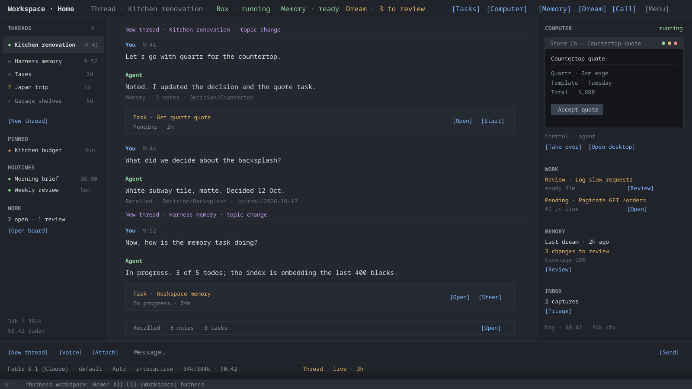
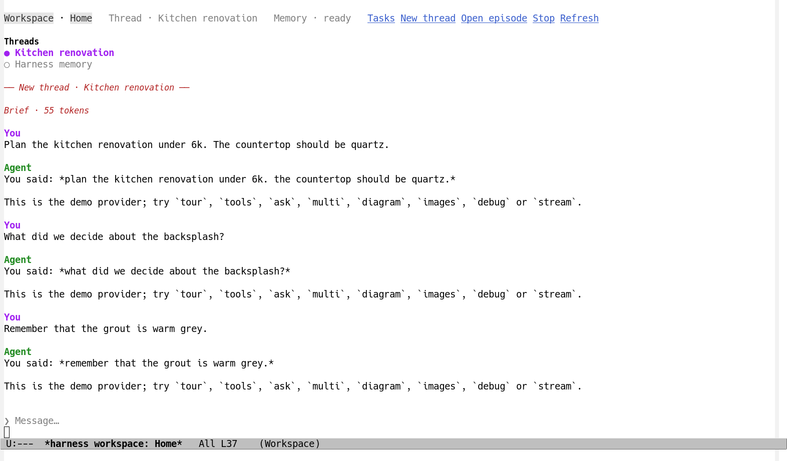

# Workspace mode

Design note, November 2026.  **First slice implemented.**  The core
chat, threads, episodes, routing, the brief, the Logseq markdown
knowledge graph with its `knowledge_*` tools, the Emacs workspace
buffer and the local computer with a real VNC screen are implemented
in `workspace`, `workspace-knowledge`, `logseq`, `workspace-box` and
`ui-workspace`.  The Logseq CLI and its DB graphs, the index, the
scribe and dream, the container backend, routines and voice are still
the staged design below.  This page is the design for the
whole mode: a persistent workspace chat with a long-term memory, a
computer of its own, and the whole harness underneath it.  The module contracts, UI copy, tests and staged plan
are on the [implementation page](workspace-mode-implementation.md).
The mode borrows the shape of two products -- OpenClaw's agent
workspace and OpenAI's dots -- but it is built from this harness's
sessions, task board, permission chain, sandbox and merge queue rather
than beside them.

The short version: **one chat, many threads, one knowledge graph, one
computer, every tool.**  The user types (or speaks) into what feels
like a single conversation.  The harness decides whether the message
continues the current thread, revives an older one, or starts a new
one; when it starts a new one it gives the model a fresh, small context
built from a Logseq graph instead of making it carry a compacted
transcript forever.  A background scribe and a nightly *dream* keep
that graph true.  The workspace has a persistent sandbox -- its own
desktop, browser and toolchain -- which the agent can use, the user can
take over, and which survives across conversations.  Everything the
harness can already do (tasks, worktrees, the merge queue, sub-agents,
supervisor plans, sessions, notifications, skills) is available from
the chat, so the same mode can run a life and run a task board.

## Design pages

- **This page** is the design: why the mode exists, what the user
  experiences, the Logseq memory, dreaming, the computer, work,
  routines, voice and clients.
- [The implementation design](workspace-mode-implementation.md) is the
  contract for building it: modules, storage, methods, events, options,
  tools, prompting, the detailed UI and copy inventory, tests, the
  staged plan, alternatives and open questions.
- [The workspace computer](workspace-computer.md) records the real
  computer that is implemented: the `local` X display, x11vnc, the
  noVNC page and WebSocket bridge, the browser profile, the control
  lock, its tools and its boundary.

## Contents

- [In short](#in-short)
- [Why this mode](#why-this-mode)
- [The mental model](#the-mental-model)
- [The one chat](#the-one-chat)
- [Using it for a life](#using-it-for-a-life-not-only-for-a-repository)
- [Using it for the harness](#using-it-for-the-harness-itself)
- [A day in the life](#a-day-in-the-life)
- [Memory: the Logseq graph](#memory-the-logseq-graph)
- [Dreaming](#dreaming-keeping-the-graph-true)
- [The computer](#the-computer-a-workspace-box)
- [Work: tasks, routines and the task board](#work-tasks-routines-and-the-task-board)
- [Voice](#voice)
- [Clients and remote access](#clients-and-remote-access)
- [The implementation design](workspace-mode-implementation.md)

## In short

| Question | Decision |
|---|---|
| What is the user-facing unit? | A **workspace**: a named, long-lived assistant with a home directory, a Logseq graph, a set of threads, a task board and a computer.  A user can have several (`Home`, `Work`, a project's). |
| What is the chat? | A **timeline** of messages and events, stitched from many ordinary harness sessions and shown as one scroll.  It survives restarts. |
| How does context clear? | A **thread** is a topic.  Each live stretch of a thread is an **episode**, an ordinary session.  A topic shift, a long context, or a long gap ends the episode; the next message starts a new one from a **brief**, not from a compacted transcript.  The old episode stays searchable. |
| How does it pick a topic back up? | A router (heuristics first, a cheap model when ambiguous) chooses *continue*, *revive* or *new*, and the memory layer builds the brief from the thread's Logseq page, its linked pages, recent decisions and open tasks. |
| What is the memory? | A local **Logseq graph** is the source of truth: a markdown graph (`$LOGSEQ_HOME`, else `~/logseq`) in the first slice, a DB graph through the CLI in the full design.  A SQLite index adds full-text search, int8 embeddings and the link graph; it is a rebuildable cache, never the authority.  The harness's **memories** are only small behavioral notes and never the workspace's knowledge. |
| How is memory kept true? | A cheap **scribe** writes durable notes after turns; a **curator** maintains thread pages; a **dream** consolidates the day's notes, updates every page that needs it, finds contradictions and duplicates, and leaves a reviewable report.  Nothing durable is written without provenance. |
| What is the computer? | A persistent **box** with its own home, desktop (Xvfb + x11vnc + noVNC), browser profile, toolchains and servers.  The first implementation is the `local` backend: its own display and process tree on this machine, not a container; the status says `local display and process`, and the rootless-container backend remains the stronger design.  The agent has broad rights inside the box, the user can take over over VNC and return control, and host mounts are explicit. |
| How does it work on non-code work? | The workspace root is an ordinary project; task mode already works outside git.  Daily-life tasks, routines, notes, decisions, people and projects all live in the graph; the box is where the results are used. |
| How does voice fit? | A call attaches to a thread.  Live voice delegates each utterance to `workspace/prompt`; replies stream back to speech.  Voice turns are ordinary chat turns marked `voice`. |
| Where does it run? | In the harness process, with the UI in Emacs and the ACP client (Flutter) as a remote front end.  The box is a separate sandbox; the memory graph is local. |
| What is the implementation status? | The core chat, threads, episodes, the Logseq markdown knowledge graph and its tools, the Emacs UI, a workspace computer and its VNC screen are implemented; the Logseq CLI and DB graphs, the index, dreaming, the container backend, routines and voice are staged.  See the [implementation page](workspace-mode-implementation.md) and [the computer](workspace-computer.md). |

## Why this mode

The harness has two strong modes at the moment, and neither is a
place to live.

- **A session** is one conversation.  It is excellent at a piece of
  work, and its compaction keeps it inside a context window by
  summarising its own past.  But a person's work is not one
  conversation: it is a set of threads that go cold and come back, with
  decisions, preferences and open loops that must survive the
  conversation.  Compaction is the wrong tool for that, because it is
  lossy, it is tied to one window, and it has no way to bring in
  something that was said in another session three weeks ago.
- **Task mode** is one session per task.  It is excellent at parallel
  work, review and merges.  But it starts at the task and ends at the
  merge; it does not know what the user is trying to do this month,
  what was decided last time, or how to answer "what should I do next?"
  without being told.

Workspace mode fills the gap between them.  It is the conversation that
owns the tasks, the memory that outlives the conversations, and the
computer where the results are used.  Task mode remains the place a
unit of work is executed and reviewed; workspace mode is the place it
is decided, remembered and followed up.

### What OpenClaw and dots get right

This design is deliberately close to two products, and owes them the
obvious ideas:

| Idea | OpenClaw | dots | Here |
|---|---|---|---|
| The agent has a home | Workspace files (`MEMORY.md`, `USER.md`, daily notes), bootstrap files, skills | Its own cloud computer and browser | A workspace root with artifacts, skills and projects, a separate Logseq graph, and a persistent box |
| Memory is curated, not a transcript | Short-term recall, promotion, `DREAMS.md`, memory search (hybrid keyword + vector), active memory | Saved notes about preferences, decisions and ongoing work, separate from chat history | Logseq graph with block provenance, a hybrid index, a scribe and a dream |
| One assistant across entry points | Channels (Slack, Telegram, ...) reach the same agent | The same dot in ChatGPT, Slack, Teams and calls | One timeline reached from Emacs, the Flutter client and voice; later a messaging bridge |
| Work continues between conversations | Automations, heartbeats, sub-agents | Background agents, tasks between conversations, wake-ups | Threads, episodes, routines, tasks and sub-agents; the harness keeps working when the UI is closed |
| The computer is visible | Browser control, nodes | **Take over** / **Return control**, browser sign-in, cloud computer | A desk panel with screenshots, a full noVNC session, CDP browser tools, takeover and return control |
| The user stays in charge | Approvals, tool policy, sandboxing | Permissions, private sign-in forms, review | The harness permission chain, a box boundary, review gates on memory changes, and the task review flow |

### What is different here

- **The knowledge graph is Logseq, not a folder of Markdown.**  Pages,
  blocks, tags, properties, journals and bidirectional links are the
  data model.  Logseq's graph is what makes a long thread cohere: a
  decision is a page that links to a project, a person, a thread and a
  journal day; retrieving the thread brings the decision with it.
- **Every durable write has provenance.**  A memory block records the
  session and node that taught it, when, and how sure the scribe was.
  The user's own edits in Logseq outrank anything the agent wrote.
- **The work goes through task mode.**  The workspace can talk about a
  task, but the task still gets its own session, worktree, review and
  merge.  The workspace is the project manager, not a second kind of
  task runner.
- **The sandbox is the harness's.**  The box is a backend of the
  existing sandbox and access model, not a separate product with its
  own permission story.
- **Nothing is hidden in a cloud.**  The graph, the index, the box
  volume and the sessions are local by default.  Hosted models still
  see what is sent to them, which the existing provider and policy
  model already governs.

### Goals

1. One place to talk, for daily life and for harness work, that never
   makes the user manage a context window.
2. A memory that is deep, inspectable and correctable, with the graph's
   links doing the work that a flat vector store cannot.
3. A computer the agent can actually use, with enough freedom inside
   it to install, build, browse and run things, and a clear boundary
   around it.
4. Whole-harness work from the chat: tasks, sessions, sub-agents,
   plans, review, merges, notifications.
5. Continuity across restarts, devices and voice.
6. The same experience for a life admin thread and a repository: the
   difference is which tools and project the thread uses, not a
   different mode.

### Non-goals (for the first release)

- A hosted, always-on cloud dot.  The workspace runs in the user's
  harness.  It can run on a server the user owns, and the box persists,
  but there is no harness-hosted service.
- A general multi-user workspace.  One person, one harness.  Shared
  workspaces are a later design.
- Replacing Logseq's editor.  The Emacs UI can browse and search
  memory; deep editing belongs in Logseq.
- Full computer-use reliability.  The browser and the screen-level
  computer tool are best-effort; the user can take over.
- Automatically verifying or merging the user's tasks.  The workspace
  may report and propose; the user reviews.

## The mental model

```
Workspace "Home"
├── Timeline        one scroll of messages and events, across threads
├── Threads         topics, each a page in the graph and an episode session
│   ├── Kitchen renovation      episode s-… (live)   page Threads/Kitchen renovation
│   ├── Harness memory          parked               page Threads/Harness memory
│   └── Taxes                   parked               page Threads/Taxes
├── Memory          a Logseq DB graph + a search index
│   ├── Journal/2026-11-06
│   ├── Projects/emacs-agent-harness
│   ├── Decisions/Countertop
│   ├── People/…
│   └── Dreams/2026-11-06
├── Work            tasks (the existing task board), routines, sub-agents
├── Desk            the persistent box: desktop, browser, files, artifacts
└── Routines        scheduled briefs and follow-ups
```

- A **workspace** is the long-lived assistant.  It has a name, a root
  directory, a project (the root's), a Logseq graph, a model and
  permission defaults, a box, routines and threads.
- A **thread** is a topic with a life of its own: a goal, a state, a
  page in memory, and a list of episodes.  "Kitchen renovation" and
  "the harness memory module" are threads.  A thread can be pinned,
  parked, renamed, merged into another, or marked done.
- An **episode** is one live stretch of a thread: an ordinary harness
  session.  It has a model, a context window, tools, a transcript and
  a cost, exactly like any other session.  What makes it an episode is
  that the workspace created it for a thread, gave it a brief, and will
  route the thread's next message to it while it is live.
- The **timeline** is the user's one chat.  It is not itself a session
  transcript.  It is an ordered log of entries: user messages, agent
  replies, thread dividers, brief cards, task and routine events, and
  voice calls, each pointing at the node or record that holds the
  content.  The UI resolves those pointers and draws one scroll.
- The **brief** is the fresh context an episode starts with: stable
  identity and preferences, the thread page, its linked pages, relevant
  project and task state, recent turns, and a bounded recall set.  It
  is a message from the harness, not from the user, and the UI folds it
  into a card.
- **Memory** is the Logseq graph.  The search index and its vectors are
  a cache.
- **Dreaming** is the background consolidation: read the day, update
  every page that should know, resolve duplicates and contradictions,
  write a report, and propose the changes that need a person.
- The **desk** (UI label `Computer`) is the sandboxed box: its desktop,
  browser, files, servers and artifacts.
- A **routine** is a saved prompt with a schedule or trigger and a
  delivery choice: the morning brief, the weekly review, the "when this
  task finishes, tell me" follow-up.
- A **channel** is how the user reached the workspace: Emacs, the
  Flutter client, a voice call, later a chat network.  Channels share
  the timeline and memory.  A private aside is a BTW, not a channel.

## The one chat

### What the user sees

The workspace buffer is a chat with three additions -- a thread
sidebar, a memory-backed header, and divider cards where the topic
changes -- and, when there is room, a side panel for the computer and
the work digest.  The panel is a view of its own, not part of the
timeline.

```
Workspace · Home        Thread · Kitchen renovation       Box · running      [Tasks] [Computer] [Memory] [Dream] [Call]
──────────────────────────────────────────────────────────────────────────────────────────────────────────────────────
Threads                  ┌─ New thread · Kitchen renovation · topic change ────────────────────────────────┐
● Kitchen renovation     │ You  9:41                                                                     │
○ Harness memory         │ Let's go with quartz for the countertop.                                      │
○ Taxes                  │                                                                               │
                         │ Agent                                                                         │
                         │ Noted.  I updated the countertop decision and the quote task.                 │
                         │ Memory · 2 notes · Decision/Countertop                                        │
                         │                                                                               │
                         │ Task · Get quartz quote        Pending · 2h        [Open] [Start]              │
                         │                                                                               │
                         │ You  9:44                                                                     │
                         │ What did we decide about the backsplash?                                      │
                         │                                                                               │
                         │ Agent                                                                         │
                         │ White subway tile, matte.  Decided 12 Oct.                                    │
                         │ Recalled · Decision/Backsplash · Journal/2026-10-12                           │
                         └───────────────────────────────────────────────────────────────────────────────┘
                         ┌─ New thread · Harness memory · topic change ─────────────────────────────────┐
                         │ You  9:52                                                                     │
                         │ Now, how is the memory task doing?                                            │
                         │                                                                               │
                         │ Agent                                                                         │
                         │ In progress.  3 of 5 todos; the index is embedding the last 400 blocks.      │
                         │ Task · Workspace memory        In progress · 24m        [Open] [Steer]         │
                         └───────────────────────────────────────────────────────────────────────────────┘
[New thread] [Voice] [Attach]  Message…                                                                    [Send]
```



The implemented first slice, captured live: the header, the thread
list, a divider, the brief card and the timeline, with the same compose
box a chat uses.



The design is deliberately a chat first.  There is no dashboard to
learn: the thread sidebar is a list, the header is a status line, and
everything else opens in a window beside the chat, as the task board
already does in its fullscreen layout.  The picture is a mockup drawn
from the copy inventory on the
[implementation page](workspace-mode-implementation.md#copy-inventory-before-implementation).
The live screenshot below is the first slice; the mockup remains the
full design (`Computer`, `Dream`, the side panel) for the later stages.

### Threads

The sidebar lists, in order: the active thread, pinned threads, other
parked threads, and (behind a fold) done threads.  Each line has a
state, a name and a last-touched time.  A state is one of:

| State | Meaning | What the line says |
|---|---|---|
| `live` | has an episode that is running, idle or blocked | `●` and the thread's name |
| `parked` | no live episode; the transcript is kept and the router may revive it | `○` and the name |
| `done` | the user finished it; the router leaves it alone unless asked | `✓` and the name |
| `waiting` | an episode waits on a question or permission | `?` and the name |

Clicking a thread:
- with no arguments, shows its last episode in the timeline and makes
  it the active thread;
- with a prefix argument, starts a new episode in it (a "fresh take");
- `[Pin]` keeps it above the fold and always in the router's
  candidates;
- `[Park]` ends its live episode at the next turn boundary and leaves
  the page and transcript for revival;
- `[Rename]` changes the thread's name and the page title.  A page
  rename the CLI version does not support is done as a new page with
  the children moved and the old page marked `superseded-by`; the
  thread record and links follow, and the timeline does not move;
- `[Merge]` folds it into another thread: the old thread's entries are
  drawn under the target (the timeline itself is not rewritten), the
  pages are linked, and the old page becomes a redirect
  (`superseded-by::`) rather than being deleted;
- `[Done]` marks it done; memory keeps the page, and the dream treats
  its open loops as resolved or asks.

A thread's page in Logseq is the shared state between the chat, the
memory and the dream.  It is not a copy of the transcript.  It holds:

```markdown
Threads/Kitchen renovation
  workspace-status:: active
  project:: [[Projects/Home]]
  goal:: Quartz countertop and a matte white backsplash, under 6k.
  next-action:: Approve the quote from Stone Co.
  open-loops::
    - Waiting on the fabricator's template date
  decisions:: [[Decisions/Countertop]], [[Decisions/Backsplash]]
  sessions:: s-…, s-…
  last-touched:: 2026-11-06
```

The brief for an episode of this thread is built from this page, its
linked pages and the pages that link to it.

### Episode boundaries, or "clearing" context

The user never asks for a compaction.  Context ends for one of these
reasons, and each is visible in the timeline as a divider:

1. **Topic change.**  The router is confident the message is about
   something else.  The current episode ends at its last turn; a new
   episode starts with a brief.  The divider says `New thread · <name>`
   or `New thread · <name> · topic change`; the thread sidebar grows.
2. **Long context.**  The episode reaches
   `harness-workspace-episode-context` (a share of the model's window,
   60% by default) or its step count.  At the next turn boundary the
   episode is parked and a new one starts in the same thread with a
   *continuation brief*: the thread page, the last few turns, and the
   decisions since.  This is not compaction: the old transcript is
   still whole, and the new episode is a fresh, small request.
3. **Long gap.**  The user comes back after
   `harness-workspace-thread-idle-hours` (8 by default) without
   touching the thread.  A new episode starts with a re-entry brief;
   the old one is warm only if the cache module kept it so.
4. **Project switch.**  The message clearly targets another project's
   thread.  The router revives that thread, and the divider names the
   project.
5. **Explicit request.**  `New thread`, `Start over`,
   `Forget this episode`, `/new`, or a message that says "let's talk
   about something else".  The user is always right.
6. **A crash or a restart.**  Episodes are sessions and survive; on
   the next message the workspace checks whether the live episode is
   still open, and either resumes it or starts a new one with a brief.

Why this is better than compacting one window:

- the old transcript is not summarised away; it is a session that can
  be searched, read, forked or reopened in full;
- the new episode does not pay for the old conversation's tokens;
- the new episode can include things the old one never saw: a decision
  from another thread, a task result from yesterday, a page the user
  edited in Logseq;
- a topic's context is a page, not a window, so it can be inspected
  and corrected by the user.

The cost is that the brief must be good.  That is the memory system's
job (below), and the brief is shown, not hidden.

### Routing

Every message goes through `workspace/prompt`, which decides where it
goes.  The decision is cheap and explainable.

1. **Hard signals first, without a model.**
   - an explicit thread reference (`@Kitchen renovation`, a click on a
     thread, a reply to a message in a thread);
   - an explicit command (`/new`, `/continue`, `/park`, `Start over`);
   - the only live episode, when there is exactly one and it is running
     or waiting on the user: the message steers it, as a message to a
     running session does today; a question or permission it waits on
     is answered in the workspace's pending panel, not by a chat line;
   - a project path or a task reference in the message, which names the
     thread or the task's thread;
   - a gap longer than the idle limit, which forces a new episode in
     the same thread.
2. **Similarity, still local.**  Embed the message and compare it with
   the thread summaries and the last turns of the live episode.  A
   clear margin picks that thread; a clear distance from every thread
   suggests a new one.  This is the same hybrid machinery as memory
   search, with no model call.
3. **The router model, only when ambiguous.**  A simple-tier model gets
   a compact state: the current thread's title and summary, the
   pinned and recently used threads, the active episode's last three
   messages, the project and its active tasks, and the user's line.  It
   answers JSON only:

   ```json
   {"action": "continue",
    "thread": "th-…",
    "title": "Kitchen renovation",
    "project": "/home/me/workspace",
    "confidence": 0.86,
    "recall": ["countertop", "Stone Co", "quote"]}
   ```

   `continue` uses the live episode; `revive` parks it and starts a new
   episode in the named thread; `new` starts a new thread; `split`
   starts a new thread and leaves the old one live (the user asked for
   a separate line of work).  A confidence below
   `harness-workspace-router-threshold` means *continue*: a wrong split
   is more annoying than a slightly long thread.  A router that fails,
   times out or answers nonsense also means *continue*.
4. **Name it.**  A new thread's name comes from the naming model, as a
   session's does; the title can be edited.  The router's title is only
   a fallback.

The message appears at once in the timeline as a pending bubble, with
a small `Routing…` activity; when the episode is chosen, the bubble
becomes that episode's user node and the reply streams into the same
thread.  If routing fails, the message goes to the current thread; no
message is lost.  A message that arrives while the active episode is
running steers it, as any running session is steered, unless the user
forces `New thread`.

The decision is never hidden: the divider says what happened, and its
buttons offer `Keep in this thread` (merge the new episode back into
the old thread), `New thread` (split), `Rename`, and `Episode`.
A wrong decision costs one click, not a lost conversation.

### The brief

The context broker builds the brief.  It is bounded by
`harness-workspace-brief-tokens` (24k by default, or the model's window
divided by three, whichever is smaller), and every part says where it
came from.

| Part | Source | Budget | What it is |
|---|---|---|---|
| Identity | workspace instructions, `Preferences` page, `People/<user>` | 5% | Who the user is, standing instructions, how they like to work |
| Thread | the thread page, its child blocks, linked `Decisions` and `People` | 20% | Goal, status, next action, open loops, decisions, recent episodes |
| Project and work | the project, active tasks, recent results | 20% | What is happening now, what is blocked, what is waiting for the user |
| Recall | hybrid search over the graph, expanded one link hop | 35% | The blocks that answer the message, with breadcrumbs and sources |
| Recent | last `harness-workspace-brief-recent-turns` (6) messages of the episode or thread | 15% | The immediate register, verbatim |
| Working set | attachments, files, URLs, screenshots, the box state | 5% | What the user pointed at |

The brief is a harness message with `:kind 'workspace-brief` at the
start of the episode.  It is recorded in the session, so the model's
request and the transcript agree, and it is folded in the UI to one
line: `Recalled · 8 notes · 3 tasks`.  Opening it shows the exact
sections, the pages and the token counts -- the same information the
model got, not a summary of it.

The stable parts (identity, thread, project) come first, the volatile
recall last, to leave the prompt-cache prefix as long as the provider
allows.  Episodes of the same thread and model may start from a warm
**thread seed** (see Cache and cost), so a thread revived several times
does not write its stable brief into the cache each time.

If the brief is thin -- no thread page, no recall, a brand-new thread --
it says so in one line, and the episode is told to ask rather than
invent.  A recall failure never blocks the turn; it is a hint
(`Recall unavailable · <reason>`), and the agent can call
`memory_search` itself.

### What the user can do at any time

- **Correct the thread.**  `Keep in this thread`, `New thread`,
  `Merge`, `Rename`, `Pin`, `Park`, `Done`.  These are actions on the
  timeline, not on a hidden router.
- **Correct the memory.**  Open a recalled page from the brief card,
  edit it in Logseq, or ask the agent to `remember`, `update` or
  `forget` something.  The memory browser (see the UI section of the
  [implementation page](workspace-mode-implementation.md)) shows what
  the scribe wrote and where it came from.
- **Correct the episode.**  `Episode` opens the ordinary session
  behind the thread: its full transcript, its model, its context, its
  tools.  The user can read, fork, compact or delete it like any
  session; the timeline follows the deletion.  A fork is a session of
  its own; `Add to thread` links it to the thread as a branch if the
  user wants to keep it.
- **Switch the register.**  `Call` starts a voice call on the thread;
  the settings line's model picker gives the thread a cheaper or a
  stronger model; a supervisor task is the deep-work path.
- **Interrupt.**  `Stop` cancels the turn, as it does in any session.
  The message stays in the timeline, marked interrupted.

### The session behind the chat

Episodes are ordinary sessions of a new kind, `workspace`, created
with:

```elisp
(session/create
 :kind 'workspace
 :cwd <thread project, else workspace root>
 :project <the same>
 :model <thread or workspace model>
 :thinking <level>
 :permission-mode <workspace default>
 :non-interactive <workspace default>
 :context-window-limit <episode limit>
 :ext (list :workspace "w-…" :thread "th-…" :episode 1))
```

A thread's project is the workspace root by default; a project thread
names its checkout, and its episodes work there.  The box mounts that
project at `/projects/<name>`, so the chat's shell and the repository
are the same files.

They are listed with kind `workspace` and named after their thread
(`Kitchen renovation · 2`), so the session list and the tree still make
sense.  The workspace module subscribes to their `agent/turn-ended`,
`session/pending-changed` and `agent/tool-call` events to write the
timeline and the memory notes.  The thread page keeps the episode ids,
so a revived thread never needs a database scan to find its history.

A workspace has no "control session".  Settings that apply to future
episodes live in the workspace record; the current episode's settings
are its own and can be changed from the chat's setting line, as in any
session.  Opening a workspace with no live episode shows the defaults
and creates the first episode when the first message is sent.

### Channels and privacy

Emacs, the Flutter client and voice all call `workspace/prompt` and
read `workspace/timeline`.  A message sent from a phone is in the
timeline in Emacs, and the reply is too.  That is the point of one
chat.

The active thread is the client's, not a single workspace cursor: a
prompt names its thread when the client has one, so two devices can
read different threads without fighting over the workspace's cursor.
The workspace keeps the last thread only as the default for a client
that has none.

A **BTW** side conversation remains private to its channel: it is a
separate session with `kind 'btw`, it is not written to the timeline
unless the user says `Add to thread`, and the scribe does not read it
by default.  This is the escape hatch for "answer this without putting
it in my life log".

Messages from a voice call are marked `voice`; messages from another
client carry the client's name in `:meta`.  The timeline is the same;
the provenance is not lost.

## Using it for a life, not only for a repository

The mode is not a coding tool with a notes page.  A workspace can be a
plain directory with no repository at all:

```
~/workspace-home/
├── inbox/                  quick captures, receipts, photos
├── artifacts/              what the box produced, by date
├── projects/               checkouts and the agent's own projects
├── skills/                 skills the user or the dream promoted
└── bin/                    small scripts the agent keeps

~/logseq/graphs/home/db.sqlite   the graph, outside the workspace root
```

A "Life" workspace uses it for:

- **Capture.**  `M-x harness-workspace-capture` (or the phone's share sheet)
  appends a block to `Inbox` without calling a model.  The morning
  routine or the dream triages it into a task, a thread or a page.
- **Planning.**  "Plan the kitchen renovation under 6k" starts a
  thread; the agent asks, researches in the browser, writes a plan page,
  links decisions and submits the quote tasks.
- **Follow-ups.**  "Remind me to call the fabricator on Tuesday" is a
  routine or a Logseq task with a date; the workspace notifies at the
  right time, in the chat or on the phone.
- **Research.**  "Compare three travel insurance policies" runs a
  browser thread in the box, saves sources as pages, and writes a
  decision.
- **People and commitments.**  A `People/` page holds what the user
  told the agent, with the date and source; the dream surfaces "you
  said you'd send Ada the draft last week".
- **Weekly review.**  A Sunday routine reads the journal, the open
  loops and the task board, and proposes what to drop, what to do next
  and what to ask about.
- **A project of the user's own.**  The box is a place to build a
  small program, a spreadsheet, a website, a 3D print, a home server --
  with the agent installing what it needs and the user taking over when
  it needs eyes.

Calendar, mail, chat and the like are ordinary tools: an MCP server,
the harness's own tool, or the box's browser as the fallback.  The
workspace does not invent an app platform; it uses the ones the
harness already discovers, and the brief says which it used.

## Using it for the harness itself

The same workspace can be pointed at the harness checkout, or at a
"Harness work" project, and used as the project manager:

- "What is blocked?" -> `task_list` with the needs-input column,
  `session_list` for blocked sessions, and a digest from
  `workspace_brief`.
- "Get the memory task finished" -> `task_get`, `session_read`, a
  message to the task's session, or a `task_control reject` with
  feedback; the workspace watches `task/review` and reports.
- "Make a task for the merge queue bug" -> `task_submit` with the
  prompt, project and priority; the thread keeps the task id and the
  dream links it to the project page.
- "Research this before we decide" -> `spawn_agent` forks or fresh
  sub-agents; their reports come back to the episode and are written
  to memory.
- "Plan this refactor" -> supervisor mode, with the plan and its
  workers visible as sessions; the workspace follows the plan's
  events and reports.
- "Review this" -> open the task's report and review threads in a
  popout, with the changes; the user verifies, never the workspace.

The workspace agent is told the difference between doing and
delegating:

> Do small, self-contained things here.  For work that will outlive
> this conversation, touch a repository, need review, or should run in
> parallel, use the task board: submit a task with a self-contained
> prompt and the context the task needs.  Do not do a task's work in
> the chat and then submit a task for it.

This is the same shape as the supervisor mode's guidance, but for a
person rather than a plan.

## A day in the life

A small example of how the pieces meet; none of it is a special case.

- **07:50.**  The phone share sheet adds "call the plumber" to `Inbox`.
  No model runs.
- **08:00.**  The `Morning brief` routine runs in a new thread.  It
  reads the inbox, the task board and the dream's report: two tasks
  wait for review, one waits on a question, the kitchen quote is still
  open.  It sends a short chat card and a notification.
- **08:10.**  "The quote is 200 over; ask for the template date."
  The router keeps it in the kitchen thread.  The agent updates
  `Threads/Kitchen renovation`, writes a decision note and sends the
  fabricator an email in the box -- after the user approves the send.
  The scribe writes the commitment to `People/Stone Co`.
- **09:30.**  "Get the memory task merged."  The workspace reads the
  task, summarizes the report and the open review threads, and waits
  for the user to verify.  The user does; the merge queue finishes; the
  task linker writes the result to the project page.
- **11:00.**  A new topic: "Compare two travel insurance policies for
  the Japan trip."  A new thread, a new episode, a fresh brief.  The
  agent browses in the box, saves the two sources as pages, and writes
  a decision; the user takes over once for a login.
- **14:00.**  A voice call attaches to the Japan thread.  The workspace
  reads the two policies aloud in a sentence each; the user asks for
  the cancellation terms; the agent checks the pages and answers.  The
  call ends while a task checks the visa rules; a call-back notification
  arrives when it is done.
- **18:00.**  The weekly review routine proposes what to drop and what
  to do next; it does not verify or delete anything.
- **03:00.**  The dream reads the day, links the plumber to the house
  project, merges two spellings of the fabricator, updates the kitchen
  thread's next action, and leaves one contradiction for review.  The
  morning brief will count it.

## Memory: the Logseq graph

The decision that this graph, and not the harness's memory module, is
the workspace's knowledge, and how the first slice keeps it in a
markdown graph, is in
[the knowledge graph note](workspace-knowledge-graph.md).

### Why a graph

A vector store over old messages is a bag of fragments.  It can find a
sentence that looks like the query; it cannot tell you that the
sentence was a proposal, that it was superseded by a decision two
weeks later, that the decision belongs to the kitchen thread and to
the contractor, and that the contractor's page says the quote is still
open.  The links are the difference between retrieval and memory.

Logseq gives the links, pages, blocks, journals, tags and properties
already, in a database graph with a CLI that runs headless.  The
harness should not rebuild that; it should add the two things Logseq
does not have -- a semantic index and an agent that maintains it -- and
stay out of the editor's way.

What the graph gives the workspace:

- **Block identity.**  Every durable note has a UUID that survives
  edits, so provenance points at a block, not a line number.
- **Bidirectional links.**  A decision links to a project and a person;
  the project's and the person's pages show it without anyone copying
  it.
- **Journals.**  The day is a page.  A dream can read the day and write
  to it; a thread can point at the day it was born.
- **Properties and tags.**  `status`, `project`, `source-session`,
  `confidence`, `supersedes` and the like are structured, queryable and
  visible in Logseq's UI.
- **A human editor.**  The user can open the graph and correct
  anything the agent wrote.  That is a feature, not an escape hatch.

What it does not have, and the harness adds:

- a semantic index over blocks and pages;
- a hybrid ranker that combines words, meaning, links and time;
- a writer that decides what is worth remembering;
- a consolidation pass that keeps the graph coherent.

### The graph is the source of truth

The index in the harness is a **cache**.  Deleting it loses nothing:
the graph holds every note, and the index is built again from the
graph.  The opposite is not true: a change the agent wants to keep is
written to the graph *first*, through the Logseq client, and only then
indexed.  If the index write fails, the memory is still correct and
the index catches up later.

This ordering also makes recovery simple: a corrupt index is deleted,
a dream or a background sync rebuilds it, and the graph is untouched.
The graph itself is backed up before every dream (a Logseq graph backup
or an export), and the workspace keeps `harness-workspace-graph-backups`
(7) of them.

### The graph, the root and the workspace

A workspace has a **graph directory**, resolved in this order:

1. its `:graph`, set when the workspace is created or changed;
2. `harness-logseq-directory` when set;
3. `$LOGSEQ_HOME` when it names a directory;
4. `~/logseq`.

The default layout is the user's Logseq markdown graph, outside the
workspace root and the box's mounts:

```
~/logseq/
├── pages/                  one file per page: Threads/, Projects/, …
└── journals/2026-11-07.md  one file per day
```

A user who already has a graph can point a workspace at it:

```elisp
(harness-call 'workspace/update id :graph "~/logseq")
```

The first slice reads and writes that markdown graph directly: pages
and journals are files, blocks are bullets, properties are
`key:: value`, and the day's journal captures what was said.  It never
touches `logseq/` inside the graph, which is Logseq's own, and it never
deletes a page or a block: that is the user's editor.  The full design
replaces the file access with the Logseq CLI for a DB graph (below);
the methods stay the same.

A workspace with no graph is still usable.  The first time it needs
knowledge, it creates `pages/` and `journals/` in the graph directory
and writes the thread's page there.  If the directory cannot be
written, the workspace runs in **degraded memory**: session search and
the timeline still work, no knowledge is written, and the header says
`Knowledge · unavailable`.  It never silently pretends to remember.

### The page schema

The schema is small enough to explain in one page and rich enough for
the dream to maintain.  It is created once, idempotently, when a graph
is attached.

**Pages and namespaces**

| Page | Holds | Example |
|---|---|---|
| `Workspace` | the workspace's own page: instructions, links, settings the user wants visible | `Workspace` |
| `Preferences` | durable preferences: how the user likes to work, tone, boundaries | `Preferences` |
| `People/<name>` | a person: relationship, preferences, commitments, dates | `People/Ada` |
| `Projects/<name>` | a project: path, repository, status, decisions, gotchas | `Projects/emacs-agent-harness` |
| `Threads/<name>` | a thread: goal, status, next action, open loops, decisions, episodes | `Threads/Kitchen renovation` |
| `Decisions/<name>` | one decision: what, why, alternatives, status, supersedes | `Decisions/Countertop` |
| `Routines/<name>` | one routine: schedule, prompt, delivery, last/next run | `Routines/Morning brief` |
| `Journal/<date>` | the day: captures, turns, task events, links | `Journal/2026-11-06` |
| `Dreams/<date>` | the dream's report and the changes it proposes | `Dreams/2026-11-06` |
| `Inbox` | uncategorised captures; the dream or the user triages them | `Inbox` |
| `Playbook` | procedures the agent learned, and candidate skills | `Playbook` |
| `Sources/<name>` | a durable source: a URL, a document, a book, a receipt | `Sources/Stone Co quote` |
| `Tasks/<id>` | a mirror of a harness task: title, state, thread, project, session | `Tasks/t-…` |

Journal pages are resolved by date through the CLI's journal target;
`Journal/2026-11-06` is the canonical reference the module uses in
provenance and links, not a requirement on the graph's journal display
name.  A graph whose journal page is `Nov 6th, 2026` still works: the
client resolves the date and returns the page's real name.

**Tags** -- `#Thread`, `#Project`, `#Person`, `#Decision`, `#Routine`,
`#Dream`, `#Memory`, `#Source`, `#Task`.  A page is tagged as well as
named, so a query does not depend on a name prefix.  A `Tasks/<id>`
page mirrors a harness task; it is not a second board, and its state
comes from the task event that wrote it.

**Properties** -- created with `logseq upsert property` on setup:

| Property | Type | Used on | Meaning |
|---|---|---|---|
| `workspace-status` | text | thread, project, decision, routine | `active`, `parked`, `done`, `open`, `superseded`, `paused`; named apart from Logseq's built-in `status` |
| `project` | node | thread, task, decision, source | the project page |
| `thread` | node | decision, task, journal block | the thread page |
| `source-session` | text | any memory block | the session id that taught it |
| `source-node` | text | any memory block | the node id inside that session |
| `learned-at` | date | any memory block | when the agent wrote it |
| `confidence` | number | inferred memory | 0 to 1; the dream uses it |
| `supersedes` | node | a decision or page | the older decision/page |
| `superseded-by` | node | a decision or page | the newer one |
| `last-touched` | date | thread, project, person | the last meaningful change |
| `next-action` | text | thread, project | the next concrete step |
| `open-loops` | text (multi-line children) | thread, person | what is still owed |
| `deliver-to` | text | routine | `chat`, `notification`, `voice` |
| `trigger` | text | routine | when it runs |
| `review` | text | dream operation | `needed`, `applied`, `rejected` |

Logseq's own editor decides how these look; the harness only requires
that they exist and are queryable.  A property the graph does not have
is created before the first write that uses it, and a write that names
an unknown property is refused, not silently dropped.

**Blocks**

Every durable block follows a shape:

```markdown
- 14:20 [[Threads/Kitchen renovation]] Chose quartz for the countertop.
  source-session:: s-01J…
  source-node:: n-…
  learned-at:: 2026-11-06
  confidence:: 0.9
```

The sentence is the memory; the properties are its provenance.  A block
without a source is either the user's own writing (which is trusted) or
a synthesis the dream marked `#Dream`.

### The Logseq client

**The first slice** has `lisp/modules/harness-logseq.el`, a client for
a markdown graph: `logseq/status`, `logseq/page`, `logseq/page-add`,
`logseq/block-add`, `logseq/property-set`, `logseq/search` and
`logseq/backlinks`, with atomic file writes.  It follows the Logseq
skill's format: `- ` bullets, indented children, `key:: value`
properties, `[[Page]]` links, no headers and no separators.  Search
reads the newest pages and journals and ranks the blocks it finds; it
is not an index yet.

The full design below is the CLI client for a DB graph:

The `logseq` module is a small, strict client for the Logseq CLI.  It
does not know about workspaces or memory policy; it knows the commands,
the JSON and the lock.

**Commands it uses**

| Need | Logseq CLI |
|---|---|
| graph setup | `graph list`, `graph create`, `graph info`, `graph backup create` |
| read a page or block | `show --page NAME`, `show --uuid UUID` |
| find by words | `search block --content`, `search page --content` |
| structured reads | `query --query EDN`, `query --name NAME` |
| write | `upsert page`, `upsert block`, `upsert task`, `upsert asset` |
| change | `upsert block --id`, `move`, `remove` |
| bulk input | `upsert block --blocks-file PATH` |
| schema | `upsert property`, `upsert tag` |

Every call is made with `--graph NAME --root-dir DIR --output json`,
with the arguments passed as a list, never through a shell.  The JSON
is parsed into plists; a command's `status` that is not `ok` is an
error with the command's own message.  The module logs the command and
its duration, never a block's text.

**One writer**

Writes are serialized in one queue inside the harness process.  The
queue is not a lock around a shell command; it is a promise chain:
each graph write starts after the previous one settles.  Its index
update is queued with it -- the FTS row and the links at once, the
embedding in the background -- so the next search can find the text
even while its vector is still being made.  A write that fails is
retried once with a backoff, and a `graph locked` or a worker revision
mismatch is retried after a `server restart`; after that it is reported
to the caller and the dream/scribe, which can queue it for later.  There is no second writer
in the workspace; the user editing in Logseq is the only other writer,
and Logseq's own lock is the boundary.

**Reads and caching**

Page UUIDs, property names and graph info are cached for a short time
(`harness-logseq-cache-seconds`, 30).  A write invalidates the entries
for the page it touched.  A read that needs a page's children asks for
the tree once, not once per block.  A batch write (a day's journal, a
dream's operations) uses one `--blocks-file` call rather than one call
per block.

**Two reads are queries.**  `changes-since` and `backlinks` are
Datalog queries, not CLI commands.  The module keeps a small set of
validated query templates and passes user values as EDN parameters,
never as text spliced into a query.  A graph version whose query shape
is not known falls back to a page walk (`list page` by update time,
then `show`) and says so in `logseq/status`; a query is never the only
way to read the graph.

**CLI absence and HTTP fallback**

The desktop Logseq app exposes a token-authenticated `POST /api` with
the plugin SDK methods.  It is useful when the desktop app is already
open and the CLI is not installed, but the CLI is the primary path
because it is headless and versioned with the app.  The module detects
both:

- `logseq/status` says `cli`, `http`, `both` or `none`, the version,
  the graph root, the graph name and the write queue's state;
- a workspace whose graph is served by HTTP uses the same methods; the
  client chooses the transport per call, with the CLI preferred.

**What the client deliberately does not do**

- It does not parse or write `db.sqlite`.
- It does not run two `upsert` calls at once.
- It does not create pages with illegal names: names are normalized,
  `/` is a namespace separator, and a name that Logseq would rewrite is
  reported before the write.
- It does not delete a page or a block without a caller that says it is
  a delete; the memory tools that expose deletion ask the user.

### The index

`workspace-knowledge.db` in the harness state directory is SQLite, with
FTS5 and the quantized vectors.  It is a cache; `memory/reindex`
deletes and rebuilds it.

**Tables**

```sql
meta(key TEXT PRIMARY KEY, value TEXT)           -- schema, graph, model, last sync
pages(id INTEGER PRIMARY KEY, uuid TEXT UNIQUE, name TEXT, kind TEXT,
      updated REAL, hash TEXT)
blocks(id INTEGER PRIMARY KEY, uuid TEXT UNIQUE, page INTEGER, parent TEXT,
       title TEXT, text TEXT, breadcrumb TEXT, updated REAL, hash TEXT,
       deleted INTEGER)
blocks_fts USING fts5(title, text, breadcrumb, content='blocks', content_rowid='id',
                      tokenize='porter unicode61 remove_diacritics 2')
chunks(block INTEGER, part INTEGER, hash TEXT, PRIMARY KEY(block, part))
vectors(hash TEXT PRIMARY KEY, model TEXT, dims INTEGER, scale REAL, vec BLOB)
links(from_uuid TEXT, to_name TEXT, kind TEXT)
threads(id TEXT PRIMARY KEY, title TEXT, page TEXT, project TEXT,
        status TEXT, summary TEXT, updated REAL, embedding BLOB)
sync_log(source TEXT PRIMARY KEY, offset TEXT, at REAL)
```

The block text is the block's title plus its body, with the page and
parent breadcrumb added to the front of the embedded text so a
fragment knows where it came from.  The FTS row keeps the title,
breadcrumb and body separately for snippets.

**Keeping it current**

- **Incremental, after writes.**  The workspace's own writes update the
  index in the same promise chain: the pages and blocks that changed,
  their chunks, their vectors, their links.  This is why a turn's note
  is searchable by the next turn.
- **Incremental, after user edits.**  Logseq is the other writer.  A
  sync loop asks `logseq/changes-since` for nodes updated after
  `meta.last-sync` and reads only those.  The query is a datalog query
  against the graph's update timestamps; it is validated on the graph
  version at startup, and a graph whose query shape is not known falls
  back to a page walk.  A user who edits a page and then asks the agent
  about it gets the edit, not yesterday's copy.
- **Full reconcile, in the dream.**  Once a day the dream compares the
  graph's page and block UUIDs with the index, removes what is gone,
  and re-embeds what changed by hash.  This is what catches deletes,
  page renames and imports that the incremental path did not see.
- **On workspace open.**  A background catch-up starts, newest thread
  first, and the header says `Memory · indexing` until it is done.
  A search that arrives during the catch-up uses what is indexed and
  says how much is missing (`Memory · 82% indexed`), instead of
  blocking the turn.

**Embeddings**

The vector layer is the same idea as `session-search`: cut a block into
at most `harness-workspace-knowledge-chunk-chars` (1200) characters, at a
paragraph or sentence boundary; hash each chunk; embed missing hashes
in batches of 16; store int8 quantized vectors with a scale; compare
with integer arithmetic in Elisp.  Text met twice -- a block quoted in
two pages, a fork's history -- is embedded once.

The embedding code is extracted from `harness-session-search.el` into a
small shared module (`harness-embeddings.el`) rather than copied:

- `harness-embeddings-chunks TEXT` -> pieces;
- `harness-embeddings-quantize VECTOR` -> `(SCALE . BYTES)`;
- `harness-embeddings-ints VECTOR` -> query vector;
- `harness-embeddings-cosine A B` -> score;
- `harness-embeddings-nearest TABLE QUERY LIMIT` -> rows;
- `harness-embeddings-embed TEXTS` -> a promise, recording usage;
- the model/dimensions settings and the "changing the model drops the
  vectors" rule.

`session-search` then uses the shared module; its tests stay the
regression suite for both.  If extracting it is too invasive for the
first stage, the workspace may copy the functions behind a deliberately
marked adapter, but the design prefers one implementation: the int8
math is easy to get subtly wrong twice.

The model is `harness-workspace-knowledge-embedding-model`; when it is nil,
the workspace uses `harness-session-search-embedding-model`; when both
are nil, semantic search is off and the index is keyword-only.  The
policy's allowed models apply.  In corporate mode only a local server
embeds, as session-search already enforces.  The model and dimensions
are part of the index's `meta`; a change rebuilds the vectors.

**What is not embedded**

- thinking, tool calls and tool results;
- raw transcripts (they remain `session_search`'s domain);
- blocks tagged `#Private` or under a page the user marked private;
- blocks the redaction layer masked, and the secret sources themselves.

The index does not become a second copy of every transcript.  It
indexes the distilled memory, plus the thread summaries the curator
writes.  That is smaller, more stable and more useful than a vector
index of everything ever said.

### Retrieval

`memory/search` is the one retrieval path, used by the brief, the tools
and the UI.  It takes a query, filters and a budget, and returns
ranked **cards**, not raw rows.

**The pipeline**

1. **Query understanding.**  The query is the user's message plus, in
   the brief, the thread's title, its open loops and its entities.  A
   cheap model is not needed for every search; a query that is a
   question is used as written, with its nouns extracted for the
   keyword half.
2. **Two recall channels.**
   - FTS5 over title, breadcrumb and body, with the same syntax as
     session search: words in any form, `"phrases"`, `prefix*`, `OR`,
     `-word`;
   - vectors of the same query, over the block chunks, with the int8
     cosine.
3. **Fusion.**  Reciprocal rank fusion (k = 60), as session-search
   does, so a block that is strong in either channel is not lost.
4. **Graph expansion.**  For each of the top seeds, add one hop:
   - the page owning the block and its parent breadcrumb;
   - the blocks the page links to (`[[...]]`) that are tagged
     `#Decision`, `#Project`, `#Person` or `#Thread`;
   - the blocks that link to the page (linked references);
   - the open tasks whose `project` or `thread` property is the page.
   An expanded item keeps its distance from the seed and gets a
   smaller weight.  This is what makes "what did we decide about the
   backsplash?" return the decision and the journal day it was made,
   not only the sentence that contains "backsplash".
5. **Boosts and decays.**  A small recency decay (half-life 90 days,
   configurable); a status penalty for `superseded`, `done` and
   `stale`; a boost for a pinned thread, a page the user opened
   recently, a decision still `active`, and a task still open.
6. **Deduplicate and budget.**  Neighbouring chunks of the same block
   collapse; the same page's children are kept together; the result is
   cut to the token budget, not a fixed count, with at least one item
   per channel when there is one.
7. **Explain.**  Each card says `:why`: `"words"`, `"meaning"`,
   `"linked from Threads/Kitchen renovation"`, `"open task"`,
   `"pinned"`, or a combination.  The UI shows a compact version; the
   agent sees the full one.

**A card**

```elisp
(:uuid "b-…" :page "Decisions/Backsplash" :breadcrumb "Projects/Home > Decisions"
 :title "White subway tile, matte"
 :text "Chose white subway tile, matte, 3x6, for the backsplash."
 :status "active" :updated "2026-10-12" :score 0.83
 :why ("meaning" "linked from Threads/Kitchen renovation" "decision")
 :links ("Threads/Kitchen renovation" "Projects/Home") :source-session "s-…")
```

**Modes**

- `hybrid` (default): both channels, fused;
- `words`: FTS only, for IDs, code symbols and exact names;
- `meaning`: vectors only, for "the thing about the...";
- `page`: everything under a page, in order;
- `thread`: the thread's page, its decisions, its open tasks and its
  last episodes, for a re-entry brief.

**Budget and latency**

A warm search is designed for 50 to 250 ms: SQLite FTS and an in-memory
vector scan over tens of thousands of chunks.  A cold index or a large
graph may take longer; the brief has a `harness-workspace-recall-timeout` (1.5 s) after which it uses what it has and says so.  The
query embedding, when semantic search is on, is the slow part; it is
cached for repeated queries (`harness-session-search--query-vectors`
already does this) and is skipped when the message is clearly a name
or a path.

**Active recall**

For a new or revived thread, and when the user asks "what do you
remember about X", the brief may be built by a **librarian**: a cheap
background session (kind `workspace-librarian`, hidden from the
session list by default) that gets the message, the thread page and
the first-pass cards, and may call `memory/search` and `memory/get` two
or three times to follow a link or disambiguate a name.  It returns a
selected, ordered set of cards with one line each, not prose.  Its
calls are recorded as a session, with its model, usage and cost, like
any other.
This is the "active memory" idea: retrieval as a small, bounded job,
not a hidden part of the chat model's prompt.

The librarian is optional (`harness-workspace-librarian`, on by
default when an embedding model is set and the provider's simple tier
exists).  When it is off, the deterministic pipeline is the brief.

### Memory tools

The workspace agent gets five tools.  The scribe writes with them, the
librarian and the dream read with them, and the module applies the
dream's batch, so there is one write path.

| Tool | What it does | Safety |
|---|---|---|
| `memory_search` | the retrieval above: query, mode, filters (`page`, `tag`, `project`, `thread`, `status`, `since`), limit, budget; returns cards with `:why` | read-only |
| `memory_get` | a page or block by name or UUID, with children and backlinks, depth-limited | read-only |
| `memory_write` | append a block, create a page, update a block or a property; links in the text; provenance filled by the module | asks when it would overwrite a block the user edited; refuses a declared secret, masks a known value |
| `memory_forget` | delete or redact a block/page, and remove it from the index | asks the user in every mode; records the deletion |
| `memory_status` | index state, last sync, last dream, pending review, counts, model, graph health | read-only |

`memory_write` is deliberately small:

```json
{"op": "append",
 "page": "Journal/2026-11-06",
 "text": "14:20 [[Threads/Kitchen renovation]] Chose quartz ...",
 "properties": {"source-session": "s-…", "source-node": "n-…"},
 "confidence": 0.9}
```

It validates the page and property names, fills `learned-at`, checks
for a duplicate block (same page, same normalized text, within a day)
and returns the block's UUID and a `:duplicate-of` when it found one.
An `update` carries `:expected-hash`; if the block changed since the
agent read it, the write is refused with the new hash, and the agent
re-reads.  This is optimistic concurrency, and it is what keeps a
scribe and a user edit from silently overwriting each other.

`memory_write` refuses a value that is a declared secret and masks a
value the redaction layer knows, replacing it with its placeholder and
saying so.  A block tagged `#Private` is not indexed and not recalled
by the brief; the user can still read it in Logseq.  A page that
becomes private is purged from the index at the next sync, not only
from future writes.

### Writing memory

There are four writers, each with a different job and a different
budget.

#### The scribe

After a turn ends, a **scribe** reads the turn and writes what is worth
keeping.  It is a cheap model (the simple tier of the workspace's
provider, unless `harness-workspace-scribe-model` says otherwise), it
has `memory_search`, `memory_get` and `memory_write`, and it has no
shell and no task tools.  It runs as a background session of kind
`workspace-scribe`, hidden from the session list by default, so its
prompt, tools, cost and choices are inspectable and it can be stopped;
it never appears as a chat.

The scribe's rule is: **durable, sourced, linked, short.**

- durable: a preference, a decision, a commitment, a fact about a
  person/project, an open loop, a correction.  Not "the user said
  hello", not the assistant's reasoning, not a tool's output;
- sourced: every block names `source-session` and `source-node`;
- linked: a block links to the thread page and to the page it is
  about (`[[Decisions/...]]`, `[[People/...]]`, `[[Projects/...]]`);
- short: one sentence per block, at most
  `harness-workspace-scribe-blocks` (6) per turn.

It searches before it writes.  A preference that already exists is
updated, not duplicated; a decision that contradicts an older one
either supersedes it (with the user's words as the source) or is
written as an open question, never as a silent replacement.  A turn
where the user said "remember" or "don't forget" gets an immediate
write; an ordinary turn may be batched.

**When it runs.**  The scribe is not on every turn by default.  The
turn's `:meta` decides:

- immediately when the user says remember/forget/decide/always/never,
  or the turn contains a task creation, a review decision, a merge or
  a routine change;
- otherwise every `harness-workspace-scribe-every` (4) turns, or when
  the episode ends, whichever comes first;
- never for a BTW or a private aside.

This keeps the cost near one cheap call per few turns instead of one
per turn, while a "remember this" is never deferred.

#### The curator

Every `harness-workspace-curate-every` (10) turns, or when a thread is
parked, a **curator** updates the thread page: the goal if it changed,
the status, the next action, the open loops, the decisions, the last
episodes and the last-touched date.  It does not rewrite the
transcript and does not create a new page unless the thread has none.
It uses `memory_get` and `memory_write`; when the next action is
genuinely ambiguous it records the ambiguity as an open loop and, if
it matters, posts one question card, without blocking the thread.

The curator is what makes a revived thread cheap: its page is already
a brief.

#### The task linker

The workspace subscribes to `task/changed`, `task/review`, `task/done`
and `merge/finished`.  On a change worth keeping it writes a journal
block and updates the project page and the thread that owns the task.
The thread is the one whose page names the task id, which the workspace
writes when it submits or promotes the thread; a task with no thread
goes to its project page and the inbox.  A change looks like:

```markdown
- 16:02 [[Projects/emacs-agent-harness]] Task [[Tasks/t-…]] ready for review: *Log slow requests*.
  source-session:: s-…
  changed:: review
```

It never duplicates a task event that is already in the journal (the
task id and the state are the key).  When a task is verified and
merged, the block says `done`, and the dream later folds the task's
result into the project page's "what changed" section.

#### The user

The user is a writer too.  They can edit the graph in Logseq, add a
block in `Inbox`, or reply to the agent's `memory_write` with a
correction.  User edits are the highest trust.  The scribe sees a
correction and appends, not overwrites.  The dream treats a user-edited
block as settled unless a newer user edit contradicts it.

**Capture** is the zero-cost path: `M-x harness-workspace-capture` appends one
block to `Inbox` with `captured::` and `source::` and returns.  It does
not call a model.  The morning routine, the dream or the user triages
it later.  The same command is a button in the workspace header and a
share target in the Flutter client.

### Provenance, correction and forgetting

Every agent-written block carries its source.  The UI's memory browser
shows the block, its page, when it was learned, the confidence and a
link to the session and node that taught it (which opens the transcript
at that node).  This is the answer to "why do you think that?".

**Correction.**  A user can select a memory card and choose `Correct`:
the chat opens a draft that quotes the block and asks for the corrected
wording.  The scribe writes a new block with `supersedes::` and
`source-session::`; the old block is marked `superseded-by::` and its
status becomes `superseded`.  Retrieval prefers the new one and still
shows the old one when asked for history.  Nothing is silently
rewritten.

**Forgetting.**  `memory_forget` deletes the block or page from Logseq
and then removes it from the index (rows, FTS segments, chunks and
vectors).  Deleting a page asks the user in every permission mode; the
tool reports what it removed.  A redaction (the secrets module) is
different: it replaces a value with a placeholder and rebuilds the
index rows, following the same rules as `session/search-redact`.  A
user who deletes a block in Logseq is trusted; the next sync removes it
from the index too.

**Private pages.**  A page with the property `private:: true` (or a
`#Private` tag) is never embedded, never recalled by the brief and
never read by the scribe.  The user can still open it in Logseq.  This
is for the things one does not want a model to bring up by accident.

**Secrets.**  The scribe and the curator run with the secrets module's
masking filter on their output, and `memory_write` refuses a value that
the redaction layer would mask.  A credential belongs in a secret
source or the box's login flow, never in the graph.

### Privacy and trust

The graph is personal.  The design's defaults follow that:

- the graph is local, under the user's chosen root (`~/logseq` by
  default), outside the workspace root and the box mounts;
- Logseq Sync is off unless the user turns it on; if it is on, the
  workspace header says `Memory · synced` and the privacy section of
  the settings page names the remote;
- embeddings go only to the model the user chose.  A local embedding
  model keeps the text local; a hosted one sends it to that provider,
  under the policy's allowed models and the corporate-mode rule;
- the dream and the scribe see transcripts; their prompts are recorded
  as background sessions (`workspace-scribe`, `workspace-dream`), so
  the user can read what was sent;
- the box never mounts the graph's SQLite file directly; it reads
  memory through the workspace tools, so a compromised command in the
  box cannot rewrite the graph behind the index's back.

### Failure and degradation

| Failure | What happens |
|---|---|
| Logseq graph missing | `Knowledge · unavailable`; chat and tasks still work; no writes; setup button |
| Graph missing | Offer to create or attach; the chat works with session search only until then |
| Logseq worker stale or locked | `logseq/server restart`, retry once; the memory write is queued and the scribe is told |
| Index corrupt | Delete and rebuild; the graph is untouched; searches say `Memory · indexing` |
| Embedding model absent or over quota | Keyword-only search; `Memory · keyword`; the brief still works; vectors catch up later |
| Recall timeout | Use the first-pass cards and say `Recall · partial`; the agent can call `memory_search` |
| A write fails validation | Nothing is written; the operation is queued or returned to the writer with the reason |
| The user edits a block while the agent updates it | The hash check refuses the write; the agent re-reads and decides |
| Disk full | Memory writes stop, the header says `Memory · disk full`, the chat still runs |

A memory failure is never a reason a chat turn fails.  The brief
degrades; the chat answers; the failure is visible.

### Cost and performance

- The scribe is the largest new cost: one simple-tier call per few
  turns, with a bounded transcript slice.  The design budgets
  `harness-workspace-knowledge-budget` (a dollar amount per workspace per
  day, or a share of the plan) and pauses the scribe (not the chat) when
  it is spent.
- Embeddings are batched and cached by hash.  The index is local; the
  cost is the provider's embedding price, once per changed chunk.
- The dream is a nightly medium-tier job with a cap on operations and
  tokens; it is the second largest cost.
- The router is one small call only when the local signals are
  ambiguous.  The common case is free.
- The brief is budgeted at 24k tokens by default.  A revived thread
  starts smaller than a compacted 200k transcript, and its stable
  prefix can be cached through a thread seed.

## Dreaming: keeping the graph true

A memory that is only appended to rots.  It fills with duplicates,
half-decisions, stale open loops and pages nobody linked.  A month
later the recall is technically full of the past and practically
useless, because the current answer is buried under three older ones.

**Dreaming** is the maintenance pass that prevents this.  It is not a
summary of the day and it is not a compaction of the chat.  It is a
set of edits to the graph, proposed against the graph's current state,
applied when they are safe and shown to the user when they are not.

OpenClaw's dreaming is the closest prior art: a scheduled consolidation
that collects short-term recall signals, scores candidates, promotes
qualified items into long-term memory, and writes a reviewable diary.
This design keeps the shape and changes the substrate: Logseq's pages,
links and properties instead of `MEMORY.md`, and the harness's sessions
and task board as the day's evidence.

### When it runs

- **Nightly**, at `harness-workspace-dream-hour` (3 by default) in the
  workspace's timezone, when the harness is running and the user is
  not around.  If the harness is off at that hour, the dream runs on
  the next start if `harness-workspace-dream-catch-up` is on (the
  default) and the missed window is within
  `harness-workspace-dream-catch-up-hours` (36).
- **After a burst of work**, when the workspace has been idle for
  `harness-workspace-dream-idle-minutes` (45) and at least
  `harness-workspace-dream-min-turns` (12) turns or 4 task completions
  have accumulated since the last dream, a **light dream** runs: only
  the journal and thread pages are consolidated, no schema changes and
  no page merges.
- **On demand**, from the header's `Dream` button or
  `M-x harness-workspace-dream`, with a scope (`today`, `since last dream`,
  `a page`, `a thread`).  A dry run is the default in the UI; `Apply`
  commits.
- **Before a risky change** -- a graph migration, a schema change or a
  workspace export -- a **checkpoint dream** runs with the same rules
  and writes a report, so the graph is coherent before it is copied.

Whether the user is around is the cache module's `cache/presence` when
it is loaded; without it, the workspace's own idle time says so.
Dreams are serialized per workspace.  A dream that is already running
is joined, not started twice.  A dream is an ordinary session of kind
`workspace-dream`, hidden with the other background kinds by default;
it has a model, a cost and a transcript, and it can be stopped.  The scribe, the curator, the librarian
and the dream are **background sessions**, not one-call internal
records: they use tools, so they run the ordinary agent loop with a
narrow tool allowlist and a short context.  The router is one model
call and is recorded as an internal session.

### The phases

A dream is a pipeline.  Each phase writes its working state to the
dream record, so a crash resumes at the next phase rather than starting
over.

```
collect -> extract -> reconcile -> plan -> apply -> reindex -> review -> diary
```

#### 1. Collect

Gather the evidence since `last-dream-at`:

- the pages and blocks changed in Logseq (the change query);
- the journal pages of the window;
- the episodes' transcripts, summarised per turn (the session store
  already has the nodes); BTW and private episodes are left out;
- task events: created, review, verified, merged, cancelled, sent back;
- routine runs and their results;
- the box's artifacts and notable browser sessions, if the workspace
  allows them in memory;
- the user's own edits: these are marked as settled evidence.

The collector builds a token-bounded digest with source pointers.  A
long window is sampled by importance: explicit user statements,
decisions, task events and thread pages first; chit-chat last.  The
digest is stored in the dream record so the next phase can be rerun
without recollecting.

#### 2. Extract

A model (the medium tier by default, `harness-workspace-dream-model`)
reads the digest and returns **candidates**, JSON only:

```json
[{"kind": "decision",
  "text": "Quartz for the countertop, 2cm edge.",
  "entities": ["Kitchen renovation", "Stone Co"],
  "thread": "Kitchen renovation",
  "source": [{"session": "s-…", "node": "n-…"},
             {"page": "Journal/2026-11-06", "block": "b-…"}],
  "confidence": 0.86,
  "why": "the user chose it after two quotes"}]
```

The kinds are the schema: `preference`, `decision`, `fact`,
`person`, `project`, `open-loop`, `procedure`, `correction`.  The
extractor is told to return nothing for small talk, to prefer an
update to an existing claim over a new page, and to name the entity it
is about.  It is capped at `harness-workspace-dream-candidates` (40).

#### 3. Reconcile

Each candidate is compared with what the graph already says:

- **new** -- nothing close;
- **duplicate** -- a block with the same normalized claim and the same
  entity;
- **update** -- the same claim with a changed value (a date, an
  amount, a name);
- **contradiction** -- a claim that cannot be true together with an
  existing one (two countertop materials, a decision reversed);
- **stale** -- a claim about something that is finished, cancelled or
  superseded.

Reconciliation uses memory search (words and meaning), the page the
candidate links to, and one model call only when the classification is
ambiguous.  It records the block it matched and a confidence.  A
duplicate is dropped; an update becomes an update operation with
`expected-hash`; a contradiction becomes a **conflict**, not an
overwrite.

#### 4. Plan

The planner turns the reconciled candidates into **operations**.  Each
operation is one of:

| Operation | Example | Risk |
|---|---|---|
| `append` | a journal line, a new decision block | low |
| `update` | a thread's next action, a project's status | low if the block was not user-edited |
| `link` | add `[[People/Ada]]` to a thread | low |
| `create-page` | a missing `Decisions/Countertop` | low |
| `supersede` | mark an old decision, link the new one | medium: review if the old block was user-edited |
| `merge-pages` | two `Ada` spellings | high: review always |
| `remove` | a duplicate block, an empty page | high: review always |
| `skill` | promote a playbook entry to a skill | high: review always |

Every operation carries:

```elisp
(:id "op-…" :type 'update :page "Threads/Kitchen renovation"
 :block "b-…" :expected-hash "sha1:…"
 :text "…" :properties (…) :sources (…)
 :risk 'low :reason "…" :dream "d-…")
```

The planner caps the operations (`harness-workspace-dream-ops`, 60),
prefers few large correct edits over many small ones, and never plans
an operation on a page tagged `#Private`.

#### 5. Apply

Low-risk operations apply in one serialized write batch, after the
graph backup.  The apply is the module's, not the model's: the dream
session returns the operation list, and `workspace-knowledge` validates
and writes it; the session never calls `memory_write` for a planned
operation.  Each operation is validated against the live graph first:

- the page exists or is created;
- the property exists;
- the block hash still matches `expected-hash`;
- the text is not a secret;
- the operation has not already been applied (`dream-op-id` in the
  block's properties) -- this is what makes a retry idempotent.

A failed operation does not abort the batch: it is marked `failed`,
the rest apply, and the dream report says which and why.  The batch
writes journal entries, thread/project updates and links; it does not
merge pages or delete anything.

Medium- and high-risk operations wait for review.

#### 6. Reindex

The dream updates the index for what it wrote, re-embeds changed
blocks, removes gone blocks and vectors, rebuilds the thread summary
embeddings, and runs a **link health** pass:

- pages with no incoming or outgoing links (orphans) are linked from
  the project or thread that owns them, or listed for review;
- links to pages that do not exist are reported (a typo or a missing
  page);
- pages whose `last-touched` is older than the thread's activity are
  flagged stale;
- duplicate page names (case, punctuation, plural) are proposed for
  merge, never merged automatically.

#### 7. Review

The dream writes `Dreams/<date>` with:

- a one-paragraph diary of what it read and what changed;
- the applied operations, each with a before/after and its sources;
- the operations that need review, each with `Apply` and `Skip`;
- conflicts, with the two claims side by side and a question;
- pages it could not resolve, and why;
- the cost, the model, the duration and the next scheduled dream.

The workspace header shows `Dream · 3 to review`; the notification says
the same.  The review UI is a popout: a list on the left, the diff and
sources on the right, `Apply`, `Skip`, `Apply all`, and an
`Undo` for the applied low-risk batch (the backup and the inverse
operations are kept for `harness-workspace-dream-undo-hours`, 72).

A review decision is feedback: a skipped merge is remembered so the
next dream does not propose it again without new evidence.

#### 8. Diary

The diary is for the user, not the model.  It is written in plain
language, short, with links.  It says what the workspace learned, what
it changed, what it is unsure about and what it wants the user to
decide.  It is also a source the chat can recall: "what did the dream
do last night?" gets the diary and the concrete changes, not a guess.

### What dreaming is allowed to decide

The dream can apply, without asking:

- journal entries;
- new decision, project, person, thread or routine pages when no page
  exists;
- updates to agent-written blocks whose source is older than the
  candidate and whose hash is unchanged;
- links and properties on agent-written blocks;
- thread status and next action when the evidence is a task event or
  an explicit user statement;
- the index and the link-health fixes that only add links.

It must ask for:

- anything that changes a user-written block;
- page merges and deletions;
- a preference change that contradicts an explicit earlier preference;
- a decision that supersedes another decision;
- a skill promotion;
- anything it cannot source.

### Scoring

Candidates are ranked by a small, explainable score before the planner:

| Signal | Weight | Why |
|---|---|---|
| explicit user emphasis (`remember`, `always`, `never`, a correction) | 3 | the user said it matters |
| a decision or a commitment | 2.5 | changes future action |
| repeated across turns or sources | 2 | durable, not a one-off |
| linked from a pinned thread or an active project | 1.5 | on the current path |
| recency | 1 / (1 + age in days / 30) | newer is more likely current |
| source trust (user edit 1, user message 0.8, agent 0.5, tool 0.3) | 0.5-1 | not all evidence is equal |
| contradiction penalty | -2 | needs a person, not a promotion |
| already a duplicate | -3 | no value in writing it again |

The thresholds are settings, not magic numbers hidden in a prompt:
`harness-workspace-dream-min-score` (2.0) and
`harness-workspace-dream-min-confidence` (0.6).  The report shows the
score of anything near the line, so tuning is possible.

### Self-improvement: playbook and skills

The user asked for a knowledge base that improves itself.  The dream's
last job is to turn repeated work into reusable procedure:

- **Playbook.**  A `Playbook` page holds short, linked procedures:
  "how this user likes a weekly review", "the quote checklist for the
  kitchen", "the release steps for the harness".  The dream appends a
  line when it sees the same sequence three times, merges duplicates
  and marks a procedure that stopped working; the curator keeps the
  page tidy.
- **Skills.**  When a procedure is stable and the harness's `skills`
  module is loaded, the dream proposes a `SKILL.md`: a name, a
  description, the steps, the tools and the evidence.  The draft goes
  to `skills/drafts/`, not the loaded `skills/` directory; the proposal
  is a diff and an `Install`/`Skip`, and the harness moves it into the
  loaded directory when the user installs it.  The workspace agent then
  sees it through `skill_search` and `skill_load`, exactly like any
  other skill.
- **Prompt tuning.**  The dream can propose a change to the
  workspace's standing instructions when the same correction appears
  three times ("you keep asking me to be shorter").  It is a proposal
  in the review list, never a silent edit.

The rule is: the dream may *draft* a procedure, but the user promotes
it.  A system that rewrites its own instructions without review is a
system that can drift.

### An example dream

```markdown
Dreams/2026-11-06
  workspace-status:: review
  window:: 2026-11-05 .. 2026-11-06
  model:: medium
  cost:: $0.14

  - The countertop decision was made in [[Threads/Kitchen renovation]]:
    quartz, 2cm edge, from [[People/Stone Co]].
  - The backsplash decision from 12 Oct still stands.
  - The quote task is still open; the fabricator's template date is the
    next action.
  - [[People/Ada]] was mentioned twice; her page did not exist.  Created
    [[People/Ada]] with the two commitments.
  - Two spellings of the contractor: [[People/Stone Co]] and
    [[People/StoneCo]].  Merge proposed; review.
  - The harness memory task was reviewed and merged; its project page
    now links the result.
  - The user edited the budget to 6k in the thread page; kept as is.
```

The applied operations are below the diary; the merge is a review card.

### Guardrails

- **Back up first.**  `graph backup create` before every apply.  The
  backup covers the graph database; the workspace's artifacts have
  their own backup path.
- **One writer.**  The dream uses the same write queue as the scribe;
  no other memory write runs during an apply batch.
- **Hashes, not hope.**  Every update names the block's expected hash.
- **Idempotent.**  An operation id is written with the block, so a
  retry cannot duplicate it.
- **No silent contradiction.**  A conflict is a card, not a rewrite.
- **No secrets.**  The redaction filter runs on the dream's output and
  on every write.
- **Private pages are out of scope.**  Not read, not embedded, not
  edited.
- **Budget and cap.**  A dream that hits its token, cost or operation
  cap stops cleanly and says where it stopped.
- **Undo.**  The applied low-risk batch keeps inverse operations and
  the backup for 72 hours; `Undo` is in the report.
- **A dream cannot change the workspace's model, permissions or box
  mounts.**  Those are settings, not memory.

### Failure

A dream that fails in `collect` or `extract` writes a short report
saying so and schedules a retry; it does not touch the graph.  A
failure in `apply` leaves the applied operations recorded, and the
report says which failed.  A crash in `review` keeps the proposals;
they are read again from the dream record.  A graph backup failure
stops the dream before any write.  The user is notified only when the
dream needs a decision or failed; a clean dream is a line in the
workspace header, not a notification.

## The computer: a workspace box

### Why a computer

A chat can tell the user what to click.  A workspace should be able to
click it, install the thing it needs, build the program, run the
server, open the page, download the file, and show the user the result.
That is the difference between an assistant that talks about work and
one that does it.

The box is also the answer to "where does it run?".  The agent's own
experiments must not happen in the user's home directory, with the
user's credentials, on the user's desktop.  A whole workspace -- a
filesystem, a desktop, a browser, package managers, a toolchain -- is
a better unit of isolation than a worktree, because it lets the agent
build software for itself, install programs, run several programs that
talk to each other, and keep state between sessions.

### What it is

A **box** is a long-lived sandbox created from a workspace image:

- **Filesystem**: its own root filesystem and home volume, plus the
  workspace root mounted read-write at `/workspace` and selected
  project checkouts at `/projects/<name>`.  Nothing else of the host is
  mounted.
- **Desktop**: Xvfb (or a headless compositor), a lightweight window
  manager, x11vnc and noVNC, so the user can see and take over the same
  desktop the agent uses.  The `local` backend implements this on the
  host; the container image is still the design.
- **Browser**: Chromium (or Firefox) with a persistent profile per
  workspace, controlled over CDP by the `browser_*` tools.  Its
  sessions and cookies live in the box's home volume; signing in on
  the user's own browser does not sign in the box.
- **Toolchain**: a base image with the common compilers and runtimes
  (`build-essential`, Python, Node, Go, Rust, Java, git, curl, image
  and document tools) and a package manager.  The agent may install
  more inside the box.
- **Services**: an init inside the box starts the desktop, browser,
  VNC and any long-running servers the agent registered; they survive
  across chats while the box runs.
- **Artifacts**: files the user should see are copied to the
  workspace's `artifacts/` (also mounted), so they are on the host and
  in backups even when the box is removed.

### Backends

| Backend | When | Notes |
|---|---|---|
| `docker` (rootless preferred) | default on Linux | the most portable; rootless mode or userns-remap keeps container root from being host root |
| `podman` | rootless Linux | same image, no daemon |
| `bwrap` + Xvfb | no container runtime, a small workspace | weaker isolation; no package installs that need root; still a separate filesystem and display |
| `ssh` to a host the user owns | a remote box | the workspace root is synced or mounted over the remote; the UI talks ACP |
| `none` | explicit only | a loud warning; the workspace's computer tools are off, not silently unconfined |

The backend is a setting (`harness-workspace-box-backend`, `auto` by
default) and a startup check.  `auto` picks rootless `docker`, then
rootless `podman`, then `bwrap`; it never picks `none`.  The workspace
header says what is running and where.  If none is available, the chat
still works; `Computer` says `Box · unavailable` with the reason, and
the computer tools are not offered to the model.

The image is built from `scripts/workspace-box/Dockerfile`, versioned
with the harness and rebuilt on demand
(`M-x harness-workspace-box-build`).  A user can point at their own image
(`harness-workspace-box-image`) and add packages
(`harness-workspace-box-packages`).

### Lifecycle

```
created -> starting -> running -> stopping -> stopped
                        |  \-> failed
                        \-> paused (snapshot taken, processes stopped)
```

- `workspace/box/start` creates the container if needed, mounts the
  workspace, starts the desktop and the control channel, and waits for
  a health check (`xdpyinfo`, the VNC port, CDP).  It is idempotent.
- `workspace/box/stop` stops the container but keeps its home volume
  and the workspace mounts.  A stopped box costs nothing.
- `workspace/box/reset` removes the container and its home volume and
  starts a clean one from the image; artifacts already copied to the
  workspace survive.  It asks the user in every mode.
- `workspace/box/snapshot` commits or archives the box's home volume
  (`docker commit` or a tarball) and records a name and a date;
  `restore` starts a new container from it.
- `workspace/box/status` says the backend, the id, the health, the
  ports, the mounts, the disk use, the last snapshot and what is
  running.
- A workspace can keep the box stopped by default
  (`harness-workspace-box-autostart` nil) and start it when the first
  computer tool is used; the UI's `Start` is explicit.

The box is not tied to an episode.  It survives the chat, the episode
and the harness restart (if the container is running, it is adopted by
its label; if not, it is started again).  That persistence is the
point: the agent's project, installed tools and browser logins are
still there tomorrow.

### What is inside, and what the agent may do

Inside the box the agent has **broad rights**:

- run any command as the box user, with `sudo` where the image allows
  it;
- install packages, build from source, run servers and desktops;
- read and write `/workspace`, `/projects/<name>`, `/scratch` and its
  own home;
- open the browser, use the network, download files, drive the
  desktop;
- create its own projects and keep them.

It does **not** have:

- the host's home, SSH keys, cloud credentials or browser profile;
- the Docker socket, the harness state directory, the Logseq graph
  file or the harness's other sessions;
- the ability to mount anything else, change the box's mounts or
  publish a port to the LAN (a box setting, approved by the user);
- an implicit right to act outside the box: sending mail, posting
  publicly, paying, pushing to a remote the user did not grant, or
  deleting the user's files are *outside* actions and follow the
  permission chain.

The rule is short: **inside rights, outside approvals.**

### Mounts and the host

The mounts are the boundary, so they are explicit and few:

| Host path | In the box | Mode | Why |
|---|---|---|---|
| the workspace root | `/workspace` | rw | notes, artifacts, projects |
| the workspace's skills | `/workspace/skills` | ro | installed skills; drafts are installed by the harness |
| a project checkout | `/projects/<name>` | rw | the code the workspace works on |
| a directory the user grants | `/mnt/<name>` | ro or rw | a one-off |
| the workspace's scratch volume | `/scratch` | rw | fast temporary work |
| the box's home volume | `/home/agent` | rw | installed tools, browser profile, dotfiles |

The **graph root is never a mount**.  If the user puts it under the
workspace root, the box masks that path with an empty tmpfs, so a
command inside the box can neither read nor write `db.sqlite`; memory
is reached through the memory tools, not the file.  A graph outside
the workspace root is not visible at all.

A mount is granted once, from the Computer settings page or by a
permission prompt; it is stored in the workspace record and shown in
the header.  A host path outside those is not visible, even if a
command names it.  The agent can ask for another mount
(`workspace/box/request-mount`), and the user approves it; the request
says why and for how long (`:once`, `:session`, `:always`).

The workspace root is a bind mount, not a copy.  The harness's file
tools see the same files on the host; the `bash` tool, when routed to
the box, sees `/workspace`.  The workspace module translates paths
between the two names (`/workspace/foo` <-> `<root>/foo`) so the agent
sees one workspace.

### The control channel

The Emacs UI and the Flutter client talk to the box through the harness,
never directly:

- `workspace/box/screenshot` returns a PNG of the current screen
  (`import` or `scrot`), optionally cropped or scaled; it is a tool
  result for the model and an image for the UI.
- `workspace/box/click`, `.../type`, `.../key`, `.../scroll`,
  `.../drag` use `xdotool` inside the box.  They work in screen
  coordinates; the screenshot's `_harness.label` can name the size.
- `workspace/box/windows` lists the windows, their titles and their
  geometry, so the agent can choose a target rather than guess.
- `workspace/box/launch` starts an app or a URL on the box's desktop.
- `workspace/box/clipboard` reads or writes the box's clipboard (text
  only; an image is a file).
- `workspace/box/exec` runs a command in the box and returns stdout,
  stderr and the status, bounded; this is the method behind the
  session's `bash` when the workspace routes it there.

The **VNC** path is for the user, not the agent:

- the box's x11vnc listens on loopback; in the implemented `local`
  backend it is an Xvfb display of its own, bound to `127.0.0.1` and
  protected by an xauth cookie in the state directory (mode 600);
- a small Python WebSocket bridge (`scripts/workspace-box/websockify.py`)
  publishes the noVNC page and the RFB socket on `127.0.0.1` on a
  random port, with a per-box token in the URL; the same port serves
  the page and `/websockify`, and the vendored noVNC 1.6.0 page is
  under `scripts/workspace-box/novnc`;
- `workspace/box/vnc` returns the URL, the socket and the state
  (`agent`/`user`), and the UI opens it;
- `Take over` sets the state to `user` and pauses the agent's screen
  tools; `Return control` sets it back.  The agent never types over
  the user while the user has control, and the state survives a
  restart;
- the VNC and web ports are not exposed to the network.  A remote
  client uses the screenshot/input methods over ACP, or an
  SSH/Tailscale tunnel to the noVNC endpoint; an authenticated reverse
  proxy is a later phase.  The local backend is not a container: a
  command in it runs as the harness user and can read what that user
  can read.  [The computer](workspace-computer.md) records that
  boundary and the container backend that replaces it.

### The browser

The browser is the most useful part of the box, and the most dangerous.
Two layers:

- **Browser tools** (`browser_open`, `browser_read`, `browser_click`,
  `browser_type`, `browser_tabs`, `browser_screenshot`,
  `browser_download`, `browser_wait`) drive Chromium over CDP.  They
  see the DOM, not only pixels; they are the preferred way to read a
  page, fill a form or follow a link.  They can upload and download
  files in the workspace.
- **Computer tools** (`computer_screenshot`, `computer_click`, ...)
  drive the screen for anything without a DOM: a desktop app, a
  native dialog, a canvas, a CAPTCHA.  They are slower and less
  reliable; the agent is told to prefer the browser.

**Signing in.**  A website login is the canonical "user must be
present" action.  The flow:

1. `browser_login` (or a login detected by the browser tool) creates a
   pending request with the site, the fields it needs
   (`username`, `password`, `otp`, ...) and the reason.
2. The UI shows a secure form, not a chat message.  The values go over
   ACP to the harness and into the page over CDP; they are never
   written to the transcript, the log or the memory, and are masked if
   they appear in output.
3. The user completes MFA on the box's screen (a `Take over` link) or
   enters the code in the form.  The request stays pending until the
   page says it succeeded or the user cancels.
4. "Save to Passwords" is optional and off by default.  When on, the
   value goes to a secret source, not to Logseq; a later login asks
   before reusing it.

**Resources.**  The profile, its sites and saved logins, the wallet
and its bounded purchase authorizations, and the permissions over
either are first-class resources: named, scoped, owned, revocable and
audited, and never raw values.  [Workspace
resources](workspace-resources.md) is the model, the wallet
invariants, the blocked contracts and the client's Resources surface.

**Outside actions.**  A form submission can send an email, post a
message, buy something or delete an account.  The browser tool marks a
submission that looks like one of these (`send`, `post`, `publish`,
`pay`, `buy`, `delete`, `unsubscribe`, a known payment or social
domain) and asks the user, even in auto mode, unless a standing rule
allows that exact site and action.  The agent's prompt says the same.
This is not a proof; it is a fence, and the UI's `Take over` is the
real control for anything that matters.

### Artifacts, snapshots and resets

Anything the user should keep is copied to the workspace's
`artifacts/<date>/` with a short name and a link from the chat.  That
includes screenshots, downloads, reports, built binaries and
recordings.  The box's own home is for tools and state, not for the
only copy of a result.

A snapshot is a named, dated copy of the box's home volume.  The
workspace keeps `harness-workspace-box-snapshots` (5) and prunes the
oldest.  A reset never touches the workspace mounts, so the notes and
artifacts are safe; the browser logins and installed tools are not.

### Remote access

The same box is reachable from a phone through the Flutter client:

- the chat and voice use ACP remote, as they do now;
- the Computer panel shows a screenshot refreshed on demand and a
  `Take over` control that turns taps and the keyboard into the same
  input methods;
- full noVNC is a WebView when the endpoint is reachable (the local
  network or a tunnel), with the same one-time token;
- a notification says when the agent needs a person at the computer
  (`Login needed · Stone Co`) and opens the thread.

The box does not accept connections from the network by itself.  The
harness is the only door, and its existing ACP authentication, token
and policy apply.

### Box safety, honestly

The box is a strong boundary, not a perfect one:

- the container runtime, its kernel and its configuration are the real
  isolation; a misconfigured runtime or a kernel bug is outside the
  harness's control;
- rootless mode is preferred because container root is then not host
  root; with a rootful Docker and no userns-remap, a container escape
  is a host compromise;
- the workspace and the granted projects are mounted read-write on
  purpose; the box can change them, and the merge/review flow is what
  protects the code, not the mount;
- the network is open by default because the box is for browsing and
  installing; a workspace can set
  `harness-workspace-box-network` to `none` or to an allowlist, at the
  cost of the browser;
- the box does not share the host's network namespace and cannot reach
  the harness's loopback ports or the user's loopback services; its
  egress is NAT, and only the noVNC endpoint is published, loopback
  only;
- the user's browser logins in the box are valuable; the profile is
  inside the box, not on the host, and the box's snapshots contain it;
- the screenshot and input tools are not a security boundary.  The
  user watching the screen is.

The design fails closed for the computer: if the backend cannot
enforce the mounts and the network setting the workspace asked for,
the box does not start, and the chat says why.  It does not quietly
run commands on the host instead.

### Box failure and degradation

| Failure | What happens |
|---|---|
| No container runtime | `Box · unavailable`; computer tools off; chat, memory and tasks still work |
| Image missing | Offer `Build`; the rest of the workspace works |
| Start timeout | Report the stage (mount, Xvfb, VNC, CDP); allow `Retry` or `Open logs` |
| Desktop died | Restart the desktop and the browser; the home volume is intact |
| Browser crashed | Restart it with the same profile; tabs may be lost |
| Disk full | `Box · disk full`; pause downloads and builds; `Reset` or `Snapshot` |
| VNC unreachable | Screenshot and input over ACP still work |
| User takes over | The agent's input is paused; a hint says `Control · you`; `Return control` resumes |
| Box lost after a harness restart | Adopt by container label; if gone, start a new one from the same home volume |

## Work: tasks, routines and the task board

### The workspace and task mode

Task mode stays exactly what it is: one session per task, a worktree,
review, the merge queue, a board.  Workspace mode is the layer above
it.

- The **Work** button opens the task board in the existing fullscreen
  layout, beside the chat.  The board is not reimplemented: it opens
  for the workspace's project, or every project, and the thread page
  lists the tasks linked to that thread.  A board filter by thread is
  a later addition; the task's page and the thread page already link
  them.
- The workspace agent has `task_list`, `task_submit`,
  `task_control`, `task_wait` and the session tools.  It can create,
  start, pause, prioritize, message, send back, retry, open the review
  and report.  It cannot verify or merge for the user; those are the
  user's answers.
- A thread can be promoted to a task: `Make a task` (or the agent's
  `task_submit` with the thread's brief) creates a task whose prompt
  includes the thread's page, the decision pages and the files, so a
  fresh task session starts with the context it needs.  The task's id
  is written back to the thread page.
- A task's review and completion are events the workspace writes to
  memory.  The thread that owns the task gets a line; the project page
  gets a line; the dream folds the result into the project summary.
- A thread can be adopted into task mode: the board's `I`
  (`task/adopt`) takes its episode as a task's session, and the thread
  page keeps the task id.  The other direction works too --
  `Follow as thread` links a task's session to a thread without moving
  it, and the workspace reads the task's events.
- The workspace does not do a task's work in the chat and then submit
  a task for it.  The prompt says so.

**The project manager.**  A workspace on a repository is a project
manager when the user wants one:

- `Brief me` returns a digest: tasks waiting for input, tasks ready
  for review, tasks at work, blocked sessions, the merge queue, the
  last dream, and what changed since yesterday.
- `What is stuck?` reads the tasks' sessions, the pending requests
  and the merge queue and says which task, what it waits on and what
  the user can do.
- `Get this finished` sends the task's session a message with the
  feedback, or starts it, or re-queues it; it reports each step as an
  event card.
- `Make a plan` uses the supervisor's plan for a big task, and the
  workspace follows the plan's steps and reports failures.
- `Verify` and `merge` are the user's; the workspace can open the
  review, summarize the report and the open threads, and ask.  It never
  clicks verify on the user's behalf.

The workspace's prompt includes a compact **task-manager playbook**:
prefer a task over doing repo work in chat; give a task a self-contained
prompt; keep the thread page linked; report with task ids; never claim a
task is done before the merge queue says so.

### Sub-agents and sessions

The full session tool set is available: list, search, read, send,
control, settings, move, wait; and `spawn_agent` for a fork, a fresh
agent, or a worktree child.

- **Research** that would fill the chat's context runs in a fresh
  sub-agent with a focused prompt; its report is written to memory and
  linked in the thread.
- **Parallel work** uses sub-agents or tasks, whichever fits: a task
  when the work needs review and a merge; a sub-agent when it is a
  bounded question or an experiment.
- **A sub-agent's worktree** merges back through the merge queue, as
  it does now; the workspace watches `merge/finished`.
- The workspace can put a sub-agent's session in the sidebar as a
  child thread (`Promote to thread`), so the user can follow it.

### Routines

A routine is a saved prompt with a trigger and a delivery choice.  It is
how the workspace is always-on without the user starting every
conversation.

```elisp
(:id "r-…" :name "Morning brief"
 :workspace "w-…"
 :trigger (:daily "08:00" :weekdays t :timezone "America/New_York")
 :prompt "Brief me: today's open loops, tasks waiting on me, tasks at
          work, the weather, and anything the dream flagged."
 :thread nil                    ; a new thread each run, or a named one
 :tools 'read-only              ; or 'full
 :model nil                     ; the workspace's cheap tier
 :deliver '(chat notification) ; chat, notification, voice
 :deliver-at "08:00"         ; when a run is delivered
 :enabled t :last-run … :next-run …)
```

**Triggers**

- `daily HH:MM`, with weekdays and a timezone;
- `weekly DAY HH:MM`;
- `every N hours` or `every N minutes`, with an active window;
- `once AT`;
- `event EVENT`, using the harness's event bus (`task/done`,
  `merge/finished`, `agent/turn-ended`, a watch), with a filter;
- `manual` (the button).

Phase 1 implements the time triggers with a small scheduler; phase 2
adds event triggers on `watch_events`; a webhook trigger belongs with
the remote ACP work.

**Runs**

A routine run is an episode with `:ext (:routine "r-…")`, a fresh
brief built from the routine's prompt and the thread/memory, and the
routine's tool policy.  The run writes:

- a chat card (`Routine · Morning brief`) with the summary and
  `Open`/`Run again`/`Pause`;
- a journal block linked to the routine page;
- a notification if the routine says so;
- a run record with status, cost, duration and what it changed.

**Missed runs** are not silently skipped.  If the harness was off, the
next start says `Morning brief · missed 08:00` and offers `Run now` or
`Skip`; the catch-up window is `harness-workspace-routine-catch-up` (12
hours).  A routine that runs while the user is asleep delivers to the
chat and a notification at a waking hour (the routine's `deliver-at`).

**Routine safety.**  A routine that creates tasks or writes memory is
`full`; one that only reads is `read-only` and gets the reading tools
only, like a task's refine step.  A routine that sends messages or
spends money is outside its tools and asks.  Creating a routine from
chat is a proposal: the agent shows the schedule and the prompt, and
the user confirms; a routine is a recurring side effect, not a message.

### Notifications

The existing notification layer gets two new sources, `workspace` and
`routine`.  A notification can carry `:workspace`, `:thread` and
`:entry`, and clicking it opens the workspace at that point in the
timeline (the Emacs UI and the Flutter client both do this).  The
notifying events:

- a task waits for review, needs input, or is done (task mode already
  does these; the workspace adds the thread name);
- a routine's brief is ready or a routine failed;
- a dream has changes to review, or failed;
- the box needs a person (`Login needed`, `Box stopped`);
- a long job the user asked to be told about finishes (the agent's
  `notify` tool);
- a voice call-back: the user ended a call while work continued, and
  the reply is ready.

Notifications are rate-limited per workspace and quiet at night unless
the user set `critical`.

### The daily and weekly rhythm

Two routines are suggested when a workspace is created, both disabled
until the user turns them on:

- **Morning brief** (weekdays 08:00, read-only): open loops, tasks
  waiting on the user, tasks at work, the dream's review count, the
  inbox count, and the weather if a weather tool is configured.  It
  speaks if the last interaction was a voice call.
- **Weekly review** (Sunday 18:00, full): read the journal and the
  board, propose what to drop, what to do next, what to ask about, and
  a plan for the week.  It writes the review to `Journal/` and the
  thread, and it does not verify or delete anything.

The user can edit the prompts; they are ordinary routines.

### Quick capture and the inbox

`M-x harness-workspace-capture` (a key in the workspace map, a button in the
header, a share target in the Flutter client) asks for one line and
appends it to `Inbox` with `captured-at::`.  It is synchronous, cheap
and works when the graph is available.  The morning brief counts the
inbox; the weekly review or the dream triages it into tasks, threads or
pages, with review for anything that becomes a task with side effects.

## Voice

### A call is a thread, spoken

The voice work already in progress (`ui-voice` with `wav` and `live`
capabilities, and the Flutter client's clip and live modes) defines the
transport.  Workspace mode adds the **target**: a call attaches to the
workspace and its active thread, not to a transient chat.

- Pressing `Call` on a thread opens the voice UI with that thread's
  brief and model.
- `wav`: the user dictates into the compose box, edits if needed, and
  sends; the reply is spoken by sentence.  The turns are ordinary
  timeline messages marked `voice`.
- `live`: the sidecar owns the microphone and speaker.  Each
  delegation becomes a `workspace/prompt` for the active thread, with
  `:channel 'voice` and `:speak t`.  The sidecar speaks the reply as
  it streams; the same interruption cancels or steers the turn.
- The call's first message is a harness **call brief**: the thread's
  page, the open tasks, the last few turns and one line of "what the
  user may want to talk about".  It is short (2k tokens) and it is not
  shown as a chat message; the UI shows `Thread · Kitchen renovation`
  in the call screen.

### Working while away

The voice model is a conversation; the workspace is the worker.  A
request that needs more than a sentence is delegated to the episode (or
a task/sub-agent), and the call can end while it runs.  The workspace:

- says `Working` in the call and keeps the thread's status;
- sends a notification (`Call-back · quote request ready`) when the
  work settles, if the user asked for one;
- has a short spoken summary ready when the call resumes: "The quote
  is back; it is 200 over budget; the fabricator can template Tuesday."

This is the "always-on" feel: the user does not hold a call open to
wait for a build.

### Voice and memory

Voice turns are text in the transcript once the sidecar transcribes
them, so the scribe, the curator and the dream treat them like any
other turn.  The memory records `channel:: voice`; the UI shows a
microphone.  Audio itself is not stored by the harness unless the user
attaches it; a local provider keeps it local, a hosted provider sends
it to its service, and the voice UI says which.  A call can be marked
`private`; its episode is tagged so the scribe, the router and the
dream skip it, and its turns stay out of memory.  The default is to
remember, because the point is continuity.

### Call-back and presence

Later, the workspace can initiate a call (a notification with a
`Call` action, a routine delivered as speech).  This needs the voice
provider's outbound path; it is out of scope for the first release,
and it is listed in the staged plan.

## Clients and remote access

### Emacs

The primary UI is a new `harness-ui-workspace-mode` buffer (see the UI
section).  It reuses:

- the compose box (`harness-compose-setup`), so attachments, file and
  task references, voice, history and send keys behave the same;
- the chat's node rendering, folding, markdown and image display;
- the fullscreen layout (`harness-fullscreen`) and the popout system;
- the pending request UI, so a question or permission from any episode
  is answered in the workspace buffer;
- the notification routing, so a click opens the workspace at the
  entry.

### Flutter client

A new `Workspace` tab:

- the timeline, with thread dividers and the thread sheet;
- the header's box, memory and dream states;
- `Call` (the existing voice screen, attached to the thread), or, at a
  desktop width and when the workspace opts in, the compact
  [voice buddy](design/workspace-voice-buddy.md) in the shell's corner;
- `Computer`: a screenshot view with tap/keyboard input over ACP, and
  an `Open desktop` WebView for noVNC when reachable;
- `Memory`: search, cards, pages, provenance and the dream review;
- `Work`: the task board, reusing the existing task screens with a
  workspace filter;
- `Resources`: the browser profile, its sites and saved logins, the
  wallet and its bounded purchase authorizations, and the access and
  audit view; the whole model is in
  [workspace resources](workspace-resources.md);
- notifications that deep-link to a timeline entry.

The client discovers the mode by the `_harness/workspace/*` methods and
the `workspace` capability it advertises at initialize.  A client that
does not know the mode sees the episodes as ordinary sessions, which is
a graceful fallback.

The first client slice is in the tree: the tab at three widths, the
thread rail, the timeline and brief, the concept rail as a prototype,
the computer desk with the takeover motion, the call attached to a
thread, the optional desktop [voice
buddy](design/workspace-voice-buddy.md), and the Resources surface for
the browser, the wallet and the access the agent has to either.  The
memory browser, the Work panel and the `Open desktop` WebView are still
to come; the implementation contract's [Flutter
client](workspace-mode-implementation.md#the-flutter-client) section
says what the slice draws and the words it uses.

### Remote harness

A remote Emacs or phone talks to a harness server elsewhere through the
existing ACP remote layer.  The workspace methods are forwarded like
any other extension; the box stays on the harness host and is reached
through the screenshot/input methods.  A noVNC tunnel is the user's
choice; the harness does not expose it by default.

### Channels later

The same workspace could be reached from a chat network (a messaging
bridge) as another channel.  That is deliberately later: the timeline
and memory are ready for it, but authentication, privacy and the
"which audience sees which message" question deserve their own design.

## Next

The implementation contract -- modules, storage, methods, events,
options, tools, prompts, the detailed UI and copy inventory, tests and
the staged plan -- is in
[workspace-mode-implementation.md](workspace-mode-implementation.md).
