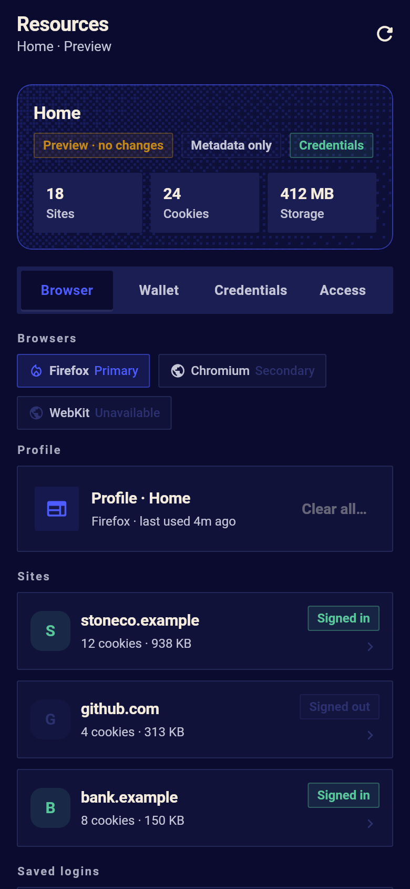
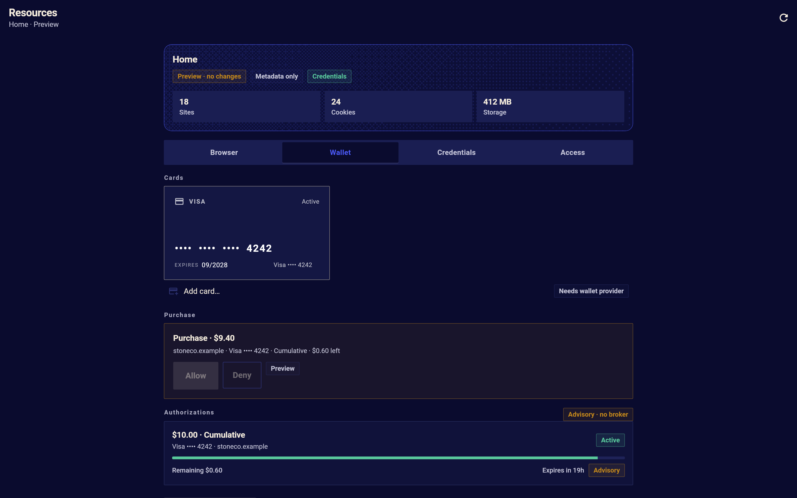
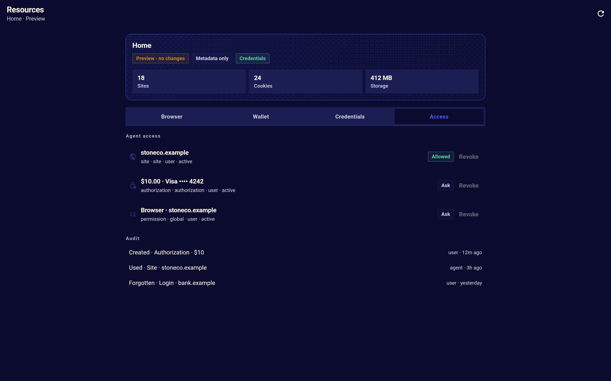
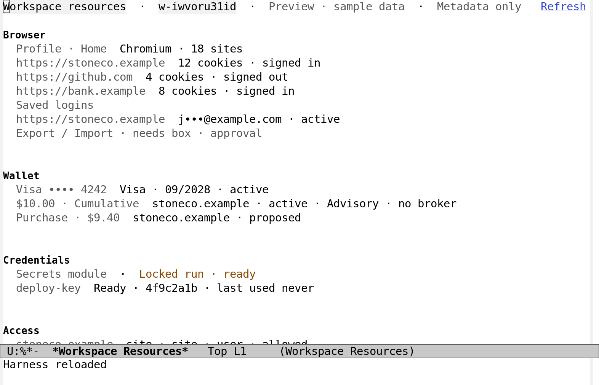

# Workspace resources: browser data, wallet and access

This page is supporting material for the product.  The product is the
one chat with intelligent memory and long-lasting knowledge curation,
the computer the agent can use, agentic coding, and a client that is a
pleasure to use; the resources here are the small, visible handles on
the browser, the wallet and the access the agent needs to do that
work.  They are deliberately a page, not the centre of the workspace.

A workspace's assistant needs more than a chat and a code folder.  It
needs a browser that stays signed in, a card it may use for a bounded
purchase, and permissions that say what it may do with either.  These
are the workspace's **resources**, and this page makes them
first-class: visible, named, scoped, owned, configurable, revocable
and auditable, rather than settings buried in a container or a
credential hidden in an environment variable.

Visibility is not exposure.  A person can see that a card exists, what
it may be used for and what it has spent without its number ever
reaching the screen, the transcript, a log or the agent's context.  A
person can see that the browser holds a site's login without reading a
cookie.  And visibility is not access: listing a resource never grants
the agent the use of it.

| Resources on a phone | The wallet on a desktop | Access and audit | The Emacs client |
|---|---|---|---|
|  |  |  |  |

This page is the design and the contract for the first slice.  The
Flutter client draws the Resources surface; the harness answers with a
documented blocked state until the box and the payment broker exist.
The client never invents a success: a preview is labelled `Preview`,
an operation without a backend is `Unavailable`, and no fixture holds
a real card, cookie or token.

## The resource model

A resource is one thing an agent workflow can use.  Every resource
has the same small set of facts, which the UI shows in the same order:

| Fact | Meaning |
|---|---|
| `kind` | `browser-profile`, `site-login`, `wallet-card`, `authorization` or `permission` |
| `label` | what the person calls it (`Home profile`, `Visa •••• 4242`, `Stone Co · $10`) |
| `scope` | `workspace`, `profile`, `site`, `authorization` or `global` |
| `owner` | who set it up: `user` or `workspace` |
| `state` | `active`, `expired`, `revoked`, `exhausted` or `unavailable` |
| `availability` | `ready`, `blocked` or `needs-approval` |
| `access` | what the agent may do: `none`, `ask` or `allowed` |
| `used` | when it was last used, and by which thread when known |
| `expires` | when it goes away by itself, if it does |

**Access is separate from state.**  A card can be `active` and the
agent's access `none`; an authorization can be `active` with access
`allowed` until it expires, at which point the state becomes `expired`
and the access is gone with it.  The Access tab is the view where the
two are read together, and where a grant is revoked.

**Every change is audited.**  Creating, using, exhausting, expiring,
revoking and deleting a resource writes an audit entry: when, what
changed, who did it (`user`, `agent`, `system`), and the scope.  The
entries hold metadata only.  The audit is the answer to "what did it
do with my card this week", and it is never a place for a value.

## Browser resources

The box has one Chromium profile per workspace (the design's
[box section](workspace-mode.md#the-browser)).  The browser resources
are that profile, the sites in it, and the logins it holds.

### Scopes

| Scope | What it is | What can be done |
|---|---|---|
| Workspace | the box's browser profile, one per workspace | clear cache and site data; export/import (blocked contract) |
| Profile | the named profile in the box (`default`) | clear all cookies and site data; reset permissions |
| Site | one origin (`https://stoneco.example`) | clear its cookies, storage, cache and permissions; forget its login |
| Login | one saved session token for a site | forget it; reveal is not offered (below) |

A site is an origin, not a substring: `https://stoneco.example` never
covers `https://evil.example/stoneco.example`.  The box's profile is
per workspace, so one workspace cannot see another workspace's sites,
and the user's own browser is never in scope.

### Metadata by default

The harness reads cookies and storage through Chromium's DevTools
protocol and **strips every value before it leaves the box**:

- `Storage.getCookies` gives each cookie's name, domain, path,
  expiry, `secure`, `httpOnly`, `sameSite` and size; the value is
  dropped in the box and never crosses ACP.
- Local storage and IndexedDB entries are counted by key count and
  byte size, not listed.
- The cache is a byte count.
- A saved login is the site, a masked username, when it was created
  and last used, and whether it still works.  There is no password
  field, no cookie value and no token field in the wire format.

The UI shows, per site: the origin, `12 cookies · 3.2 MB · Signed in`,
and when it was last used.  The strings `Signed in`, `Signed out` and
`Unknown` come from the browser's own session state, not from a
guessed login form.

### Saved logins

"Saved logins" are the site sessions the box keeps: the cookies and
storage that make a site remember the person.  They are not
Chromium's password manager.  Chromium does not expose its saved
passwords over DevTools; its `Login Data` store is encrypted with the
OS keyring and has no supported automation API.  The design does not
pretend otherwise, and the UI has no "show password":

- `Forget login` clears the site's cookies, storage and service
  workers, and says what it removed.  It is destructive and asks
  first.
- `Reveal` is not implemented.  A value that a person may need to
  read is a separate trust decision: it would need a permission
  request, a confirmation, a transient display with a timeout, and a
  guarantee that it never enters the transcript, the log or the
  agent's context.  With no box there is nothing to reveal; the
  design keeps the door closed rather than half-open.
- `Save to Passwords` in the login flow stays opt-in and off by
  default, and writes to a secret source, never to the graph.

### Cleanup

`Clear cookies`, `Clear site data`, `Clear cache` and `Clear all
browser data` are the destructive operations.  Each one:

1. names the scope and the site in its title and its body, with the
   counts and bytes that will go;
2. says `Cannot be undone`;
3. asks again (`Cancel` is the safe default; the confirm button is
   destructive and red);
4. calls the harness and reports exactly what the box removed; a
   failure leaves the previous state on screen and says why.

`Clear all browser data` takes the profile scope and a typed
confirmation (the workspace's name) because there is no undo.  The
cache is cheap to lose and the design says so; cookies and logins are
not, and the confirmation says which sites are signed in.

### Transfer

Export and import of browser data are a **blocked contract**, not a
button that pretends.  Chromium's cookie and login stores are
encrypted with the OS keyring; a portable archive would need a
passphrase, a versioned format, integrity protection and a policy for
what may leave the box.  The UI shows `Export` and `Import` disabled
with `Needs box · approval`, and the design defines the contract for
the stage that implements it:

- export is user-initiated, passphrase-encrypted, written to a
  workspace artifact, never to the chat; the agent cannot read it;
- import is user-initiated, asks before overwriting a site, and never
  imports a cookie for a site the person did not name;
- both require a permission request and an audit entry, and neither
  can be started by the agent.

### Browsers: Firefox first

A workspace can offer more than one browser, and **Firefox is the
primary and most supported one**.  The Resources page names the
available types (`Firefox · Primary`, `Chromium · Secondary`, and a
`WebKit · Unavailable` where it is not there) and draws the profile of
the one in use.  The reason for the order is what each browser exposes
to automation and to a data page:

| Browser | Browsing control | Cookies and data | Notes |
|---|---|---|---|
| **Firefox** (primary) | WebDriver BiDi / Marionette | cookies through BiDi `storage.getCookies` / `storage.deleteCookies`; site storage, cache and profile files in the profile directory | no CDP; the profile is a directory the box owns; the password manager is encrypted with the OS keyring and is not exposed |
| Chromium (secondary) | DevTools Protocol | `Storage.getCookies` (values stripped), `Storage.clearDataForOrigin`, `Browser` permissions | the default automation path before Firefox; now the second choice |
| WebKit | WebDriver | limited; no stable cookie enumeration | named as unavailable rather than promised |

Firefox is preferred because it is a browser a person uses, its
automation is a standard (BiDi), and its profile is a plain directory
the box can own without a vendor account.  The contract and the UI say
which browser is primary; a client never silently switches.  The box
is staged, so all of this is blocked until it runs.

### What the browser really offers

The operations above are feasible with Chromium's DevTools protocol,
which is why the design promises them: `Storage.getCookies` (metadata
after stripping), `Storage.clearDataForOrigin` (cookies, local
storage, indexedDB, cache storage, service workers),
`Network.deleteCookies` and `Browser.grantPermissions` /
`Browser.resetPermissions`.  The password manager, the keyring and
the OS wallet are not exposed, and are not promised.  The box is
staged; until it exists the methods answer `unavailable` with
`:reason "box-staged"` and no data.

## Wallet and bounded purchases

The wallet is the other half of the resources idea: the agent should
be able to pay for something a person approved, within a bound the
person set, and never beyond it.

### Cards are references, not numbers

A wallet card in the harness is a **reference to a tokenized card**,
not card data:

- the record is `id`, `label`, `network`, `last4`, `exp-month`,
  `exp-year`, `state`, `added`, `last-used`;
- there is no PAN, no CVV, no expiry *date* beyond month and year, no
  cardholder name and no token value in the harness, the client, the
  transcript or a fixture;
- the token lives with the payment provider or the OS wallet, and the
  broker exchanges it when a purchase is made.  **No provider is
  implemented in this slice**; the wallet is mock data in the client
  and a blocked contract on the harness.  The UI does not offer `Add
  card`; it says `Needs wallet provider`.

The fixtures and screenshots use a made-up `Visa •••• 4242`, and the
test suite asserts that no `pan`, `cvv`, `number`, `token` or `secret`
key exists in a request or a rendered tree.

### Authorization: the minimal useful model

A **purchase authorization** is a person's bounded permission for the
agent to spend, tied to one card:

| Field | Minimal rule |
|---|---|
| `amount` | a positive integer in the currency's minor unit; the cap |
| `currency` | one ISO currency; no conversion, no mixed-currency authorization |
| `cap-kind` | `per-transaction` (each charge at most the cap) or `cumulative` (spent + reserved + charge at most the cap) |
| `merchant-scope` | `any`, or an allow-list of origins/domains (`stoneco.example`); a mismatch is declined |
| `product-scope` | optional line-item match; advisory in this slice, enforced only by the broker |
| `fees` | `included` (the cap covers tax, shipping and fees; the default) or `excluded` (the cap is the goods total, and the UI says `Cap excludes fees`) |
| `expires` | a duration (1 hour, 24 hours, 7 days) or `never`; an expired authorization cannot be used |
| `status` | `active`, `exhausted`, `expired`, `revoked` |
| `spent`, `reserved` | minor units, for a cumulative authorization; `remaining = amount − spent − reserved` |
| `created`, `created-by` | the audit's anchor; only a person creates an authorization |

The defaults are the safe ones: **cumulative**, **fees included**,
**this site** when the request came from a site, **24 hours**.  A
cumulative authorization is the only one that can say "up to $10" in
the sense most people mean; a per-transaction authorization says "up
to $10 each" and the UI never shortens it to "up to $10".

### The invariants that keep $10 at $10

For a purchase to be approved under an authorization:

1. the authorization is `active` and not expired or revoked;
2. the merchant matches the scope (origin equality, not substring);
3. the currency matches;
4. the **total charge** used for the cap includes tax, shipping and
   fees when `fees` is `included`; when `excluded`, the UI shows the
   goods total and the extra separately and never claims the total
   is bounded;
5. for `per-transaction`, `charge ≤ amount`; for `cumulative`,
   `spent + reserved + charge ≤ amount`;
6. the charge carries an **idempotency key**, and a repeated key
   returns the first result instead of charging twice;
7. a reservation is atomic: a second concurrent attempt sees the
   reserved amount and is refused (or waits), and an abandoned
   reservation is released after a timeout;
8. a second charge from the same merchant for the same amount within
   a short window, while the first is still pending, is treated as a
   duplicate and needs a person's confirmation.

A retry reuses the idempotency key; a *new* purchase gets a new one.
A declined charge releases its reservation.  The audit records the
attempt, the decision, the amount and the reason, never the token.

### Final confirmation, and the enforcement boundary

The authorization is the **bound**, not the confirmation.  The first
slice always asks the person for a final confirmation of a proposed
purchase, showing: merchant, amount, fees, the card's last four, the
authorization's remaining amount and its expiry.  `Allow` is the only
way to proceed; `Deny` writes a declined attempt and changes nothing.
The agent can propose a purchase; it cannot create an authorization,
raise a cap, extend an expiry or approve its own purchase.

That model is only as good as the boundary that enforces it.  A
browser cannot stop a merchant from charging more; a prompt is not a
payment processor.  **There is no trusted payment broker in this
slice**, so an authorization is **advisory**: the UI labels it
`Advisory · no broker`, and neither the design nor the screen claims
an enforceable limit.  The broker stage will be the enforcement
point (token, amount, merchant, idempotency, settlement), and only
then may the UI say `Enforced`.

### What is deliberately not here

No budgets or envelopes across cards; no subscriptions; no refunds;
no multi-currency; no card creation, import or export; no real
charges; no claim that a merchant or the tax is verified.  These are
listed as future work, not implied by a button.

## Access and audit

The Access tab reads the same resources as one question: **what may
the agent use, and how?**

| Resource | Access `none` | Access `ask` | Access `allowed` |
|---|---|---|---|
| Browser site | the agent has not used it | the agent asks before opening a new site | the site is in the workspace's allowed list |
| Saved login | the login exists but the agent may not use the session | a login request waits for the person | the session is used for the thread |
| Wallet card | the card is only metadata | a purchase asks every time (the first slice's only mode) | a future standing rule; not implemented |
| Authorization | — | — | the authorization is active and in scope |
| Permission | denied | asks | allowed for the session or the workspace |

`Revoke` removes the access, not the resource: a revoked site login
keeps the cookies for the person, and the agent must ask again.  A
revoked authorization cannot be used; the card stays.  A revoked
permission is the harness's existing permission ladder, reused
rather than reimplemented.

**Audit** is the last section of Access: recent entries with time,
resource, action, actor and scope.  The client shows the last few and
the harness keeps the rest.  No entry holds a value.

## Generic task credentials

The resources above are the workspace's *personal* ones: a browser
session and a card.  Ordinary harness tasks need a third, separate
kind: **generic credentials** — an SSH key, an AWS/GCP IAM role or
service account, an agent-owned repository push key — used by a
command in a task's sandbox.  The distinction is a rule, not a
convenience: **an ordinary task never receives a personal browser
login or a wallet item.**  Those stay in the workspace's box and are
used only by the workspace's own browser and the payment broker.

This section is design direction.  It is deliberately not implemented
in this slice, and it reuses the sandbox that already exists rather
than adding a second secret pathway.

### What exists today

The `secret-sandbox` module is the boundary the new layer would sit
on:

- a person declares sources (`harness-secrets-sources`, or
  `secrets/add-source`): a file and JSON path, a regexp, a command,
  an environment variable or a literal, each with a label;
- `secret-sandbox/secrets` lists the labels with a source, a
  fingerprint, usability, an error and the last use — **never a
  value**;
- `secret-sandbox/run` takes a session, a label and one command,
  hides every source and live secret directory from every other
  command, runs the command in the locked sandbox with the value in
  `$HARNESS_SECRET_FILE`, and withholds stdout, stderr, exit status
  and duration.  The person approves every run, once, seeing the
  exact command;
- masking keeps the value out of what the harness stores, and the
  permission stages refuse a file read or write that touches a
  source.

That is already a good *value* boundary.  What it does not have is a
*permission* boundary per task: any task that may call
`run_with_secret` may ask for any declared label, with the person's
per-run approval; there is no grant, expiry, operation or target
scope, rotation record, revocation or audit beyond the last use, and
no client UI.  A person who wants a task to push to a repository has
to approve each command, and a person who wants a task *not* to see a
database credential has no way to say so except by not declaring it.

### The grant model

A **credential grant** is the resource the person creates, and the
task receives a reference, never a value:

| Field | Meaning |
|---|---|
| `secret` | the label of a declared secret source |
| `holder` | the task and session the grant is for (`task`, `session`, `episode`) |
| `owner` | who created it (`user` only; an agent cannot create a grant) |
| `operations` | what the credential may be used for: `git-push`, `ssh`, `aws:AssumeRole`, `http`, or a named operation; not "anything" |
| `targets` | the hosts, repositories, accounts or roles it may reach (a URL/allow-list, never a substring match) |
| `expires` | a time or a number of uses; no grant is unbounded by default |
| `delegation` | whether a child task may receive a copy, and with what reduced expiry |
| `revoked` | the person's immediate stop, checked on every call |
| `audit` | every use: who, task, session, operation, target, decision, time |

The grant is enforced in `secret-sandbox/run`, before the locked
sandbox starts: it must match the session's task and the requested
operation and target, the grant must be active and unexpired, and the
use is recorded before the command runs.  The person still approves
each run in this stage; the grant narrows *what* can be asked for,
and it can be the thing a standing approval is later attached to,
not a replacement for the value boundary.

**Deny by default.**  A task without a grant gets no label from this
layer, even if the source is declared.  A fork, a sub-agent or a
child task does **not** inherit a grant: a child gets one only if the
parent's grant says `delegation` and the harness copies it with an
expiry no later than the parent's.  Ending a task, revoking a grant
or the grant's expiry stops the next run; a run already in flight
keeps the sandbox it has.  Rotation is a change of the source, not a
new grant: the next run reads the new value and the grant's audit
says so.

**Short-lived and provider-backed by default.**  Where a provider can
issue an assumed role or a short-lived token, the grant names the
role or the provider and the broker exchanges it at use time; a raw
export is the exception, not the path.  An agent-owned push key is
still a key the person provisioned with bounded rights, and its grant
is scoped to one repository and one operation.  Delegated signing
uses the provider's signing API, not a copy of the private key.

**Isolation from the personal resources.**  Browser logins and wallet
cards are never labels in this layer: the browser's cookies stay in
the box and never become a `run_with_secret` value; the wallet's
token stays with the payment broker.  A task that needs to read a
page uses the browser tools, not a copied cookie.  This is what keeps
"the agent may deploy" from becoming "the agent may spend".

### The follow-on boundary

The grant layer is a separate task, with its own security model and
tests; this task only defines the contract and the UI vocabulary:

- **Dependencies**: `secret-sandbox` (the locked run and masking),
  `session` (holder, parent and termination), `tasks` (task
  termination and the child-task relation), `perms` (the approval
  ladder), and the workspace resources model for the UI's `Access`
  tab.
- **Methods**: `credential/grant` (create, from the Emacs UI or a
  future client), `credential/revoke`, `credential/grants` (metadata
  only), and a check inside `secret-sandbox/run`; no new secret
  transport.
- **Security tests**: no grant / wrong operation / wrong target /
  expired / revoked / child without delegation all refuse before the
  sandbox starts; a concurrent use does not widen the grant; a value
  never appears in the grant, the audit, the transcript or a tool
  result; task termination revokes; rotation changes only the value.
- **UI (future)**: the `Access` tab lists a task's grants with
  owner, scope, operations, targets, expiry and revoke.  It is not in
  this slice because the grant layer does not exist yet, and a screen
  that pretends to grant access would be worse than none.

**Current vs planned, in one line**: today a person can declare a
secret and approve one locked command at a time; planned is a
per-task, per-operation, expiring grant that the harness enforces
before the same locked command, with audit, delegation and
revocation.

## The contract

The methods are workspace extensions on the existing bus.  A client
discovers them through `initialize`; without them the Resources
surface still opens and says what is unavailable.

| Method | Params | Answer |
|---|---|---|
| `workspace/resources/status` | `id` | `(:status :reason :metadata-only :browser :wallet :access :audit)` |
| `workspace/browser/clear` | `id scope origin kinds` | the new browser section, or `unavailable` |
| `workspace/browser/login/forget` | `id login` | the new browser section, or `unavailable` |
| `workspace/wallet/authorization/create` | `id card amount currency cap-kind merchant-scope expires fees tax shipping` | the new wallet section, or `unavailable` |
| `workspace/wallet/authorization/revoke` | `id authorization` | the new wallet section, or `unavailable` |
| `workspace/wallet/purchase/decide` | `id purchase decision idempotency` | the new wallet section, or `unavailable` |

`status` is one of `ready`, `unavailable`, `needs-approval` or
`failed`; `reason` names why (`box-staged`, `wallet-provider`,
`payment-broker`, `permission`, `browser-stopped`).  Every answer is
metadata-only and carries `:metadata-only t`.  The first slice's
harness answers every method with:

```elisp
(:status "unavailable" :reason "box-staged" :metadata-only t
 :browser nil :wallet nil :access nil :audit nil)
```

and the create/clear/revoke/forget methods answer the same way with
`:changed nil`.  That is a real answer to a real request, not a
simulated success; the client renders `Unavailable · box staged`.

### Wire shape (first slice)

```
browser: (:profile (:label "Home" :kind "chromium" :bytes 412000000
                    :sites 18 :last-used "2026-11-06T18:20:00Z")
          :sites ((:origin "https://stoneco.example" :cookies 12
                   :storage-bytes 320000 :cache-bytes 640000
                   :auth "signed-in" :last-used "…")
                  …)
          :logins ((:id "lg-1" :origin "https://stoneco.example"
                    :username "j•••@example.com" :state "active"
                    :created "…" :last-used "…") …)
          :totals (:cookies 42 :bytes 412000000))

wallet:  (:cards ((:id "card-1" :label "Visa •••• 4242" :network "visa"
                   :last4 "4242" :exp-month 9 :exp-year 2028
                   :state "active" :added "…" :last-used "…"))
         :authorizations ((:id "auth-1" :card "card-1" :amount 1000
                           :currency "USD" :cap-kind "cumulative"
                           :merchant-scope ("stoneco.example")
                           :fees "included" :tax "included" :shipping "included"
                           :expires "…" :status "active"
                           :spent 0 :reserved 0 :advisory t :created "…"))
         :purchases ((:id "buy-1" :authorization "auth-1"
                      :merchant "stoneco.example" :amount 940
                      :currency "USD" :status "proposed" :at "…")))
```

There is no field for a value.  A client that receives one ignores it,
and the harness never sends one.

## The Resources surface

One page, three tabs, on phone and desktop:

- **Phone**: the desk's `Resources` action opens a full page; tabs are
  a segmented row; a site or an authorization opens a detail page
  with a back arrow; the new-authorization form is a sheet.
- **Desktop**: the same page in a window: a list column and a detail
  column at 900 px and wider, a dialog for the form.  The desk shows
  `Resources` beside `Details`.

A header card names the workspace, the status (`Live` / `Preview` /
`Unavailable` / `Needs approval` / `Failed`) and the rule `Metadata
only · values never shown`.  A `Preview` banner says `Preview · no
changes`; its destructive actions are disabled.

### Copy inventory

| String | Where |
|---|---|
| `Resources` | page title and desk action |
| `Browser` / `Wallet` / `Access` | tabs |
| `Profile · Home` / `Profile · default` | profile card |
| `Cookies 12` / `Site data 3.2 MB` / `Cache 640 KB` / `Permissions 2` | data rows |
| `Signed in` / `Signed out` / `Unknown` | auth state |
| `Saved logins` / `Forget login` / `Reveal` | login list and actions |
| `Clear cookies` / `Clear site data` / `Clear cache` / `Clear all…` | actions |
| `Export…` / `Import…` / `Needs box · approval` | transfer rows |
| `Cards` / `Visa •••• 4242` / `09/2028` / `Active` | wallet cards |
| `Authorizations` / `$10.00 · cumulative · Stone Co` / `Remaining $8.20` | authorizations |
| `Per transaction` / `Cap excludes fees` | cap facts |
| `Advisory · no broker` | enforcement fact |
| `New authorization` / `Amount` / `Merchant` / `Expires` | form |
| `Allow` / `Deny` / `Revoke` / `Cancel` | confirmations |
| `Access` / `Allowed` / `Ask` / `None` / `Revoke` | access rows |
| `Audit` / `Created` / `Revised` / `Revoked` / `Cleared` | history |
| `Unavailable · box staged` / `Needs wallet provider` / `Needs approval` | states |
| `No sites` / `No logins` / `No cards` / `No authorizations` | empty states |

The two dialogs carry a short factual body (`Site · stoneco.example ·
12 cookies · cannot be undone`); every heading and button is a noun
or adjective.  The theme is the app's; the states are spoken, not
colour only.

### States the tests hold

- loading, ready, preview, unavailable (`box-staged`), needs-approval,
  failed with `Retry`;
- empty sites, empty logins, empty cards, empty authorizations;
- a clear/forget/revoke that is cancelled changes nothing;
- a clear/forget/revoke that fails keeps the previous state and says
  why; a retry reuses the same id;
- a create with a zero/negative amount, an unsupported currency, an
  expiry in the past, or no merchant is refused before a request;
- a per-transaction authorization says `Per transaction`, a
  cumulative one shows `Remaining`;
- a card with no provider is metadata-only and `Add card` is absent;
- a proposed purchase shows the amount, fees, last four, remaining
  and expiry, and `Allow`/`Deny` are the only outcomes;
- text at 1.5× and 2× does not overflow on 390 px or 1440 px;
- the semantics tree names each row and action.

## Platform differences

| Platform | Difference |
|---|---|
| Android | the back gesture closes a detail before the page; the sheet uses the system drag handle; `Copied` feedback uses the platform toast |
| iOS / macOS | dialogs are `CupertinoAlertDialog`; the sheet is the platform sheet; no file picker for export until the contract exists |
| Desktop | a two-column layout; Escape closes the detail; `Cmd/Ctrl+R` refreshes; the form is a dialog |
| Narrow phone | one column, tabs above the list, the form a full-height sheet; the amount field uses the decimal keyboard |
| No box | every tab renders `Unavailable · box staged`; no action pretends to work |

## Tests and status

| Test | What it holds |
|---|---|
| `test/resources_model_test.dart` | parsing, redaction, no secret keys, the wallet invariants (cap kind, fees, expiry, merchant, duplicate, remaining) |
| `test/resources_controller_test.dart` | load/unavailable/error, clear/forget/revoke cancellation and failure, create validation, purchase decision, no optimistic success |
| `test/resources_screen_test.dart` | phone and desktop rendering, tabs, redacted metadata, confirmations, disabled preview actions, a11y, text scale, empty states |
| `test/resources_screenshots_test.dart` | the pictures: phone list, site detail, wallet, authorization form |
| `test/harness-workspace-resources-test.el` | the methods exist and answer `unavailable · box-staged`; the answer has no value/secret keys; create/clear/revoke change nothing |

**The credentials are the built-in secrets module.**  The harness lists
its declared secret sources through `secret-sandbox/secrets` and
`secret-sandbox/status`: label, fingerprint, usability, error and last
use, never a value.  The Resources page shows that list on its
`Credentials` tab, and the Emacs page in its `Credentials` section;
both say whether a locked run is ready and why not, and neither offers
a reveal.  The generic task-credential grant above is the follow-on
layer that will narrow those declarations per task; today the module
is the whole credential store and the sandbox is the whole boundary.

**Implemented now**: the Resources surface on both clients (the
Flutter page and the Emacs `C-c w R` page), the models and invariants,
the credentials from the secrets module, the confirmations and blocked
states, the harness contract and its blocked answers, mock data in
tests and screenshots, and this page.
**Future**: the box's browser adapter (CDP), the OS/provider wallet,
the payment broker that enforces the authorization, export/import,
reveal, standing rules, budgets, refunds and multi-currency.  None of
the future work is implied by a button that says it is done.
