# Harness

A native, adaptive [Agent Client Protocol](https://agentclientprotocol.com)
(ACP) client for the **emacs-agent-harness**. It is a standalone Flutter app:
nothing here imports the Lisp tree, and the whole client is a normal ACP
client first. When the agent on the other end is the harness, it discovers the
harness's extended methods and lights up the task board, usage, live activity,
rich transcript nodes and question diagrams. When it is any other ACP agent,
the chat and permission prompts still work, and the enhanced views are simply
not offered.

| iOS | Android |
|---|---|
|  |  |
|  |  |
|  |  |
|  |  |


Signing in happens inside the app, with ACP's own `authenticate`: the harness
lists how, the user picks "Approve in Emacs", and presses Approve in Emacs after
comparing the code. It happens once: the app keeps the address of the harness
and the session secret the harness hands it, and goes back in by itself every
time it opens. It asks again only when the harness does.

| Choosing how to sign in | Waiting for the approval | Opened again, harness out of reach |
|---|---|---|
|  |  |  |

## What it does

- **Streams a real conversation.** Markdown answers, streamed thoughts, tool
  calls with their input and output, plans, context-compaction notes, hints and
  the activity of the running turn (waiting, thinking, writing, preparing a
  tool call, running tools, compacting). A conversation opens on its latest
  message.
- **Draws what is written as Markdown.** The answers of the agent, the
  messages sent to it (yours, another session's, the harness's), a plan, the
  summary a compaction leaves (a line, "Context compacted · 37 words", which
  opens to it) and the report a task was handed in with are headings, lists,
  bold, code, tables and links, never `##`, `**` and backticks as they were
  typed. Thoughts and hints are shown as they are, as they are in the Emacs
  chat. See [Markdown](#markdown).
- **Reads a tool call, not its JSON.** A call is a line until it is opened;
  opened, it shows the command, the path, the text an edit takes out and puts
  in as what they are, and what the call said, a screenful at a time, with
  *Show all* and a page of its own for the whole of it. A call that failed, or
  that the permission system refused, says so under its title. The call that
  hands a task's work in shows its report. A stretch of quiet calls, the reads
  and the commands among them, is one line, "3 tool calls: Read file ×2,
  Search files", which opens to the calls: the tools that fold are the harness's
  own allow list, the one its Emacs chat folds by. See
  [Tool calls](#tool-calls).

  | A command | Runs of calls | The report of a hand-in call |
  |---|---|---|
  | 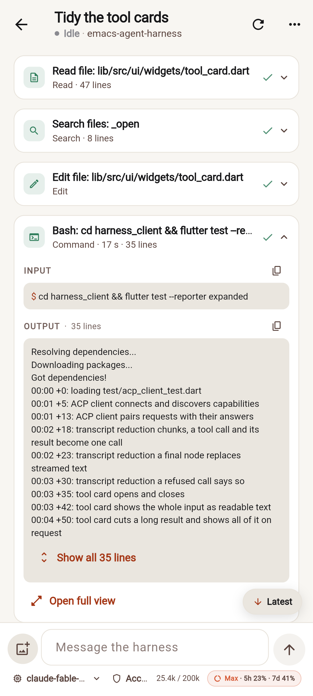 | 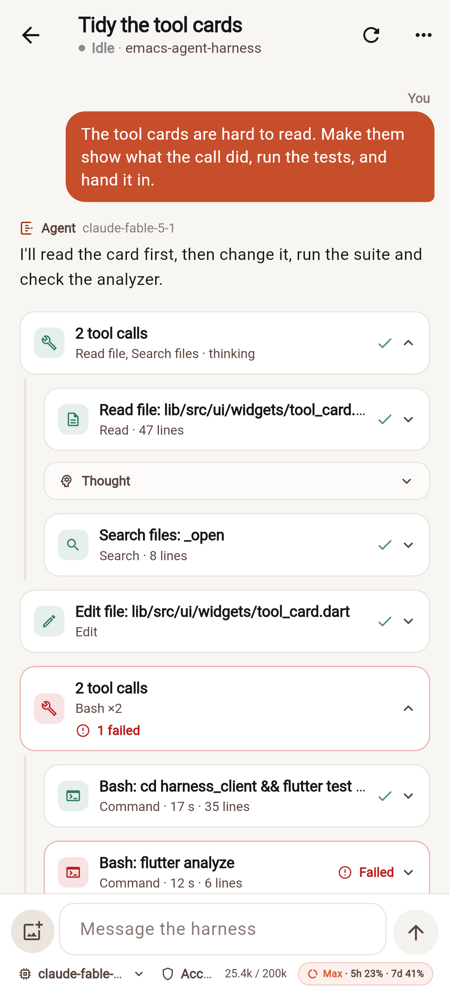 | 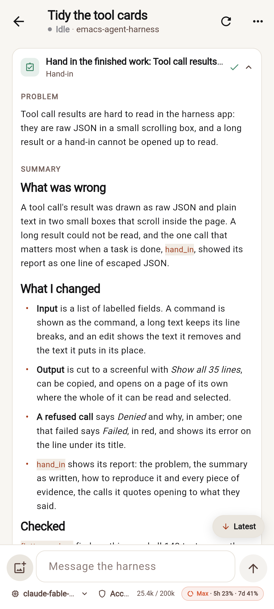 |
- **Answers the agent.** Standard ACP permission requests become an inline
  decision card with *Allow*, *Deny*, *Allow for session*, *Always allow* and
  *Always deny*; a path glob can be edited before a lasting answer is given.
  The card says what the call would do, in a sentence or two a cheap model
  writes while it waits (*Model summary*, marked as advice that can be wrong,
  with a spinner until it comes; `_harness.summarizing`, `_harness.summary`
  and `_harness.summaryModel` of the request, and `session/pending-updated`
  when it arrives, which the app keeps for a request it does not hold yet):
  a model that fails leaves the card as it was, and nothing in the app reads
  the summary but the person.
  Harness `_harness/ask_user` questions become a choice with optional ASCII or
  image diagrams, a free-text answer, and the harness's cold-cache cost note
  when it sends one. A question the agent lets you tick several options of
  (`allowMultiple`, from `allow_multiple` of the tool) has check boxes instead
  of radio buttons: *Send answer (2)* sends the labels of the ticked options,
  in the order the options were given, one to a line, with what was typed in
  the field after them as a note; with nothing ticked and nothing typed there
  is nothing to send, and the field's own send key and arrow send the same.
  The diagram shown is the one of the option tapped last, ticked or not. A
  question can always be answered, on a small phone with
  the keyboard up too: the card takes the room the screen has left and no more,
  the question is read in full in its body (Markdown drawn, scrolling when it
  is long), and the answer stays in a footer that does not scroll away -- the
  *Send answer* button for a chosen option, the field for a typed one (the
  keyboard's send key sends it). The message field gives way to the card while
  a question waits, and is back, with what was typed in it, once it is
  answered. Requests that were already waiting when the client connected, or
  that the harness holds without having asked this device, are recovered
  through `permission/pending` and `question/pending` -- when the conversation
  is opened and whenever the harness says (`session/pending-changed`) what a
  session waits for -- and one that is answered somewhere else (in Emacs, on
  another device) goes from the screen. A request is shown only while the
  harness holds it: one that its turn took with it (the turn was cancelled or
  failed), that came with a session that was closed (an inactive session waits
  for nobody), or that was answered while the phone was out of reach and heard
  nothing of it, is gone as soon as the app reads the sessions again -- when the
  connection is back (every conversation, not only the open one), on
  pull-to-refresh, and as the harness's records of a session arrive. What the
  harness says of a session replaces what the app knew of it, so *Needs you*,
  the count on its tab and the notice that sessions need an answer match what
  Emacs shows. The task board's *Answer* opens the conversation of the task
  that waits.
- **Shows the rest of the harness.** The task board (all seven columns, queue
  state and slot use, backlog mode, and everything that can be done with a
  task, below; a finished task's card has the words of its summary and its
  sheet the whole report, drawn as Markdown), spend, tokens, live sessions, daily spend, per-model and
  per-project breakdowns, budgets, the plan quota of the providers that report
  one, the model catalogue, harness modules and the full ACP capability report.
- **Shows who pays, and how much of the plan is left.** As the harness's Emacs
  does in its header lines, a session, the task board and the session list read
  `$1.20` when calls are billed per token and `Max` when a subscription pays
  (`$0.40+Max` when some was billed as extra usage), with the plan's session
  and weekly quota beside it: `Max · 5h 23% · 7d 41%`, each window coloured
  from 70% full on (amber, orange from 85%, red from 95%), and any other
  window that fills up joins them. A tap on it says who pays, what the calls
  came to at API prices, and a meter for every window with when it resets.
  The Usage view has a **Plan** section: a card for each provider that
  reports one, with the plan, the account, a meter for each window, the extra
  usage the plan allows, a warning when its limit is close or reached, and
  **Refresh**, which has the providers ask their source again. It follows the
  harness's `provider/quota-updated` events, so the windows fill up on screen
  as the work uses them. A harness without `provider/quota` still shows the
  plan its sessions say paid, without the windows.

  | Status | Usage |
  |---|---|
  | 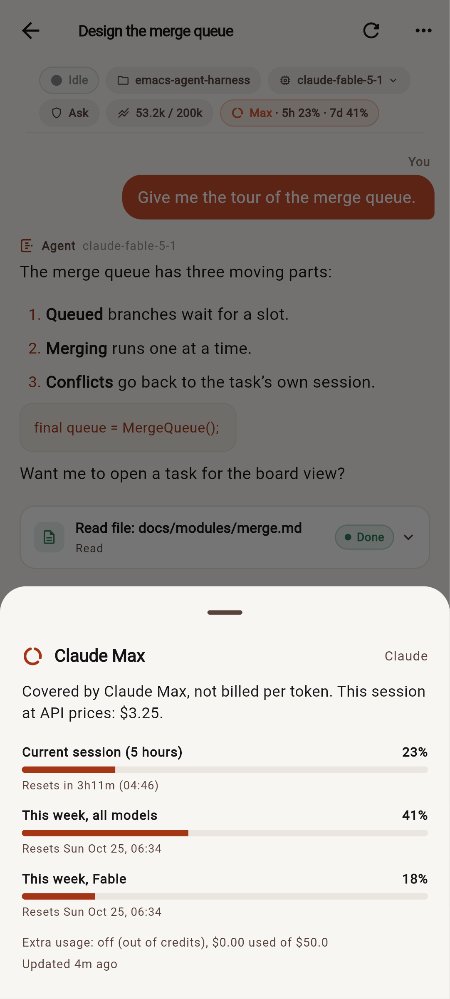 |  |
- **Treats a project as a main checkout.** A task, and a sub-agent started in
  its worktree, works in a git worktree, which the harness files under the
  worktree itself, and an agent may give a sub-agent a scratch directory in the
  temporary directory of its session (`harness-UID/ID/...`). The app folds
  each worktree into the checkout it was made from, and a scratch directory
  into the project of the session whose directory it is, so the project
  pickers and filters (the new task sheet's among them), the session and task
  rows, and the Usage "Projects" list have one entry per project, and a
  project's usage adds up the spend of its worktrees. The harness says which
  checkout a directory belongs to (`project/mains`, which reads the
  repository's own `.git` files, wherever the worktree was made, and answers
  for none, `""`, for a scratch directory whose session is gone); the app asks
  about every directory it knows, the ones `insights/projects` lists too, once.
  Where the harness has no answer, because it is older or the directory is
  gone, the path says what it can: the `PROJECT/.worktrees/BRANCH` layout, the
  `PROJECT-worktrees/BRANCH` one the harness made worktrees in first, and a
  scratch directory is none. What the harness names as another project, or as
  none, wins over the path.
- **Opens the task board on every project.** The board shows the tasks of
  all the projects the harness works in, each card saying whose it is, so
  that what is running in a project nobody opened the app on is not out of
  sight. The project pill narrows it to one (and back); only then does the
  board show that project's queue, which is the project's alone, and a task
  made for another project than the narrowed board's widens it to every
  project, where the task is. A choice of
  "All projects" in a project menu stays: the events of the harness, which
  refresh the app every few seconds, do not turn it back. Every project
  menu, like every other menu, scrolls, so that no project in a long list is
  out of reach. The app does not read all the sessions again when the harness
  makes or ends a record of a model call of its own (an `internal` session),
  which it does every few seconds.
- **Manages a task as fully as the board in Emacs does.** A task's card (its
  buttons and its *…* menu) and its sheet offer what the harness will take for
  it where it stands, the same sets as the cards of the board in Emacs
  (`harness-ui-tasks--actions`) and the actions of the `task_control` tool, and
  no others:

  | Where it is | What is offered |
  |---|---|
  | Pending | *Start now*; *Pause* (the task is put back in the queue and held there: *Resume*, which a paused task offers first, lets the queue have it again); *Message* for a task that was put back in the queue after it worked; *Drop* |
  | Backlog | *Start now*, *Queue it*, *Message* (feedback on the write-up, or steering while it is written), *Drop* |
  | Needs input | *Answer*, which opens the task's session, and *Stop*, for a question or a permission; for a task that stopped part way *Retry* (*Retry merge* after a merge that failed), *Pause*, *Message*, *Mark complete* |
  | Active | *Message* (steering), *Pause*, *Return to queue* (`task/return-to-pending`: the task goes back in the queue, to start again where it stopped), *Stop*, *Mark complete* |
  | Merging | *Message*, *Stop*, *Mark complete* |
  | Review | *Verify and merge*, *Send back* (with feedback), *Mark complete*, *Archive* |
  | Done | *Archive*, *Message* (the session takes it up again) |

  Every task that has a session also has *Open session*, and its *Priority*
  (low, medium or high, which is its session's: a sheet has a control for it,
  a menu a choice of the other two), and every task *Delete task*.  A task that
  was archived is out of sight until *Show archived tasks*, and *Unarchive*
  brings it back.  The harness does the work and checks the state of the task
  each time (`test/task_actions_test.dart` has the table of what is offered
  where); the app keeps no rules of its own about what may happen, and shows
  what the harness says when it refuses, on the sheet, which covers the board's
  own banner, and reads the board again, since a refusal usually means the
  board was behind (it was verified in Emacs while the sheet was open).
  What stops work or throws it away is asked first: *Stop*, *Drop*, *Delete task*
  (which also asks whether the session goes too, for a task that has one worth
  keeping) and *Mark complete*; a message and the feedback of *Send back* are
  written in a dialog of their own, and an empty one sends nothing.  The
  priority is shown at once and goes back if the harness refuses it.  An action
  whose method the harness lacks (an older one) is not offered.

  The queue of a project is *set*, never toggled, from the line under the
  project's name: *Pause the queue* and *Queue the backlog automatically*
  (`task/suspend-queue`, `task/resume-queue`, `task/set-backlog-mode`), so a
  phone that is a moment behind cannot turn a queue the other way from the one
  asked for.  *Pause all* and *Resume all* do the same to every task of the
  project (`task/pause-all`, `task/resume-all`), and with the board on every
  project, *All queues* pauses or resumes every project's queue and every
  task at once (`task/suspend-all-queues`, `task/resume-all-queues`).  The app
  follows a queue that is paused in Emacs, or by an agent, as the harness says
  so (`task/queue`, `task/backlog-mode`).

  | The menu of a card | The sheet of a task | What is asked first |
  |---|---|---|
  | 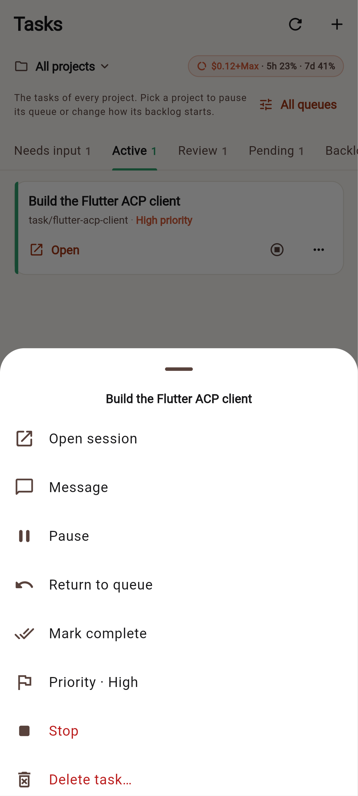 | 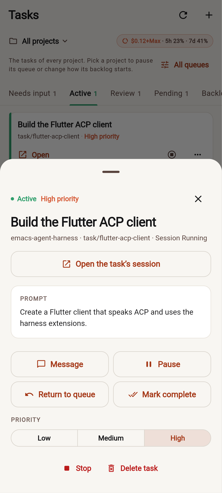 | 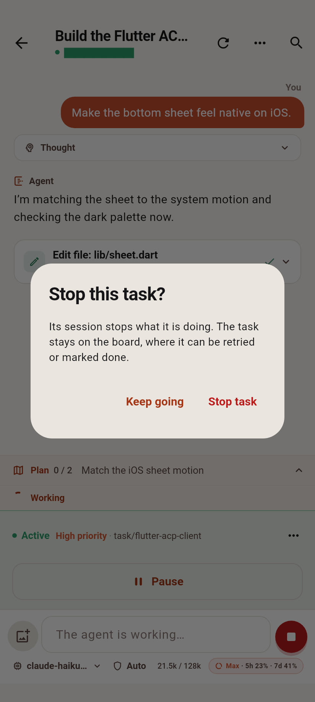 |
  | 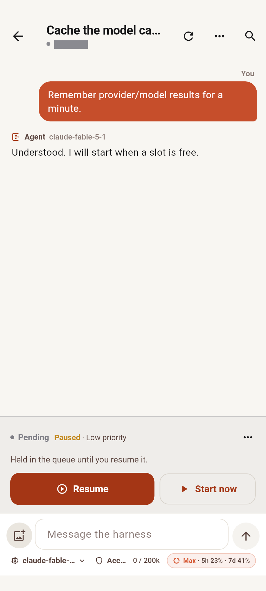 | 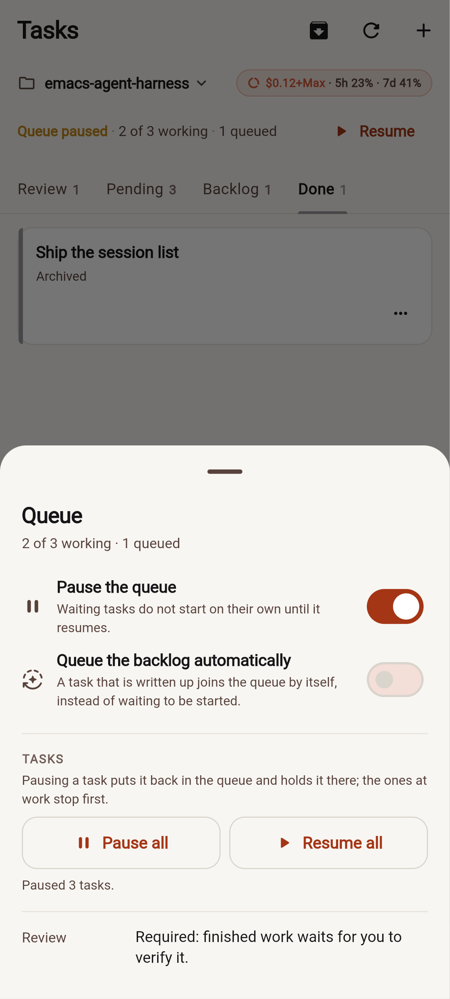 | 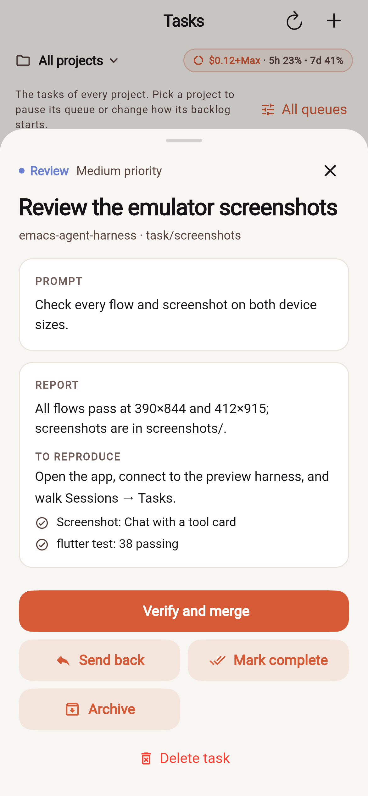 |
 **Detects extensions per feature.** `initialize` is read for standard ACP
  capabilities and for the harness's `_harness.methods` and `_harness.events`.
  Each screen asks for the exact methods it needs. A missing method turns off
  that one view or action at runtime; a plain ACP agent gets a small "Standard
  ACP agent" notice, three tabs instead of five, and a working chat.
- **Finds anything in words.** A magnifying glass at the end of every header
  (the five screens, and a conversation's; on a wide screen a *Search* row in
  the sidebar) opens the quick search: one box to say what you want -- "how do
  I attach an image to a task?", "where did I debug the merge queue?", "the
  task about the docs", "get rid of the screenshots task" -- and an action to
  tap, a session or a task to open, or the answer in words comes back. The
  harness answers it: this is the search `C-c h /` opens in Emacs, the same
  cheap model reading the same sessions and tasks by the same rules (the
  harness's `search/ask`, `search/warm` and `task/search-apply`), and none of
  it is done in the app. What only the app knows it sends along, as Emacs
  sends its commands: the things it can do, and the taps that reach each
  (*Tasks tab › +*), which is how a "how do I ...?" is answered about the
  phone and not with Emacs keys. See [Quick search](#quick-search).

  | The way in | A question | An order |
  |---|---|---|
  | 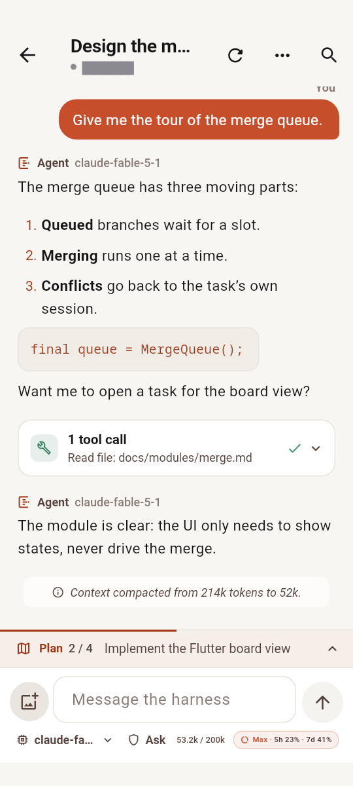 | 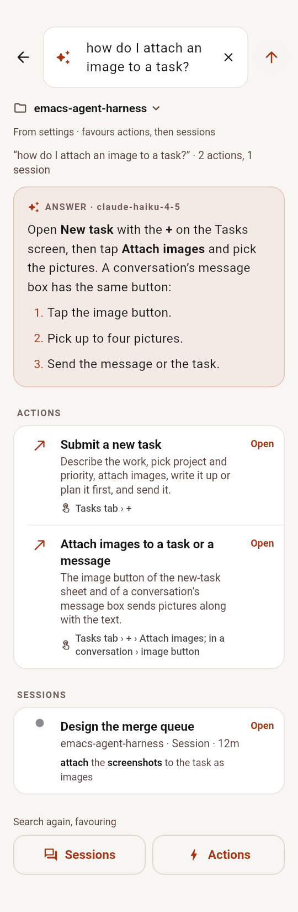 | 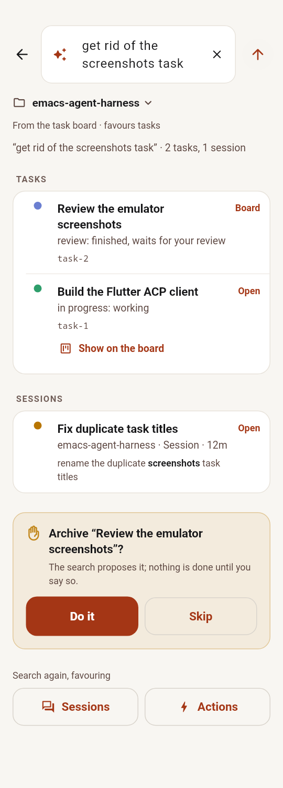 |
- **Feels at home on the platform.** Material 3 with warm paper surfaces on
  Android; Cupertino navigation, tab bar, switches, sheets, typography and
  motion on iOS and macOS. Wide screens get a sidebar and a list/detail split.
  Theme and a System/Android/Apple preview are in Settings.
- **Connects the way the harness is reached.** ACP over WebSocket (`ws://`
  and `wss://`, or the `https://` URL of a harness behind a TLS proxy) or
  ACP's line-framed TCP (`tcp://`) on desktop; the browser build uses
  WebSocket only. A remote harness lets a device in by ACP's own sign-in: it
  lists its `authMethods` in `initialize`, the app shows them, and the user
  taps one. **Approve in Emacs** asks the person at the harness's Emacs, who
  compares the four-digit code the app shows with the one Emacs shows and
  presses Approve: nothing to type or copy, and the app is not left. A harness
  set up for OpenID Connect also lists a login at its identity provider, which
  the app opens in the browser. The harness hands the app a **session secret**
  (`hs1_…`) for the device, which the app keeps and presents on every
  connection (the `bearer.SECRET` WebSocket subprotocol), so the next
  connection needs no sign-in. A secret given by hand goes in the field below
  the address, or in the address as `?token=`; it is taken out of the
  address, so it is never remembered or shown inside a URL. The app says in
  `initialize` that it can keep a session secret, and when the harness replaces
  it (every seven days by default) it saves the new one at once, in place of
  the old.
- **Stays signed in.** What a device needs to get back into its harness is
  kept on the device: the address, and the session secret (or the token it was
  given by hand), with *Remember* on, which it is unless the person turns it
  off. When the app opens (a cold start of a phone app that the system ended
  in the background, a page that is loaded again) it reads that before the
  first frame and **goes back in by itself**: no connection form, nothing to
  tap, and no approval to ask for in Emacs again. The first thing on screen is
  a quiet "Welcome back" with where it is going, and then the sessions. The
  person is asked for something only when the harness asks. A harness that
  no longer knows the secret (it was revoked, or it ran out: 30 days unused,
  or 90 days after it was issued) leads to the sign-in screen, once, with the
  reason; the app does not keep offering a secret that was turned down, and
  it does not throw it away either, in case the harness only said no for now.
  A harness that **cannot be reached** (no network yet, the harness
  restarting, a VPN that is not up) is not a reason to ask anything: the card
  says where the app is going back to and what the last try said ("The
  harness refused the connection: is it running?"), and the app tries again
  by itself, at once, then after 1, 2, 4, 8 and every 15 seconds. It waits
  while the phone is put away and tries at once when it is picked up. *Retry
  now* does not wait for the timer, and *Use another address* stops and shows
  the form with the address and secret in it. What the person chose is kept
  too. Settings → *Disconnect* means the app waits for a tap on *Connect* the
  next time it opens (it still holds the address and secret, so that is all it
  takes); *Sign out of this harness* and turning *Remember* off forget them;
  a new connection turns going back in by itself on again. The saving is done
  in order and writes what the app holds at that moment, so a secret the
  harness replaced is never overwritten by an older one that was still on its
  way to disk, and a connection made while the preference store was still
  being read is kept, not undone by what the store then says.
  A device whose preference store does not work (it does not open, or it
  refuses a write) cannot remember anything, and says so: a notice above the
  connection form, and in place of the promise under *Remember* in Settings,
  names what failed ("The settings store of this device did not open:
  NoSuchMethodError…") and that the address and the secret are asked for
  again each time the app opens. Without it that looks like *Remember* being
  broken, with no way to tell why. A damaged value in the store (say the
  theme) does not make the device forget its harness: each value is read on
  its own.
  **Keep `shared_preferences_android` at 2.5.2 or later** (it is a direct
  dependency in `pubspec.yaml` for that). 2.5.0 and 2.5.1 find Kotlin classes
  by name through JNI and ship no R8 keep rules, Flutter runs R8 on every
  release build (what `tool/qr_install.sh` installs), and the plugin then
  dies at startup: the app could neither read nor write its preferences, so
  it forgot the address and the session secret each time it closed, though
  everything was fine in debug builds, in the browser and in the tests, none
  of which run R8. `verification/r8-prefs-release-build.txt` shows what R8
  does to those classes with each version.
- **Keeps a conversation useful.** Local echo, auto-scroll with a "Latest"
  chip, a collapsible plan strip, a context-window meter, cost per session, and
  image attachments to prompts. A message sent while the agent works is not
  part of the conversation yet, for the model has not read it: it waits last,
  marked *Queued*, and stands in the transcript where the model reads it, after
  what the agent did before, once the turn takes it (the harness says which
  messages it holds with `session/steering-changed`, and the session's
  `steering` list).  So is a message the harness holds back from a turn
  that has not begun -- the one that waits for a compaction, or for the
  answer to the question about a cold prompt cache -- listed there too, so
  it shows *Queued* until it is delivered.
- **Keeps a conversation in the order the harness recorded it.** Every node
  the harness records says which node it follows (`parent`), and the app
  stands each message, call and system note after the one it follows, however
  the updates come in. They do not always come in order. A phone that was
  away (asleep, or out of range) misses what the harness records meanwhile --
  a mode switched on (*non-interactive on*), a note of the tool slots
  changing, the messages after them -- and is announced the newest messages
  as soon as the connection is back, before it has read the conversation
  again; what it missed was then added under them, as a block at the bottom,
  and a note stood below messages that came after it instead of between the
  messages around it. The same came of a conversation read by `session/load`,
  a run of updates, that a note the harness wrote while it was on its way
  reached in the middle (or before). An item never stands before the item of
  a node it follows: one that came first waits for it, and stands right after
  it. The harness also holds what it records back until the replay it is
  sending has gone out, but the app does not rely on that: an older harness,
  and the stretch between the connection coming back and the replay
  starting, still come in any order. Where nodes name no parent (an agent
  that is no harness, an older harness) the order the updates came in is the
  order. See `displayItems` of `TranscriptState` and
  `test/transcript_order_test.dart`.
- **Keeps what the harness says to itself short.** A compaction replaces the
  conversation up to it with a summary of it, which can be thousands of words
  and says again what the messages around it said: one made right after a task
  was handed in repeats the report, and a session that is opened on its last
  message opened on the end of it, a page of small centred text with the
  markdown showing. It is one line now, *Context compacted into a brief
  summary by haiku, before the prompt cache lapsed*, with how many words
  there are under it, and opens to the summary as the markdown it was
  written in when it is tapped, as it does in the Emacs chat (the
  header says the same there). A note that is only a line (the *Context
  compacted from 214k tokens to 52k.* of an agent that is no harness) stays on
  its line. A hint of more than five lines, or four
  hundred characters (what the tool slots did while the machine was busy, an
  error with all that the provider said), is cut to its first three lines
  with *Show more*; the usual hint of a line or two is shown whole. What was
  opened stays open while the list scrolls past it. See `compactionTitle`
  and `isLongNote` in `lib/src/ui/format.dart` and
  `test/system_note_test.dart`.
- **Takes pictures with a new task.** The New task sheet attaches up to four
  images to the description, as a message does. A phone can name no file of
  the harness's machine, so the bytes go with `task/submit`
  (`opts.attachments`, each `{mime, name, data}` with `data` in base64) and the
  harness keeps each as a file of the task's own, which its session is handed
  and its detail view lists. The type is read from the bytes (PNG, JPEG, GIF
  or WebP; anything else is refused on the sheet, as is a picture over 10 MB),
  the pictures stay with the description if the sheet is closed or the
  connection lost, and the button shows only when the harness's `task/settings`
  say it takes them (`inlineAttachments`): an older harness would lose them.
- **Starts a new task as the last one was set.** The New task sheet's
  priority and its three switches (*Write it up first*, *Plan first*, *Work in
  the main tree*) are kept as they were left, so a person who files the same
  kind of task over and over picks them once: the next sheet opens with them,
  and so does the next run of the app (shared preferences, `newTaskPriority`,
  `newTaskRefine`, `newTaskPlan`, `newTaskMainTree`). They are kept as they
  change on the sheet, whether or not a task is sent from it. Sending clears
  the description, the project and the pictures, which are the draft's, and
  leaves these four; so does losing the connection, and signing out (they are
  the device's, whichever harness it is signed in to). Only the sheet reads
  and writes them: a task sent another way is sent with the options it names.
- **Survives a lost connection.** A phone loses its connection all the time:
  it sleeps, changes network, a VPN restarts, the harness reloads. The app
  does not tell the person to go and reconnect. Over `ws://` and `wss://` it
  pings the harness every 25 seconds, which keeps a quiet connection open
  through a mobile network, a VPN or a NAT, and finds a dead one in under a
  minute instead of when the next request times out. When the connection goes
  (or is found dead, or the app returns to the foreground to find it gone) a
  quiet **"Connection lost. Reconnecting…"** banner appears, with a *Retry
  now* button, and the app connects again by itself with the session secret it
  holds: at once, then after 1, 2, 4, 8 and every 15 seconds. The screens do
  not go anywhere meanwhile: the tab, the open conversation, a sheet and
  everything typed in them stay as they were; sending waits for the
  connection and a message waits in its field; a request made in the gap
  goes out over the new connection a moment late; and when it is back the
  lists, the tasks and the open transcript are read again, and a permission
  or question that was waiting is offered again. A message sent as the
  connection died, which the harness never got (it echoes a message the
  moment it takes it, or says it holds it for the running turn), goes back in
  the box instead of being lost. A phone
  that is put away does not keep trying; it connects the moment it is picked
  up. Only a harness that no longer accepts the device's session (it was
  ended in Emacs) needs the person: the app falls back to the sign-in screen,
  and whatever was typed is kept for when they are back (`DraftStore`; in
  memory, for the life of the app). Settings → *Reconnect* does the same in
  place; it used to disconnect first, which threw every screen away.

## Quick start

Requires Flutter 3.47.7 / Dart 3.13.5. The version is pinned in
`.flutter-version`. Run the installer once; it downloads that SDK into
`~/.local/share/flutter-versions` (or uses it if it is already there) and
installs a small `~/.local/bin/flutter` launcher that selects the pinned SDK
inside this directory. Other projects keep using the default Flutter SDK.

```sh
tool/install_flutter.sh
flutter pub get
flutter run -d macos          # or: flutter run -d <android-device>
```

If you prefer not to install the launcher, `tool/flutter` is the same
per-project selector and can be run directly (`tool/flutter build apk`).

Older Flutter tooling (3.16 and earlier) can misreport this project as using
the deleted Android v1 embedding. Those releases only look for a Groovy
`android/build.gradle`; without one they check the wrong manifest path and
report that `android/AndroidManifest.xml` is missing. This project is on
embedding v2 (`app/src/main/AndroidManifest.xml` carries `flutterEmbedding=2`
and `MainActivity` extends the v2 `FlutterActivity`) and ships a Groovy root
build file for that check, but those releases also cannot resolve the
project's Dart 3.13 dependencies. Use the pinned SDK above, or any Flutter
release that understands a mixed Groovy/Kotlin Gradle project.

Or run the web build:

```sh
flutter run -d chrome
```

In Emacs, press `C-c h P` to open the remote control page, `[start serving]`,
and type the ACP address it shows (`ws://ADDRESS:4276/acp`) into the app.
The app then asks how to sign in: choose **Approve in Emacs**, check that Emacs
shows the code the app shows, and press Approve there (`C-c h y`). On a
desktop build connected to a local ACP server, the
address is `tcp://127.0.0.1:PORT`; the port and token are in `acp-address` and
`acp-token` in the harness state directory.

The browser cannot open raw TCP. Serve the built web app over HTTP and use the
harness's WebSocket address:

```sh
flutter build web --release
python3 -m http.server 8080 --directory build/web
# open http://127.0.0.1:8080
```

The Android APK is built with the debug key so it installs directly; it needs
Android 7 (API 24) or newer. `tool/qr_install.sh` builds and installs it over
Wi-Fi from the terminal, with no cable (see *Installing on a phone over
Wi-Fi*). This is a local-network test client: the session secret is kept in
the app's shared preferences when *Remember* is on, which is what lets the
app go back in by itself when it opens, not in a platform keychain (*Sign out
of this harness* in Settings ends the session on the harness and forgets it
here), and
`ws://` is cleartext. Use it on a trusted network, or a VPN such as Tailscale.
Cleartext traffic is enabled for `ws://` on a local network, and the `INTERNET`
permission is declared in the release manifest. iOS and macOS prompts for
local-network access are declared too; macOS has the outgoing-network
entitlement.

The Android build pins the NDK, Build-Tools, platform and CMake versions that
AGP uses in every module (`harness.*` in `android/gradle.properties`), because
Flutter 3.47's defaults are newer than the components in some SDK
installations. Change those four values to the versions installed on your
machine if the build reports a missing SDK package.

## Installing on a phone over Wi-Fi

`tool/qr_install.sh` builds the Android APK when needed and installs it on a
phone over the local network, with no USB cable. "Needed" includes an APK that
is older than the app sources: a change under `lib/`, `assets/` or `android/`,
or to `pubspec.yaml`, `pubspec.lock` or `.flutter-version`, triggers a build.
That matters because an APK left over from an earlier run would otherwise keep
the phone on old code even after the app was fixed. The phone pairs as a
wireless debugging device by scanning a QR code shown in the terminal, then adb
installs the APK and opens the app. A build that fails because a package in the
pub cache lost its files is repaired and run again (see *Building the apps*):

```sh
tool/qr_install.sh                 # build if stale, show a QR code to pair with, install, open
tool/qr_install.sh --build         # rebuild even when the APK is current
tool/qr_install.sh --debug         # build/install the debug APK
tool/qr_install.sh --no-build      # install the existing APK, warn if it is stale
tool/qr_install.sh --code          # pair with the six-digit pairing code instead
tool/qr_install.sh --no-launch     # install without opening the app
tool/qr_install.sh --no-image      # keep the QR text-only, no image window
tool/qr_install.sh --connect 192.168.1.7:41234  # skip pairing, use that port
```

On Android 11 or newer, enable *Developer options*, open *Wireless debugging*
and tap *Pair device with QR code*, then scan the code the script shows. The
phone and the computer must be on the same network. The script finds adb in
`ADB`, `PATH`, or the Android SDK (`ANDROID_HOME`, `ANDROID_SDK_ROOT` and the
usual install locations); the QR code is drawn by `tool/qr_terminal.py` in
Unicode blocks at error-correction level L, so `qrencode` is not needed. The
code is shown on a fresh screen, so a code from an earlier run is not beside it
for the scanner to pick. On a graphical desktop a large copy also opens in an
image viewer (the same code; close it when the phone is paired); `--no-image`
keeps it text-only. `--qr` asks for this explicitly; a plain run does the same.

Scan the code from *Wireless debugging*, not with the camera app. Android's QR
pairing format is really a Wi-Fi network code (`WIFI:T:ADB;S:service;P:password;;`),
even though it only carries an adb service name and password. Some phone camera
apps read such a code as a network to join, which takes the phone off its
current Wi-Fi, so the screen repeats that warning. The script also makes the
code useless as a network: its service name is `studio-` plus 32 random
characters (39 bytes), longer than the 32-byte Wi-Fi SSID limit. The wireless
debugging scanner does not mind: it takes any non-empty name and password,
starts adb pairing, and never joins a network, and the phone advertises its
pairing service over mDNS under that name (which allows 63 bytes).

`--code` pairs with the six-digit code instead and shows no QR code at all. Tap
*Pair device with pairing code* and keep that dialog open: the script finds the
phone with mDNS, asks for the six digits shown there, pairs, and installs the
app. If mDNS cannot find the dialog, pass the *IP address & port* it shows with
`--pair-address 192.168.1.7:37111`; `--pair-code 123456` supplies the code
without prompting. Both options ask for `--code` themselves, so they need not
be combined with it; they cannot be combined with `--qr`.

After pairing, the phone's debugging port can take a few seconds to appear, and
adb's mDNS cache can hold an old port. The script only tries addresses on the
phone it just paired with, retries every published port until one answers, and
does not give up on the first refused connection. While nothing has connected
it prints each refusal once (`adb connect: failed to connect to
'192.168.1.7:46037': Connection refused`), so an old record for a closed port
shows instead of the script seeming to hang; a refusal beside a service that did
connect is not worth a line.

The phone can publish two services under its name: an old record on a port that
is closed now, and the live one, renamed `adb-SERIAL-xxxxxx (2)` because the
name was still taken. adb lists services as `name<TAB>type<TAB>ip:port`, so that
name, space and all, is one field, and the script reads the list by tabs (and
`adb devices` too, whose serials can be such names). Reading it by spaces, as
earlier versions did, dropped the live service and left only the old record: the
script retried a closed port until it timed out, "stuck waiting for the phone's
debugging port". adb's own connect after pairing only matches the exact name, so
it never connects a renamed service itself.

After 15 seconds of waiting the script says how to skip the wait. If the port
never appears, open *Wireless debugging* on the phone, read the *IP address &
port* shown there, and pass it with `--connect`. When the script gives up it
says what it saw: the last connect error, a phone adb lists but that is not
ready (`offline`), or that adb's mDNS list has no wireless debugging service
for the phone at all (a firewall blocking mDNS, UDP port 5353, does that).

A phone that adb already sees (connected by USB, or paired earlier) is used
directly. Emulators are ignored unless named with `--device SERIAL`, and more
than one connected phone also needs `--device`.

For a phone where wireless debugging is unavailable, `--serve` starts a small
HTTP server on the local network instead. Scan its QR code with the phone's
camera, download the APK and install it, allowing installs from that browser
when Android asks:

```sh
tool/qr_install.sh --serve
```

`--serve` listens on every interface and serves only that APK. If it prints an
address the phone cannot reach (a VPN interface, say), pass the right one with
`--address 192.168.1.10`. The pairing credentials and the download URL are
meant for a trusted local network; the phone needs Android 7 (API 24) or newer.

## Graceful extension detection

The client never assumes a method because the agent calls itself a harness.
`HarnessCapabilities` maps each view to the methods or events it uses:

| View or ability | Requires |
|---|---|
| Session list and chat | standard `session/list`, `session/load`, `session/prompt` |
| Streaming transcript, tools, plans | standard `session/update` |
| Permission prompts | standard `session/request_permission` |
| Rich nodes, final text, usage on a node | `session/get`, `session/nodes` |
| Runs of tool calls folded under one line | `tools/list`, whose `coalescable` says which tools' calls fold; a harness without it folds nothing |
| Live activity | `agent/activity` or `agent/activity-changed` |
| Task board | `task/list`; each action of a task needs its own method (`task/start`, `task/pause`, `task/delete`, …, `priority/set`) and is not offered without it |
| Usage | `usage/totals` or `usage/summary` |
| Plan quota | `provider/quota` and `provider/list`, which says which providers report one |
| Question diagrams | `question/image` for images; ASCII comes with the request |
| Pictures of a transcript: the screenshots a task handed in, an image `read_file` read | `session/image`; without it they are named, not drawn |
| Project picker | `insights/projects` (and `project/mains`, to fold worktrees and scratch directories) |
| Rename, fork, delete | `session/update`, `session/fork`, `session/delete` |
| Priority | `priority/set` |
| Model catalogue | `provider/list`, `provider/models` |

A method that disappears at runtime (`-32601`) is marked unavailable for that
connection and the affected UI hides itself. The **Server** tab shows exactly
what was detected, including `off` rows, and the raw `initialize` answer.

The standard method set used here is:

```text
initialize · authenticate · logout · session/new · session/load · session/list
session/prompt · session/cancel · session/set_mode · session/set_model
```

Everything beyond that is under `_harness/` and is optional.

### The extension shapes this client understands

- Sessions: `_harness/session/list` (full plists), `session/get`,
  `session/nodes`, `session/update`, `session/fork`, `session/delete`.
- Transcript: `_harness/node` (full node), `_harness/session` (title, status,
  usage, todos, queue, pending), `_harness/activity` (phase, tool, detail,
  running calls), `_harness/event` (task, usage, turn and config events).
- Tools: `tools/list`, an array with a spec for each tool of the harness
  (`name`, `label`, `kind`, `coalescable`; the schemas come too, and are not
  read). It is asked for once for a connection, before a conversation is
  replayed, and again after the harness is reloaded (`harness/reloaded`) or
  reached again after the connection was lost. The app has no list of tools
  of its own.
- Tasks: `task/list`, `task/slots`, `task/settings`, `task/submit`,
  `task/start`, `task/queue`, `task/verify`, `task/reject`, `task/prompt`,
  `task/retry`, `task/merge`, `task/cancel`, `task/complete`, `task/archive`
  (`restore` brings one back), `task/delete` (`delete-session` takes its
  session along), `task/pause`, `task/resume`, `task/return-to-pending`, and
  `priority/set` with the task's session (a task's priority is its session's).
  The queue of a project, which always names the project (`cwd`):
  `task/suspend-queue`, `task/resume-queue`, `task/set-backlog-mode`, and
  `task/pause-all`, `task/resume-all` (every project's without `cwd`);
  `task/suspend-all-queues`, `task/resume-all-queues`;
  `task/toggle-queue`, `task/toggle-backlog-mode` for a harness that can only
  switch them.  The events `task/changed`, `task/review`, `task/done`,
  `task/deleted`, `task/queue` and `task/backlog-mode`.  Nothing of this is
  the app's own: the harness's ACP lets a client call every `task/` method, and
  `test/harness-tasks-test.el` keeps the calls the app makes, with their
  arguments, working.
- Usage: `usage/totals`, `usage/summary`, `usage/live-all`, `usage/rates`,
  `usage/budgets`.
- Plan quota: `provider/list` (a provider's `capabilities.quota` says it
  reports one), `provider/quota` (`providerId`, and `refresh` to have the
  provider ask its source again; no model call) and the
  `provider/quota-updated` event, `[providerId, quota]`. A quota is its
  `billing` (`api`, `subscription` or `extra-usage`), `plan` and `plan-label`,
  `auth`, `account`, its `windows` (`name`, `label`, `used` from 0 to 1,
  `resets` in epoch seconds), `extra` usage, `limit-status`, `using-extra`
  and `updated`. A session's own `usage.billing` and `usage.plan` say how its
  calls were paid.
- Server: `harness/version`, `harness/modules`, `insights/projects`,
  `project/mains`, `provider/list`, `provider/models`, `config/describe`.
- Pictures: `session/image` (`{id, path}` → `{mime, name, size, data}`, `data`
  in base64). A tool result and a hand-in name their pictures by a path on the
  harness's machine (`_harness.attachments` of a result, `{kind: "image",
  path}` in a report's evidence), which a phone cannot open; the harness gives
  the bytes of a file the session's transcript shows, and only if they are a
  picture. See *Pictures* below.
- Questions: `_harness/ask_user` request, `question/pending`,
  `question/answer`, `question/cancel`, `question/image`; a question of several
  choices comes with `allowMultiple: true` in the request, and as
  `allow-multiple` in the payload of the pending question, and is answered in
  text like any other: the ticked labels, one to a line, then the typed words;
  permission answers
  are the standard `{outcome: {outcome: "selected", optionId}}` reply, with an
  optional `_harness.pattern`.

The params for `_harness/*` are the keyword arguments of the bus method, in
kebab case or camelCase; `task/submit` takes its optional settings under
`opts`, while `&rest` methods such as `usage/totals` take the keys directly.
`tool` nodes do not carry ACP's `kind`, so the client infers common kinds from
the tool name when it rebuilds a transcript from nodes.

## Architecture

```text
lib/src/acp/          JSON-RPC peer, WebSocket/TCP transports, capabilities
lib/src/models/       sessions, transcript reducer, tasks, usage, plan quota,
                      activity
lib/src/services/     typed HarnessApi over ACP and _harness
lib/src/state/        connection, sessions, tasks, usage, plan quota,
                      interactions, quick search
lib/src/ui/           adaptive widgets, theme, screens and transcript widgets
tool/                 preview ACP server, real-harness probe, phone installer,
                      pub cache check
test/                 unit, reducer and widget-flow tests
e2e/                  Playwright mobile-emulated flows and screenshots
```

- `AcpClient` is transport-agnostic and knows nothing about the harness. It
  pairs request ids, surfaces notifications, answers agent requests and fails
  pending calls when the transport goes away.
- `AppController` owns the connection and the capability switch. It routes
  `session/update` to the open `SessionController`, `_harness/event` to the
  task/usage controllers, and permission/question requests to the session that
  must answer them. It watches the client it connected with: when that ends
  (`AcpClient.closed`) the phase becomes `reconnecting`, which keeps the home
  screens mounted, and it connects again in place (`HarnessApi.rebind` moves
  the api, and the session, task and usage controllers built on it, to the new
  `AcpClient`) with the backoff above, then reads everything again. It gives
  up only when the harness refuses the device's session secret (`needsAuth`).
  `DraftStore` keeps unsent text outside the widgets (a new task's
  description, project and pictures are its `TaskDraft`; how the sheet's
  priority and switches are set is not, but the device's, below). `resume()`
  is what the app does when it opens (`HarnessApp` starts it as soon as the
  settings are read, which `main` does before the first frame, waiting at most
  a second for a store that does not answer): it connects with the address and
  secret `SettingsController` kept (`canResume`), through the same `connect`
  as a tap on the form, and while the harness cannot be reached repeats it
  with the same backoff (`resuming`, `resumeError`, `cancelResume`). It stops
  at `needsAuth`, which is a question for the person. A `connect` that was
  taken over by a newer one (the person asked for another address while the
  first was still waiting for its harness) ends without touching what the
  newer one did.
- `SettingsController` keeps the address and the session secret (shared
  preferences), `rememberConnection`, and `reconnectOnLaunch`, which says
  whether the app goes back in by itself next time: a connection makes it
  true, *Disconnect* makes it false. It keeps, too, how the new task sheet was
  left (`newTaskChoices`, a `NewTaskChoices`: the priority and the three
  switches), which the sheet starts from and writes as each changes; no
  screen follows it, so it tells none. Its writes of the connection and of
  those choices go one after another and write what is held when they run. It
  reads each value on its own, and knows when the store does not work:
  `persistenceProblem` is why the device cannot keep anything (the store did
  not open, or the last write of some key was refused or raised), which the
  connection form and Settings put on screen.
- The quick search is three small pieces and the page that draws them.
  `QuickSearchApi` is the harness's `search/warm`, `search/ask` and
  `task/search-apply`, typed (`QuickSearchPlan` is what `search/ask` answers).
  `quickCommands` is what the app tells the harness it can do, as the harness's
  Emacs tells it its commands: names, labels, one line each, and the taps that
  reach them, made from the app as it is now (capabilities, projects, settings).
  `QuickSearchController`, one for each time the page opens, asks, drops the
  answers nobody waits for, and proposes and does orders.  The home shell, which
  implements `QuickSearchHost`, is what goes anywhere and does what a person
  chose, once the page has closed: the page's result is a `QuickSearchChoice`.
- `WebSocketAcpTransport` pings (`webSocketPingInterval`, 25 s) where
  `dart:io` can, closes a connection whose peer stops answering, and says why
  a connection ended (`AcpClient.closeReason`) in words the banner can show.
  The harness answers pings with pongs, as RFC 6455 asks.
- `TranscriptState` turns both standard chunks and full harness nodes into one
  list, keeping a tool call and its result together (with the `meta` of its
  result: how long it took, whether it was refused, the report a hand-in call
  handed in), preferring a final node's content over streamed text, and
  grouping chunks by `_harness.nodeId`. `models/tool_display.dart` is what a
  person needs to read a call, in plain Dart: clean text, the fields of an
  input, durations, evidence and `HandInReport`.
- `HarnessStyle` is the native-feel switch. Widgets choose Material or
  Cupertino controls from it; it follows the real platform and can be
  previewed in Settings or with `?platform=cupertino` on the web.

## Layout

Every page follows the same rules about where a piece of text goes, so a fact
is always in the same kind of place. The type scale and the spacing are in
`lib/src/ui/theme/harness_theme.dart` (`HarnessText`, `HarnessSpace`), the
pieces in `lib/src/ui/adaptive/layout_widgets.dart`.

| What | Where, and how it is written |
|---|---|
| What a page is | The title in the page header and, under it, one line of context: for a conversation, `● Idle · project`. The header never moves and nothing is laid over it. |
| What a page is about | A **scope bar** under the header: the project (a choice, when there is more than one to choose from) and a short fact at the far end (`Updated just now`). The project is said there once, not on every row. |
| A way to look at a list | A **tab strip**: one row, starting on the page gutter, a count after each label, a rule under the one that is shown. It scrolls; it never wraps into a block of pills. |
| A fact about a thing | Text, joined by a middle dot (`HarnessMetaLine`); on a row, the first line has the title and the time at its edge, the second the facts and the cost at its edge, on shared baselines. |
| A state | A dot and a word (`HarnessStatusLabel`). A tool call that went well is a check mark; one that failed says so, in red, one the permission system refused says *Denied*, in amber. |
| A message to the person | A **notice**, in the flow of the page under its header (`HarnessNotice`): a session that needs an answer, a failed action, a lost connection. |
| How the next message is handled | Under the message field: the model and the permission mode (a choice each), then how full the context is and what the conversation has cost. |
| A choice among a few things | A pill, in a sheet (`HarnessPill`), and only there. |
| The way into the search | A magnifying glass at the end of every page's header (`HarnessPage`), so that it is in the same place on every page; a line in the sidebar of a wide screen. |
| Lists of names (methods, events, models) | Plain words in a grid, grouped under the name of their group; never a pill each. |

Text is one of nine roles (page title, sheet title, row title, body, subtitle,
meta, label, caption, mono) and nothing is set below 11 px. Space is on a
4-point grid; titles, rows, cards and labels share a 16-point gutter, and a
page of text and cards is no wider than 840 points. `test/layout_test.dart`
states these rules as geometry: where a notice is, which edges line up, that
nothing overflows on a 320-point phone, and where there are no pills.

## Quick search

The button is `HarnessPage`'s: every page of the app with a header (the five
screens, and a conversation) has a magnifying glass at the end of it, put there
by the home shell (`QuickSearchEntry`), which is also what opens the search and
what carries out what it is closed with.  A wide screen has a *Search* row at the
top of its sidebar.  The page is `lib/src/ui/screens/quick_search_screen.dart`,
its state `lib/src/state/quick_search_controller.dart`, and what the app tells
the harness it can do `lib/src/state/quick_search_catalogue.dart`.

| The way in | Nothing typed yet | Answered |
|---|---|---|
| 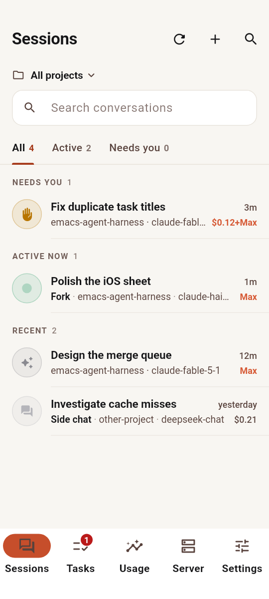 | 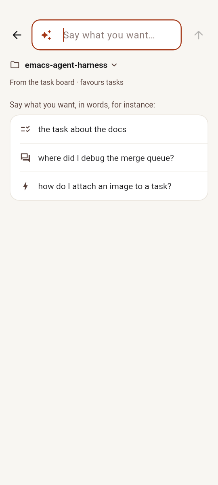 |  |

What the app asks of the harness (`lib/src/services/quick_search_api.dart`) is
what Emacs asks, so a line gets the answer there would be:

- `search/warm` as the page opens, so that the model's process is up by the time
  the line is typed; it says which model answers ("asking claude-haiku-4-5…").
- `search/ask` with the line, **where it was typed** (`context`: the screen, the
  conversation, the project, and `client: "phone app"`, which tells the model the
  person is on the phone and its commands are the app's), **what to favour**
  (`bias`) and **what the app can do** (`commands`).  The harness answers with a
  plan: the answer in words (Markdown), a note, the actions, sessions and tasks
  the line is about, best first, and the orders it proposes.  A search that finds
  nothing is widened by the harness itself, once, and says so in its note.
- `task/search-apply` with the orders a person said yes to.

Nothing here reads a transcript, ranks a task or decides what a line means.  The
app only draws the plan.

- **Where you are sets what it favours.**  On the task board tasks come first, in
  the list of sessions sessions, anywhere else (usage, the server page, the
  settings, a conversation) the app's actions; it only favours, and the harness
  reads the rest too.  The line under the box says it: "From the task board ·
  favours tasks".  *Sessions* and *Actions*, under "Search again, favouring",
  ask the same line again, favouring those.  Opened in a conversation, the search leaves that
  conversation out of what it finds.
- **The project** is the one the screen is on (the board's, when it is narrowed to
  one; else the project of the latest work, which the usage and a new session
  also start in).  Its tasks are what a search reads of the board; sessions are
  found in every project.  When the harness has more than one project the line
  with its name opens a menu to search another.
- **A question gets an answer in words.**  "How do I attach an image to a task?"
  is answered in a card above what was found, as the Markdown it is, whole, with
  the name of the model; a line that only finds something, or orders something,
  gets the list alone.
- **Actions** are the app's own, and what the model names is only what the app
  sent: the screens, a new session in the project and a new task, attaching
  images, answering the session that needs you, refreshing, what can be done with
  a task and with the queue, showing the archived tasks, a command for each
  project (it narrows the board to it), the theme and the agent's thoughts (changed
  at once), non-interactive mode, reconnecting, disconnecting, signing out,
  staying signed in and the platform's style.  Each has the name it is called by,
  a line of what it does (the harness's model reads 120 characters of it) and the
  taps that reach it, as an Emacs command has its keys, so that the answer to "how
  do I ...?" says where to tap.  What this harness cannot do (it has no task board,
  no usage) is not offered.  A tap closes the search and does it, or goes where it
  is done.
- **Sessions** are found by their names and by what was said in them (the harness
  searches every transcript), with the passage found and the words in it marked;
  a tap opens the conversation.  **Tasks** are the board's, with where each stands
  as the harness reads it: a tap opens the task's conversation, where a task is
  handled, or shows it on the board when it has none; *Show on the board* does the
  latter for one that has.
- **Orders are proposed, never done unasked.**  "Stop the docs task" and "make the
  parser task high priority" come back as a question -- *Stop “Fix the docs”?* --
  with *Do it* and *Skip*; *Do it* has the harness do it (`task/search-apply`),
  and the line under says how each went, "Archived “Fix the docs”" or "Could not
  stop “Fix the docs”: it is not working", in the harness's words; the board is
  read again.  What Emacs's board would run at once is asked about here too.
- **It says what is happening.**  While it waits the page shows the line and the
  model and has *Stop*, which gives up waiting (the model's own call goes on at
  the harness and what it says is dropped when it comes); a failure says why in the
  harness's words, with *Retry*; a search that found nothing says so; a harness
  that is out of reach is waited for ("Reconnecting to the harness…", with what was
  typed kept, and the search is back as the app is); one without the search (an
  older one, or with its `tasks-search` module off) says so, and offers nothing it
  cannot do.  The back arrow and the system's back close the page, and an answer
  that comes after that is dropped; so does Escape on a keyboard that has it, where
  Return searches (Shift-Return breaks the line) and a phone's search key does the
  same.  The lines searched are kept for the life of the app and shown again as
  *Recent*.

| Waiting | Failed | Nothing found |
|---|---|---|
| 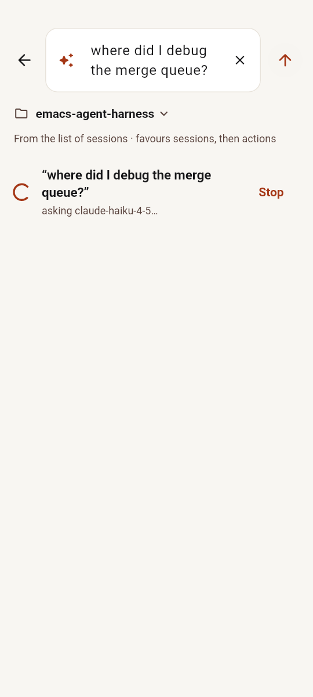 | 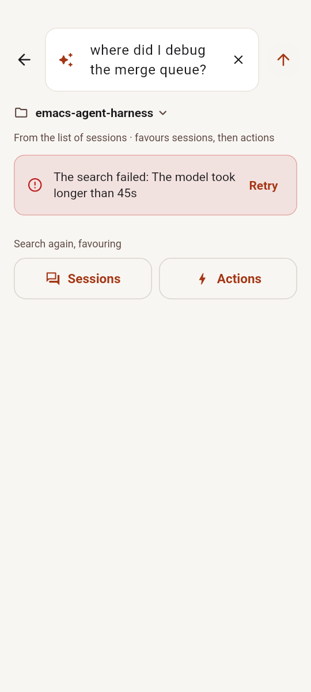 | 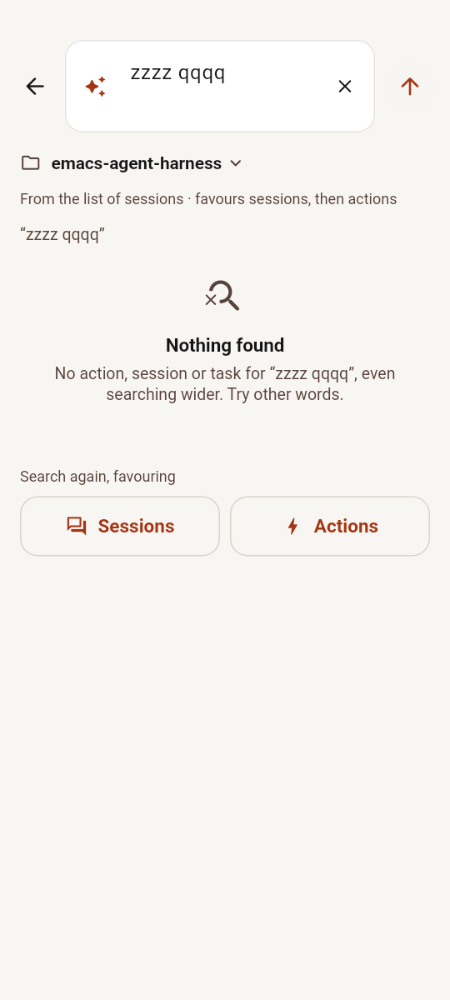 |
| 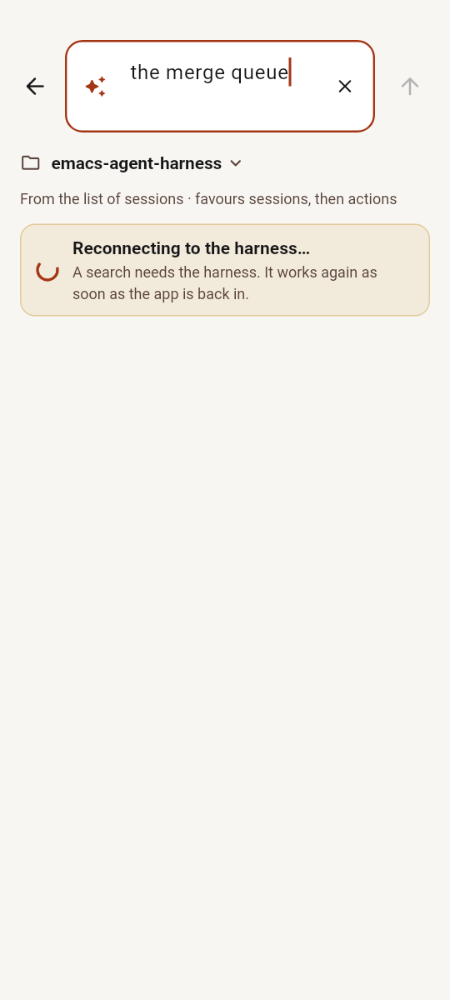 | 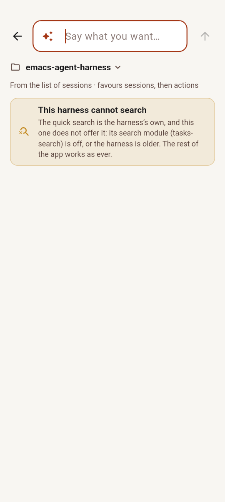 | 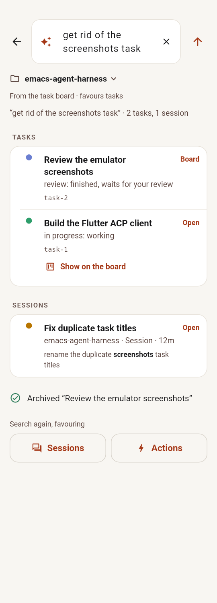 |

| The Apple style | The dark theme | The task board's header |
|---|---|---|
| 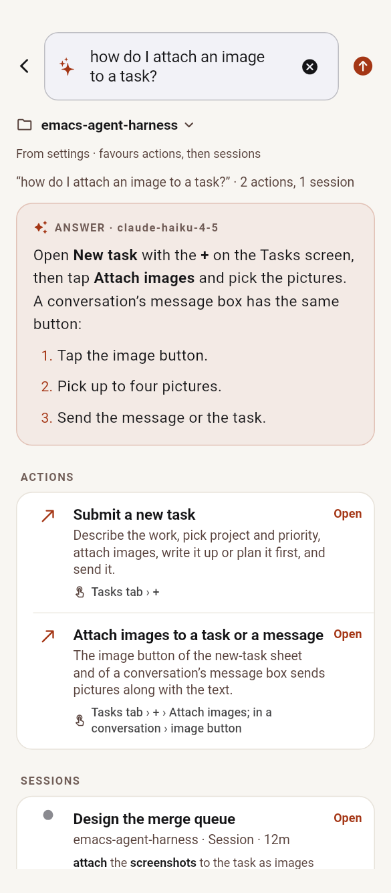 | 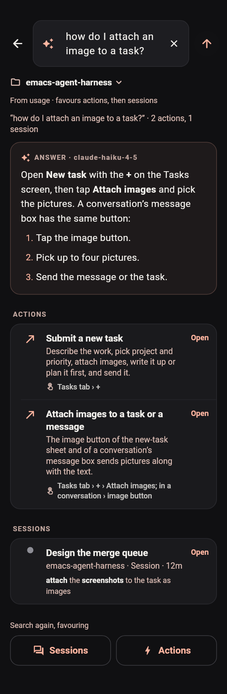 | 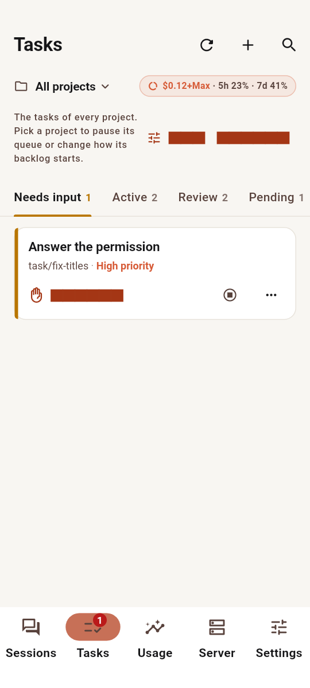 |

What Emacs's quick search has that the phone's does not: *Describe*, since the
app's actions have no documentation to show; *All matches*, which opens the
session search's own view (the app has none); and an *Open* that goes to the
message the words were found in (a conversation opens at its end, and the passage
found is shown under the session).

## Tool calls

A call in the transcript is a card: an icon for what kind of call it is, its
title (`Bash: flutter test`, `Edit file: lib/a.dart`), a line of facts under
it (`Command · 17 s · 35 lines`: how long a slow call took and how much a long
one said) and how it ended. Nothing of what is in a card is built until it is
opened (`ToolCard`, `lib/src/ui/widgets/tool_card.dart`).

| What | How it is shown |
|---|---|
| How it ended | Running: a spinner. Went well: a check. Failed: *Failed*, in red, and the line of its output that says what went wrong under its title. Refused by the permission system: *Denied*, in amber, with the reason; it never ran, so it is not a failure. A failed call can be closed like any other. |
| What it was given | The fields of its input, not JSON (`toolFields`): a command after its prompt, a path or a flag on one line, the text an edit takes out in red and puts in in green, a file's content as it is, prose (a summary, a prompt) as markdown. Line breaks are line breaks, not `\n` in quotes. |
| What it said | Selectable text, its escape sequences and progress-bar rewrites taken out (`cleanToolText`), with how many lines it is. Long text is cut to a screenful, in the card and not in a box that scrolls inside the page, with *Show all 35 lines* / *Show less*. *(no output)* when it said nothing, *Waiting for the result…* while it runs. Both input and output can be copied. |
| All of it | *Open full view* (offered when something is cut, and on a report) opens the call on a page of its own (`ToolDetailScreen`): the whole title, every field, the output built a screenful at a time, so that a result of any length opens at once and is copied whole. |
| What it handed back | A picture (`read_file` on a PNG, a JPEG, a GIF, a WebP, a BMP or an SVG) is drawn under *PICTURE*, above the words that describe it, and tapped it is shown larger. A video or a file is named under *ATTACHMENTS*. See *Pictures* below. |
| The hand-in call | Its report, not its input (`HandInReport`): the problem, the summary as markdown, how to reproduce it, and the evidence, one line each. A note, some code or a call the report quotes opens to what it holds; a screenshot is drawn under its line (see *Pictures* below); a video or a file is on the harness's machine, so it is named. *Cannot continue* and *no merge* are said. A hand-in the harness refused shows its error and what was asked for. |
| Where it is | A card that is opened is brought into view: the last call of a task, the one that hands its work in, grows below the screen, so the page follows it (a card taller than the screen is shown from its top). A card that was opened stays open while the page is scrolled past it. |

The harness writes what the client needs on the call's result node: its
`output`, `is-error`, and in its `meta` the `duration`, `denied` (the
permission system refused the call) and, for `hand_in`, the `report` with its
evidence resolved. A call replayed from `session/nodes` and one that arrives
as `tool_call` / `tool_call_update` / `_harness/node` end up the same
`ToolView`.

### Pictures

A result and a hand-in name the pictures they show by paths on the harness's
machine, which a phone cannot open: a `read_file` call on an image brings
`attachments` (`{path, mime, size, name}`), a task's report lists its evidence
as `{kind: "image", path, caption}`. The app asks the harness for the bytes
(`session/image`, of the session whose transcript shows the file) and draws
them, in the opened card of a `read_file` call, under the line of a hand-in's
evidence (in the card, in its full view and in the task's sheet).

- While a picture comes there is a placeholder of its own size; once it has,
  it is drawn no larger than it is and no taller than a screenful, and decoded
  for the width it is drawn at (a screenshot of a whole display is not held
  at its own size). An SVG is drawn on white.
- Tapped, it is shown on a page of its own (`PictureViewerScreen`): pinch to
  zoom, drag to move about it, double-tap to zoom in on a place and again to
  come back.
- A picture the harness cannot give says why, in the harness's words (it is
  gone: the worktree of a finished task goes with its task; it is larger than
  16 MiB; it is no picture), with *Try again*. The rest of the page reads as
  it did.
- A harness without `session/image` is no error: the pictures are named, as
  they were before they were drawn. So is a picture of a type the app cannot
  draw (a TIFF), a video and a file. Playing a video needs a player the app
  does not have.
- The app keeps what it fetched while it is looked at (`HarnessPictures`: once
  for each file of a session, the newest 64 MiB, a failure not kept) and
  forgets it with the connection.

### Runs of calls

A stretch of quiet calls is one line, as it is in the harness's Emacs chat.
Both read the same flag, the `coalescable` of each tool's spec in `tools/list`
(the harness's allow list), so the app keeps no list of its own, and a tool
the harness puts on the list folds in both at once. The rules are the chat's
(`harness-chat--regroup`), in plain Dart (`segmentTranscript`,
`lib/src/models/tool_runs.dart`) so that they are tried without a widget.

| What | How it is shown |
|---|---|
| Which calls fold | Only those of the tools on the allow list: the quiet reads (`read_file`, `grep`, `list_dir`, the lookups of sessions and tasks, the tools that look into Emacs) and `bash`. What writes, acts on other sessions or tasks, waits or watches, or reaches the web is a card of its own, and ends the run it meets: an edit among reads leaves two lines with its own card between them. |
| A run | The calls that follow one another with nothing between them but thinking. Thinking between two calls folds in (*· thinking ×2*), since a model that thinks before every call would never have a run otherwise; thinking before the first call or after the last stays out. Anything else ends a run: the agent's words, the person's, a hint, a compaction, a plan. A lone call is a run of one, *1 tool call*, named as its card is. |
| The line | `ToolRunCard`: *3 tool calls*, under it what they were, counted by what people call the tools (*Read file ×2, Search files*), and how many failed or were refused, in red and amber, which a run that is closed must not hide. A spinner while a call runs, a check when all went well. |
| Opened | Tapping the line opens the run (`ToolRunMember`): its calls, set in under it, each as closed as a call is anywhere else, and the thoughts between them when thinking is shown. The first call is brought into view, since the calls come out below a line that may be at the foot of the page. Tapping again folds them. |
| What stays out | A call whose result brings a picture or a video, one the session waits for the person to allow (the pending request names it by its `toolCallId`; it joins the run once it is answered) and one the harness recorded for the session and the agent never made (its `_harness.from`). |
| Kept open | What the person opened is kept by the calls in it, not by the run: a call that joins an open run, or one that leaves it while it waits and comes back, leaves the run as it was open. A run made of calls of one that was open is open too, and no other. |
| Without the list | A harness that cannot say which tools fold (no `tools/list`: an older harness or a plain ACP agent) folds nothing, and neither does one that does not answer. The conversation opens all the same, and each call is a card of its own. |

The transcript is a list of rows and not of runs, so that an open run of a
hundred calls builds only the calls near the screen. The runs are worked out
from the whole list of items at each build, so a conversation read in one go
and one that grew call by call fold the same way.

| | | |
|---|---|---|
| 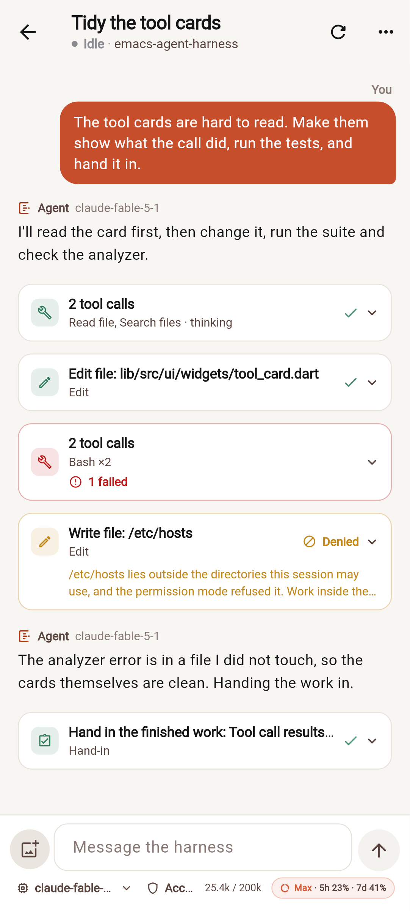 | 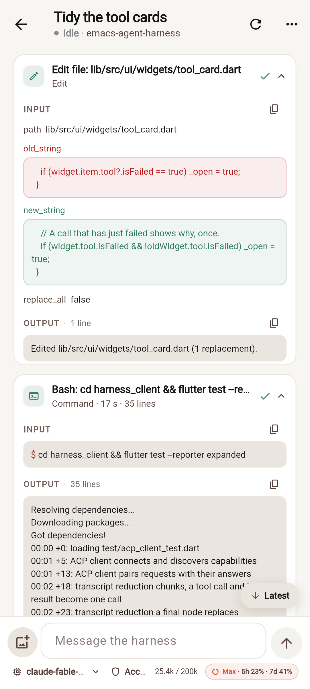 | 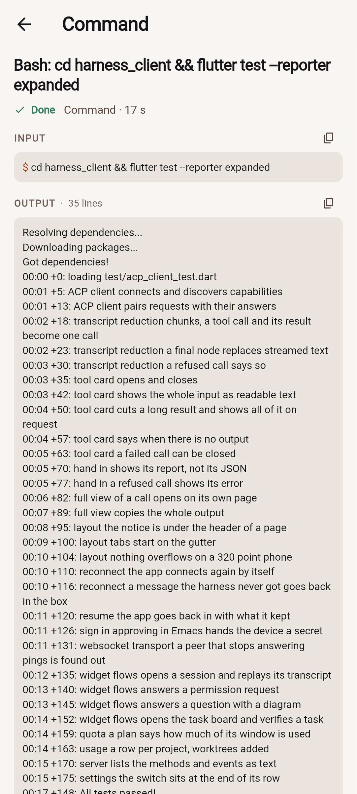 |
| 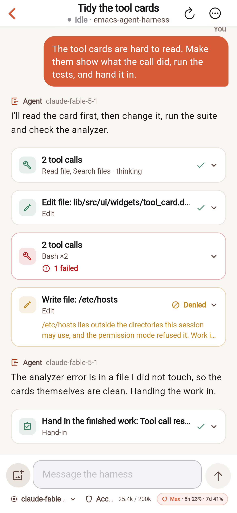 | 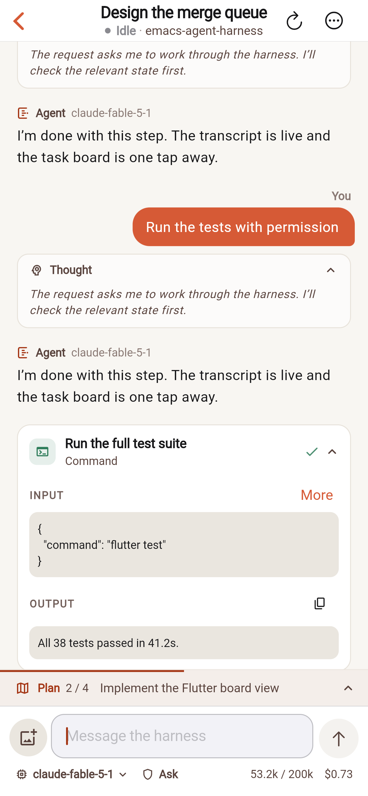 | |

## Markdown

What a person or an agent writes for a person is Markdown, and the app draws it
as Markdown wherever it is read, as the Emacs chat does: `HarnessMarkdown`, over
`flutter_markdown` (headings, lists, bold and italics, code and code blocks,
quotes, tables, links, which open outside the app; a line break is a line
break).  The harness sends the text as it was written, so nothing is lost on
the way.

| Where | What is drawn |
|---|---|
| A conversation | What the agent answers, and a plan; the messages sent to it, whoever sends them, in their bubble (the text takes the bubble's colour, and the bubble hugs it); the summary a compaction leaves, which is a page long, under the line "Context compacted · N words" that opens to it (a note of one line stays on its line). Thoughts, hints and nodes the app does not know are shown as they are, as in the Emacs chat. |
| A tool call | The prose in its input (a summary, a prompt, a question, a body) and, for the hand-in call, the problem, the summary, how to reproduce it and the notes among the evidence. |
| The task board, the sheet of a task | The report the task was handed in with, by the same `HandInReportView` as the hand-in call's card and from the same record (`TaskReport.handIn`), so that a report reads the same on the board and in the session: the problem, the summary, how to reproduce it and the evidence. A round of work that handed none in says so, and draws the last message of its session. |
| The task board, a card | The first words of the summary, without its syntax (`markdownPreview` in `lib/src/ui/format.dart`): a heading, a paragraph and an item of a list are told apart by a dot, a link is its text, a code span its code, and words that only look like syntax (`snake_case`, `2 * 3`, `List<String>`) stay. A row of a list has no room for a heading. |
| A question | The question of the card that asks one. |

## Testing

```sh
flutter analyze                    # no issues
flutter test                       # 348 tests: ACP, capabilities, reducer,
                                   # connection parsing, boot, widget flows,
                                   # layout, tool calls, reconnecting, going
                                   # back in on launch, saved settings,
                                   # WebSocket pings
python3 tool/test_qr_tools.py      # QR encoder against qrencode, the phone
                                   # installer (pairing, install, build
                                   # freshness, pub cache repair) with a fake
                                   # adb and flutter, the APK server
python3 tool/test_check_build.py   # the build check below, with a fake flutter
tool/check_build.sh                # builds what is committed, as a person
                                   # will: pub get --enforce-lockfile,
                                   # analyze, test, release APK, and a build
                                   # over the base's when dependencies changed
```

`tool/check_build.sh` is what a task that changes the app runs before it hands
in, and this repository's `hand_in` (its dev plugin,
`.harness/plugins/dev/harness-client-check.el`; the harness itself asks nothing
of any task) refuses the task without it.  It works in a copy
of the committed tree, on a toolchain `tool/client_toolchain.sh` finds or
installs, and its [docs/dev-loop.md](../docs/dev-loop.md) section says what it
runs and why.  `--quick` analyzes and tests the working tree and builds
nothing.  Tests that fail at the base too are listed, not held against the
branch; one that fails only here, or a file that no longer loads, fails it.

The widget tests drive the real `AcpClient` against an in-memory ACP server
(`test/support/fake_harness.dart`), not mocks of the state layer. They cover:

- connect and capability discovery, session-secret auth and the auth-required
  panel, pairing links (`POST /pair` against a fake HTTP client), connection
  links with a token, refused codes, and plain TCP's second `initialize`
- sessions, search and project filter (worktrees fold into their project)
- the task board on every project, narrowed to one and widened again, and a
  project menu too long for its sheet, scrolled to its last project
  (`test/task_scope_test.dart`, `task_board_widget_test.dart`); the sessions
  that internal sessions do not make the app read again
  (`test/session_events_test.dart`)
- the new task sheet's project row against a harness that lists worktrees and
  scratch directories as projects
- transcript replay, streaming, thought blocks and plan
- the order of a transcript (`test/transcript_order_test.dart`): a system note
  such as *non-interactive on* stands between the messages around it while the
  conversation goes on, when it is read again, when the app was away from it
  and the newest message came before the conversation was read again, and when
  it was recorded while the replay of the conversation was on its way, at
  every point of the run, or came before it; a result that comes before its
  call is one card; a note that is added to stays where it is; nodes that name
  no parent, a parent that is not there, a second branch and a loop of parents
  stay in the order they came; a message held for the turn stays last and
  stands after what it followed once taken; and the app reads such
  conversations from a harness that writes a note into the middle of the
  replay, and after it was out of touch
  (`test/transcript_order_view_test.dart`: the same transcripts drawn as their
  updates came and as the harness recorded them, with pictures written where
  `HARNESS_SHOTS` says)
- the notes the harness writes for itself (`test/system_note_test.dart`): what
  a compaction says of itself (how, who wrote it, why then); a compaction is
  one line with its word count, builds none of the summary and leaves the end
  of a handed-in session on one screen; it opens to the summary as markdown,
  folds again and stays open while the list scrolls away and back, in the
  style of Android and of an iPhone; one that kept no words has nothing to
  open, and one that is a line long stays on its line; a hint of a line or
  two is whole, a long one, or a long line, is cut
  and opens and cuts again (pictures written where `HARNESS_SHOTS` says)
- Markdown (`test/markdown_preview_test.dart`, `markdown_rendering_test.dart`,
  `markdown_screenshots_test.dart`): the report a task was handed in with is
  drawn as Markdown on the board -- its card has the words of the summary
  without the syntax (`markdownPreview`), its sheet the problem, the summary,
  how to reproduce it and the evidence, with headings, bold, code, lists and
  links -- and so are the messages sent to a conversation and the summary a
  compaction leaves, which is folded under its line; what the agent writes and
  a plan were drawn already, and are kept so; thoughts and hints stay as they
  are; pictures of them, in both styles and both themes, are written where
  `HARNESS_SHOTS` says
- tool calls (`test/tool_display_test.dart`, `test/tool_card_test.dart`,
  `test/tool_flow_test.dart`): a call is closed and builds nothing of its
  body until it is opened; its input is the text it was, never `\n` in quotes;
  a long result is cut to a screenful, shown whole on request and read to its
  last line on a page of its own; a failed call says so, why, and can be
  closed; a refused one is *Denied*, not *Failed*; the call that hands the
  work in shows its report, its quoted calls open, and it is seen when opened
  although it is the last thing below the screen; an opened call stays open
  when the page is scrolled past it; a conversation opens on its latest
  message; nothing overflows at 320 points or at one and a half times the
  text; and the whole path from the harness's nodes (`call-id`, `is-error`, a
  result's `meta`) to the page
- runs of calls (`test/tool_runs_test.dart`, `tool_run_view_test.dart`,
  `tool_flow_test.dart`): the allow list is the harness's, read from
  `tools/list` (`test/support/harness_tools.json` is the real one, and a suite
  on the Emacs side, `test/harness-client-tools-test.el`, keeps it honest); a
  stretch of calls of listed tools is one run, cut by any other call or item,
  with the thinking between them folded in and the thinking around them left
  out; a call with a picture, one waiting for an answer and one the harness
  recorded stay out; the line counts the calls by label and the failed and
  refused ones; a run opens to its calls, each closed, and its first call is
  brought into view; it stays open as calls join it or leave it and come back;
  an open run of three hundred calls builds a few of them; nothing overflows at
  320 points or at one and a half times the text, in either style; and the
  whole path from `tools/list` to the page, for a harness that lists its tools,
  one that does not, one that fails to answer, and one that is reloaded
 permission request and allow, question with a diagram and send
- answering the agent's question on phones (`test/question_card_test.dart`):
  on a 360×640 phone, a tall one, a Pixel and an iPhone, with the keyboard
  down and up, a question with options and diagrams and one with none are
  answered -- the card, its field and its button are inside what the screen
  shows (the tests assert where they are), a long Markdown question is read
  to its last words, the keyboard's send key sends what was typed and nothing
  when nothing was, the composer gives way and comes back, and a question the
  harness holds without having asked this device is found (when the
  conversation opens, and while it is open), is not shown twice, goes when it
  is answered elsewhere, and is not lost when the harness took no answer; a
  question of several choices has check boxes (also when the harness holds it,
  and for a screen reader), nothing to send until one is ticked or something
  typed, sends the ticked labels in the order given, with the typed note after
  them, from the button, the arrow or the keyboard's send key, shows the
  diagram of the option tapped last, starts again with nothing ticked for the
  next question and keeps its ticks while the card is laid out again, and is
  as whole on those phones as a question of one choice
  (`test/question_task_board_test.dart`: the task board's *Answer* opens that
  conversation; `test/question_screenshots_test.dart`: pictures of the card,
  drawn with the fonts of a phone, written where `HARNESS_SHOTS` says)
- pictures of the harness's machine (`test/picture_test.dart`: what the
  harness answers, which files the app draws, how the app keeps them;
  `test/picture_widget_test.dart`: a picture while it comes, once it has, when
  it cannot and shown larger, in a `read_file` card, in a hand-in and in its
  full view; `test/picture_flow_test.dart`: the same through the whole client
  against the fake harness, and in the task's sheet, with a harness that gives
  none and with a picture that is gone, and on the nodes and the task a real
  harness wrote for a `read_file` and a `hand_in`
  (`test/support/live_picture_nodes.json`, captured from a live harness, so
  that the app is tried on the shapes it gives); `test/picture_screenshots_test.dart`:
  pictures of those, written where `HARNESS_SHOTS` says)
- creating a session and opening the new-task sheet / submitting a task, with
  pictures (`test/new_task_images_test.dart`: attached, removed, kept in the
  draft, limited to four, refused by type and size, hidden from a harness that
  does not take them, listed on the task), and the message composer still
  attaching as it did
- the new-task sheet's priority and switches (`test/new_task_choices_test.dart`,
  and `settings_controller_test.dart` for the store): the first sheet starts
  from the defaults, the next from how the last was set, sent or only closed,
  changing one and sending updates what is kept, they are there when the app is
  opened again and after the connection is lost, and a task sent without the
  sheet is sent as it was asked for. The store: written a key at a time, read
  again by the next run, a damaged value (or a priority no task has) keeping
  its default and the rest, a choice made while the store is still being read
  kept, the last write the one that lasts, a refused write said, signing out
  leaves them. With `HARNESS_SHOTS=DIR` the same file draws the sheet as it
  opens, with the choices made and opened again, as Android and as iPhone
  pictures (the Material buttons' labels are squares in the test font)
- task review and verification, usage (a row per project, worktrees added),
  server capability table and project list
- what can be done with a task (`test/task_actions_test.dart`,
  `task_controller_actions_test.dart`, `task_actions_widget_test.dart`): the
  actions offered for a task in each column and state, as the board in Emacs
  offers them; each action's call, with its arguments (an archive sends no
  `restore: false`, a queue call always names its project, a harness that can
  only toggle is toggled only when the queue is not as asked); that every
  action offered is one the harness takes, tried on a task in each state
  against a harness that checks the state as the real one does; what is asked
  before a task is stopped, dropped, deleted or marked complete; the message
  and the feedback; the priority, shown at once and taken back when refused;
  the harness's words on the sheet when it refuses, and the board read again;
  the queue and the backlog mode set from their switches, and followed when
  Emacs changes them; archived tasks hidden and brought back; and a harness
  from before the controls, which is offered none of them
- plain ACP fallback (three tabs, working chat, standard notice)
- Cupertino rendering of the shell
- layout (`test/layout_test.dart`): the notice that a session needs an answer
  is under the header and never over it (and the page under it keeps its
  place), tabs, search and rows start on the gutter, the cost of every row
  ends on one edge, a conversation has its model and mode under the message
  field and no pills under its title, nothing overflows on a 320-point phone,
  and the server page lists methods and events as text
- the quick search (`test/quick_search_test.dart`, `quick_search_widget_test.dart`,
  `quick_search_screenshots_test.dart`, `quick_search_real_harness_test.dart`):
  what the harness answers is read into a plan (an answer, a note, actions,
  sessions with the passage found, tasks, orders; what the harness leaves out
  is `null`); the commands the app offers are named once each, in words, with a
  description of at most the 120 characters the model reads, the taps that
  reach them as their keys, and are left out where the harness cannot do them
  (no task board, no usage), where they would change nothing (the theme in use)
  and past forty projects; each does what it says (a setting at once, a screen
  by the shell, a project narrows the board, a new session starts in the
  project searched); the controller asks with where it was typed and the
  catalogue, keeps the lines, drops the answer to a line that was asked over,
  to one given up on and to a page that is gone, says a failure in the
  harness's words, asks again favouring something else, proposes the orders
  and does them only when told, says how each went and reads the board again;
  on the whole app, against a fake harness whose search is scripted
  (`test/support/quick_search_harness.dart`, which stands before the fake
  harness and leaves it as it is): the button is in the header of each of the
  five screens and a conversation, at its end, and in a wide screen's sidebar,
  and opens the page with the box ready and the place said; an answer in words
  is drawn as Markdown above the actions, which are tapped (a screen is shown,
  a setting set, a project narrowed); sessions open as conversations and tasks
  as their conversation or on the board; what the place favours is listed
  first; an order waits for *Do it* or *Skip* and says how it went; the wait
  names the line and the model and can be stopped, and what comes after is
  dropped; nothing found, a failure with *Retry*, a harness out of reach (the
  line kept, the search back with the connection), a harness without the
  search, the way out by the arrow and by the system's back, the lines of
  before, asking again, the project to search, and the Apple style.  The
  pictures (written where `HARNESS_SHOTS` says) are of the page drawn as the app
  draws it, with the fonts of a phone, in both styles and themes.  The last
  file talks to a real harness (see *Against a real harness*) and is skipped
  without one.
- a lost connection (`test/reconnect_test.dart`, `reconnect_widget_test.dart`):
  a fake harness that drops the connection, refuses the next ones, goes silent
  or no longer knows the device's secret. The app notices, connects again by
  itself with backoff, keeps its screens (a typed message, a half-written
  task, a search filter, the tab) and reads them again, answers nothing on the
  dead connection, falls back to sign-in only when turned away and keeps what
  was typed, waits while it is in the background, finds a connection that died
  without a word by a probe, puts a message the harness never got back in the
  box (and not one it did), and reconnects in place from Settings
- a device that signed in before and is opened again (`test/resume_test.dart`,
  `resume_widget_test.dart`, `settings_controller_test.dart`): it goes back in
  by itself with the address and secret it kept, over WebSocket and plain TCP,
  and the harness is asked nothing, the first frame is not the connection
  form, a secret the harness replaced on the way in is the one kept, one the
  harness turns down leads to the sign-in once and is not offered again, a
  harness out of reach is tried again (at once on request, not while the app is
  away, one that takes the connection and never answers is given up on) and
  said in words, *Disconnect*, *Sign out* and *Remember* off keep it from going
  back in, *Use another address* takes over, and an attempt that was taken
  over does not undo the one that replaced it, even when it fails long after.
  The saved settings: the flag, `canResume`, overlapping writes that finish out
  of order, a connection made while the store is still being read, a damaged
  value that must not take the address with it
- a device that cannot keep what it learns (`test/persistence_notice_test.dart`,
  `settings_controller_test.dart`, `test/support/broken_preference_stores.dart`):
  a store that dies with a `NoSuchMethodError` as the Android plugin did in a
  release build, one that refuses a write or raises on it. The app starts and
  connects all the same, the connection form and Settings say why nothing is
  remembered, the notice goes when writes work again, and a write that works
  does not hide one that did not
- the dependency that made it so (`test/dependency_guard_test.dart`):
  `pubspec.lock` and `pubspec.yaml` may not take `shared_preferences_android`
  below 2.5.2
- real sockets (`test/websocket_transport_test.dart`): a peer that stops
  answering pings is found out and named, an idle connection to one that
  answers stays open, and what the peer said when it closed is reported
- a real network (`test/reconnect_network_test.dart`): the app's own
  transport through a TCP proxy that cuts every connection, refuses new ones
  or swallows all traffic, as a network that died without a word does: the
  connection is got back and the open conversation is read again

### End-to-end in a mobile emulator

```sh
cd e2e
npm install
npx playwright install chromium
cd ..
SKIP_BUILD=1 ./e2e/run.sh       # or ./e2e/run.sh to build first
```

`e2e/run.sh` starts the preview harness (`tool/mock_harness_server.dart`, one
with extensions, one plain ACP and one, `--tools`, whose session has done some
work for `e2e/run_tools.mjs`), serves the E2E web build, and drives
Chromium with iPhone 13 (`390×844 @3x`) and Pixel 7 (`412×915 @2.625x`) device
metrics, plus a 1280×900 macOS layout. It walks connect, sessions, new session,
chat, streaming, permission, question with diagrams, the task board, new task,
review/verify, usage, server capabilities, settings, the macOS split view and
the plain-ACP fallback, writing a screenshot for each. It also signs in with an
approval and loads the page again: the app must be on its sessions at once,
with no form and no second approval (the mock would take six seconds), and
again with the harness cut off (the browser's WebSocket is closed by
Playwright) it must show the reconnecting card and, once the harness is back,
get in by itself. `e2e/run_task_actions.mjs` then does what a person does with
a task -- the menu of a card, the sheet with its actions and priority, what
is asked before a task is stopped or deleted, a task paused and resumed, one
archived and brought back, the queue of a project paused -- on both styles, and
writes a screenshot for each.  The screenshots in this README are the output.

| | |
|---|---|
|  |  |
|  |  |
|  |  |

The environment used to build this had no KVM, so the emulator is Chromium's
mobile device emulation at real phone viewports and touch input. A release APK
is built for installing on a real Android device; see `dist/README.txt`.

### Against a real harness

`tool/real_harness_probe.dart` connects to a running harness over ACP and
performs a scripted turn:

```sh
dart run tool/real_harness_probe.dart 127.0.0.1:PORT "" /path/to/project
```

The run recorded in `verification/real-harness-probe.txt` was made against a
real `emacs-agent-harness` 3.0.0 started headlessly with the demo provider:

```text
agent: emacs-agent-harness 3.0.0
protocol: 1 · harness: true · extensions: 148
features: Sessions, Live transcript, Permission prompts, Rich nodes, Activity, Usage, Question images, Fork, Providers, Harness info
created session da81df8a-373e-4d15-b3c5-b13ac78835ef
prompt stopped: end_turn
updates: {user_message_chunk: 1, _harness/node: 9, _harness/activity: 7,
          agent_thought_chunk: 2, _harness/session: 2,
          agent_message_chunk: 3, tool_call: 1, tool_call_update: 1}
nodes: 6 (user, thinking, assistant, tool-call, tool-result, assistant)
OK
```

This checks the real `initialize`, `session/list`, `session/new` with
`_harness` metadata, `session/prompt` streaming, activity, node replay and
`_harness/session/nodes` shapes — not just the preview server.

`tool/with_real_harness.sh` does what that run did by hand: it starts this
checkout's harness headless, as the user's Emacs starts its own (an
`emacs --batch` process that serves ACP on a loopback port), with every module
and the demo provider -- which answers a prompt or a search from its words, and
needs no account and no network -- and runs a command with the address in
`HARNESS_REAL_ADDRESS` (and `HARNESS_REAL_TOKEN`, `HARNESS_REAL_CWD`), then stops
the harness.  The suites that need a real harness skip without them, so this
is how they run:

```sh
tool/with_real_harness.sh flutter test test/quick_search_real_harness_test.dart
```

`test/quick_search_real_harness_test.dart` is the quick search against the
real `search/warm`, `search/ask` and `task/search-apply`, from the catalogue the
app really builds: the plan of a question ("how do I attach an image to a
task?") that the real harness encodes -- the answer in words, naming the app's
action and the taps that reach it, not Emacs keys --, a session found by what
was said in it with the passage and where the words are in it, a task found by
its words, the order to archive it proposed and done, and a line nothing
matches.  It is what keeps the app's idea of the plan the harness's own.

## Building the apps

```sh
flutter build apk --release        # build/app/outputs/flutter-apk/app-release.apk
flutter build web --release        # build/web
flutter build macos --release      # on a Mac with Xcode
flutter build ios --release        # on a Mac with Xcode, signed for a device
```

The Android build in this checkout used JDK 21 and Android SDK 36; set
`JAVA_HOME` and `ANDROID_HOME` accordingly. Release builds use the generated
debug signing config so they install for testing; replace it before publishing.
The icon is generated from `assets/icon.png` with `dart run flutter_launcher_icons`.

A build that stops with

```
Error: Error when reading '.../.pub-cache/hosted/pub.dev/NAME-VERSION/lib/NAME.dart': No such file or directory
Target kernel_snapshot_program failed: Exception
```

straight after `flutter pub get` said "Got dependencies!" means a package in the
pub cache lost its files. `pub get` counts a package as installed once its
directory is in the cache and never looks inside, so it does not notice. A tool
that was told to reinstall a package and was stopped half way leaves exactly
this behind: a sandboxed shell sees only the parts of `~/.pub-cache` that were
mounted into it, so pub tries to reinstall what it cannot see and deletes the
real files of a directory that was mounted (in such a shell, set `PUB_CACHE`
to a scratch directory).

A build that stops with

```
GeneratedPluginRegistrant.java:34: error: cannot find symbol
  symbol:   class SharedPreferencesPlugin
  location: package io.flutter.plugins.sharedpreferences
```

after a dependency was raised is a plugin whose compiled classes are left over
from its older version: Kotlin's incremental compiler keeps its state in
`build/`, keyed by the paths of the sources, and a plugin's sources sit in the
pub cache under a directory named after its version.  Raising
`shared_preferences_android` from 2.5.0 to 2.5.2 over the `build/` of 2.5.0
drops `SharedPreferencesPlugin`; the same tree built from an empty `build/` is
fine.  `android/gradle.properties` sets `kotlin.incremental=false` so that it
cannot happen (`test/build_config_test.dart` keeps the line there), and the
build over the base's build in `tool/check_build.sh` is what would have shown
it before the dependency went in.  `flutter clean` throws a build that is
already like that away.

In this directory, `flutter pub cache repair` reinstalls the packages in
`pubspec.lock`. It removes a package whose directory is empty and reports it as
failed, so follow it with `flutter pub get`. `tool/qr_install.sh` does both by
itself, before the build when `python3 tool/check_pub_cache.py` (which lists the
incomplete packages) finds one, and after a build that failed.

## Preview server

For UI work without a harness:

```sh
dart run tool/mock_harness_server.dart --port 4277
# in another shell
flutter run -d chrome
# connect to ws://127.0.0.1:4277/acp
```

`--standard` makes it a plain ACP agent with no extensions, which is how the
fallback screenshots were made.

## License

GPL-3.0, the same license as the emacs-agent-harness. The app is self-contained
and can be published from its own repository.
