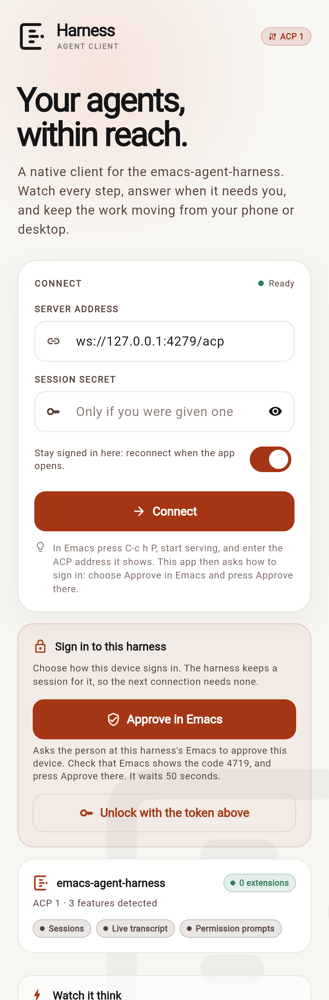
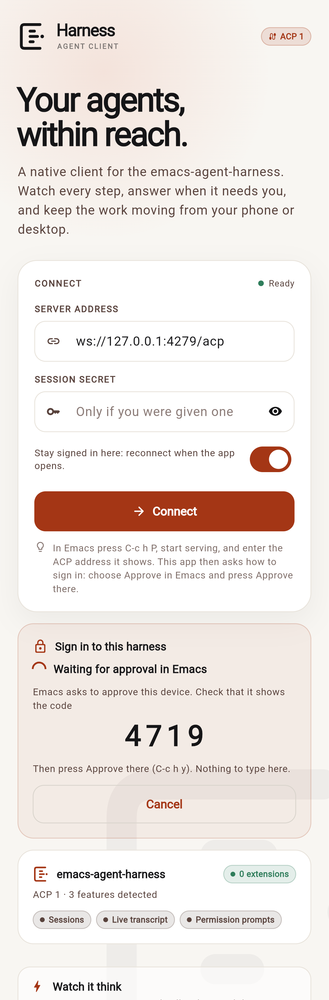
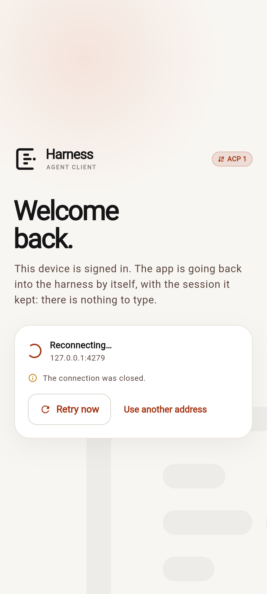

# Harness

A native, adaptive [Agent Client Protocol](https://agentclientprotocol.com)
(ACP) client for the **emacs-agent-harness**. It is a standalone Flutter app:
nothing here imports the Lisp tree, and the whole client is a normal ACP
client first. When the agent on the other end is the harness, it discovers the
harness's extended methods and lights up the task board, usage, live activity,
rich transcript nodes and question diagrams. When it is any other ACP agent,
the chat and permission prompts still work, and the enhanced views are simply
not offered.

| iOS | Android |
|---|---|
|  |  |
|  |  |
|  |  |
|  |  |


Signing in happens inside the app, with ACP's own `authenticate`: the harness
lists how, the user picks "Approve in Emacs", and presses Approve in Emacs after
comparing the code. It happens once: the app keeps the address of the harness
and the session secret the harness hands it, and goes back in by itself every
time it opens. It asks again only when the harness does.

| Choosing how to sign in | Waiting for the approval | Opened again, harness out of reach |
|---|---|---|
|  |  |  |

## What it does

- **Streams a real conversation.** Markdown answers, streamed thoughts, tool
  calls with their input and output, plans, context-compaction notes, hints and
  the activity of the running turn (waiting, thinking, writing, preparing a
  tool call, running tools, compacting).
- **Answers the agent.** Standard ACP permission requests become an inline
  decision card with *Allow*, *Deny*, *Allow for session*, *Always allow* and
  *Always deny*; a path glob can be edited before a lasting answer is given.
  Harness `_harness/ask_user` questions become a choice with optional ASCII or
  image diagrams, a free-text answer, and the harness's cold-cache cost note
  when it sends one. Requests that were already waiting when the client
  connected are recovered through `permission/pending` and `question/pending`.
- **Shows the rest of the harness.** The task board (all seven columns, queue
  state and slot use, backlog mode, submit/start/queue/verify/reject/retry/
  complete/archive), spend, tokens, live sessions, daily spend, per-model and
  per-project breakdowns, budgets, the model catalogue, harness modules and the
  full ACP capability report.
- **Treats a project as a main checkout.** A task, and a sub-agent started in
  its worktree, works in a git worktree, which the harness files under the
  worktree itself. The app folds each worktree into the checkout it was made
  from, so the project pickers and filters, the session and task rows, and the
  Usage "Projects" list have one entry per project, and a project's usage adds
  up the spend of its worktrees. The harness says which checkout a directory
  belongs to (`project/mains`, which reads the repository's own `.git` files,
  wherever the worktree was made); a harness without it is folded by the
  `PROJECT/.worktrees/BRANCH` layout it makes worktrees in.
- **Detects extensions per feature.** `initialize` is read for standard ACP
  capabilities and for the harness's `_harness.methods` and `_harness.events`.
  Each screen asks for the exact methods it needs. A missing method turns off
  that one view or action at runtime; a plain ACP agent gets a small "Standard
  ACP agent" notice, three tabs instead of five, and a working chat.
- **Feels at home on the platform.** Material 3 with warm paper surfaces on
  Android; Cupertino navigation, tab bar, switches, sheets, typography and
  motion on iOS and macOS. Wide screens get a sidebar and a list/detail split.
  Theme and a System/Android/Apple preview are in Settings.
- **Connects the way the harness is reached.** ACP over WebSocket (`ws://`
  and `wss://`, or the `https://` URL of a harness behind a TLS proxy) or
  ACP's line-framed TCP (`tcp://`) on desktop; the browser build uses
  WebSocket only. A remote harness lets a device in by ACP's own sign-in: it
  lists its `authMethods` in `initialize`, the app shows them, and the user
  taps one. **Approve in Emacs** asks the person at the harness's Emacs, who
  compares the four-digit code the app shows with the one Emacs shows and
  presses Approve: nothing to type or copy, and the app is not left. A harness
  set up for OpenID Connect also lists a login at its identity provider, which
  the app opens in the browser. The harness hands the app a **session secret**
  (`hs1_…`) for the device, which the app keeps and presents on every
  connection (the `bearer.SECRET` WebSocket subprotocol), so the next
  connection needs no sign-in. A secret given by hand goes in the field below
  the address, or in the address as `?token=`; it is taken out of the
  address, so it is never remembered or shown inside a URL. The app says in
  `initialize` that it can keep a session secret, and when the harness replaces
  it (every seven days by default) it saves the new one at once, in place of
  the old.
- **Stays signed in.** What a device needs to get back into its harness is
  kept on the device: the address, and the session secret (or the token it was
  given by hand), with *Remember* on, which it is unless the person turns it
  off. When the app opens (a cold start of a phone app that the system ended
  in the background, a page that is loaded again) it reads that before the
  first frame and **goes back in by itself**: no connection form, nothing to
  tap, and no approval to ask for in Emacs again. The first thing on screen is
  a quiet "Welcome back" with where it is going, and then the sessions. The
  person is asked for something only when the harness asks. A harness that
  no longer knows the secret (it was revoked, or it ran out: 30 days unused,
  or 90 days after it was issued) leads to the sign-in screen, once, with the
  reason; the app does not keep offering a secret that was turned down, and
  it does not throw it away either, in case the harness only said no for now.
  A harness that **cannot be reached** (no network yet, the harness
  restarting, a VPN that is not up) is not a reason to ask anything: the card
  says where the app is going back to and what the last try said ("The
  harness refused the connection: is it running?"), and the app tries again
  by itself, at once, then after 1, 2, 4, 8 and every 15 seconds. It waits
  while the phone is put away and tries at once when it is picked up. *Retry
  now* does not wait for the timer, and *Use another address* stops and shows
  the form with the address and secret in it. What the person chose is kept
  too. Settings → *Disconnect* means the app waits for a tap on *Connect* the
  next time it opens (it still holds the address and secret, so that is all it
  takes); *Sign out of this harness* and turning *Remember* off forget them;
  a new connection turns going back in by itself on again. The saving is done
  in order and writes what the app holds at that moment, so a secret the
  harness replaced is never overwritten by an older one that was still on its
  way to disk, and a connection made while the preference store was still
  being read is kept, not undone by what the store then says.
- **Keeps a conversation useful.** Local echo, auto-scroll with a "Latest"
  chip, a collapsible plan strip, a context-window meter, cost per session, and
  image attachments to prompts.
- **Survives a lost connection.** A phone loses its connection all the time:
  it sleeps, changes network, a VPN restarts, the harness reloads. The app
  does not tell the person to go and reconnect. Over `ws://` and `wss://` it
  pings the harness every 25 seconds, which keeps a quiet connection open
  through a mobile network, a VPN or a NAT, and finds a dead one in under a
  minute instead of when the next request times out. When the connection goes
  (or is found dead, or the app returns to the foreground to find it gone) a
  quiet **"Connection lost. Reconnecting…"** banner appears, with a *Retry
  now* button, and the app connects again by itself with the session secret it
  holds: at once, then after 1, 2, 4, 8 and every 15 seconds. The screens do
  not go anywhere meanwhile: the tab, the open conversation, a sheet and
  everything typed in them stay as they were; sending waits for the
  connection and a message waits in its field; a request made in the gap
  goes out over the new connection a moment late; and when it is back the
  lists, the tasks and the open transcript are read again, and a permission
  or question that was waiting is offered again. A message sent as the
  connection died, which the harness never got (it echoes a message the
  moment it takes it), goes back in the box instead of being lost. A phone
  that is put away does not keep trying; it connects the moment it is picked
  up. Only a harness that no longer accepts the device's session (it was
  ended in Emacs) needs the person: the app falls back to the sign-in screen,
  and whatever was typed is kept for when they are back (`DraftStore`; in
  memory, for the life of the app). Settings → *Reconnect* does the same in
  place; it used to disconnect first, which threw every screen away.

## Quick start

Requires Flutter 3.47.7 / Dart 3.13.5. The version is pinned in
`.flutter-version`. Run the installer once; it downloads that SDK into
`~/.local/share/flutter-versions` (or uses it if it is already there) and
installs a small `~/.local/bin/flutter` launcher that selects the pinned SDK
inside this directory. Other projects keep using the default Flutter SDK.

```sh
tool/install_flutter.sh
flutter pub get
flutter run -d macos          # or: flutter run -d <android-device>
```

If you prefer not to install the launcher, `tool/flutter` is the same
per-project selector and can be run directly (`tool/flutter build apk`).

Older Flutter tooling (3.16 and earlier) can misreport this project as using
the deleted Android v1 embedding. Those releases only look for a Groovy
`android/build.gradle`; without one they check the wrong manifest path and
report that `android/AndroidManifest.xml` is missing. This project is on
embedding v2 (`app/src/main/AndroidManifest.xml` carries `flutterEmbedding=2`
and `MainActivity` extends the v2 `FlutterActivity`) and ships a Groovy root
build file for that check, but those releases also cannot resolve the
project's Dart 3.13 dependencies. Use the pinned SDK above, or any Flutter
release that understands a mixed Groovy/Kotlin Gradle project.

Or run the web build:

```sh
flutter run -d chrome
```

In Emacs, press `C-c h P` to open the remote control page, `[start serving]`,
and type the ACP address it shows (`ws://ADDRESS:4276/acp`) into the app.
The app then asks how to sign in: choose **Approve in Emacs**, check that Emacs
shows the code the app shows, and press Approve there (`C-c h y`). On a
desktop build connected to a local ACP server, the
address is `tcp://127.0.0.1:PORT`; the port and token are in `acp-address` and
`acp-token` in the harness state directory.

The browser cannot open raw TCP. Serve the built web app over HTTP and use the
harness's WebSocket address:

```sh
flutter build web --release
python3 -m http.server 8080 --directory build/web
# open http://127.0.0.1:8080
```

The Android APK is built with the debug key so it installs directly; it needs
Android 7 (API 24) or newer. `tool/qr_install.sh` builds and installs it over
Wi-Fi from the terminal, with no cable (see *Installing on a phone over
Wi-Fi*). This is a local-network test client: the session secret is kept in
the app's shared preferences when *Remember* is on, which is what lets the
app go back in by itself when it opens, not in a platform keychain (*Sign out
of this harness* in Settings ends the session on the harness and forgets it
here), and
`ws://` is cleartext. Use it on a trusted network, or a VPN such as Tailscale.
Cleartext traffic is enabled for `ws://` on a local network, and the `INTERNET`
permission is declared in the release manifest. iOS and macOS prompts for
local-network access are declared too; macOS has the outgoing-network
entitlement.

The Android build pins the NDK, Build-Tools, platform and CMake versions that
AGP uses in every module (`harness.*` in `android/gradle.properties`), because
Flutter 3.47's defaults are newer than the components in some SDK
installations. Change those four values to the versions installed on your
machine if the build reports a missing SDK package.

## Installing on a phone over Wi-Fi

`tool/qr_install.sh` builds the Android APK when needed and installs it on a
phone over the local network, with no USB cable. "Needed" includes an APK that
is older than the app sources: a change under `lib/`, `assets/` or `android/`,
or to `pubspec.yaml`, `pubspec.lock` or `.flutter-version`, triggers a build.
That matters because an APK left over from an earlier run would otherwise keep
the phone on old code even after the app was fixed. The phone pairs as a
wireless debugging device by scanning a QR code shown in the terminal, then adb
installs the APK and opens the app. A build that fails because a package in the
pub cache lost its files is repaired and run again (see *Building the apps*):

```sh
tool/qr_install.sh                 # build if stale, show a QR code to pair with, install, open
tool/qr_install.sh --build         # rebuild even when the APK is current
tool/qr_install.sh --debug         # build/install the debug APK
tool/qr_install.sh --no-build      # install the existing APK, warn if it is stale
tool/qr_install.sh --code          # pair with the six-digit pairing code instead
tool/qr_install.sh --no-launch     # install without opening the app
tool/qr_install.sh --no-image      # keep the QR text-only, no image window
tool/qr_install.sh --connect 192.168.1.7:41234  # skip pairing, use that port
```

On Android 11 or newer, enable *Developer options*, open *Wireless debugging*
and tap *Pair device with QR code*, then scan the code the script shows. The
phone and the computer must be on the same network. The script finds adb in
`ADB`, `PATH`, or the Android SDK (`ANDROID_HOME`, `ANDROID_SDK_ROOT` and the
usual install locations); the QR code is drawn by `tool/qr_terminal.py` in
Unicode blocks at error-correction level L, so `qrencode` is not needed. The
code is shown on a fresh screen, so a code from an earlier run is not beside it
for the scanner to pick. On a graphical desktop a large copy also opens in an
image viewer (the same code; close it when the phone is paired); `--no-image`
keeps it text-only. `--qr` asks for this explicitly; a plain run does the same.

Scan the code from *Wireless debugging*, not with the camera app. Android's QR
pairing format is really a Wi-Fi network code (`WIFI:T:ADB;S:service;P:password;;`),
even though it only carries an adb service name and password. Some phone camera
apps read such a code as a network to join, which takes the phone off its
current Wi-Fi, so the screen repeats that warning. The script also makes the
code useless as a network: its service name is `studio-` plus 32 random
characters (39 bytes), longer than the 32-byte Wi-Fi SSID limit. The wireless
debugging scanner does not mind: it takes any non-empty name and password,
starts adb pairing, and never joins a network, and the phone advertises its
pairing service over mDNS under that name (which allows 63 bytes).

`--code` pairs with the six-digit code instead and shows no QR code at all. Tap
*Pair device with pairing code* and keep that dialog open: the script finds the
phone with mDNS, asks for the six digits shown there, pairs, and installs the
app. If mDNS cannot find the dialog, pass the *IP address & port* it shows with
`--pair-address 192.168.1.7:37111`; `--pair-code 123456` supplies the code
without prompting. Both options ask for `--code` themselves, so they need not
be combined with it; they cannot be combined with `--qr`.

After pairing, the phone's debugging port can take a few seconds to appear, and
adb's mDNS cache can hold an old port. The script only tries addresses on the
phone it just paired with, retries every published port until one answers, and
does not give up on the first refused connection. While nothing has connected
it prints each refusal once (`adb connect: failed to connect to
'192.168.1.7:46037': Connection refused`), so an old record for a closed port
shows instead of the script seeming to hang; a refusal beside a service that did
connect is not worth a line.

The phone can publish two services under its name: an old record on a port that
is closed now, and the live one, renamed `adb-SERIAL-xxxxxx (2)` because the
name was still taken. adb lists services as `name<TAB>type<TAB>ip:port`, so that
name, space and all, is one field, and the script reads the list by tabs (and
`adb devices` too, whose serials can be such names). Reading it by spaces, as
earlier versions did, dropped the live service and left only the old record: the
script retried a closed port until it timed out, "stuck waiting for the phone's
debugging port". adb's own connect after pairing only matches the exact name, so
it never connects a renamed service itself.

After 15 seconds of waiting the script says how to skip the wait. If the port
never appears, open *Wireless debugging* on the phone, read the *IP address &
port* shown there, and pass it with `--connect`. When the script gives up it
says what it saw: the last connect error, a phone adb lists but that is not
ready (`offline`), or that adb's mDNS list has no wireless debugging service
for the phone at all (a firewall blocking mDNS, UDP port 5353, does that).

A phone that adb already sees (connected by USB, or paired earlier) is used
directly. Emulators are ignored unless named with `--device SERIAL`, and more
than one connected phone also needs `--device`.

For a phone where wireless debugging is unavailable, `--serve` starts a small
HTTP server on the local network instead. Scan its QR code with the phone's
camera, download the APK and install it, allowing installs from that browser
when Android asks:

```sh
tool/qr_install.sh --serve
```

`--serve` listens on every interface and serves only that APK. If it prints an
address the phone cannot reach (a VPN interface, say), pass the right one with
`--address 192.168.1.10`. The pairing credentials and the download URL are
meant for a trusted local network; the phone needs Android 7 (API 24) or newer.

## Graceful extension detection

The client never assumes a method because the agent calls itself a harness.
`HarnessCapabilities` maps each view to the methods or events it uses:

| View or ability | Requires |
|---|---|
| Session list and chat | standard `session/list`, `session/load`, `session/prompt` |
| Streaming transcript, tools, plans | standard `session/update` |
| Permission prompts | standard `session/request_permission` |
| Rich nodes, final text, usage on a node | `session/get`, `session/nodes` |
| Live activity | `agent/activity` or `agent/activity-changed` |
| Task board | `task/list` (actions need `task/start`, `task/verify`, …) |
| Usage | `usage/totals` or `usage/summary` |
| Question diagrams | `question/image` for images; ASCII comes with the request |
| Project picker | `insights/projects` (and `project/mains`, to fold worktrees) |
| Rename, fork, delete | `session/update`, `session/fork`, `session/delete` |
| Priority | `priority/set` |
| Model catalogue | `provider/list`, `provider/models` |

A method that disappears at runtime (`-32601`) is marked unavailable for that
connection and the affected UI hides itself. The **Server** tab shows exactly
what was detected, including `off` rows, and the raw `initialize` answer.

The standard method set used here is:

```text
initialize · authenticate · logout · session/new · session/load · session/list
session/prompt · session/cancel · session/set_mode · session/set_model
```

Everything beyond that is under `_harness/` and is optional.

### The extension shapes this client understands

- Sessions: `_harness/session/list` (full plists), `session/get`,
  `session/nodes`, `session/update`, `session/fork`, `session/delete`.
- Transcript: `_harness/node` (full node), `_harness/session` (title, status,
  usage, todos, queue, pending), `_harness/activity` (phase, tool, detail,
  running calls), `_harness/event` (task, usage, turn and config events).
- Tasks: `task/list`, `task/slots`, `task/settings`, `task/submit`,
  `task/start`, `task/queue`, `task/verify`, `task/reject`, `task/prompt`,
  `task/retry`, `task/cancel`, `task/complete`, `task/archive`,
  `task/toggle-queue`, `task/toggle-backlog-mode`.
- Usage: `usage/totals`, `usage/summary`, `usage/live-all`, `usage/rates`,
  `usage/budgets`.
- Server: `harness/version`, `harness/modules`, `insights/projects`,
  `project/mains`, `provider/list`, `provider/models`, `config/describe`.
- Questions: `_harness/ask_user` request, `question/pending`,
  `question/answer`, `question/cancel`, `question/image`; permission answers
  are the standard `{outcome: {outcome: "selected", optionId}}` reply, with an
  optional `_harness.pattern`.

The params for `_harness/*` are the keyword arguments of the bus method, in
kebab case or camelCase; `task/submit` takes its optional settings under
`opts`, while `&rest` methods such as `usage/totals` take the keys directly.
`tool` nodes do not carry ACP's `kind`, so the client infers common kinds from
the tool name when it rebuilds a transcript from nodes.

## Architecture

```text
lib/src/acp/          JSON-RPC peer, WebSocket/TCP transports, capabilities
lib/src/models/       sessions, transcript reducer, tasks, usage, activity
lib/src/services/     typed HarnessApi over ACP and _harness
lib/src/state/        connection, sessions, tasks, usage, interactions
lib/src/ui/           adaptive widgets, theme, screens and transcript widgets
tool/                 preview ACP server, real-harness probe, phone installer,
                      pub cache check
test/                 unit, reducer and widget-flow tests
e2e/                  Playwright mobile-emulated flows and screenshots
```

- `AcpClient` is transport-agnostic and knows nothing about the harness. It
  pairs request ids, surfaces notifications, answers agent requests and fails
  pending calls when the transport goes away.
- `AppController` owns the connection and the capability switch. It routes
  `session/update` to the open `SessionController`, `_harness/event` to the
  task/usage controllers, and permission/question requests to the session that
  must answer them. It watches the client it connected with: when that ends
  (`AcpClient.closed`) the phase becomes `reconnecting`, which keeps the home
  screens mounted, and it connects again in place (`HarnessApi.rebind` moves
  the api, and the session, task and usage controllers built on it, to the new
  `AcpClient`) with the backoff above, then reads everything again. It gives
  up only when the harness refuses the device's session secret (`needsAuth`).
  `DraftStore` keeps unsent text outside the widgets. `resume()` is what the
  app does when it opens (`HarnessApp` starts it as soon as the settings are
  read, which `main` does before the first frame, waiting at most a second
  for a store that does not answer): it connects with the address and secret
  `SettingsController` kept (`canResume`), through the same `connect` as a tap
  on the form, and while the harness cannot be reached repeats it with the
  same backoff (`resuming`, `resumeError`, `cancelResume`). It stops at
  `needsAuth`, which is a question for the person. A `connect` that was
  taken over by a newer one (the person asked for another address while the
  first was still waiting for its harness) ends without touching what the
  newer one did.
- `SettingsController` keeps the address and the session secret (shared
  preferences), `rememberConnection`, and `reconnectOnLaunch`, which says
  whether the app goes back in by itself next time: a connection makes it
  true, *Disconnect* makes it false. Its writes of the connection go one
  after another and write what is held when they run.
- `WebSocketAcpTransport` pings (`webSocketPingInterval`, 25 s) where
  `dart:io` can, closes a connection whose peer stops answering, and says why
  a connection ended (`AcpClient.closeReason`) in words the banner can show.
  The harness answers pings with pongs, as RFC 6455 asks.
- `TranscriptState` turns both standard chunks and full harness nodes into one
  list, keeping a tool call and its result together, preferring a final node's
  content over streamed text, and grouping chunks by `_harness.nodeId`.
- `HarnessStyle` is the native-feel switch. Widgets choose Material or
  Cupertino controls from it; it follows the real platform and can be
  previewed in Settings or with `?platform=cupertino` on the web.

## Testing

```sh
flutter analyze                    # no issues
flutter test                       # 172 tests: ACP, capabilities, reducer,
                                   # connection parsing, boot, widget flows,
                                   # reconnecting, going back in on launch,
                                   # saved settings, WebSocket pings
python3 tool/test_qr_tools.py      # QR encoder against qrencode, the phone
                                   # installer (pairing, install, build
                                   # freshness, pub cache repair) with a fake
                                   # adb and flutter, the APK server
```

The widget tests drive the real `AcpClient` against an in-memory ACP server
(`test/support/fake_harness.dart`), not mocks of the state layer. They cover:

- connect and capability discovery, session-secret auth and the auth-required
  panel, pairing links (`POST /pair` against a fake HTTP client), connection
  links with a token, refused codes, and plain TCP's second `initialize`
- sessions, search and project filter (worktrees fold into their project)
- transcript replay, streaming, tool cards, thought blocks and plan
- permission request and allow, question with a diagram and send
- creating a session and opening the new-task sheet / submitting a task
- task review and verification, usage (a row per project, worktrees added),
  server capability table and project list
- plain ACP fallback (three tabs, working chat, standard notice)
- Cupertino rendering of the shell
- a lost connection (`test/reconnect_test.dart`, `reconnect_widget_test.dart`):
  a fake harness that drops the connection, refuses the next ones, goes silent
  or no longer knows the device's secret. The app notices, connects again by
  itself with backoff, keeps its screens (a typed message, a half-written
  task, a search filter, the tab) and reads them again, answers nothing on the
  dead connection, falls back to sign-in only when turned away and keeps what
  was typed, waits while it is in the background, finds a connection that died
  without a word by a probe, puts a message the harness never got back in the
  box (and not one it did), and reconnects in place from Settings
- a device that signed in before and is opened again (`test/resume_test.dart`,
  `resume_widget_test.dart`, `settings_controller_test.dart`): it goes back in
  by itself with the address and secret it kept, over WebSocket and plain TCP,
  and the harness is asked nothing, the first frame is not the connection
  form, a secret the harness replaced on the way in is the one kept, one the
  harness turns down leads to the sign-in once and is not offered again, a
  harness out of reach is tried again (at once on request, not while the app is
  away, one that takes the connection and never answers is given up on) and
  said in words, *Disconnect*, *Sign out* and *Remember* off keep it from going
  back in, *Use another address* takes over, and an attempt that was taken
  over does not undo the one that replaced it, even when it fails long after.
  The saved settings: the flag, `canResume`, overlapping writes that finish out
  of order, a connection made while the store is still being read
- real sockets (`test/websocket_transport_test.dart`): a peer that stops
  answering pings is found out and named, an idle connection to one that
  answers stays open, and what the peer said when it closed is reported
- a real network (`test/reconnect_network_test.dart`): the app's own
  transport through a TCP proxy that cuts every connection, refuses new ones
  or swallows all traffic, as a network that died without a word does: the
  connection is got back and the open conversation is read again

### End-to-end in a mobile emulator

```sh
cd e2e
npm install
npx playwright install chromium
cd ..
SKIP_BUILD=1 ./e2e/run.sh       # or ./e2e/run.sh to build first
```

`e2e/run.sh` starts the preview harness (`tool/mock_harness_server.dart`, one
with extensions and one plain ACP), serves the E2E web build, and drives
Chromium with iPhone 13 (`390×844 @3x`) and Pixel 7 (`412×915 @2.625x`) device
metrics, plus a 1280×900 macOS layout. It walks connect, sessions, new session,
chat, streaming, permission, question with diagrams, the task board, new task,
review/verify, usage, server capabilities, settings, the macOS split view and
the plain-ACP fallback, writing a screenshot for each. It also signs in with an
approval and loads the page again: the app must be on its sessions at once,
with no form and no second approval (the mock would take six seconds), and
again with the harness cut off (the browser's WebSocket is closed by
Playwright) it must show the reconnecting card and, once the harness is back,
get in by itself. The screenshots in this README are the output.

| | |
|---|---|
|  |  |
|  |  |
|  |  |

The environment used to build this had no KVM, so the emulator is Chromium's
mobile device emulation at real phone viewports and touch input. A release APK
is built for installing on a real Android device; see `dist/README.txt`.

### Against a real harness

`tool/real_harness_probe.dart` connects to a running harness over ACP and
performs a scripted turn:

```sh
dart run tool/real_harness_probe.dart 127.0.0.1:PORT "" /path/to/project
```

The run recorded in `verification/real-harness-probe.txt` was made against a
real `emacs-agent-harness` 3.0.0 started headlessly with the demo provider:

```text
agent: emacs-agent-harness 3.0.0
protocol: 1 · harness: true · extensions: 148
features: Sessions, Live transcript, Permission prompts, Rich nodes, Activity, Usage, Question images, Fork, Providers, Harness info
created session da81df8a-373e-4d15-b3c5-b13ac78835ef
prompt stopped: end_turn
updates: {user_message_chunk: 1, _harness/node: 9, _harness/activity: 7,
          agent_thought_chunk: 2, _harness/session: 2,
          agent_message_chunk: 3, tool_call: 1, tool_call_update: 1}
nodes: 6 (user, thinking, assistant, tool-call, tool-result, assistant)
OK
```

This checks the real `initialize`, `session/list`, `session/new` with
`_harness` metadata, `session/prompt` streaming, activity, node replay and
`_harness/session/nodes` shapes — not just the preview server.

## Building the apps

```sh
flutter build apk --release        # build/app/outputs/flutter-apk/app-release.apk
flutter build web --release        # build/web
flutter build macos --release      # on a Mac with Xcode
flutter build ios --release        # on a Mac with Xcode, signed for a device
```

The Android build in this checkout used JDK 21 and Android SDK 36; set
`JAVA_HOME` and `ANDROID_HOME` accordingly. Release builds use the generated
debug signing config so they install for testing; replace it before publishing.
The icon is generated from `assets/icon.png` with `dart run flutter_launcher_icons`.

A build that stops with

```
Error: Error when reading '.../.pub-cache/hosted/pub.dev/NAME-VERSION/lib/NAME.dart': No such file or directory
Target kernel_snapshot_program failed: Exception
```

straight after `flutter pub get` said "Got dependencies!" means a package in the
pub cache lost its files. `pub get` counts a package as installed once its
directory is in the cache and never looks inside, so it does not notice. A tool
that was told to reinstall a package and was stopped half way leaves exactly
this behind: a sandboxed shell sees only the parts of `~/.pub-cache` that were
mounted into it, so pub tries to reinstall what it cannot see and deletes the
real files of a directory that was mounted (in such a shell, set `PUB_CACHE`
to a scratch directory).

In this directory, `flutter pub cache repair` reinstalls the packages in
`pubspec.lock`. It removes a package whose directory is empty and reports it as
failed, so follow it with `flutter pub get`. `tool/qr_install.sh` does both by
itself, before the build when `python3 tool/check_pub_cache.py` (which lists the
incomplete packages) finds one, and after a build that failed.

## Preview server

For UI work without a harness:

```sh
dart run tool/mock_harness_server.dart --port 4277
# in another shell
flutter run -d chrome
# connect to ws://127.0.0.1:4277/acp
```

`--standard` makes it a plain ACP agent with no extensions, which is how the
fallback screenshots were made.

## License

GPL-3.0, the same license as the emacs-agent-harness. The app is self-contained
and can be published from its own repository.
