# Harness

A native, adaptive [Agent Client Protocol](https://agentclientprotocol.com)
(ACP) client for the **emacs-agent-harness**. It is a standalone Flutter app:
nothing here imports the Lisp tree, and the whole client is a normal ACP
client first. When the agent on the other end is the harness, it discovers the
harness's extended methods and lights up the task board, usage, live activity,
rich transcript nodes and question diagrams. When it is any other ACP agent,
the chat and permission prompts still work, and the enhanced views are simply
not offered.

| iOS | Android |
|---|---|
| 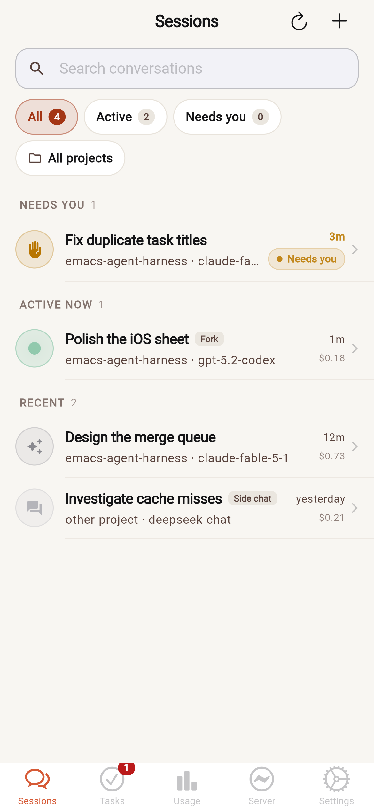 | 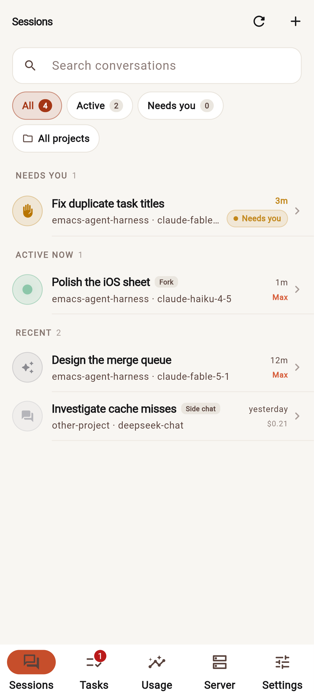 |
| 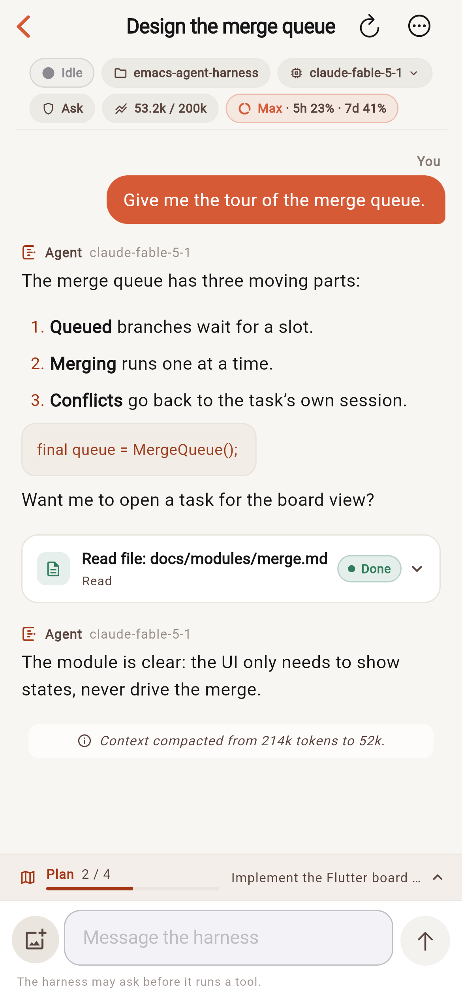 | 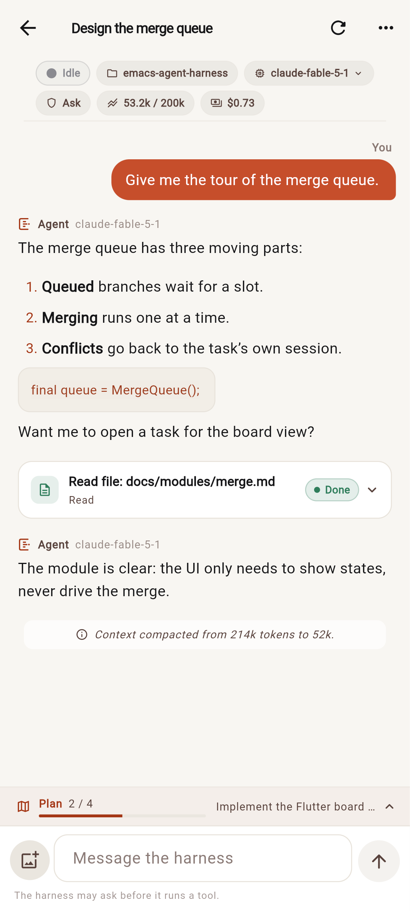 |
| 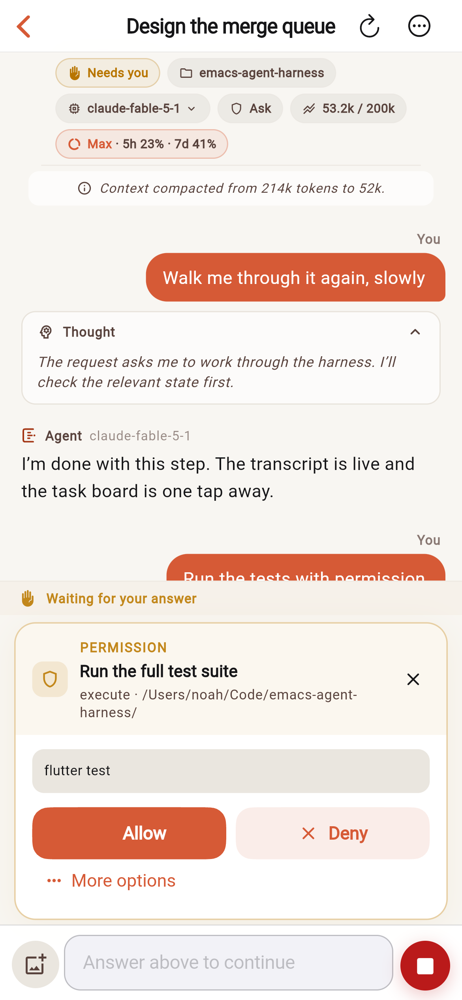 | 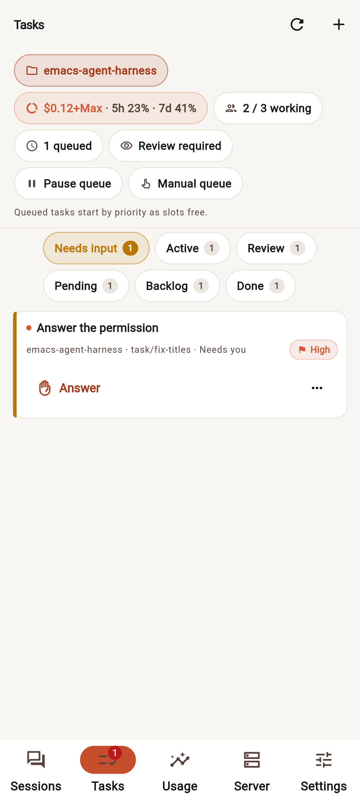 |
| 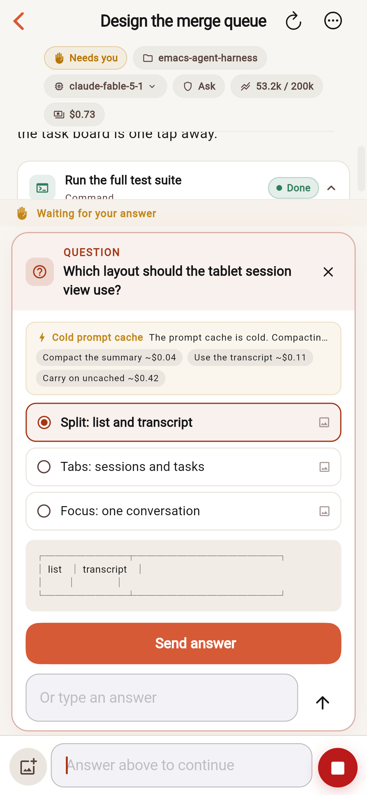 | 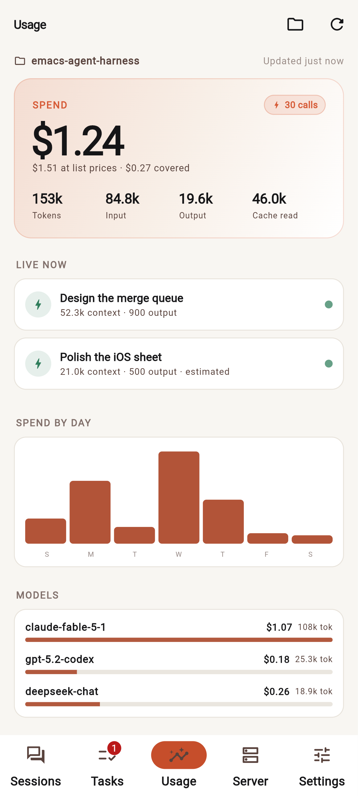 |

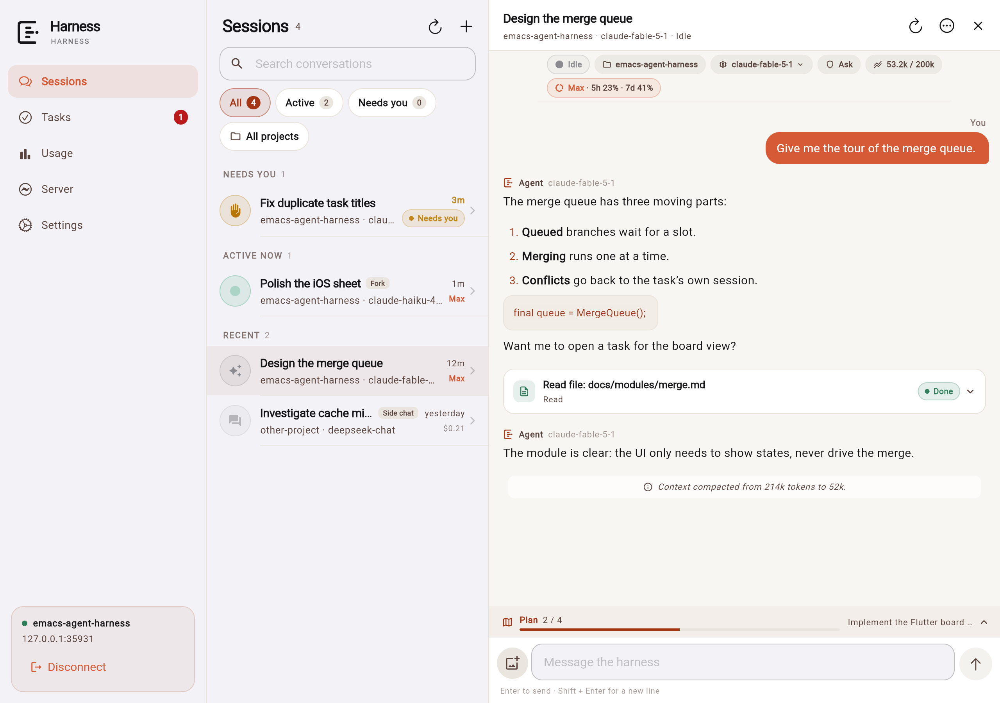

## What it does

- **Streams a real conversation.** Markdown answers, streamed thoughts, tool
  calls with their input and output, plans, context-compaction notes, hints and
  the activity of the running turn (waiting, thinking, writing, preparing a
  tool call, running tools, compacting).
- **Answers the agent.** Standard ACP permission requests become an inline
  decision card with *Allow*, *Deny*, *Allow for session*, *Always allow* and
  *Always deny*; a path glob can be edited before a lasting answer is given.
  Harness `_harness/ask_user` questions become a choice with optional ASCII or
  image diagrams, a free-text answer, and the harness's cold-cache cost note
  when it sends one. Requests that were already waiting when the client
  connected are recovered through `permission/pending` and `question/pending`.
- **Shows the rest of the harness.** The task board (all seven columns, queue
  state and slot use, backlog mode, submit/start/queue/verify/reject/retry/
  complete/archive), spend, tokens, live sessions, daily spend, per-model and
  per-project breakdowns, budgets, the model catalogue, harness modules and the
  full ACP capability report.
- **Detects extensions per feature.** `initialize` is read for standard ACP
  capabilities and for the harness's `_harness.methods` and `_harness.events`.
  Each screen asks for the exact methods it needs. A missing method turns off
  that one view or action at runtime; a plain ACP agent gets a small "Standard
  ACP agent" notice, three tabs instead of five, and a working chat.
- **Feels at home on the platform.** Material 3 with warm paper surfaces on
  Android; Cupertino navigation, tab bar, switches, sheets, typography and
  motion on iOS and macOS. Wide screens get a sidebar and a list/detail split.
  Theme and a System/Android/Apple preview are in Settings.
- **Connects the way the harness is reached.** ACP over WebSocket (`ws://` and
  `wss://`) or ACP's line-framed TCP (`tcp://`) on desktop, the shared token
  from `acp-token`, and the harness's `pair` auth method when a QR code is
  waiting to be scanned. The browser build uses WebSocket only.
- **Keeps a conversation useful.** Local echo, auto-scroll with a "Latest"
  chip, a collapsible plan strip, a context-window meter, cost per session, and
  image attachments to prompts.

## Quick start

Requires Flutter 3.47.7 / Dart 3.13.5. The version is pinned in
`.flutter-version`. Run the installer once; it downloads that SDK into
`~/.local/share/flutter-versions` (or uses it if it is already there) and
installs a small `~/.local/bin/flutter` launcher that selects the pinned SDK
inside this directory. Other projects keep using the default Flutter SDK.

```sh
tool/install_flutter.sh
flutter pub get
flutter run -d macos          # or: flutter run -d <android-device>
```

If you prefer not to install the launcher, `tool/flutter` is the same
per-project selector and can be run directly (`tool/flutter build apk`).

Older Flutter tooling (3.16 and earlier) can misreport this project as using
the deleted Android v1 embedding. Those releases only look for a Groovy
`android/build.gradle`; without one they check the wrong manifest path and
report that `android/AndroidManifest.xml` is missing. This project is on
embedding v2 (`app/src/main/AndroidManifest.xml` carries `flutterEmbedding=2`
and `MainActivity` extends the v2 `FlutterActivity`) and ships a Groovy root
build file for that check, but those releases also cannot resolve the
project's Dart 3.13 dependencies. Use the pinned SDK above, or any Flutter
release that understands a mixed Groovy/Kotlin Gradle project.

Or run the web build:

```sh
flutter run -d chrome
```

In Emacs, press `C-c h P` to open the remote control page, `[start serving]`,
and use the `ws://ADDRESS:4276/acp` address it shows. Add the token if the
harness has one. On a desktop build connected to a local ACP server, the
address is `tcp://127.0.0.1:PORT`; the port and token are in `acp-address` and
`acp-token` in the harness state directory.

The browser cannot open raw TCP. Serve the built web app over HTTP and use the
harness's WebSocket address:

```sh
flutter build web --release
python3 -m http.server 8080 --directory build/web
# open http://127.0.0.1:8080
```

The Android APK is built with the debug key so it installs directly; it needs
Android 7 (API 24) or newer. `tool/qr_install.sh` builds and installs it over
Wi-Fi from the terminal, with no cable (see *Installing on a phone over
Wi-Fi*). This is a local-network test client: the token is kept in the app's
shared preferences when *Remember* is on, not in a platform keychain, and
`ws://` is cleartext. Use it on a trusted network, or a VPN such as Tailscale.
Cleartext traffic is enabled for `ws://` on a local network, and the `INTERNET`
permission is declared in the release manifest. iOS and macOS prompts for
local-network access are declared too; macOS has the outgoing-network
entitlement.

The Android build pins the NDK, Build-Tools, platform and CMake versions that
AGP uses in every module (`harness.*` in `android/gradle.properties`), because
Flutter 3.47's defaults are newer than the components in some SDK
installations. Change those four values to the versions installed on your
machine if the build reports a missing SDK package.

## Installing on a phone over Wi-Fi

`tool/qr_install.sh` builds the Android APK when needed and installs it on a
phone over the local network, with no USB cable. "Needed" includes an APK that
is older than the app sources: a change under `lib/`, `assets/` or `android/`,
or to `pubspec.yaml`, `pubspec.lock` or `.flutter-version`, triggers a build.
That matters because an APK left over from an earlier run would otherwise keep
the phone on old code even after the app was fixed. The phone pairs as a
wireless debugging device by scanning a QR code shown in the terminal, then adb
installs the APK and opens the app. A build that fails because a package in the
pub cache lost its files is repaired and run again (see *Building the apps*):

```sh
tool/qr_install.sh                 # build if stale, show a QR code to pair with, install, open
tool/qr_install.sh --build         # rebuild even when the APK is current
tool/qr_install.sh --debug         # build/install the debug APK
tool/qr_install.sh --no-build      # install the existing APK, warn if it is stale
tool/qr_install.sh --code          # pair with the six-digit pairing code instead
tool/qr_install.sh --no-launch     # install without opening the app
tool/qr_install.sh --no-image      # keep the QR text-only, no image window
tool/qr_install.sh --connect 192.168.1.7:41234  # skip pairing, use that port
```

On Android 11 or newer, enable *Developer options*, open *Wireless debugging*
and tap *Pair device with QR code*, then scan the code the script shows. The
phone and the computer must be on the same network. The script finds adb in
`ADB`, `PATH`, or the Android SDK (`ANDROID_HOME`, `ANDROID_SDK_ROOT` and the
usual install locations); the QR code is drawn by `tool/qr_terminal.py` in
Unicode blocks at error-correction level L, so `qrencode` is not needed. The
code is shown on a fresh screen, so a code from an earlier run is not beside it
for the scanner to pick. On a graphical desktop a large copy also opens in an
image viewer (the same code; close it when the phone is paired); `--no-image`
keeps it text-only. `--qr` asks for this explicitly; a plain run does the same.

Scan the code from *Wireless debugging*, not with the camera app. Android's QR
pairing format is really a Wi-Fi network code (`WIFI:T:ADB;S:service;P:password;;`),
even though it only carries an adb service name and password. Some phone camera
apps read such a code as a network to join, which takes the phone off its
current Wi-Fi, so the screen repeats that warning. The script also makes the
code useless as a network: its service name is `studio-` plus 32 random
characters (39 bytes), longer than the 32-byte Wi-Fi SSID limit. The wireless
debugging scanner does not mind: it takes any non-empty name and password,
starts adb pairing, and never joins a network, and the phone advertises its
pairing service over mDNS under that name (which allows 63 bytes).

`--code` pairs with the six-digit code instead and shows no QR code at all. Tap
*Pair device with pairing code* and keep that dialog open: the script finds the
phone with mDNS, asks for the six digits shown there, pairs, and installs the
app. If mDNS cannot find the dialog, pass the *IP address & port* it shows with
`--pair-address 192.168.1.7:37111`; `--pair-code 123456` supplies the code
without prompting. Both options ask for `--code` themselves, so they need not
be combined with it; they cannot be combined with `--qr`.

After pairing, the phone's debugging port can take a few seconds to appear, and
adb's mDNS cache can hold an old port. The script only tries addresses on the
phone it just paired with, retries every published port until one answers, and
does not give up on the first refused connection. If the port never appears,
open *Wireless debugging* on the phone, read the *IP address & port* shown
there, and pass it with `--connect`.

A phone that adb already sees (connected by USB, or paired earlier) is used
directly. Emulators are ignored unless named with `--device SERIAL`, and more
than one connected phone also needs `--device`.

For a phone where wireless debugging is unavailable, `--serve` starts a small
HTTP server on the local network instead. Scan its QR code with the phone's
camera, download the APK and install it, allowing installs from that browser
when Android asks:

```sh
tool/qr_install.sh --serve
```

`--serve` listens on every interface and serves only that APK. If it prints an
address the phone cannot reach (a VPN interface, say), pass the right one with
`--address 192.168.1.10`. The pairing credentials and the download URL are
meant for a trusted local network; the phone needs Android 7 (API 24) or newer.

## Graceful extension detection

The client never assumes a method because the agent calls itself a harness.
`HarnessCapabilities` maps each view to the methods or events it uses:

| View or ability | Requires |
|---|---|
| Session list and chat | standard `session/list`, `session/load`, `session/prompt` |
| Streaming transcript, tools, plans | standard `session/update` |
| Permission prompts | standard `session/request_permission` |
| Rich nodes, final text, usage on a node | `session/get`, `session/nodes` |
| Live activity | `agent/activity` or `agent/activity-changed` |
| Task board | `task/list` (actions need `task/start`, `task/verify`, …) |
| Usage | `usage/totals` or `usage/summary` |
| Question diagrams | `question/image` for images; ASCII comes with the request |
| Project picker | `insights/projects` |
| Rename, fork, delete | `session/update`, `session/fork`, `session/delete` |
| Priority | `priority/set` |
| Model catalogue | `provider/list`, `provider/models` |

A method that disappears at runtime (`-32601`) is marked unavailable for that
connection and the affected UI hides itself. The **Server** tab shows exactly
what was detected, including `off` rows, and the raw `initialize` answer.

The standard method set used here is:

```text
initialize · authenticate · session/new · session/load · session/list
session/prompt · session/cancel · session/set_mode · session/set_model
```

Everything beyond that is under `_harness/` and is optional.

### The extension shapes this client understands

- Sessions: `_harness/session/list` (full plists), `session/get`,
  `session/nodes`, `session/update`, `session/fork`, `session/delete`.
- Transcript: `_harness/node` (full node), `_harness/session` (title, status,
  usage, todos, queue, pending), `_harness/activity` (phase, tool, detail,
  running calls), `_harness/event` (task, usage, turn and config events).
- Tasks: `task/list`, `task/slots`, `task/settings`, `task/submit`,
  `task/start`, `task/queue`, `task/verify`, `task/reject`, `task/prompt`,
  `task/retry`, `task/cancel`, `task/complete`, `task/archive`,
  `task/toggle-queue`, `task/toggle-backlog-mode`.
- Usage: `usage/totals`, `usage/summary`, `usage/live-all`, `usage/rates`,
  `usage/budgets`.
- Server: `harness/version`, `harness/modules`, `insights/projects`,
  `provider/list`, `provider/models`, `config/describe`.
- Questions: `_harness/ask_user` request, `question/pending`,
  `question/answer`, `question/cancel`, `question/image`; permission answers
  are the standard `{outcome: {outcome: "selected", optionId}}` reply, with an
  optional `_harness.pattern`.

The params for `_harness/*` are the keyword arguments of the bus method, in
kebab case or camelCase; `task/submit` takes its optional settings under
`opts`, while `&rest` methods such as `usage/totals` take the keys directly.
`tool` nodes do not carry ACP's `kind`, so the client infers common kinds from
the tool name when it rebuilds a transcript from nodes.

## Architecture

```text
lib/src/acp/          JSON-RPC peer, WebSocket/TCP transports, capabilities
lib/src/models/       sessions, transcript reducer, tasks, usage, activity
lib/src/services/     typed HarnessApi over ACP and _harness
lib/src/state/        connection, sessions, tasks, usage, interactions
lib/src/ui/           adaptive widgets, theme, screens and transcript widgets
tool/                 preview ACP server, real-harness probe, phone installer,
                      pub cache check
test/                 unit, reducer and widget-flow tests
e2e/                  Playwright mobile-emulated flows and screenshots
```

- `AcpClient` is transport-agnostic and knows nothing about the harness. It
  pairs request ids, surfaces notifications, answers agent requests and fails
  pending calls when the transport goes away.
- `AppController` owns the connection and the capability switch. It routes
  `session/update` to the open `SessionController`, `_harness/event` to the
  task/usage controllers, and permission/question requests to the session that
  must answer them.
- `TranscriptState` turns both standard chunks and full harness nodes into one
  list, keeping a tool call and its result together, preferring a final node's
  content over streamed text, and grouping chunks by `_harness.nodeId`.
- `HarnessStyle` is the native-feel switch. Widgets choose Material or
  Cupertino controls from it; it follows the real platform and can be
  previewed in Settings or with `?platform=cupertino` on the web.

## Testing

```sh
flutter analyze                    # no issues
flutter test                       # 27 tests: ACP, capabilities, reducer,
                                   # connection parsing, boot, widget flows
python3 tool/test_qr_tools.py      # QR encoder against qrencode, the phone
                                   # installer (pairing, install, build
                                   # freshness, pub cache repair) with a fake
                                   # adb and flutter, the APK server
```

The widget tests drive the real `AcpClient` against an in-memory ACP server
(`test/support/fake_harness.dart`), not mocks of the state layer. They cover:

- connect and capability discovery, token auth and the auth-required panel
- sessions, search and project filter
- transcript replay, streaming, tool cards, thought blocks and plan
- permission request and allow, question with a diagram and send
- creating a session and opening the new-task sheet / submitting a task
- task review and verification, usage, server capability table
- plain ACP fallback (three tabs, working chat, standard notice)
- Cupertino rendering of the shell

### End-to-end in a mobile emulator

```sh
cd e2e
npm install
npx playwright install chromium
cd ..
SKIP_BUILD=1 ./e2e/run.sh       # or ./e2e/run.sh to build first
```

`e2e/run.sh` starts the preview harness (`tool/mock_harness_server.dart`, one
with extensions and one plain ACP), serves the E2E web build, and drives
Chromium with iPhone 13 (`390×844 @3x`) and Pixel 7 (`412×915 @2.625x`) device
metrics, plus a 1280×900 macOS layout. It walks connect, sessions, new session,
chat, streaming, permission, question with diagrams, the task board, new task,
review/verify, usage, server capabilities, settings, the macOS split view and
the plain-ACP fallback, writing a screenshot for each. The screenshots in this
README are the output.

| | |
|---|---|
|  |  |
| 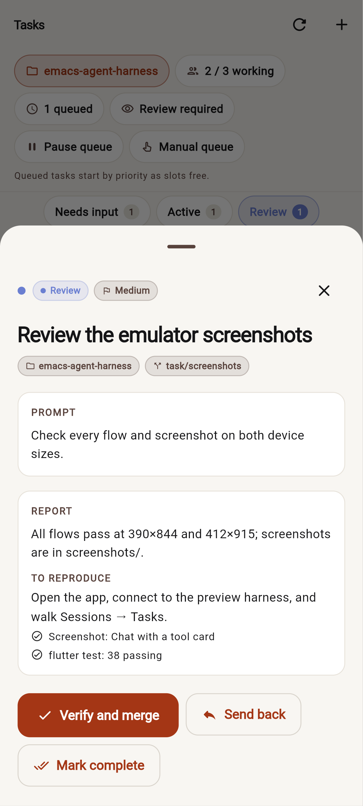 | 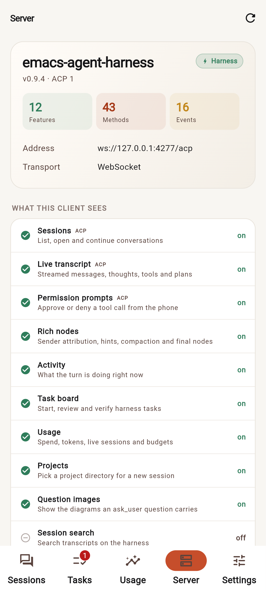 |
| 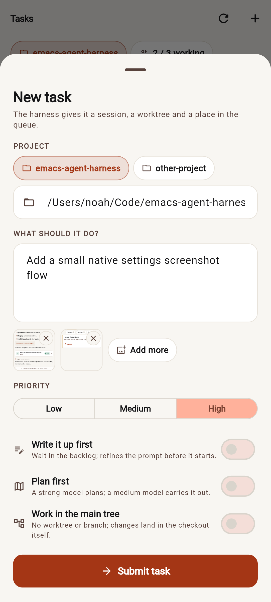 | 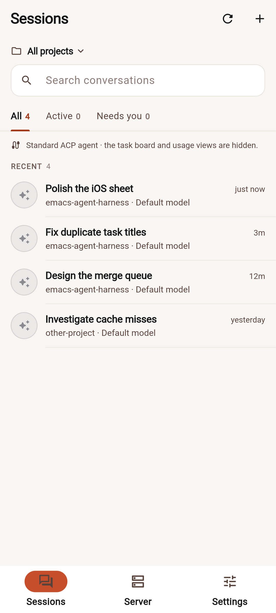 |

The environment used to build this had no KVM, so the emulator is Chromium's
mobile device emulation at real phone viewports and touch input. A release APK
is built for installing on a real Android device; see `dist/README.txt`.

### Against a real harness

`tool/real_harness_probe.dart` connects to a running harness over ACP and
performs a scripted turn:

```sh
dart run tool/real_harness_probe.dart 127.0.0.1:PORT "" /path/to/project
```

The run recorded in `verification/real-harness-probe.txt` was made against a
real `emacs-agent-harness` 3.0.0 started headlessly with the demo provider:

```text
agent: emacs-agent-harness 3.0.0
protocol: 1 · harness: true · extensions: 148
features: Sessions, Live transcript, Permission prompts, Rich nodes, Activity, Usage, Question images, Fork, Providers, Harness info
created session da81df8a-373e-4d15-b3c5-b13ac78835ef
prompt stopped: end_turn
updates: {user_message_chunk: 1, _harness/node: 9, _harness/activity: 7,
          agent_thought_chunk: 2, _harness/session: 2,
          agent_message_chunk: 3, tool_call: 1, tool_call_update: 1}
nodes: 6 (user, thinking, assistant, tool-call, tool-result, assistant)
OK
```

This checks the real `initialize`, `session/list`, `session/new` with
`_harness` metadata, `session/prompt` streaming, activity, node replay and
`_harness/session/nodes` shapes — not just the preview server.

## Building the apps

```sh
flutter build apk --release        # build/app/outputs/flutter-apk/app-release.apk
flutter build web --release        # build/web
flutter build macos --release      # on a Mac with Xcode
flutter build ios --release        # on a Mac with Xcode, signed for a device
```

The Android build in this checkout used JDK 21 and Android SDK 36; set
`JAVA_HOME` and `ANDROID_HOME` accordingly. Release builds use the generated
debug signing config so they install for testing; replace it before publishing.
The icon is generated from `assets/icon.png` with `dart run flutter_launcher_icons`.

A build that stops with

```
Error: Error when reading '.../.pub-cache/hosted/pub.dev/NAME-VERSION/lib/NAME.dart': No such file or directory
Target kernel_snapshot_program failed: Exception
```

straight after `flutter pub get` said "Got dependencies!" means a package in the
pub cache lost its files. `pub get` counts a package as installed once its
directory is in the cache and never looks inside, so it does not notice. A tool
that was told to reinstall a package and was stopped half way leaves exactly
this behind: a sandboxed shell sees only the parts of `~/.pub-cache` that were
mounted into it, so pub tries to reinstall what it cannot see and deletes the
real files of a directory that was mounted (in such a shell, set `PUB_CACHE`
to a scratch directory).

In this directory, `flutter pub cache repair` reinstalls the packages in
`pubspec.lock`. It removes a package whose directory is empty and reports it as
failed, so follow it with `flutter pub get`. `tool/qr_install.sh` does both by
itself, before the build when `python3 tool/check_pub_cache.py` (which lists the
incomplete packages) finds one, and after a build that failed.

## Preview server

For UI work without a harness:

```sh
dart run tool/mock_harness_server.dart --port 4277
# in another shell
flutter run -d chrome
# connect to ws://127.0.0.1:4277/acp
```

`--standard` makes it a plain ACP agent with no extensions, which is how the
fallback screenshots were made.

## License

GPL-3.0, the same license as the emacs-agent-harness. The app is self-contained
and can be published from its own repository.
